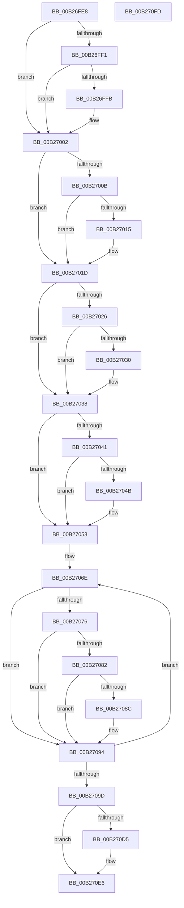

# sub_00B26FE8

- RVA: `0x00B26FE8`–`0x00B27115` (길이 `301` bytes)
- VA: `0x0000000140B26FE8`
- 실행 섹션: `PAGE`
- PDB 이름 있음: `아니요`; PDB Function 태그: `아니요`
- unwind 정보 RVA: `0x00092768`
- 디코드: `81`개 명령, `301/301` bytes 표시
- 미해석 바이트: `0` (있으면 어셈블리에 `.byte`로 보존)

> 이 문서는 커널 이미지의 기계어와 PDB 기호를 분석해 생성했습니다. 4번과 5번은 함수 원형과 자료형을 바이너리 사용 방식에서 추정한 C 해석이며 원본 소스 복구 결과는 아닙니다.

## 1. Dependencies

- 직접 호출 지점: **3**; 고유 호출 대상: **2**
- 직접 호출자로 확인된 함수: **0**
- RIP 상대 이미지 참조: **6**

### Outgoing calls
- `0x00B270E1` → [KsepDebugPrint](../../text/4D/KsepDebugPrint_function_004DCFF0.md) (function, `0x004DCFF0`)
- `0x00B270F2` → [KsepLogInfo](../../text/49/KsepLogInfo_function_00499A68.md) (function, `0x00499A68`)
- `0x00B27106` → [KsepLogInfo](../../text/49/KsepLogInfo_function_00499A68.md) (function, `0x00499A68`)

### Direct callers
- 이 함수 시작 RVA로 연결되는 직접 call은 확인되지 않았습니다. 간접 호출은 완전히 역산할 수 없습니다.

### Static image references
- `0x00B27076` → RVA `0x0029B590` (`IopInvalidDeviceRequest`; read)
- `0x00B270A7` → RVA `0x00F105E0` (`.data`; read/write)
- `0x00B270B1` → RVA `0x00F103E0` (`.data`; read)
- `0x00B270CB` → RVA `0x00E66CE8` (`.data`; read)
- `0x00B270D8` → RVA `0x00B00E20` (` ?? ::NNGAKEGL::`string'`; read)
- `0x00B270FD` → RVA `0x00B00DE0` (` ?? ::NNGAKEGL::`string'`; read)

## 2. Other-region calls and transfers

- 다른 실행 섹션으로 향하는 call: **3**
  - `0x00B270E1` → [KsepDebugPrint](../../text/4D/KsepDebugPrint_function_004DCFF0.md) (`PAGE` → `.text`)
  - `0x00B270F2` → [KsepLogInfo](../../text/49/KsepLogInfo_function_00499A68.md) (`PAGE` → `.text`)
  - `0x00B27106` → [KsepLogInfo](../../text/49/KsepLogInfo_function_00499A68.md) (`PAGE` → `.text`)
- call이 아닌 외부 분기/꼬리 이동: **2**
  - `0x00B270F8` → [KseShimDriverIoCallbacks + 0x70](../95/KseShimDriverIoCallbacks_function_00958BFC.md) (`tail-transfer`)
  - `0x00B27110` → [KseShimDriverIoCallbacks + 0x7F](../95/KseShimDriverIoCallbacks_function_00958BFC.md) (`tail-transfer`)

## 3. Assembly (complete function range)

```asm
00B26FE8  48 8B 57 58                     mov rdx, qword ptr [rdi + 0x58]
00B26FEC  48 85 D2                        test rdx, rdx
00B26FEF  74 11                           je 0x140b27002
00B26FF1  48 8B 4C 24 40                  mov rcx, qword ptr [rsp + 0x40]
00B26FF6  48 85 C9                        test rcx, rcx
00B26FF9  74 07                           je 0x140b27002
00B26FFB  48 89 10                        mov qword ptr [rax], rdx
00B26FFE  48 89 4F 58                     mov qword ptr [rdi + 0x58], rcx
00B27002  48 8B 57 60                     mov rdx, qword ptr [rdi + 0x60]
00B27006  48 85 D2                        test rdx, rdx
00B27009  74 12                           je 0x140b2701d
00B2700B  48 8B 4C 24 48                  mov rcx, qword ptr [rsp + 0x48]
00B27010  48 85 C9                        test rcx, rcx
00B27013  74 08                           je 0x140b2701d
00B27015  48 89 50 08                     mov qword ptr [rax + 8], rdx
00B27019  48 89 4F 60                     mov qword ptr [rdi + 0x60], rcx
00B2701D  48 8B 57 68                     mov rdx, qword ptr [rdi + 0x68]
00B27021  48 85 D2                        test rdx, rdx
00B27024  74 12                           je 0x140b27038
00B27026  48 8B 4C 24 50                  mov rcx, qword ptr [rsp + 0x50]
00B2702B  48 85 C9                        test rcx, rcx
00B2702E  74 08                           je 0x140b27038
00B27030  48 89 50 10                     mov qword ptr [rax + 0x10], rdx
00B27034  48 89 4F 68                     mov qword ptr [rdi + 0x68], rcx
00B27038  49 8B 56 08                     mov rdx, qword ptr [r14 + 8]
00B2703C  48 85 D2                        test rdx, rdx
00B2703F  74 12                           je 0x140b27053
00B27041  48 8B 4C 24 58                  mov rcx, qword ptr [rsp + 0x58]
00B27046  48 85 C9                        test rcx, rcx
00B27049  74 08                           je 0x140b27053
00B2704B  48 89 50 18                     mov qword ptr [rax + 0x18], rdx
00B2704F  49 89 4E 08                     mov qword ptr [r14 + 8], rcx
00B27053  BB 1C 00 00 00                  mov ebx, 0x1c
00B27058  4C 8D 4C 24 60                  lea r9, [rsp + 0x60]
00B2705D  4C 8B C0                        mov r8, rax
00B27060  48 8D 4F 70                     lea rcx, [rdi + 0x70]
00B27064  4C 2B C7                        sub r8, rdi
00B27067  4C 2B CF                        sub r9, rdi
00B2706A  44 8D 53 EC                     lea r10d, [rbx - 0x14]
00B2706E  48 8B 11                        mov rdx, qword ptr [rcx]
00B27071  48 85 D2                        test rdx, rdx
00B27074  74 1E                           je 0x140b27094
00B27076  4C 8D 1D 13 45 77 FF            lea r11, [rip - 0x88baed]
00B2707D  49 3B D3                        cmp rdx, r11
00B27080  74 12                           je 0x140b27094
00B27082  4D 8B 5C 09 90                  mov r11, qword ptr [r9 + rcx - 0x70]
00B27087  4D 85 DB                        test r11, r11
00B2708A  74 08                           je 0x140b27094
00B2708C  49 89 54 08 B0                  mov qword ptr [r8 + rcx - 0x50], rdx
00B27091  4C 89 19                        mov qword ptr [rcx], r11
00B27094  49 03 CA                        add rcx, r10
00B27097  48 83 EB 01                     sub rbx, 1
00B2709B  75 D1                           jne 0x140b2706e
00B2709D  49 89 46 38                     mov qword ptr [r14 + 0x38], rax
00B270A1  41 8B F7                        mov esi, r15d
00B270A4  8D 43 01                        lea eax, [rbx + 1]
00B270A7  F0 0F C1 05 31 95 3E 00         lock xadd dword ptr [rip + 0x3e9531], eax
00B270AF  FF C0                           inc eax
00B270B1  48 8D 0D 28 93 3E 00            lea rcx, [rip + 0x3e9328]
00B270B8  83 E0 3F                        and eax, 0x3f
00B270BB  8D 7B 09                        lea edi, [rbx + 9]
00B270BE  48 8B 5C 24 28                  mov rbx, qword ptr [rsp + 0x28]
00B270C3  48 C7 04 C1 06 01 08 00         mov qword ptr [rcx + rax*8], 0x80106
00B270CB  8B 05 17 FC 33 00               mov eax, dword ptr [rip + 0x33fc17]
00B270D1  A8 01                           test al, 1
00B270D3  74 11                           je 0x140b270e6
00B270D5  4C 8B C3                        mov r8, rbx
00B270D8  48 8D 15 41 9D FD FF            lea rdx, [rip - 0x262bf]
00B270DF  8B CF                           mov ecx, edi
00B270E1  E8 0A 5F 9B FF                  call 0x1404dcff0
00B270E6  4C 8B C3                        mov r8, rbx
00B270E9  48 8D 15 30 9D FD FF            lea rdx, [rip - 0x262d0]
00B270F0  8B CF                           mov ecx, edi
00B270F2  E8 71 29 97 FF                  call 0x140499a68
00B270F7  90                              nop
00B270F8  E9 6F 1B E3 FF                  jmp 0x140958c6c
00B270FD  48 8D 15 DC 9C FD FF            lea rdx, [rip - 0x26324]
00B27104  33 C9                           xor ecx, ecx
00B27106  E8 5D 29 97 FF                  call 0x140499a68
00B2710B  B8 0D 00 00 C0                  mov eax, 0xc000000d
00B27110  E9 66 1B E3 FF                  jmp 0x140958c7b
```

## 4. C-style interpretation (structured pseudocode)

```c
__int64 __fastcall sub_00B26FE8(__int64 a1, __int64 a2, __int64 a3, __int64 a4, __int64 a5, __int64 a6, __int64 a7, __int64 a8, __int64 a9, __int64 a10, __int64 a11, __int64 a12)
{
    __int64 result;
    __int64 v_rbx;

    if (*(unsigned __int64 *)(v_rdi + 88) == 0) goto loc_00B27002;
    if (a8 != 0) {
        *(unsigned __int64 *)(result) = *(unsigned __int64 *)(v_rdi + 88);
        *(unsigned __int64 *)(v_rdi + 88) = a8;
    }
    if (*(unsigned __int64 *)(v_rdi + 96) == 0) goto loc_00B2701D;
    if (a9 != 0) {
        *(unsigned __int64 *)(result + 8) = *(unsigned __int64 *)(v_rdi + 96);
        *(unsigned __int64 *)(v_rdi + 96) = a9;
    }
    if (*(unsigned __int64 *)(v_rdi + 104) == 0) goto loc_00B27038;
    if (a10 != 0) {
        *(unsigned __int64 *)(result + 16) = *(unsigned __int64 *)(v_rdi + 104);
        *(unsigned __int64 *)(v_rdi + 104) = a10;
    }
    if (*(unsigned __int64 *)(v_r14 + 8) == 0) goto loc_00B27053;
    if (a11 != 0) {
        *(unsigned __int64 *)(result + 24) = *(unsigned __int64 *)(v_r14 + 8);
        *(unsigned __int64 *)(v_r14 + 8) = a11;
    }
    a3 = (result) - (v_rdi);
    a4 = (a12) - (v_rdi);
loc_00B2706E:
    if (*(unsigned __int64 *)(v_rdi + 112) == 0) goto loc_00B27094;
    if ((*(unsigned __int64 *)(v_rdi + 112)) == (v_rip - 8960749)) goto loc_00B27094;
    if (*(unsigned __int64 *)(a4 + v_rdi + 112 * 1 - 112) != 0) {
        *(unsigned __int64 *)(a3 + v_rdi + 112 * 1 - 80) = *(unsigned __int64 *)(v_rdi + 112);
        *(unsigned __int64 *)(v_rdi + 112) = *(unsigned __int64 *)(a4 + v_rdi + 112 * 1 - 112);
    }
    a1 = (v_rdi + 112) + (28 - 20);
    v_rbx = (28) - (1);
    if (condition_is_not_equal) goto loc_00B2706E;
    *(unsigned __int64 *)(v_r14 + 56) = result;
    result = (unsigned int)((v_rbx + 1) + 1);
    result = (unsigned int)((result) & (63));
    *(unsigned __int64 *)(v_rip + 4100904 + result * 8) = 0x80106ULL;
    result = (unsigned int)(*(unsigned int *)(v_rip + 3406871));
    if ((((unsigned __int8)((unsigned int)(*(unsigned int *)(v_rip + 3406871)))) & (1)) != 0) {
        a3 = a5;
        a2 = v_rip - 156351;
        a1 = (unsigned int)(v_rbx + 9);
        result = KsepDebugPrint(a1, a2, a3, a4);
    }
    result = KsepLogInfo((unsigned int)((unsigned int)(v_rbx + 9)), v_rip - 156368, a5, a4);
}
```

## 5. (Beta) C Style

```c
int64_t sub_00B26FE8(int64_t Arg1, int64_t Arg2, int64_t Arg3, int64_t Arg4, int64_t Arg5, uint64_t Arg6, uint64_t Arg7, int64_t Arg8, int64_t Arg9, int64_t Arg10, int64_t Arg11, int64_t Arg12)
{
    int64_t result;
    int64_t local_rbx;

    if (*(uint64_t *)(local_rdi + 0x58) == 0) goto loc_00B27002;
    if (Arg8 != 0) {
        *(uint64_t *)(result) = *(uint64_t *)(local_rdi + 0x58);
        *(uint64_t *)(local_rdi + 0x58) = Arg8;
    }
    if (*(uint64_t *)(local_rdi + 0x60) == 0) goto loc_00B2701D;
    if (Arg9 != 0) {
        *(uint64_t *)(result + 0x8) = *(uint64_t *)(local_rdi + 0x60);
        *(uint64_t *)(local_rdi + 0x60) = Arg9;
    }
    if (*(uint64_t *)(local_rdi + 0x68) == 0) goto loc_00B27038;
    if (Arg10 != 0) {
        *(uint64_t *)(result + 0x10) = *(uint64_t *)(local_rdi + 0x68);
        *(uint64_t *)(local_rdi + 0x68) = Arg10;
    }
    if (*(uint64_t *)(local_r14 + 0x8) == 0) goto loc_00B27053;
    if (Arg11 != 0) {
        *(uint64_t *)(result + 0x18) = *(uint64_t *)(local_r14 + 0x8);
        *(uint64_t *)(local_r14 + 0x8) = Arg11;
    }
    Arg3 = (result) - (local_rdi);
    Arg4 = (Arg12) - (local_rdi);
loc_00B2706E:
    if (*(uint64_t *)(local_rdi + 0x70) == 0) goto loc_00B27094;
    if ((*(uint64_t *)(local_rdi + 0x70)) == (v_rip - 8960749)) goto loc_00B27094;
    if (*(uint64_t *)(Arg4 + local_rdi + 0x70 * 1 - 0x70) != 0) {
        *(uint64_t *)(Arg3 + local_rdi + 0x70 * 1 - 0x50) = *(uint64_t *)(local_rdi + 0x70);
        *(uint64_t *)(local_rdi + 0x70) = *(uint64_t *)(Arg4 + local_rdi + 0x70 * 1 - 0x70);
    }
    Arg1 = (local_rdi + 112) + (28 - 20);
    local_rbx = (28) - (1);
    if (condition_is_not_equal) goto loc_00B2706E;
    *(uint64_t *)(local_r14 + 0x38) = result;
    result = (uint32_t)((local_rbx + 1) + 1);
    result = (uint32_t)((result) & (63));
    *(uint64_t *)(v_rip + 0x3E9328 + result * 8) = 0x80106ULL;
    result = (uint32_t)(*(uint32_t *)(v_rip + 0x33FC17));
    if ((((uint8_t)((uint32_t)(*(uint32_t *)(v_rip + 0x33FC17)))) & (1)) != 0) {
        Arg3 = Arg5;
        Arg2 = v_rip - 156351;
        Arg1 = (uint32_t)(local_rbx + 9);
        result = KsepDebugPrint(Arg1, Arg2, Arg3, Arg4);
    }
    result = KsepLogInfo((uint32_t)((uint32_t)(local_rbx + 9)), v_rip - 156368, Arg5, Arg4);
}
```

## 6. Execution-region graph

[열기: 2D/3D 그래프와 함수 탐색 컨트롤 패널](../../../control-panel.html?section=page&rva=0x00B26FE8&view=graph)

- 2D 그래프는 위에서 아래로 흐르고, 3D 그래프는 빈 공간을 드래그해 회전합니다. Shift+드래그는 이동, 휠은 확대·축소, 함수 노드 선택은 대상 보고서 이동입니다.

### Static fallback


