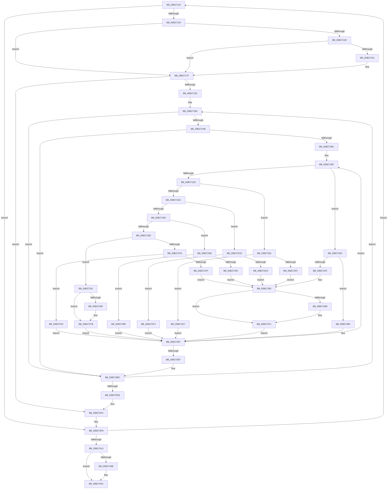

# sub_00B27116

- RVA: `0x00B27116`–`0x00B27463` (길이 `845` bytes)
- VA: `0x0000000140B27116`
- 실행 섹션: `PAGE`
- PDB 이름 있음: `아니요`; PDB Function 태그: `아니요`
- unwind 정보 RVA: `0x00092794`
- 디코드: `174`개 명령, `845/845` bytes 표시
- 미해석 바이트: `0` (있으면 어셈블리에 `.byte`로 보존)

> 이 문서는 커널 이미지의 기계어와 PDB 기호를 분석해 생성했습니다. 4번과 5번은 함수 원형과 자료형을 바이너리 사용 방식에서 추정한 C 해석이며 원본 소스 복구 결과는 아닙니다.

## 1. Dependencies

- 직접 호출 지점: **7**; 고유 호출 대상: **4**
- 직접 호출자로 확인된 함수: **0**
- RIP 상대 이미지 참조: **9**

### Outgoing calls
- `0x00B27172` → [RtlAssert](../../text/5E/RtlAssert_function_005E75E0.md) (function, `0x005E75E0`)
- `0x00B27276` → [KsepDebugPrint](../../text/4D/KsepDebugPrint_function_004DCFF0.md) (function, `0x004DCFF0`)
- `0x00B2728C` → [KsepLogError](../../text/49/KsepLogError_function_00499A98.md) (function, `0x00499A98`)
- `0x00B27377` → [KsepDebugPrint](../../text/4D/KsepDebugPrint_function_004DCFF0.md) (function, `0x004DCFF0`)
- `0x00B27388` → [KsepLogError](../../text/49/KsepLogError_function_00499A98.md) (function, `0x00499A98`)
- `0x00B27447` → [KsepDebugPrint](../../text/4D/KsepDebugPrint_function_004DCFF0.md) (function, `0x004DCFF0`)
- `0x00B27458` → [KsepLogInfo](../../text/49/KsepLogInfo_function_00499A68.md) (function, `0x00499A68`)

### Direct callers
- 이 함수 시작 RVA로 연결되는 직접 call은 확인되지 않았습니다. 간접 호출은 완전히 역산할 수 없습니다.

### Static image references
- `0x00B27132` → RVA `0x00F101C0` (`.data`; read/write)
- `0x00B27157` → RVA `0x00E66CE8` (`.data`; read)
- `0x00B27164` → RVA `0x00B00C70` (` ?? ::NNGAKEGL::`string'`; read)
- `0x00B2716B` → RVA `0x00B00C20` (` ?? ::NNGAKEGL::`string'`; read)
- `0x00B27196` → RVA `0x00000000` (`image boundary/outside`; read)
- `0x00B2726A` → RVA `0x00B00BC0` (` ?? ::NNGAKEGL::`string'`; read)
- `0x00B2736B` → RVA `0x00B00C40` (` ?? ::NNGAKEGL::`string'`; read)
- `0x00B27418` → RVA `0x00F105E0` (`.data`; read/write)
- `0x00B2743B` → RVA `0x00B00BF0` (` ?? ::NNGAKEGL::`string'`; read)

## 2. Other-region calls and transfers

- 다른 실행 섹션으로 향하는 call: **7**
  - `0x00B27172` → [RtlAssert](../../text/5E/RtlAssert_function_005E75E0.md) (`PAGE` → `.text`)
  - `0x00B27276` → [KsepDebugPrint](../../text/4D/KsepDebugPrint_function_004DCFF0.md) (`PAGE` → `.text`)
  - `0x00B2728C` → [KsepLogError](../../text/49/KsepLogError_function_00499A98.md) (`PAGE` → `.text`)
  - `0x00B27377` → [KsepDebugPrint](../../text/4D/KsepDebugPrint_function_004DCFF0.md) (`PAGE` → `.text`)
  - `0x00B27388` → [KsepLogError](../../text/49/KsepLogError_function_00499A98.md) (`PAGE` → `.text`)
  - `0x00B27447` → [KsepDebugPrint](../../text/4D/KsepDebugPrint_function_004DCFF0.md) (`PAGE` → `.text`)
  - `0x00B27458` → [KsepLogInfo](../../text/49/KsepLogInfo_function_00499A68.md) (`PAGE` → `.text`)
- call이 아닌 외부 분기/꼬리 이동: **1**
  - `0x00B2745E` → [KsepGetShimCallbacksForDriver + 0x5E](../95/KsepGetShimCallbacksForDriver_function_00958E64.md) (`tail-transfer`)

## 3. Assembly (complete function range)

```asm
00B27116  49 8B 0C 24                     mov rcx, qword ptr [r12]
00B2711A  8B 41 1C                        mov eax, dword ptr [rcx + 0x1c]
00B2711D  A8 04                           test al, 4
00B2711F  0F 85 D3 02 00 00               jne 0x140b273f8
00B27125  4C 8B 69 10                     mov r13, qword ptr [rcx + 0x10]
00B27129  4D 85 ED                        test r13, r13
00B2712C  75 51                           jne 0x140b2717f
00B2712E  41 8D 45 01                     lea eax, [r13 + 1]
00B27132  F0 0F C1 05 86 90 3E 00         lock xadd dword ptr [rip + 0x3e9086], eax
00B2713A  FF C0                           inc eax
00B2713C  83 E0 3F                        and eax, 0x3f
00B2713F  41 C7 84 C6 E4 01 F1 00 20 04 00 C0  mov dword ptr [r14 + rax*8 + 0xf101e4], 0xc0000420
00B2714B  41 C7 84 C6 E0 01 F1 00 34 03 07 00  mov dword ptr [r14 + rax*8 + 0xf101e0], 0x70334
00B27157  8B 05 8B FB 33 00               mov eax, dword ptr [rip + 0x33fb8b]
00B2715D  A8 04                           test al, 4
00B2715F  74 1E                           je 0x140b2717f
00B27161  45 33 C9                        xor r9d, r9d
00B27164  48 8D 15 05 9B FD FF            lea rdx, [rip - 0x264fb]
00B2716B  48 8D 0D AE 9A FD FF            lea rcx, [rip - 0x26552]
00B27172  E8 69 04 AC FF                  call 0x1405e75e0
00B27177  48 8B 94 24 80 00 00 00         mov rdx, qword ptr [rsp + 0x80]
00B2717F  49 8B 4D 30                     mov rcx, qword ptr [r13 + 0x30]
00B27183  44 8B C3                        mov r8d, ebx
00B27186  89 5C 24 78                     mov dword ptr [rsp + 0x78], ebx
00B2718A  83 39 04                        cmp dword ptr [rcx], 4
00B2718D  0F 84 5F 02 00 00               je 0x140b273f2
00B27193  4C 8B F3                        mov r14, rbx
00B27196  4C 8D 25 63 8E 4D FF            lea r12, [rip - 0xb2719d]
00B2719D  41 83 3C 0E 03                  cmp dword ptr [r14 + rcx], 3
00B271A2  48 8B D1                        mov rdx, rcx
00B271A5  0F 85 11 02 00 00               jne 0x140b273bc
00B271AB  49 8B 44 0E 10                  mov rax, qword ptr [r14 + rcx + 0x10]
00B271B0  44 8B FB                        mov r15d, ebx
00B271B3  83 38 02                        cmp dword ptr [rax], 2
00B271B6  0F 84 00 02 00 00               je 0x140b273bc
00B271BC  48 8B FB                        mov rdi, rbx
00B271BF  49 8B 6C 0E 10                  mov rbp, qword ptr [r14 + rcx + 0x10]
00B271C4  8B 4C 2F 08                     mov ecx, dword ptr [rdi + rbp + 8]
00B271C8  8B C1                           mov eax, ecx
00B271CA  83 E8 01                        sub eax, 1
00B271CD  0F 84 5F 01 00 00               je 0x140b27332
00B271D3  83 E8 01                        sub eax, 1
00B271D6  0F 84 25 01 00 00               je 0x140b27301
00B271DC  83 E8 01                        sub eax, 1
00B271DF  0F 84 E8 00 00 00               je 0x140b272cd
00B271E5  83 F8 01                        cmp eax, 1
00B271E8  0F 84 A8 00 00 00               je 0x140b27296
00B271EE  8D 41 9C                        lea eax, [rcx - 0x64]
00B271F1  83 F8 1B                        cmp eax, 0x1b
00B271F4  77 3B                           ja 0x140b27231
00B271F6  8B C8                           mov ecx, eax
00B271F8  48 39 5C C6 20                  cmp qword ptr [rsi + rax*8 + 0x20], rbx
00B271FD  74 23                           je 0x140b27222
00B271FF  B8 01 00 00 00                  mov eax, 1
00B27204  F0 0F C1 05 B4 8F 3E 00         lock xadd dword ptr [rip + 0x3e8fb4], eax
00B2720C  FF C0                           inc eax
00B2720E  83 E0 3F                        and eax, 0x3f
00B27211  41 C7 84 C4 E0 01 F1 00 8F 03 07 00  mov dword ptr [r12 + rax*8 + 0xf101e0], 0x7038f
00B2721D  E9 33 01 00 00                  jmp 0x140b27355
00B27222  48 8B 44 2F 10                  mov rax, qword ptr [rdi + rbp + 0x10]
00B27227  48 89 44 CE 20                  mov qword ptr [rsi + rcx*8 + 0x20], rax
00B2722C  E9 66 01 00 00                  jmp 0x140b27397
00B27231  B8 01 00 00 00                  mov eax, 1
00B27236  F0 0F C1 05 82 8F 3E 00         lock xadd dword ptr [rip + 0x3e8f82], eax
00B2723E  FF C0                           inc eax
00B27240  83 E0 3F                        and eax, 0x3f
00B27243  41 C7 84 C4 E4 01 F1 00 0D 00 00 C0  mov dword ptr [r12 + rax*8 + 0xf101e4], 0xc000000d
00B2724F  41 C7 84 C4 E0 01 F1 00 9C 03 07 00  mov dword ptr [r12 + rax*8 + 0xf101e0], 0x7039c
00B2725B  8B 05 87 FA 33 00               mov eax, dword ptr [rip + 0x33fa87]
00B27261  A8 02                           test al, 2
00B27263  74 16                           je 0x140b2727b
00B27265  44 8B 44 2F 08                  mov r8d, dword ptr [rdi + rbp + 8]
00B2726A  48 8D 15 4F 99 FD FF            lea rdx, [rip - 0x266b1]
00B27271  B9 09 00 00 00                  mov ecx, 9
00B27276  E8 75 5D 9B FF                  call 0x1404dcff0
00B2727B  44 8B 44 2F 08                  mov r8d, dword ptr [rdi + rbp + 8]
00B27280  48 8D 15 39 99 FD FF            lea rdx, [rip - 0x266c7]
00B27287  B9 09 00 00 00                  mov ecx, 9
00B2728C  E8 07 28 97 FF                  call 0x140499a98
00B27291  E9 01 01 00 00                  jmp 0x140b27397
00B27296  48 39 5E 18                     cmp qword ptr [rsi + 0x18], rbx
00B2729A  74 23                           je 0x140b272bf
00B2729C  B8 01 00 00 00                  mov eax, 1
00B272A1  F0 0F C1 05 17 8F 3E 00         lock xadd dword ptr [rip + 0x3e8f17], eax
00B272A9  FF C0                           inc eax
00B272AB  83 E0 3F                        and eax, 0x3f
00B272AE  41 C7 84 C4 E0 01 F1 00 7D 03 07 00  mov dword ptr [r12 + rax*8 + 0xf101e0], 0x7037d
00B272BA  E9 96 00 00 00                  jmp 0x140b27355
00B272BF  48 8B 44 2F 10                  mov rax, qword ptr [rdi + rbp + 0x10]
00B272C4  48 89 46 18                     mov qword ptr [rsi + 0x18], rax
00B272C8  E9 CA 00 00 00                  jmp 0x140b27397
00B272CD  48 39 5E 10                     cmp qword ptr [rsi + 0x10], rbx
00B272D1  74 20                           je 0x140b272f3
00B272D3  B8 01 00 00 00                  mov eax, 1
00B272D8  F0 0F C1 05 E0 8E 3E 00         lock xadd dword ptr [rip + 0x3e8ee0], eax
00B272E0  FF C0                           inc eax
00B272E2  83 E0 3F                        and eax, 0x3f
00B272E5  41 C7 84 C4 E0 01 F1 00 6E 03 07 00  mov dword ptr [r12 + rax*8 + 0xf101e0], 0x7036e
00B272F1  EB 62                           jmp 0x140b27355
00B272F3  48 8B 44 2F 10                  mov rax, qword ptr [rdi + rbp + 0x10]
00B272F8  48 89 46 10                     mov qword ptr [rsi + 0x10], rax
00B272FC  E9 96 00 00 00                  jmp 0x140b27397
00B27301  48 39 5E 08                     cmp qword ptr [rsi + 8], rbx
00B27305  74 20                           je 0x140b27327
00B27307  B8 01 00 00 00                  mov eax, 1
00B2730C  F0 0F C1 05 AC 8E 3E 00         lock xadd dword ptr [rip + 0x3e8eac], eax
00B27314  FF C0                           inc eax
00B27316  83 E0 3F                        and eax, 0x3f
00B27319  41 C7 84 C4 E0 01 F1 00 5F 03 07 00  mov dword ptr [r12 + rax*8 + 0xf101e0], 0x7035f
00B27325  EB 2E                           jmp 0x140b27355
00B27327  48 8B 44 2F 10                  mov rax, qword ptr [rdi + rbp + 0x10]
00B2732C  48 89 46 08                     mov qword ptr [rsi + 8], rax
00B27330  EB 65                           jmp 0x140b27397
00B27332  48 39 1E                        cmp qword ptr [rsi], rbx
00B27335  74 58                           je 0x140b2738f
00B27337  B8 01 00 00 00                  mov eax, 1
00B2733C  F0 0F C1 05 7C 8E 3E 00         lock xadd dword ptr [rip + 0x3e8e7c], eax
00B27344  FF C0                           inc eax
00B27346  83 E0 3F                        and eax, 0x3f
00B27349  41 C7 84 C4 E0 01 F1 00 50 03 07 00  mov dword ptr [r12 + rax*8 + 0xf101e0], 0x70350
00B27355  41 C7 84 C4 E4 01 F1 00 01 00 00 C0  mov dword ptr [r12 + rax*8 + 0xf101e4], 0xc0000001
00B27361  8B 05 81 F9 33 00               mov eax, dword ptr [rip + 0x33f981]
00B27367  A8 02                           test al, 2
00B27369  74 11                           je 0x140b2737c
00B2736B  48 8D 15 CE 98 FD FF            lea rdx, [rip - 0x26732]
00B27372  B9 09 00 00 00                  mov ecx, 9
00B27377  E8 74 5C 9B FF                  call 0x1404dcff0
00B2737C  48 8D 15 BD 98 FD FF            lea rdx, [rip - 0x26743]
00B27383  B9 09 00 00 00                  mov ecx, 9
00B27388  E8 0B 27 97 FF                  call 0x140499a98
00B2738D  EB 08                           jmp 0x140b27397
00B2738F  48 8B 44 2F 10                  mov rax, qword ptr [rdi + rbp + 0x10]
00B27394  48 89 06                        mov qword ptr [rsi], rax
00B27397  49 8B 55 30                     mov rdx, qword ptr [r13 + 0x30]
00B2739B  41 FF C7                        inc r15d
00B2739E  41 8B FF                        mov edi, r15d
00B273A1  48 8B CA                        mov rcx, rdx
00B273A4  48 C1 E7 05                     shl rdi, 5
00B273A8  49 8B 44 16 10                  mov rax, qword ptr [r14 + rdx + 0x10]
00B273AD  83 3C 07 02                     cmp dword ptr [rdi + rax], 2
00B273B1  0F 85 08 FE FF FF               jne 0x140b271bf
00B273B7  44 8B 44 24 78                  mov r8d, dword ptr [rsp + 0x78]
00B273BC  41 FF C0                        inc r8d
00B273BF  44 89 44 24 78                  mov dword ptr [rsp + 0x78], r8d
00B273C4  4B 8D 0C 40                     lea rcx, [r8 + r8*2]
00B273C8  4C 8D 34 CD 00 00 00 00         lea r14, [rcx*8]
00B273D0  48 8B CA                        mov rcx, rdx
00B273D3  41 83 3C 16 04                  cmp dword ptr [r14 + rdx], 4
00B273D8  0F 85 BF FD FF FF               jne 0x140b2719d
00B273DE  4C 8B 64 24 20                  mov r12, qword ptr [rsp + 0x20]
00B273E3  4C 8D 35 16 8C 4D FF            lea r14, [rip - 0xb273ea]
00B273EA  48 8B 94 24 80 00 00 00         mov rdx, qword ptr [rsp + 0x80]
00B273F2  41 B8 34 03 00 00               mov r8d, 0x334
00B273F8  49 83 C4 50                     add r12, 0x50
00B273FC  48 83 EA 01                     sub rdx, 1
00B27400  4C 89 64 24 20                  mov qword ptr [rsp + 0x20], r12
00B27405  48 89 94 24 80 00 00 00         mov qword ptr [rsp + 0x80], rdx
00B2740D  0F 85 03 FD FF FF               jne 0x140b27116
00B27413  B8 01 00 00 00                  mov eax, 1
00B27418  F0 0F C1 05 C0 91 3E 00         lock xadd dword ptr [rip + 0x3e91c0], eax
00B27420  FF C0                           inc eax
00B27422  83 E0 3F                        and eax, 0x3f
00B27425  49 C7 84 C6 E0 03 F1 00 B0 03 07 00  mov qword ptr [r14 + rax*8 + 0xf103e0], 0x703b0
00B27431  8B 05 B1 F8 33 00               mov eax, dword ptr [rip + 0x33f8b1]
00B27437  A8 01                           test al, 1
00B27439  74 11                           je 0x140b2744c
00B2743B  48 8D 15 AE 97 FD FF            lea rdx, [rip - 0x26852]
00B27442  B9 09 00 00 00                  mov ecx, 9
00B27447  E8 A4 5B 9B FF                  call 0x1404dcff0
00B2744C  48 8D 15 9D 97 FD FF            lea rdx, [rip - 0x26863]
00B27453  B9 09 00 00 00                  mov ecx, 9
00B27458  E8 0B 26 97 FF                  call 0x140499a68
00B2745D  90                              nop
00B2745E  E9 5F 1A E3 FF                  jmp 0x140958ec2
```

## 4. C-style interpretation (structured pseudocode)

```c
__int64 __fastcall sub_00B27116(__int64 a1, __int64 a2, __int64 a3, int a4, __int64 a5, __int64 a6, __int64 a7, __int64 a8, __int64 a9, __int64 a10, __int64 a11, __int64 a12, __int64 a13, __int64 a14, unsigned int a15, __int64 a16)
{
    __int64 result;
    __int64 v_r12;
    __int64 v_r15;
    __int64 v_rdi;
    unsigned __int64 v_stack_p20;
    unsigned int v_stack_p78;
    unsigned __int64 v_stack_p80;

    if ((((unsigned __int8)((unsigned int)(*(unsigned int *)(*(unsigned __int64 *)(v_r12) + 28)))) & (4)) != 0) goto loc_00B273F8;
    if (*(unsigned __int64 *)(*(unsigned __int64 *)(v_r12) + 16) != 0) goto loc_00B2717F;
    result = (unsigned int)((*(unsigned __int64 *)(*(unsigned __int64 *)(v_r12) + 16) + 1) + 1);
    result = (unsigned int)((result) & (63));
    *(unsigned int *)(v_r14 + result * 8 + 15794660) = 0xC0000420ULL;
    *(unsigned int *)(v_r14 + result * 8 + 15794656) = 0x70334ULL;
    result = (unsigned int)(*(unsigned int *)(v_rip + 3406731));
    if ((((unsigned __int8)((unsigned int)(*(unsigned int *)(v_rip + 3406731)))) & (4)) != 0) {
        a4 = 0;
        a2 = v_rip - 156923;
        a1 = v_rip - 157010;
        result = RtlAssert(a1, a2, a3, a4);
        a2 = a16;
    }
    v_stack_p78 = (unsigned int)(v_rbx);
    if ((*(unsigned int *)(*(unsigned __int64 *)(*(unsigned __int64 *)(*(unsigned __int64 *)(v_r12) + 16) + 48))) == 4) goto loc_00B273F2;
loc_00B2719D:
    if ((*(unsigned int *)(v_rbx + *(unsigned __int64 *)(*(unsigned __int64 *)(*(unsigned __int64 *)(v_r12) + 16) + 48) * 1)) != 3) goto loc_00B273BC;
    if ((*(unsigned int *)(*(unsigned __int64 *)(v_rbx + *(unsigned __int64 *)(*(unsigned __int64 *)(*(unsigned __int64 *)(v_r12) + 16) + 48) * 1 + 16))) == 2) goto loc_00B273BC;
loc_00B271BF:
    result = (unsigned int)(((unsigned int)((unsigned int)((unsigned int)(*(unsigned int *)(v_rbx + *(unsigned __int64 *)(v_rbx + *(unsigned __int64 *)(*(unsigned __int64 *)(*(unsigned __int64 *)(v_r12) + 16) + 48) * 1 + 16) * 1 + 8))))) - (1));
    if (condition_is_equal) goto loc_00B27332;
    result = (unsigned int)((result) - (1));
    if (condition_is_equal) goto loc_00B27301;
    result = (unsigned int)((result) - (1));
    if (condition_is_equal) goto loc_00B272CD;
    if (((unsigned int)(result)) == 1) goto loc_00B27296;
    if (((unsigned int)((unsigned int)(*(unsigned int *)(v_rbx + *(unsigned __int64 *)(v_rbx + *(unsigned __int64 *)(*(unsigned __int64 *)(*(unsigned __int64 *)(v_r12) + 16) + 48) * 1 + 16) * 1 + 8)) - 100)) > 27) goto loc_00B27231;
    if ((*(unsigned __int64 *)(v_rsi + (unsigned int)(*(unsigned int *)(v_rbx + *(unsigned __int64 *)(v_rbx + *(unsigned __int64 *)(*(unsigned __int64 *)(*(unsigned __int64 *)(v_r12) + 16) + 48) * 1 + 16) * 1 + 8)) - 100 * 8 + 32)) == v_rbx) goto loc_00B27222;
    result = (unsigned int)((1) + 1);
    result = (unsigned int)((result) & (63));
    *(unsigned int *)(v_rip - 11694493 + result * 8 + 15794656) = 0x7038FULL;
    goto loc_00B27355;
loc_00B27222:
    *(unsigned __int64 *)(v_rsi + (unsigned int)((unsigned int)((unsigned int)(*(unsigned int *)(v_rbx + *(unsigned __int64 *)(v_rbx + *(unsigned __int64 *)(*(unsigned __int64 *)(*(unsigned __int64 *)(v_r12) + 16) + 48) * 1 + 16) * 1 + 8)) - 100)) * 8 + 32) = *(unsigned __int64 *)(v_rbx + *(unsigned __int64 *)(v_rbx + *(unsigned __int64 *)(*(unsigned __int64 *)(*(unsigned __int64 *)(v_r12) + 16) + 48) * 1 + 16) * 1 + 16);
    goto loc_00B27397;
loc_00B27231:
    result = (unsigned int)((1) + 1);
    result = (unsigned int)((result) & (63));
    *(unsigned int *)(v_rip - 11694493 + result * 8 + 15794660) = 0xC000000DULL;
    *(unsigned int *)(v_rip - 11694493 + result * 8 + 15794656) = 0x7039CULL;
    result = (unsigned int)(*(unsigned int *)(v_rip + 3406471));
    if ((((unsigned __int8)((unsigned int)(*(unsigned int *)(v_rip + 3406471)))) & (2)) != 0) {
        a3 = *(unsigned int *)(v_rbx + *(unsigned __int64 *)(v_rbx + *(unsigned __int64 *)(*(unsigned __int64 *)(*(unsigned __int64 *)(v_r12) + 16) + 48) * 1 + 16) * 1 + 8);
        a2 = v_rip - 157361;
        a1 = 9;
        result = KsepDebugPrint(a1, a2, a3, a4);
    }
    result = KsepLogError(9, v_rip - 157383, (unsigned int)(*(unsigned int *)(v_rbx + *(unsigned __int64 *)(v_rbx + *(unsigned __int64 *)(*(unsigned __int64 *)(*(unsigned __int64 *)(v_r12) + 16) + 48) * 1 + 16) * 1 + 8)), a4);
    goto loc_00B27397;
loc_00B27296:
    if ((*(unsigned __int64 *)(v_rsi + 24)) == v_rbx) goto loc_00B272BF;
    result = (unsigned int)((1) + 1);
    result = (unsigned int)((result) & (63));
    *(unsigned int *)(v_rip - 11694493 + result * 8 + 15794656) = 0x7037DULL;
    goto loc_00B27355;
loc_00B272BF:
    *(unsigned __int64 *)(v_rsi + 24) = *(unsigned __int64 *)(v_rbx + *(unsigned __int64 *)(v_rbx + *(unsigned __int64 *)(*(unsigned __int64 *)(*(unsigned __int64 *)(v_r12) + 16) + 48) * 1 + 16) * 1 + 16);
    goto loc_00B27397;
loc_00B272CD:
    if ((*(unsigned __int64 *)(v_rsi + 16)) == v_rbx) goto loc_00B272F3;
    result = (unsigned int)((1) + 1);
    result = (unsigned int)((result) & (63));
    *(unsigned int *)(v_rip - 11694493 + result * 8 + 15794656) = 0x7036EULL;
    goto loc_00B27355;
loc_00B272F3:
    *(unsigned __int64 *)(v_rsi + 16) = *(unsigned __int64 *)(v_rbx + *(unsigned __int64 *)(v_rbx + *(unsigned __int64 *)(*(unsigned __int64 *)(*(unsigned __int64 *)(v_r12) + 16) + 48) * 1 + 16) * 1 + 16);
    goto loc_00B27397;
loc_00B27301:
    if ((*(unsigned __int64 *)(v_rsi + 8)) == v_rbx) goto loc_00B27327;
    result = (unsigned int)((1) + 1);
    result = (unsigned int)((result) & (63));
    *(unsigned int *)(v_rip - 11694493 + result * 8 + 15794656) = 0x7035FULL;
    goto loc_00B27355;
loc_00B27327:
    *(unsigned __int64 *)(v_rsi + 8) = *(unsigned __int64 *)(v_rbx + *(unsigned __int64 *)(v_rbx + *(unsigned __int64 *)(*(unsigned __int64 *)(*(unsigned __int64 *)(v_r12) + 16) + 48) * 1 + 16) * 1 + 16);
    goto loc_00B27397;
loc_00B27332:
    if ((*(unsigned __int64 *)(v_rsi)) == v_rbx) goto loc_00B2738F;
    result = (unsigned int)((1) + 1);
    result = (unsigned int)((result) & (63));
    *(unsigned int *)(v_rip - 11694493 + result * 8 + 15794656) = 0x70350ULL;
loc_00B27355:
    *(unsigned int *)(v_rip - 11694493 + result * 8 + 15794660) = 0xC0000001ULL;
    result = (unsigned int)(*(unsigned int *)(v_rip + 3406209));
    if ((((unsigned __int8)((unsigned int)(*(unsigned int *)(v_rip + 3406209)))) & (2)) != 0) {
        a2 = v_rip - 157490;
        a1 = 9;
        result = KsepDebugPrint(a1, a2, (unsigned int)(*(unsigned int *)(v_rbx + *(unsigned __int64 *)(v_rbx + *(unsigned __int64 *)(*(unsigned __int64 *)(*(unsigned __int64 *)(v_r12) + 16) + 48) * 1 + 16) * 1 + 8)), a4);
    }
    result = KsepLogError(9, v_rip - 157507, (unsigned int)(*(unsigned int *)(v_rbx + *(unsigned __int64 *)(v_rbx + *(unsigned __int64 *)(*(unsigned __int64 *)(*(unsigned __int64 *)(v_r12) + 16) + 48) * 1 + 16) * 1 + 8)), a4);
    goto loc_00B27397;
loc_00B2738F:
    *(unsigned __int64 *)(v_rsi) = *(unsigned __int64 *)(v_rbx + *(unsigned __int64 *)(v_rbx + *(unsigned __int64 *)(*(unsigned __int64 *)(*(unsigned __int64 *)(v_r12) + 16) + 48) * 1 + 16) * 1 + 16);
loc_00B27397:
    v_r15 = (unsigned int)(((unsigned int)((unsigned int)(v_rbx))) + 1);
    v_rdi = ((unsigned int)((unsigned int)(v_r15))) << (5);
    if ((*(unsigned int *)(v_rdi + *(unsigned __int64 *)(v_rbx + *(unsigned __int64 *)(*(unsigned __int64 *)(*(unsigned __int64 *)(v_r12) + 16) + 48) * 1 + 16) * 1)) != 2) goto loc_00B271BF;
loc_00B273BC:
    a3 = (unsigned int)(((unsigned int)(a15)) + 1);
    v_stack_p78 = (unsigned int)(a3);
    if ((*(unsigned int *)(a3 + a3 * 2 * 8 + *(unsigned __int64 *)(*(unsigned __int64 *)(*(unsigned __int64 *)(v_r12) + 16) + 48) * 1)) != 4) goto loc_00B2719D;
loc_00B273F2:
loc_00B273F8:
    v_r12 = (v_stack_p20) + (80);
    a2 = (a16) - (1);
    v_stack_p20 = v_r12;
    v_stack_p80 = a2;
    if (condition_is_not_equal) goto loc_00B27116;
    result = (unsigned int)((1) + 1);
    result = (unsigned int)((result) & (63));
    *(unsigned __int64 *)(v_rip - 11695082 + result * 8 + 15795168) = 0x703B0ULL;
    result = (unsigned int)(*(unsigned int *)(v_rip + 3406001));
    if ((((unsigned __int8)((unsigned int)(*(unsigned int *)(v_rip + 3406001)))) & (1)) != 0) {
        a2 = v_rip - 157778;
        a1 = 9;
        result = KsepDebugPrint(a1, a2, 820, a4);
    }
    result = KsepLogInfo(9, v_rip - 157795, 820, a4);
}
```

## 5. (Beta) C Style

```c
int64_t sub_00B27116(int64_t Arg1, int64_t Arg2, int64_t Arg3, int32_t Arg4, uint64_t Arg5, uint64_t Arg6, uint64_t Arg7, uint64_t Arg8, uint64_t Arg9, uint64_t Arg10, uint64_t Arg11, uint64_t Arg12, uint64_t Arg13, uint64_t Arg14, uint32_t Arg15, int64_t Arg16)
{
    int64_t result;
    int64_t local_r12;
    int64_t local_r15;
    int64_t local_rdi;
    uint64_t v_stack_p20;
    uint32_t v_stack_p78;
    uint64_t v_stack_p80;

    if ((((uint8_t)((uint32_t)(*(uint32_t *)(*(uint64_t *)(local_r12) + 0x1C)))) & (4)) != 0) goto loc_00B273F8;
    if (*(uint64_t *)(*(uint64_t *)(local_r12) + 0x10) != 0) goto loc_00B2717F;
    result = (uint32_t)((*(uint64_t *)(*(uint64_t *)(local_r12) + 0x10) + 1) + 1);
    result = (uint32_t)((result) & (63));
    *(uint32_t *)(local_r14 + result * 8 + 0xF101E4) = 0xC0000420ULL;
    *(uint32_t *)(local_r14 + result * 8 + 0xF101E0) = 0x70334ULL;
    result = (uint32_t)(*(uint32_t *)(v_rip + 0x33FB8B));
    if ((((uint8_t)((uint32_t)(*(uint32_t *)(v_rip + 0x33FB8B)))) & (4)) != 0) {
        Arg4 = 0;
        Arg2 = v_rip - 156923;
        Arg1 = v_rip - 157010;
        result = RtlAssert(Arg1, Arg2, Arg3, Arg4);
        Arg2 = Arg16;
    }
    v_stack_p78 = (uint32_t)(local_rbx);
    if ((*(uint32_t *)(*(uint64_t *)(*(uint64_t *)(*(uint64_t *)(local_r12) + 0x10) + 0x30))) == 4) goto loc_00B273F2;
loc_00B2719D:
    if ((*(uint32_t *)(local_rbx + *(uint64_t *)(*(uint64_t *)(*(uint64_t *)(local_r12) + 0x10) + 0x30) * 1)) != 3) goto loc_00B273BC;
    if ((*(uint32_t *)(*(uint64_t *)(local_rbx + *(uint64_t *)(*(uint64_t *)(*(uint64_t *)(local_r12) + 0x10) + 0x30) * 1 + 0x10))) == 2) goto loc_00B273BC;
loc_00B271BF:
    result = (uint32_t)(((uint32_t)((uint32_t)((uint32_t)(*(uint32_t *)(local_rbx + *(uint64_t *)(local_rbx + *(uint64_t *)(*(uint64_t *)(*(uint64_t *)(local_r12) + 0x10) + 0x30) * 1 + 0x10) * 1 + 0x8))))) - (1));
    if (condition_is_equal) goto loc_00B27332;
    result = (uint32_t)((result) - (1));
    if (condition_is_equal) goto loc_00B27301;
    result = (uint32_t)((result) - (1));
    if (condition_is_equal) goto loc_00B272CD;
    if (((uint32_t)(result)) == 1) goto loc_00B27296;
    if (((uint32_t)((uint32_t)(*(uint32_t *)(local_rbx + *(uint64_t *)(local_rbx + *(uint64_t *)(*(uint64_t *)(*(uint64_t *)(local_r12) + 0x10) + 0x30) * 1 + 0x10) * 1 + 0x8)) - 100)) > 27) goto loc_00B27231;
    if ((*(uint64_t *)(local_rsi + (uint32_t)(*(uint32_t *)(local_rbx + *(uint64_t *)(local_rbx + *(uint64_t *)(*(uint64_t *)(*(uint64_t *)(local_r12) + 0x10) + 0x30) * 1 + 0x10) * 1 + 0x8)) - 0x64 * 8 + 0x20)) == local_rbx) goto loc_00B27222;
    result = (uint32_t)((1) + 1);
    result = (uint32_t)((result) & (63));
    *(uint32_t *)(v_rip - 0xB2719D + result * 8 + 0xF101E0) = 0x7038FULL;
    goto loc_00B27355;
loc_00B27222:
    *(uint64_t *)(local_rsi + (uint32_t)((uint32_t)((uint32_t)(*(uint32_t *)(local_rbx + *(uint64_t *)(local_rbx + *(uint64_t *)(*(uint64_t *)(*(uint64_t *)(local_r12) + 0x10) + 0x30) * 1 + 0x10) * 1 + 0x8)) - 0x64)) * 8 + 0x20) = *(uint64_t *)(local_rbx + *(uint64_t *)(local_rbx + *(uint64_t *)(*(uint64_t *)(*(uint64_t *)(local_r12) + 0x10) + 0x30) * 1 + 0x10) * 1 + 0x10);
    goto loc_00B27397;
loc_00B27231:
    result = (uint32_t)((1) + 1);
    result = (uint32_t)((result) & (63));
    *(uint32_t *)(v_rip - 0xB2719D + result * 8 + 0xF101E4) = 0xC000000DULL;
    *(uint32_t *)(v_rip - 0xB2719D + result * 8 + 0xF101E0) = 0x7039CULL;
    result = (uint32_t)(*(uint32_t *)(v_rip + 0x33FA87));
    if ((((uint8_t)((uint32_t)(*(uint32_t *)(v_rip + 0x33FA87)))) & (2)) != 0) {
        Arg3 = *(uint32_t *)(local_rbx + *(uint64_t *)(local_rbx + *(uint64_t *)(*(uint64_t *)(*(uint64_t *)(local_r12) + 0x10) + 0x30) * 1 + 0x10) * 1 + 0x8);
        Arg2 = v_rip - 157361;
        Arg1 = 9;
        result = KsepDebugPrint(Arg1, Arg2, Arg3, Arg4);
    }
    result = KsepLogError(9, v_rip - 157383, (uint32_t)(*(uint32_t *)(local_rbx + *(uint64_t *)(local_rbx + *(uint64_t *)(*(uint64_t *)(*(uint64_t *)(local_r12) + 0x10) + 0x30) * 1 + 0x10) * 1 + 0x8)), Arg4);
    goto loc_00B27397;
loc_00B27296:
    if ((*(uint64_t *)(local_rsi + 0x18)) == local_rbx) goto loc_00B272BF;
    result = (uint32_t)((1) + 1);
    result = (uint32_t)((result) & (63));
    *(uint32_t *)(v_rip - 0xB2719D + result * 8 + 0xF101E0) = 0x7037DULL;
    goto loc_00B27355;
loc_00B272BF:
    *(uint64_t *)(local_rsi + 0x18) = *(uint64_t *)(local_rbx + *(uint64_t *)(local_rbx + *(uint64_t *)(*(uint64_t *)(*(uint64_t *)(local_r12) + 0x10) + 0x30) * 1 + 0x10) * 1 + 0x10);
    goto loc_00B27397;
loc_00B272CD:
    if ((*(uint64_t *)(local_rsi + 0x10)) == local_rbx) goto loc_00B272F3;
    result = (uint32_t)((1) + 1);
    result = (uint32_t)((result) & (63));
    *(uint32_t *)(v_rip - 0xB2719D + result * 8 + 0xF101E0) = 0x7036EULL;
    goto loc_00B27355;
loc_00B272F3:
    *(uint64_t *)(local_rsi + 0x10) = *(uint64_t *)(local_rbx + *(uint64_t *)(local_rbx + *(uint64_t *)(*(uint64_t *)(*(uint64_t *)(local_r12) + 0x10) + 0x30) * 1 + 0x10) * 1 + 0x10);
    goto loc_00B27397;
loc_00B27301:
    if ((*(uint64_t *)(local_rsi + 0x8)) == local_rbx) goto loc_00B27327;
    result = (uint32_t)((1) + 1);
    result = (uint32_t)((result) & (63));
    *(uint32_t *)(v_rip - 0xB2719D + result * 8 + 0xF101E0) = 0x7035FULL;
    goto loc_00B27355;
loc_00B27327:
    *(uint64_t *)(local_rsi + 0x8) = *(uint64_t *)(local_rbx + *(uint64_t *)(local_rbx + *(uint64_t *)(*(uint64_t *)(*(uint64_t *)(local_r12) + 0x10) + 0x30) * 1 + 0x10) * 1 + 0x10);
    goto loc_00B27397;
loc_00B27332:
    if ((*(uint64_t *)(local_rsi)) == local_rbx) goto loc_00B2738F;
    result = (uint32_t)((1) + 1);
    result = (uint32_t)((result) & (63));
    *(uint32_t *)(v_rip - 0xB2719D + result * 8 + 0xF101E0) = 0x70350ULL;
loc_00B27355:
    *(uint32_t *)(v_rip - 0xB2719D + result * 8 + 0xF101E4) = 0xC0000001ULL;
    result = (uint32_t)(*(uint32_t *)(v_rip + 0x33F981));
    if ((((uint8_t)((uint32_t)(*(uint32_t *)(v_rip + 0x33F981)))) & (2)) != 0) {
        Arg2 = v_rip - 157490;
        Arg1 = 9;
        result = KsepDebugPrint(Arg1, Arg2, (uint32_t)(*(uint32_t *)(local_rbx + *(uint64_t *)(local_rbx + *(uint64_t *)(*(uint64_t *)(*(uint64_t *)(local_r12) + 0x10) + 0x30) * 1 + 0x10) * 1 + 0x8)), Arg4);
    }
    result = KsepLogError(9, v_rip - 157507, (uint32_t)(*(uint32_t *)(local_rbx + *(uint64_t *)(local_rbx + *(uint64_t *)(*(uint64_t *)(*(uint64_t *)(local_r12) + 0x10) + 0x30) * 1 + 0x10) * 1 + 0x8)), Arg4);
    goto loc_00B27397;
loc_00B2738F:
    *(uint64_t *)(local_rsi) = *(uint64_t *)(local_rbx + *(uint64_t *)(local_rbx + *(uint64_t *)(*(uint64_t *)(*(uint64_t *)(local_r12) + 0x10) + 0x30) * 1 + 0x10) * 1 + 0x10);
loc_00B27397:
    local_r15 = (uint32_t)(((uint32_t)((uint32_t)(local_rbx))) + 1);
    local_rdi = ((uint32_t)((uint32_t)(local_r15))) << (5);
    if ((*(uint32_t *)(local_rdi + *(uint64_t *)(local_rbx + *(uint64_t *)(*(uint64_t *)(*(uint64_t *)(local_r12) + 0x10) + 0x30) * 1 + 0x10) * 1)) != 2) goto loc_00B271BF;
loc_00B273BC:
    Arg3 = (uint32_t)(((uint32_t)(Arg15)) + 1);
    v_stack_p78 = (uint32_t)(Arg3);
    if ((*(uint32_t *)(Arg3 + Arg3 * 2 * 8 + *(uint64_t *)(*(uint64_t *)(*(uint64_t *)(local_r12) + 0x10) + 0x30) * 1)) != 4) goto loc_00B2719D;
loc_00B273F2:
loc_00B273F8:
    local_r12 = (v_stack_p20) + (80);
    Arg2 = (Arg16) - (1);
    v_stack_p20 = local_r12;
    v_stack_p80 = Arg2;
    if (condition_is_not_equal) goto loc_00B27116;
    result = (uint32_t)((1) + 1);
    result = (uint32_t)((result) & (63));
    *(uint64_t *)(v_rip - 0xB273EA + result * 8 + 0xF103E0) = 0x703B0ULL;
    result = (uint32_t)(*(uint32_t *)(v_rip + 0x33F8B1));
    if ((((uint8_t)((uint32_t)(*(uint32_t *)(v_rip + 0x33F8B1)))) & (1)) != 0) {
        Arg2 = v_rip - 157778;
        Arg1 = 9;
        result = KsepDebugPrint(Arg1, Arg2, 820, Arg4);
    }
    result = KsepLogInfo(9, v_rip - 157795, 820, Arg4);
}
```

## 6. Execution-region graph

[열기: 2D/3D 그래프와 함수 탐색 컨트롤 패널](../../../control-panel.html?section=page&rva=0x00B27116&view=graph)

- 2D 그래프는 위에서 아래로 흐르고, 3D 그래프는 빈 공간을 드래그해 회전합니다. Shift+드래그는 이동, 휠은 확대·축소, 함수 노드 선택은 대상 보고서 이동입니다.

### Static fallback


