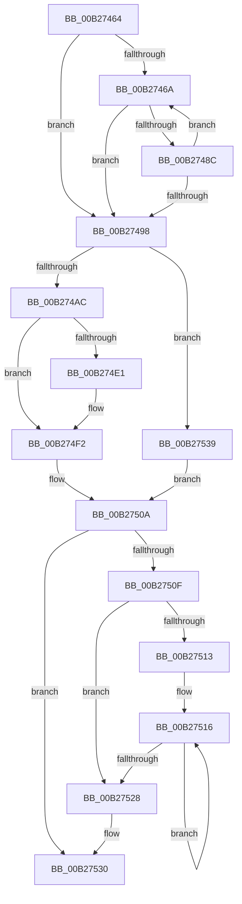

# sub_00B27464

- RVA: `0x00B27464`–`0x00B27548` (길이 `228` bytes)
- VA: `0x0000000140B27464`
- 실행 섹션: `PAGE`
- PDB 이름 있음: `아니요`; PDB Function 태그: `아니요`
- unwind 정보 RVA: `0x000927C0`
- 디코드: `63`개 명령, `228/228` bytes 표시
- 미해석 바이트: `0` (있으면 어셈블리에 `.byte`로 보존)

> 이 문서는 커널 이미지의 기계어와 PDB 기호를 분석해 생성했습니다. 4번과 5번은 함수 원형과 자료형을 바이너리 사용 방식에서 추정한 C 해석이며 원본 소스 복구 결과는 아닙니다.

## 1. Dependencies

- 직접 호출 지점: **6**; 고유 호출 대상: **6**
- 직접 호출자로 확인된 함수: **0**
- RIP 상대 이미지 참조: **4**

### Outgoing calls
- `0x00B27483` → [KsepStringDuplicate](../95/KsepStringDuplicate_function_0095B454.md) (function, `0x0095B454`)
- `0x00B2749D` → [KsepDbGetShimInfo](../74/KsepDbGetShimInfo_function_00748E94.md) (function, `0x00748E94`)
- `0x00B274ED` → [KsepDebugPrint](../../text/4D/KsepDebugPrint_function_004DCFF0.md) (function, `0x004DCFF0`)
- `0x00B274FE` → [KsepLogError](../../text/49/KsepLogError_function_00499A98.md) (function, `0x00499A98`)
- `0x00B27519` → [KsepStringFree](../95/KsepStringFree_function_0095A1B8.md) (function, `0x0095A1B8`)
- `0x00B2752B` → [KsepPoolFreePaged](../../text/4B/KsepPoolFreePaged_function_004B0E10.md) (function, `0x004B0E10`)

### Direct callers
- 이 함수 시작 RVA로 연결되는 직접 call은 확인되지 않았습니다. 간접 호출은 완전히 역산할 수 없습니다.

### Static image references
- `0x00B274B1` → RVA `0x00F101C0` (`.data`; read/write)
- `0x00B274BB` → RVA `0x00F101E0` (`.data`; read)
- `0x00B274D6` → RVA `0x00E66CE8` (`.data`; read)
- `0x00B274E4` → RVA `0x00B00930` (` ?? ::NNGAKEGL::`string'`; read)

## 2. Other-region calls and transfers

- 다른 실행 섹션으로 향하는 call: **3**
  - `0x00B274ED` → [KsepDebugPrint](../../text/4D/KsepDebugPrint_function_004DCFF0.md) (`PAGE` → `.text`)
  - `0x00B274FE` → [KsepLogError](../../text/49/KsepLogError_function_00499A98.md) (`PAGE` → `.text`)
  - `0x00B2752B` → [KsepPoolFreePaged](../../text/4B/KsepPoolFreePaged_function_004B0E10.md) (`PAGE` → `.text`)
- call이 아닌 외부 분기/꼬리 이동: **1**
  - `0x00B27534` → [KsepEngineGetShimsFromRegistry + 0x65](../95/KsepEngineGetShimsFromRegistry_function_0095907C.md) (`tail-transfer`)

## 3. Assembly (complete function range)

```asm
00B27464  33 DB                           xor ebx, ebx
00B27466  85 FF                           test edi, edi
00B27468  74 2E                           je 0x140b27498
00B2746A  8B D3                           mov edx, ebx
00B2746C  4C 8D 3C 9B                     lea r15, [rbx + rbx*4]
00B27470  48 03 D2                        add rdx, rdx
00B27473  49 C1 E7 04                     shl r15, 4
00B27477  49 8D 4E 10                     lea rcx, [r14 + 0x10]
00B2747B  49 03 CF                        add rcx, r15
00B2747E  48 8B 54 D6 08                  mov rdx, qword ptr [rsi + rdx*8 + 8]
00B27483  E8 CC 3F E3 FF                  call 0x14095b454
00B27488  85 C0                           test eax, eax
00B2748A  78 0C                           js 0x140b27498
00B2748C  43 83 64 37 44 00               and dword ptr [r15 + r14 + 0x44], 0
00B27492  FF C3                           inc ebx
00B27494  3B DF                           cmp ebx, edi
00B27496  72 D2                           jb 0x140b2746a
00B27498  8B D7                           mov edx, edi
00B2749A  49 8B CE                        mov rcx, r14
00B2749D  E8 F2 19 C2 FF                  call 0x140748e94
00B274A2  8B D8                           mov ebx, eax
00B274A4  85 C0                           test eax, eax
00B274A6  0F 89 8D 00 00 00               jns 0x140b27539
00B274AC  B8 01 00 00 00                  mov eax, 1
00B274B1  F0 0F C1 05 07 8D 3E 00         lock xadd dword ptr [rip + 0x3e8d07], eax
00B274B9  FF C0                           inc eax
00B274BB  48 8D 15 1E 8D 3E 00            lea rdx, [rip + 0x3e8d1e]
00B274C2  83 E0 3F                        and eax, 0x3f
00B274C5  41 B8 02 00 00 00               mov r8d, 2
00B274CB  89 5C C2 04                     mov dword ptr [rdx + rax*8 + 4], ebx
00B274CF  C7 04 C2 05 04 02 00            mov dword ptr [rdx + rax*8], 0x20405
00B274D6  8B 05 0C F8 33 00               mov eax, dword ptr [rip + 0x33f80c]
00B274DC  41 84 C0                        test r8b, al
00B274DF  74 11                           je 0x140b274f2
00B274E1  44 8B C3                        mov r8d, ebx
00B274E4  48 8D 15 45 94 FD FF            lea rdx, [rip - 0x26bbb]
00B274EB  33 C9                           xor ecx, ecx
00B274ED  E8 FE 5A 9B FF                  call 0x1404dcff0
00B274F2  44 8B C3                        mov r8d, ebx
00B274F5  48 8D 15 34 94 FD FF            lea rdx, [rip - 0x26bcc]
00B274FC  33 C9                           xor ecx, ecx
00B274FE  E8 95 25 97 FF                  call 0x140499a98
00B27503  8B 7D 40                        mov edi, dword ptr [rbp + 0x40]
00B27506  48 8B 75 F0                     mov rsi, qword ptr [rbp - 0x10]
00B2750A  48 85 F6                        test rsi, rsi
00B2750D  74 21                           je 0x140b27530
00B2750F  85 FF                           test edi, edi
00B27511  74 15                           je 0x140b27528
00B27513  4C 8B FE                        mov r15, rsi
00B27516  49 8B CF                        mov rcx, r15
00B27519  E8 9A 2C E3 FF                  call 0x14095a1b8
00B2751E  49 83 C7 10                     add r15, 0x10
00B27522  48 83 EF 01                     sub rdi, 1
00B27526  75 EE                           jne 0x140b27516
00B27528  48 8B CE                        mov rcx, rsi
00B2752B  E8 E0 98 98 FF                  call 0x1404b0e10
00B27530  48 8B 7D 50                     mov rdi, qword ptr [rbp + 0x50]
00B27534  E9 A8 1B E3 FF                  jmp 0x1409590e1
00B27539  48 8B 45 50                     mov rax, qword ptr [rbp + 0x50]
00B2753D  33 DB                           xor ebx, ebx
00B2753F  41 89 7D 00                     mov dword ptr [r13], edi
00B27543  4C 89 30                        mov qword ptr [rax], r14
00B27546  EB C2                           jmp 0x140b2750a
```

## 4. C-style interpretation (structured pseudocode)

```c
__int64 __fastcall sub_00B27464(void)
{
    __int64 result;
    __int64 v_r15;
    __int64 v_rbx;
    __int64 v_rdi;

    v_rbx = 0;
    if ((unsigned int)(v_rdi) == 0) goto loc_00B27498;
loc_00B2746A:
    a2 = (0) + (0);
    v_r15 = (v_rbx + v_rbx * 4) << (4);
    a1 = (v_r14 + 16) + (v_r15);
    result = KsepStringDuplicate(a1, *(unsigned __int64 *)(v_rsi + a2 * 8 + 8), a3, a4);
    if (sign_flag) goto loc_00B27498;
    v_rbx = (unsigned int)((v_rbx) + 1);
    if (((unsigned int)(v_rbx)) < ((unsigned int)(v_rdi))) goto loc_00B2746A;
loc_00B27498:
    result = KsepDbGetShimInfo(v_r14, (unsigned int)((unsigned int)(v_rdi)), a3, a4);
    if (!sign_flag) goto loc_00B27539;
    result = (unsigned int)((1) + 1);
    result = (unsigned int)((result) & (63));
    *(unsigned int *)(v_rip + 4099358 + result * 8 + 4) = (unsigned int)((unsigned int)((unsigned int)(result)));
    *(unsigned int *)(v_rip + 4099358 + result * 8) = 0x20405ULL;
    result = (unsigned int)(*(unsigned int *)(v_rip + 3405836));
    if (((2) & ((unsigned __int8)((unsigned int)(*(unsigned int *)(v_rip + 3405836))))) != 0) {
        a3 = (unsigned int)((unsigned int)((unsigned int)(result)));
        a2 = v_rip - 158651;
        a1 = 0;
        result = KsepDebugPrint(a1, a2, a3, a4);
    }
    a1 = 0;
    result = KsepLogError(a1, v_rip - 158668, (unsigned int)((unsigned int)((unsigned int)((unsigned int)(result)))), a4);
loc_00B2750A:
    if (*(unsigned __int64 *)(v_rbp - 16) == 0) goto loc_00B27530;
    if ((unsigned int)((unsigned int)(*(unsigned int *)(v_rbp + 64))) == 0) goto loc_00B27528;
loc_00B27516:
    result = KsepStringFree(*(unsigned __int64 *)(v_rbp - 16), v_rip - 158668, (unsigned int)((unsigned int)((unsigned int)((unsigned int)(result)))), a4);
    v_r15 = (*(unsigned __int64 *)(v_rbp - 16)) + (16);
    v_rdi = ((unsigned int)(*(unsigned int *)(v_rbp + 64))) - (1);
    if (condition_is_not_equal) goto loc_00B27516;
loc_00B27528:
    result = KsepPoolFreePaged(*(unsigned __int64 *)(v_rbp - 16), v_rip - 158668, (unsigned int)((unsigned int)((unsigned int)((unsigned int)(result)))), a4);
loc_00B27530:
loc_00B27539:
    v_rbx = 0;
    *(unsigned int *)(v_r13) = (unsigned int)(*(unsigned __int64 *)(v_rbp + 80));
    *(unsigned __int64 *)(*(unsigned __int64 *)(v_rbp + 80)) = v_r14;
    goto loc_00B2750A;
}
```

## 5. (Beta) C Style

```c
void sub_00B27464(void)
{
    int64_t result;
    int64_t local_r15;
    int64_t local_rbx;
    int64_t local_rdi;

    local_rbx = 0;
    if ((uint32_t)(local_rdi) == 0) goto loc_00B27498;
loc_00B2746A:
    a2 = (0) + (0);
    local_r15 = (local_rbx + local_rbx * 4) << (4);
    a1 = (local_r14 + 16) + (local_r15);
    result = KsepStringDuplicate(a1, *(uint64_t *)(local_rsi + a2 * 8 + 0x8), a3, a4);
    if (sign_flag) goto loc_00B27498;
    local_rbx = (uint32_t)((local_rbx) + 1);
    if (((uint32_t)(local_rbx)) < ((uint32_t)(local_rdi))) goto loc_00B2746A;
loc_00B27498:
    result = KsepDbGetShimInfo(local_r14, (uint32_t)((uint32_t)(local_rdi)), a3, a4);
    if (!sign_flag) goto loc_00B27539;
    result = (uint32_t)((1) + 1);
    result = (uint32_t)((result) & (63));
    *(uint32_t *)(v_rip + 0x3E8D1E + result * 8 + 0x4) = (uint32_t)((uint32_t)((uint32_t)(result)));
    *(uint32_t *)(v_rip + 0x3E8D1E + result * 8) = 0x20405ULL;
    result = (uint32_t)(*(uint32_t *)(v_rip + 0x33F80C));
    if (((2) & ((uint8_t)((uint32_t)(*(uint32_t *)(v_rip + 0x33F80C))))) != 0) {
        a3 = (uint32_t)((uint32_t)((uint32_t)(result)));
        a2 = v_rip - 158651;
        a1 = 0;
        result = KsepDebugPrint(a1, a2, a3, a4);
    }
    a1 = 0;
    result = KsepLogError(a1, v_rip - 158668, (uint32_t)((uint32_t)((uint32_t)((uint32_t)(result)))), a4);
loc_00B2750A:
    if (*(uint64_t *)(local_rbp - 0x10) == 0) goto loc_00B27530;
    if ((uint32_t)((uint32_t)(*(uint32_t *)(local_rbp + 0x40))) == 0) goto loc_00B27528;
loc_00B27516:
    result = KsepStringFree(*(uint64_t *)(local_rbp - 0x10), v_rip - 158668, (uint32_t)((uint32_t)((uint32_t)((uint32_t)(result)))), a4);
    local_r15 = (*(uint64_t *)(local_rbp - 0x10)) + (16);
    local_rdi = ((uint32_t)(*(uint32_t *)(local_rbp + 0x40))) - (1);
    if (condition_is_not_equal) goto loc_00B27516;
loc_00B27528:
    result = KsepPoolFreePaged(*(uint64_t *)(local_rbp - 0x10), v_rip - 158668, (uint32_t)((uint32_t)((uint32_t)((uint32_t)(result)))), a4);
loc_00B27530:
loc_00B27539:
    local_rbx = 0;
    *(uint32_t *)(local_r13) = (uint32_t)(*(uint64_t *)(local_rbp + 0x50));
    *(uint64_t *)(*(uint64_t *)(local_rbp + 0x50)) = local_r14;
    goto loc_00B2750A;
}
```

## 6. Execution-region graph

[열기: 2D/3D 그래프와 함수 탐색 컨트롤 패널](../../../control-panel.html?section=page&rva=0x00B27464&view=graph)

- 2D 그래프는 위에서 아래로 흐르고, 3D 그래프는 빈 공간을 드래그해 회전합니다. Shift+드래그는 이동, 휠은 확대·축소, 함수 노드 선택은 대상 보고서 이동입니다.

### Static fallback


