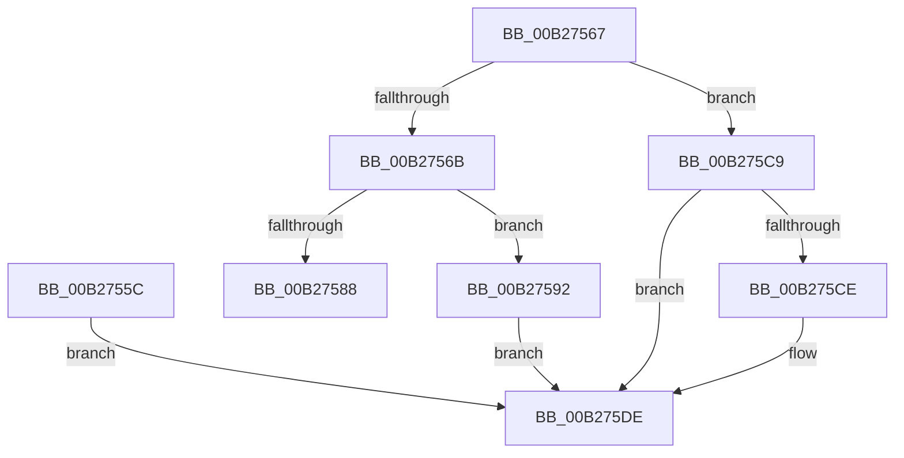

# sub_00B2755C

- RVA: `0x00B2755C`–`0x00B275E5` (길이 `137` bytes)
- VA: `0x0000000140B2755C`
- 실행 섹션: `PAGE`
- PDB 이름 있음: `아니요`; PDB Function 태그: `아니요`
- unwind 정보 RVA: `0x00092878`
- 디코드: `39`개 명령, `137/137` bytes 표시
- 미해석 바이트: `0` (있으면 어셈블리에 `.byte`로 보존)

> 이 문서는 커널 이미지의 기계어와 PDB 기호를 분석해 생성했습니다. 4번과 5번은 함수 원형과 자료형을 바이너리 사용 방식에서 추정한 C 해석이며 원본 소스 복구 결과는 아닙니다.

## 1. Dependencies

- 직접 호출 지점: **3**; 고유 호출 대상: **2**
- 직접 호출자로 확인된 함수: **0**
- RIP 상대 이미지 참조: **0**

### Outgoing calls
- `0x00B27577` → [KsepPoolAllocatePaged](../../text/4A/KsepPoolAllocatePaged_function_004A9EFC.md) (function, `0x004A9EFC`)
- `0x00B275A1` → [memcpy](../../text/6C/memcpy_function_006C6840.md) (function, `0x006C6840`)
- `0x00B275B3` → [memcpy](../../text/6C/memcpy_function_006C6840.md) (function, `0x006C6840`)

### Direct callers
- 이 함수 시작 RVA로 연결되는 직접 call은 확인되지 않았습니다. 간접 호출은 완전히 역산할 수 없습니다.

### Static image references
- 디코드된 RIP-relative 메모리 참조가 없습니다.

## 2. Other-region calls and transfers

- 다른 실행 섹션으로 향하는 call: **3**
  - `0x00B27577` → [KsepPoolAllocatePaged](../../text/4A/KsepPoolAllocatePaged_function_004A9EFC.md) (`PAGE` → `.text`)
  - `0x00B275A1` → [memcpy](../../text/6C/memcpy_function_006C6840.md) (`PAGE` → `.text`)
  - `0x00B275B3` → [memcpy](../../text/6C/memcpy_function_006C6840.md) (`PAGE` → `.text`)
- call이 아닌 외부 분기/꼬리 이동: **2**
  - `0x00B2758D` → [KsepDbGetDriverShims + 0x112](../95/KsepDbGetDriverShims_function_00959A58.md) (`tail-transfer`)
  - `0x00B275E0` → [KsepDbGetDriverShims + 0x112](../95/KsepDbGetDriverShims_function_00959A58.md) (`tail-transfer`)

## 3. Assembly (complete function range)

```asm
00B2755C  49 89 37                        mov qword ptr [r15], rsi
00B2755F  33 F6                           xor esi, esi
00B27561  41 89 3C 24                     mov dword ptr [r12], edi
00B27565  EB 77                           jmp 0x140b275de
00B27567  85 FF                           test edi, edi
00B27569  74 5E                           je 0x140b275c9
00B2756B  42 8D 04 37                     lea eax, [rdi + r14]
00B2756F  48 8D 0C 80                     lea rcx, [rax + rax*4]
00B27573  48 C1 E1 04                     shl rcx, 4
00B27577  E8 80 29 98 FF                  call 0x1404a9efc
00B2757C  48 89 45 40                     mov qword ptr [rbp + 0x40], rax
00B27580  48 8B C8                        mov rcx, rax
00B27583  48 85 C0                        test rax, rax
00B27586  75 0A                           jne 0x140b27592
00B27588  BB 17 00 00 C0                  mov ebx, 0xc0000017
00B2758D  E9 D8 25 E3 FF                  jmp 0x140959b6a
00B27592  48 8B 55 E8                     mov rdx, qword ptr [rbp - 0x18]
00B27596  4B 8D 1C B6                     lea rbx, [r14 + r14*4]
00B2759A  48 C1 E3 04                     shl rbx, 4
00B2759E  4C 8B C3                        mov r8, rbx
00B275A1  E8 9A F2 B9 FF                  call 0x1406c6840
00B275A6  48 8B 4D 40                     mov rcx, qword ptr [rbp + 0x40]
00B275AA  48 8B D6                        mov rdx, rsi
00B275AD  48 03 CB                        add rcx, rbx
00B275B0  44 8B C7                        mov r8d, edi
00B275B3  E8 88 F2 B9 FF                  call 0x1406c6840
00B275B8  48 8B 45 40                     mov rax, qword ptr [rbp + 0x40]
00B275BC  49 89 07                        mov qword ptr [r15], rax
00B275BF  42 8D 04 37                     lea eax, [rdi + r14]
00B275C3  41 89 04 24                     mov dword ptr [r12], eax
00B275C7  EB 15                           jmp 0x140b275de
00B275C9  45 85 F6                        test r14d, r14d
00B275CC  74 10                           je 0x140b275de
00B275CE  48 8B 45 E8                     mov rax, qword ptr [rbp - 0x18]
00B275D2  48 83 65 E8 00                  and qword ptr [rbp - 0x18], 0
00B275D7  49 89 07                        mov qword ptr [r15], rax
00B275DA  45 89 34 24                     mov dword ptr [r12], r14d
00B275DE  33 DB                           xor ebx, ebx
00B275E0  E9 85 25 E3 FF                  jmp 0x140959b6a
```

## 4. C-style interpretation (structured pseudocode)

```c
__int64 __fastcall sub_00B2755C(void)
{
    __int64 v_rbx;
    __int64 v_rsi;

    *(unsigned __int64 *)(v_r15) = v_rsi;
    v_rsi = 0;
    *(unsigned int *)(v_r12) = (unsigned int)(v_rdi);
    goto loc_00B275DE;
loc_00B275DE:
    v_rbx = 0;
}
```

## 5. (Beta) C Style

```c
void sub_00B2755C(void)
{
    int64_t local_rbx;
    int64_t local_rsi;

    *(uint64_t *)(local_r15) = local_rsi;
    local_rsi = 0;
    *(uint32_t *)(local_r12) = (uint32_t)(local_rdi);
    goto loc_00B275DE;
loc_00B275DE:
    local_rbx = 0;
}
```

## 6. Execution-region graph

[열기: 2D/3D 그래프와 함수 탐색 컨트롤 패널](../../../control-panel.html?section=page&rva=0x00B2755C&view=graph)

- 2D 그래프는 위에서 아래로 흐르고, 3D 그래프는 빈 공간을 드래그해 회전합니다. Shift+드래그는 이동, 휠은 확대·축소, 함수 노드 선택은 대상 보고서 이동입니다.

### Static fallback


