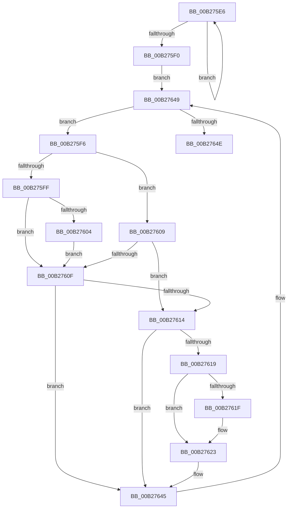

# sub_00B275E6

- RVA: `0x00B275E6`–`0x00B2765B` (길이 `117` bytes)
- VA: `0x0000000140B275E6`
- 실행 섹션: `PAGE`
- PDB 이름 있음: `아니요`; PDB Function 태그: `아니요`
- unwind 정보 RVA: `0x00092950`
- 디코드: `37`개 명령, `117/117` bytes 표시
- 미해석 바이트: `0` (있으면 어셈블리에 `.byte`로 보존)

> 이 문서는 커널 이미지의 기계어와 PDB 기호를 분석해 생성했습니다. 4번과 5번은 함수 원형과 자료형을 바이너리 사용 방식에서 추정한 C 해석이며 원본 소스 복구 결과는 아닙니다.

## 1. Dependencies

- 직접 호출 지점: **0**; 고유 호출 대상: **0**
- 직접 호출자로 확인된 함수: **0**
- RIP 상대 이미지 참조: **0**

### Outgoing calls
- 직접 디코드된 call 명령이 없습니다.

### Direct callers
- 이 함수 시작 RVA로 연결되는 직접 call은 확인되지 않았습니다. 간접 호출은 완전히 역산할 수 없습니다.

### Static image references
- 디코드된 RIP-relative 메모리 참조가 없습니다.

## 2. Other-region calls and transfers

- 다른 실행 섹션으로 향하는 call: **0**
- call이 아닌 외부 분기/꼬리 이동: **1**
  - `0x00B27656` → [SdbpCreateSearchPathPartsFromPath + 0x84](../95/SdbpCreateSearchPathPartsFromPath_function_0095A238.md) (`tail-transfer`)

## 3. Assembly (complete function range)

```asm
00B275E6  48 FF C0                        inc rax
00B275E9  66 44 39 24 47                  cmp word ptr [rdi + rax*2], r12w
00B275EE  75 F6                           jne 0x140b275e6
00B275F0  48 8D 14 47                     lea rdx, [rdi + rax*2]
00B275F4  EB 53                           jmp 0x140b27649
00B275F6  0F B7 02                        movzx eax, word ptr [rdx]
00B275F9  66 83 F8 5C                     cmp ax, 0x5c
00B275FD  75 0A                           jne 0x140b27609
00B275FF  48 85 DB                        test rbx, rbx
00B27602  75 0B                           jne 0x140b2760f
00B27604  48 8B DA                        mov rbx, rdx
00B27607  EB 06                           jmp 0x140b2760f
00B27609  66 41 3B C5                     cmp ax, r13w
00B2760D  74 05                           je 0x140b27614
00B2760F  48 3B FA                        cmp rdi, rdx
00B27612  75 31                           jne 0x140b27645
00B27614  48 85 DB                        test rbx, rbx
00B27617  74 2C                           je 0x140b27645
00B27619  66 41 3B C5                     cmp ax, r13w
00B2761D  75 04                           jne 0x140b27623
00B2761F  48 83 C2 02                     add rdx, 2
00B27623  48 2B DA                        sub rbx, rdx
00B27626  41 8B C7                        mov eax, r15d
00B27629  48 D1 FB                        sar rbx, 1
00B2762C  FF C3                           inc ebx
00B2762E  48 8D 0C 40                     lea rcx, [rax + rax*2]
00B27632  48 03 C9                        add rcx, rcx
00B27635  41 FF C7                        inc r15d
00B27638  41 89 5C C8 10                  mov dword ptr [r8 + rcx*8 + 0x10], ebx
00B2763D  49 8B DC                        mov rbx, r12
00B27640  49 89 54 C8 08                  mov qword ptr [r8 + rcx*8 + 8], rdx
00B27645  48 83 EA 02                     sub rdx, 2
00B27649  48 3B D7                        cmp rdx, rdi
00B2764C  73 A8                           jae 0x140b275f6
00B2764E  4D 89 06                        mov qword ptr [r14], r8
00B27651  B8 01 00 00 00                  mov eax, 1
00B27656  E9 61 2C E3 FF                  jmp 0x14095a2bc
```

## 4. C-style interpretation (structured pseudocode)

```c
__int64 __fastcall sub_00B275E6(__int64 a1, __int64 a2, __int64 a3)
{
    __int64 result;
    __int64 v_r15;
    __int64 v_rbx;

    result = (result) + 1;
    if ((*(unsigned __int16 *)(v_rdi + result * 2)) != ((unsigned __int16)(v_r12))) goto loc_00B275E6;
    goto loc_00B27649;
loc_00B275F6:
    if (((unsigned __int16)(*(unsigned __int16 *)(v_rdi + result * 2))) != 92) goto loc_00B27609;
    if (v_rbx != 0) goto loc_00B2760F;
    goto loc_00B2760F;
loc_00B27609:
    if (((unsigned __int16)(*(unsigned __int16 *)(v_rdi + result * 2))) == ((unsigned __int16)(v_r13))) goto loc_00B27614;
loc_00B2760F:
    if (v_rdi != (v_rdi + result * 2)) goto loc_00B27645;
loc_00B27614:
    if (v_rdi + result * 2 == 0) goto loc_00B27645;
    if (((unsigned __int16)(*(unsigned __int16 *)(v_rdi + result * 2))) == ((unsigned __int16)(v_r13))) {
        a2 = (v_rdi + result * 2) + (2);
    }
    v_rbx = (v_rdi + result * 2) - (a2);
    v_rbx = (v_rbx) >> (1);
    v_rbx = (unsigned int)((v_rbx) + 1);
    a1 = ((unsigned int)((unsigned int)(v_r15)) + (unsigned int)((unsigned int)(v_r15)) * 2) + ((unsigned int)((unsigned int)(v_r15)) + (unsigned int)((unsigned int)(v_r15)) * 2);
    v_r15 = (unsigned int)((v_r15) + 1);
    *(unsigned int *)(a3 + a1 * 8 + 16) = (unsigned int)(v_rbx);
    *(unsigned __int64 *)(a3 + a1 * 8 + 8) = a2;
loc_00B27645:
    a2 = (a2) - (2);
loc_00B27649:
    if (a2 >= v_rdi) goto loc_00B275F6;
    *(unsigned __int64 *)(v_r14) = a3;
}
```

## 5. (Beta) C Style

```c
int64_t sub_00B275E6(int64_t Arg1, int64_t Arg2, void *Arg3)
{
    uint8_t *arg3 = (uint8_t *)Arg3;

    int64_t result;
    int64_t local_r15;
    int64_t local_rbx;

    result = (result) + 1;
    if ((*(uint16_t *)(local_rdi + result * 2)) != ((uint16_t)(local_r12))) goto loc_00B275E6;
    goto loc_00B27649;
loc_00B275F6:
    if (((uint16_t)(*(uint16_t *)(local_rdi + result * 2))) != 92) goto loc_00B27609;
    if (local_rbx != 0) goto loc_00B2760F;
    goto loc_00B2760F;
loc_00B27609:
    if (((uint16_t)(*(uint16_t *)(local_rdi + result * 2))) == ((uint16_t)(local_r13))) goto loc_00B27614;
loc_00B2760F:
    if (local_rdi != (local_rdi + result * 2)) goto loc_00B27645;
loc_00B27614:
    if (local_rdi + result * 2 == 0) goto loc_00B27645;
    if (((uint16_t)(*(uint16_t *)(local_rdi + result * 2))) == ((uint16_t)(local_r13))) {
        Arg2 = (local_rdi + result * 2) + (2);
    }
    local_rbx = (local_rdi + result * 2) - (Arg2);
    local_rbx = (local_rbx) >> (1);
    local_rbx = (uint32_t)((local_rbx) + 1);
    Arg1 = ((uint32_t)((uint32_t)(local_r15)) + (uint32_t)((uint32_t)(local_r15)) * 2) + ((uint32_t)((uint32_t)(local_r15)) + (uint32_t)((uint32_t)(local_r15)) * 2);
    local_r15 = (uint32_t)((local_r15) + 1);
    *(uint32_t *)(arg3 + Arg1 * 8 + 0x10) = (uint32_t)(local_rbx);
    *(uint64_t *)(arg3 + Arg1 * 8 + 0x8) = Arg2;
loc_00B27645:
    Arg2 = (Arg2) - (2);
loc_00B27649:
    if (Arg2 >= local_rdi) goto loc_00B275F6;
    *(void **)(local_r14) = Arg3;
}
```

### 관측된 메모리 오프셋

구조체 형식이 확인되지 않은 접근은 인자 기준의 오프셋으로만 기록했습니다.

| 기준 인자 | 오프셋 표현 | 폭 (bit) | 접근 |
|---|---:|---:|---|
| `Arg3` | `+ 0x8 + rcx*8` | `64` | `W` |
| `Arg3` | `+ 0x10 + rcx*8` | `32` | `W` |

## 6. Execution-region graph

[열기: 2D/3D 그래프와 함수 탐색 컨트롤 패널](../../../control-panel.html?section=page&rva=0x00B275E6&view=graph)

- 2D 그래프는 위에서 아래로 흐르고, 3D 그래프는 빈 공간을 드래그해 회전합니다. Shift+드래그는 이동, 휠은 확대·축소, 함수 노드 선택은 대상 보고서 이동입니다.

### Static fallback


