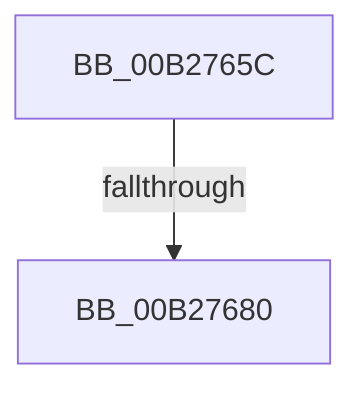

# sub_00B2765C

- RVA: `0x00B2765C`–`0x00B27692` (길이 `54` bytes)
- VA: `0x0000000140B2765C`
- 실행 섹션: `PAGE`
- PDB 이름 있음: `아니요`; PDB Function 태그: `아니요`
- unwind 정보 RVA: `0x000929C0`
- 디코드: `9`개 명령, `54/54` bytes 표시
- 미해석 바이트: `0` (있으면 어셈블리에 `.byte`로 보존)

> 이 문서는 커널 이미지의 기계어와 PDB 기호를 분석해 생성했습니다. 4번과 5번은 함수 원형과 자료형을 바이너리 사용 방식에서 추정한 C 해석이며 원본 소스 복구 결과는 아닙니다.

## 1. Dependencies

- 직접 호출 지점: **2**; 고유 호출 대상: **2**
- 직접 호출자로 확인된 함수: **0**
- RIP 상대 이미지 참조: **0**

### Outgoing calls
- `0x00B27663` → [AslFree](../95/AslFree_function_0095B674.md) (function, `0x0095B674`)
- `0x00B27680` → [AslHashFree](../81/AslHashFree_function_0081CC70.md) (function, `0x0081CC70`)

### Direct callers
- 이 함수 시작 RVA로 연결되는 직접 call은 확인되지 않았습니다. 간접 호출은 완전히 역산할 수 없습니다.

### Static image references
- 디코드된 RIP-relative 메모리 참조가 없습니다.

## 2. Other-region calls and transfers

- 다른 실행 섹션으로 향하는 call: **0**
- call이 아닌 외부 분기/꼬리 이동: **2**
  - `0x00B2767A` → [SdbCloseDatabaseRead + 0x15](../95/SdbCloseDatabaseRead_function_0095A728.md) (`tail-transfer`)
  - `0x00B2768D` → [SdbCloseDatabaseRead + 0x15](../95/SdbCloseDatabaseRead_function_0095A728.md) (`tail-transfer`)

## 3. Assembly (complete function range)

```asm
00B2765C  48 8B 93 50 0A 00 00            mov rdx, qword ptr [rbx + 0xa50]
00B27663  E8 0C 40 E3 FF                  call 0x14095b674
00B27668  48 8B 8B 58 0A 00 00            mov rcx, qword ptr [rbx + 0xa58]
00B2766F  48 83 A3 50 0A 00 00 00         and qword ptr [rbx + 0xa50], 0
00B27677  48 85 C9                        test rcx, rcx
00B2767A  0F 84 BD 30 E3 FF               je 0x14095a73d
00B27680  E8 EB 55 CF FF                  call 0x14081cc70
00B27685  48 83 A3 58 0A 00 00 00         and qword ptr [rbx + 0xa58], 0
00B2768D  E9 AB 30 E3 FF                  jmp 0x14095a73d
```

## 4. C-style interpretation (structured pseudocode)

```c
__int64 __fastcall sub_00B2765C(void)
{
    __int64 result;

    result = AslFree(a1, *(unsigned __int64 *)(v_rbx + 2640), a3, a4);
    result = AslHashFree(*(unsigned __int64 *)(v_rbx + 2648), *(unsigned __int64 *)(v_rbx + 2640), a3, a4);
}
```

## 5. (Beta) C Style

```c
void sub_00B2765C(void)
{
    int64_t result;

    result = AslFree(a1, *(uint64_t *)(local_rbx + 0xA50), a3, a4);
    result = AslHashFree(*(uint64_t *)(local_rbx + 0xA58), *(uint64_t *)(local_rbx + 0xA50), a3, a4);
}
```

## 6. Execution-region graph

[열기: 2D/3D 그래프와 함수 탐색 컨트롤 패널](../../../control-panel.html?section=page&rva=0x00B2765C&view=graph)

- 2D 그래프는 위에서 아래로 흐르고, 3D 그래프는 빈 공간을 드래그해 회전합니다. Shift+드래그는 이동, 휠은 확대·축소, 함수 노드 선택은 대상 보고서 이동입니다.

### Static fallback


