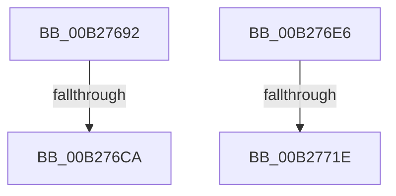

# sub_00B27692

- RVA: `0x00B27692`–`0x00B2773A` (길이 `168` bytes)
- VA: `0x0000000140B27692`
- 실행 섹션: `PAGE`
- PDB 이름 있음: `아니요`; PDB Function 태그: `아니요`
- unwind 정보 RVA: `0x000929EC`
- 디코드: `32`개 명령, `168/168` bytes 표시
- 미해석 바이트: `0` (있으면 어셈블리에 `.byte`로 보존)

> 이 문서는 커널 이미지의 기계어와 PDB 기호를 분석해 생성했습니다. 4번과 5번은 함수 원형과 자료형을 바이너리 사용 방식에서 추정한 C 해석이며 원본 소스 복구 결과는 아닙니다.

## 1. Dependencies

- 직접 호출 지점: **2**; 고유 호출 대상: **1**
- 직접 호출자로 확인된 함수: **0**
- RIP 상대 이미지 참조: **5**

### Outgoing calls
- `0x00B276DB` → [RtlAssert](../../text/5E/RtlAssert_function_005E75E0.md) (function, `0x005E75E0`)
- `0x00B2772F` → [RtlAssert](../../text/5E/RtlAssert_function_005E75E0.md) (function, `0x005E75E0`)

### Direct callers
- 이 함수 시작 RVA로 연결되는 직접 call은 확인되지 않았습니다. 간접 호출은 완전히 역산할 수 없습니다.

### Static image references
- `0x00B27697` → RVA `0x00F101C0` (`.data`; read/write)
- `0x00B276BB` → RVA `0x00E66CE8` (`.data`; read)
- `0x00B276CD` → RVA `0x00B011C0` (` ?? ::NNGAKEGL::`string'`; read)
- `0x00B276D4` → RVA `0x00B01310` (` ?? ::NNGAKEGL::`string'`; read)
- `0x00B27728` → RVA `0x00B01330` (` ?? ::NNGAKEGL::`string'`; read)

## 2. Other-region calls and transfers

- 다른 실행 섹션으로 향하는 call: **2**
  - `0x00B276DB` → [RtlAssert](../../text/5E/RtlAssert_function_005E75E0.md) (`PAGE` → `.text`)
  - `0x00B2772F` → [RtlAssert](../../text/5E/RtlAssert_function_005E75E0.md) (`PAGE` → `.text`)
- call이 아닌 외부 분기/꼬리 이동: **4**
  - `0x00B276C4` → [KsepRegistryOpenKey + 0x59](../95/KsepRegistryOpenKey_function_0095A79C.md) (`tail-transfer`)
  - `0x00B276E1` → [KsepRegistryOpenKey + 0x59](../95/KsepRegistryOpenKey_function_0095A79C.md) (`tail-transfer`)
  - `0x00B27718` → [KsepRegistryOpenKey + 0x62](../95/KsepRegistryOpenKey_function_0095A79C.md) (`tail-transfer`)
  - `0x00B27735` → [KsepRegistryOpenKey + 0x62](../95/KsepRegistryOpenKey_function_0095A79C.md) (`tail-transfer`)

## 3. Assembly (complete function range)

```asm
00B27692  B8 01 00 00 00                  mov eax, 1
00B27697  F0 0F C1 05 21 8B 3E 00         lock xadd dword ptr [rip + 0x3e8b21], eax
00B2769F  FF C0                           inc eax
00B276A1  41 B8 A6 01 00 00               mov r8d, 0x1a6
00B276A7  83 E0 3F                        and eax, 0x3f
00B276AA  41 C7 44 C4 04 20 04 00 C0      mov dword ptr [r12 + rax*8 + 4], 0xc0000420
00B276B3  41 C7 04 C4 A6 01 04 00         mov dword ptr [r12 + rax*8], 0x401a6
00B276BB  8B 05 27 F6 33 00               mov eax, dword ptr [rip + 0x33f627]
00B276C1  41 84 C5                        test r13b, al
00B276C4  0F 84 2B 31 E3 FF               je 0x14095a7f5
00B276CA  45 33 C9                        xor r9d, r9d
00B276CD  48 8D 15 EC 9A FD FF            lea rdx, [rip - 0x26514]
00B276D4  48 8D 0D 35 9C FD FF            lea rcx, [rip - 0x263cb]
00B276DB  E8 00 FF AB FF                  call 0x1405e75e0
00B276E0  90                              nop
00B276E1  E9 0F 31 E3 FF                  jmp 0x14095a7f5
00B276E6  B8 01 00 00 00                  mov eax, 1
00B276EB  F0 0F C1 05 CD 8A 3E 00         lock xadd dword ptr [rip + 0x3e8acd], eax
00B276F3  FF C0                           inc eax
00B276F5  41 B8 A7 01 00 00               mov r8d, 0x1a7
00B276FB  83 E0 3F                        and eax, 0x3f
00B276FE  41 C7 44 C4 04 20 04 00 C0      mov dword ptr [r12 + rax*8 + 4], 0xc0000420
00B27707  41 C7 04 C4 A7 01 04 00         mov dword ptr [r12 + rax*8], 0x401a7
00B2770F  8B 05 D3 F5 33 00               mov eax, dword ptr [rip + 0x33f5d3]
00B27715  41 84 C5                        test r13b, al
00B27718  0F 84 E0 30 E3 FF               je 0x14095a7fe
00B2771E  45 33 C9                        xor r9d, r9d
00B27721  48 8D 15 98 9A FD FF            lea rdx, [rip - 0x26568]
00B27728  48 8D 0D 01 9C FD FF            lea rcx, [rip - 0x263ff]
00B2772F  E8 AC FE AB FF                  call 0x1405e75e0
00B27734  90                              nop
00B27735  E9 C4 30 E3 FF                  jmp 0x14095a7fe
```

## 4. C-style interpretation (structured pseudocode)

```c
__int64 __fastcall sub_00B27692(__int64 a1, __int64 a2, __int64 a3, int a4)
{
    __int64 result;

    result = (unsigned int)((1) + 1);
    result = (unsigned int)((result) & (63));
    *(unsigned int *)(v_r12 + result * 8 + 4) = 0xC0000420ULL;
    *(unsigned int *)(v_r12 + result * 8) = 0x401A6ULL;
    a4 = 0;
    result = RtlAssert(v_rip - 156619, v_rip - 156948, 422, a4);
}
```

## 5. (Beta) C Style

```c
int64_t sub_00B27692(int64_t Arg1, int64_t Arg2, int64_t Arg3, int32_t Arg4)
{
    int64_t result;

    result = (uint32_t)((1) + 1);
    result = (uint32_t)((result) & (63));
    *(uint32_t *)(local_r12 + result * 8 + 0x4) = 0xC0000420ULL;
    *(uint32_t *)(local_r12 + result * 8) = 0x401A6ULL;
    Arg4 = 0;
    result = RtlAssert(v_rip - 156619, v_rip - 156948, 422, Arg4);
}
```

## 6. Execution-region graph

[열기: 2D/3D 그래프와 함수 탐색 컨트롤 패널](../../../control-panel.html?section=page&rva=0x00B27692&view=graph)

- 2D 그래프는 위에서 아래로 흐르고, 3D 그래프는 빈 공간을 드래그해 회전합니다. Shift+드래그는 이동, 휠은 확대·축소, 함수 노드 선택은 대상 보고서 이동입니다.

### Static fallback


