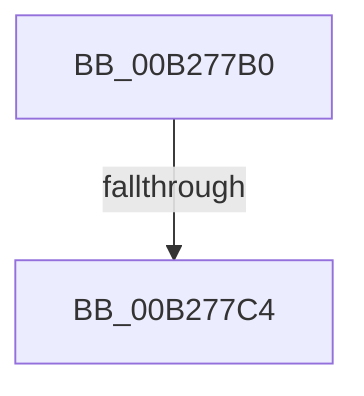

# sub_00B277B0

- RVA: `0x00B277B0`–`0x00B27811` (길이 `97` bytes)
- VA: `0x0000000140B277B0`
- 실행 섹션: `PAGE`
- PDB 이름 있음: `아니요`; PDB Function 태그: `아니요`
- unwind 정보 RVA: `0x00092A9C`
- 디코드: `26`개 명령, `97/97` bytes 표시
- 미해석 바이트: `0` (있으면 어셈블리에 `.byte`로 보존)

> 이 문서는 커널 이미지의 기계어와 PDB 기호를 분석해 생성했습니다. 4번과 5번은 함수 원형과 자료형을 바이너리 사용 방식에서 추정한 C 해석이며 원본 소스 복구 결과는 아닙니다.

## 1. Dependencies

- 직접 호출 지점: **3**; 고유 호출 대상: **2**
- 직접 호출자로 확인된 함수: **0**
- RIP 상대 이미지 참조: **0**

### Outgoing calls
- `0x00B277D9` → [RtlInitUnicodeString](../../text/42/RtlInitUnicodeString_function_0042A780.md) (function, `0x0042A780`)
- `0x00B277E5` → [RtlInitUnicodeString](../../text/42/RtlInitUnicodeString_function_0042A780.md) (function, `0x0042A780`)
- `0x00B27804` → [KsepEvntLogFlagsApplied](../../text/5C/KsepEvntLogFlagsApplied_function_005CBAD0.md) (function, `0x005CBAD0`)

### Direct callers
- 이 함수 시작 RVA로 연결되는 직접 call은 확인되지 않았습니다. 간접 호출은 완전히 역산할 수 없습니다.

### Static image references
- 디코드된 RIP-relative 메모리 참조가 없습니다.

## 2. Other-region calls and transfers

- 다른 실행 섹션으로 향하는 call: **3**
  - `0x00B277D9` → [RtlInitUnicodeString](../../text/42/RtlInitUnicodeString_function_0042A780.md) (`PAGE` → `.text`)
  - `0x00B277E5` → [RtlInitUnicodeString](../../text/42/RtlInitUnicodeString_function_0042A780.md) (`PAGE` → `.text`)
  - `0x00B27804` → [KsepEvntLogFlagsApplied](../../text/5C/KsepEvntLogFlagsApplied_function_005CBAD0.md) (`PAGE` → `.text`)
- call이 아닌 외부 분기/꼬리 이동: **2**
  - `0x00B277BE` → [KseQueryDeviceFlags + 0x9B](../95/KseQueryDeviceFlags_function_0095AF00.md) (`tail-transfer`)
  - `0x00B2780C` → [KseQueryDeviceFlags + 0x7E](../95/KseQueryDeviceFlags_function_0095AF00.md) (`tail-transfer`)

## 3. Assembly (complete function range)

```asm
00B277B0  8B 75 38                        mov esi, dword ptr [rbp + 0x38]
00B277B3  8B CE                           mov ecx, esi
00B277B5  81 E1 FF FF FF CF               and ecx, 0xcfffffff
00B277BB  83 F9 0B                        cmp ecx, 0xb
00B277BE  0F 85 D7 37 E3 FF               jne 0x14095af9b
00B277C4  0F 57 C0                        xorps xmm0, xmm0
00B277C7  48 8D 4D F0                     lea rcx, [rbp - 0x10]
00B277CB  0F 57 C9                        xorps xmm1, xmm1
00B277CE  49 8B D7                        mov rdx, r15
00B277D1  0F 11 45 F0                     movups xmmword ptr [rbp - 0x10], xmm0
00B277D5  0F 11 4D E0                     movups xmmword ptr [rbp - 0x20], xmm1
00B277D9  E8 A2 2F 90 FF                  call 0x14042a780
00B277DE  48 8B D3                        mov rdx, rbx
00B277E1  48 8D 4D E0                     lea rcx, [rbp - 0x20]
00B277E5  E8 96 2F 90 FF                  call 0x14042a780
00B277EA  48 8B 5D D8                     mov rbx, qword ptr [rbp - 0x28]
00B277EE  48 8D 55 E0                     lea rdx, [rbp - 0x20]
00B277F2  C1 EE 1C                        shr esi, 0x1c
00B277F5  48 8D 4D F0                     lea rcx, [rbp - 0x10]
00B277F9  F7 D6                           not esi
00B277FB  4C 8B CB                        mov r9, rbx
00B277FE  83 E6 01                        and esi, 1
00B27801  44 8B C6                        mov r8d, esi
00B27804  E8 C7 42 AA FF                  call 0x1405cbad0
00B27809  49 89 1E                        mov qword ptr [r14], rbx
00B2780C  E9 6D 37 E3 FF                  jmp 0x14095af7e
```

## 4. C-style interpretation (structured pseudocode)

```c
__int64 __fastcall sub_00B277B0(void)
{
    __int64 result;
    __int64 v_rsi;

    a1 = (unsigned int)(((unsigned int)((unsigned int)((unsigned int)(*(unsigned int *)(v_rbp + 56))))) & (0xCFFFFFFFULL));
    *(unsigned __int64 *)(v_rbp - 16) = v_xmm0;
    *(unsigned __int64 *)(v_rbp - 32) = v_xmm1;
    result = RtlInitUnicodeString(v_rbp - 16, v_r15, a3, a4);
    result = RtlInitUnicodeString(v_rbp - 32, v_rbx, a3, a4);
    v_rsi = (unsigned int)(((unsigned int)(*(unsigned int *)(v_rbp + 56))) >> (28));
    v_rsi = (unsigned int)(~(v_rsi));
    v_rsi = (unsigned int)((v_rsi) & (1));
    result = KsepEvntLogFlagsApplied(v_rbp - 16, v_rbp - 32, (unsigned int)((unsigned int)(v_rsi)), *(unsigned __int64 *)(v_rbp - 40));
    *(unsigned __int64 *)(v_r14) = *(unsigned __int64 *)(v_rbp - 40);
}
```

## 5. (Beta) C Style

```c
void sub_00B277B0(void)
{
    int64_t result;
    int64_t local_rsi;

    a1 = (uint32_t)(((uint32_t)((uint32_t)((uint32_t)(*(uint32_t *)(local_rbp + 0x38))))) & (0xCFFFFFFFULL));
    *(uint64_t *)(local_rbp - 0x10) = v_xmm0;
    *(uint64_t *)(local_rbp - 0x20) = v_xmm1;
    result = RtlInitUnicodeString(local_rbp - 16, local_r15, a3, a4);
    result = RtlInitUnicodeString(local_rbp - 32, local_rbx, a3, a4);
    local_rsi = (uint32_t)(((uint32_t)(*(uint32_t *)(local_rbp + 0x38))) >> (28));
    local_rsi = (uint32_t)(~(local_rsi));
    local_rsi = (uint32_t)((local_rsi) & (1));
    result = KsepEvntLogFlagsApplied(local_rbp - 16, local_rbp - 32, (uint32_t)((uint32_t)(local_rsi)), *(uint64_t *)(local_rbp - 0x28));
    *(uint64_t *)(local_r14) = *(uint64_t *)(local_rbp - 0x28);
}
```

## 6. Execution-region graph

[열기: 2D/3D 그래프와 함수 탐색 컨트롤 패널](../../../control-panel.html?section=page&rva=0x00B277B0&view=graph)

- 2D 그래프는 위에서 아래로 흐르고, 3D 그래프는 빈 공간을 드래그해 회전합니다. Shift+드래그는 이동, 휠은 확대·축소, 함수 노드 선택은 대상 보고서 이동입니다.

### Static fallback


