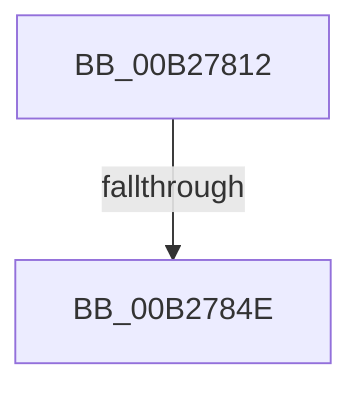

# sub_00B27812

- RVA: `0x00B27812`–`0x00B2786A` (길이 `88` bytes)
- VA: `0x0000000140B27812`
- 실행 섹션: `PAGE`
- PDB 이름 있음: `아니요`; PDB Function 태그: `아니요`
- unwind 정보 RVA: `0x00092B28`
- 디코드: `17`개 명령, `88/88` bytes 표시
- 미해석 바이트: `0` (있으면 어셈블리에 `.byte`로 보존)

> 이 문서는 커널 이미지의 기계어와 PDB 기호를 분석해 생성했습니다. 4번과 5번은 함수 원형과 자료형을 바이너리 사용 방식에서 추정한 C 해석이며 원본 소스 복구 결과는 아닙니다.

## 1. Dependencies

- 직접 호출 지점: **1**; 고유 호출 대상: **1**
- 직접 호출자로 확인된 함수: **0**
- RIP 상대 이미지 참조: **5**

### Outgoing calls
- `0x00B2785F` → [RtlAssert](../../text/5E/RtlAssert_function_005E75E0.md) (function, `0x005E75E0`)

### Direct callers
- 이 함수 시작 RVA로 연결되는 직접 call은 확인되지 않았습니다. 간접 호출은 완전히 역산할 수 없습니다.

### Static image references
- `0x00B27817` → RVA `0x00F101C0` (`.data`; read/write)
- `0x00B27821` → RVA `0x00F101E0` (`.data`; read)
- `0x00B27840` → RVA `0x00E66CE8` (`.data`; read)
- `0x00B27851` → RVA `0x00B01160` (` ?? ::NNGAKEGL::`string'`; read)
- `0x00B27858` → RVA `0x00B01120` (` ?? ::NNGAKEGL::`string'`; read)

## 2. Other-region calls and transfers

- 다른 실행 섹션으로 향하는 call: **1**
  - `0x00B2785F` → [RtlAssert](../../text/5E/RtlAssert_function_005E75E0.md) (`PAGE` → `.text`)
- call이 아닌 외부 분기/꼬리 이동: **2**
  - `0x00B27848` → [KsepStringDuplicate + 0x2B](../95/KsepStringDuplicate_function_0095B454.md) (`tail-transfer`)
  - `0x00B27865` → [KsepStringDuplicate + 0x2B](../95/KsepStringDuplicate_function_0095B454.md) (`tail-transfer`)

## 3. Assembly (complete function range)

```asm
00B27812  B8 01 00 00 00                  mov eax, 1
00B27817  F0 0F C1 05 A1 89 3E 00         lock xadd dword ptr [rip + 0x3e89a1], eax
00B2781F  FF C0                           inc eax
00B27821  48 8D 15 B8 89 3E 00            lea rdx, [rip + 0x3e89b8]
00B27828  83 E0 3F                        and eax, 0x3f
00B2782B  41 B8 52 02 00 00               mov r8d, 0x252
00B27831  C7 44 C2 04 20 04 00 C0         mov dword ptr [rdx + rax*8 + 4], 0xc0000420
00B27839  C7 04 C2 52 02 03 00            mov dword ptr [rdx + rax*8], 0x30252
00B27840  8B 05 A2 F4 33 00               mov eax, dword ptr [rip + 0x33f4a2]
00B27846  A8 04                           test al, 4
00B27848  0F 84 31 3C E3 FF               je 0x14095b47f
00B2784E  45 33 C9                        xor r9d, r9d
00B27851  48 8D 15 08 99 FD FF            lea rdx, [rip - 0x266f8]
00B27858  48 8D 0D C1 98 FD FF            lea rcx, [rip - 0x2673f]
00B2785F  E8 7C FD AB FF                  call 0x1405e75e0
00B27864  90                              nop
00B27865  E9 15 3C E3 FF                  jmp 0x14095b47f
```

## 4. C-style interpretation (structured pseudocode)

```c
__int64 __fastcall sub_00B27812(__int64 a1, __int64 a2, __int64 a3, int a4)
{
    __int64 result;

    result = (unsigned int)((1) + 1);
    result = (unsigned int)((result) & (63));
    *(unsigned int *)(v_rip + 4098488 + result * 8 + 4) = 0xC0000420ULL;
    *(unsigned int *)(v_rip + 4098488 + result * 8) = 0x30252ULL;
    a4 = 0;
    result = RtlAssert(v_rip - 157503, v_rip - 157432, 594, a4);
}
```

## 5. (Beta) C Style

```c
int64_t sub_00B27812(int64_t Arg1, int64_t Arg2, int64_t Arg3, int32_t Arg4)
{
    int64_t result;

    result = (uint32_t)((1) + 1);
    result = (uint32_t)((result) & (63));
    *(uint32_t *)(v_rip + 0x3E89B8 + result * 8 + 0x4) = 0xC0000420ULL;
    *(uint32_t *)(v_rip + 0x3E89B8 + result * 8) = 0x30252ULL;
    Arg4 = 0;
    result = RtlAssert(v_rip - 157503, v_rip - 157432, 594, Arg4);
}
```

## 6. Execution-region graph

[열기: 2D/3D 그래프와 함수 탐색 컨트롤 패널](../../../control-panel.html?section=page&rva=0x00B27812&view=graph)

- 2D 그래프는 위에서 아래로 흐르고, 3D 그래프는 빈 공간을 드래그해 회전합니다. Shift+드래그는 이동, 휠은 확대·축소, 함수 노드 선택은 대상 보고서 이동입니다.

### Static fallback


