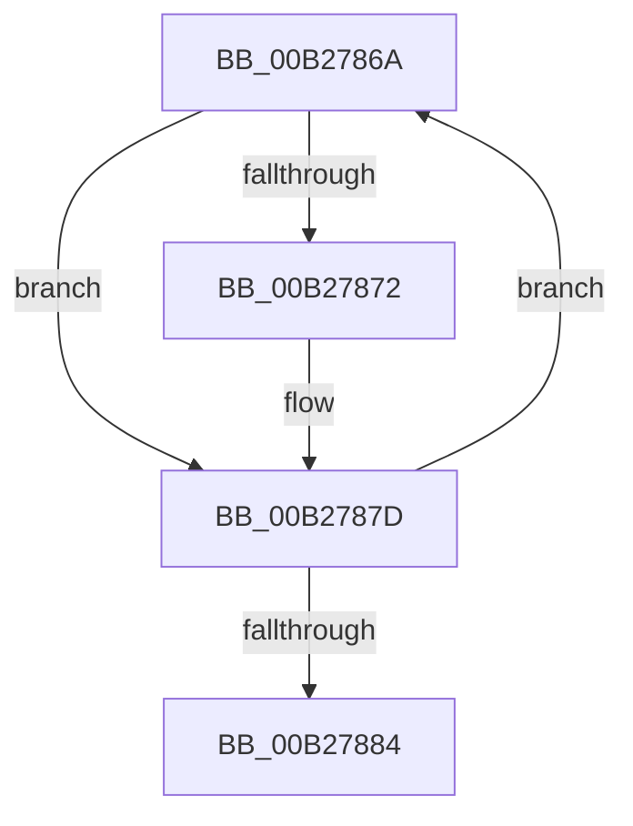

# sub_00B2786A

- RVA: `0x00B2786A`–`0x00B27889` (길이 `31` bytes)
- VA: `0x0000000140B2786A`
- 실행 섹션: `PAGE`
- PDB 이름 있음: `아니요`; PDB Function 태그: `아니요`
- unwind 정보 RVA: `0x00092B74`
- 디코드: `10`개 명령, `31/31` bytes 표시
- 미해석 바이트: `0` (있으면 어셈블리에 `.byte`로 보존)

> 이 문서는 커널 이미지의 기계어와 PDB 기호를 분석해 생성했습니다. 4번과 5번은 함수 원형과 자료형을 바이너리 사용 방식에서 추정한 C 해석이며 원본 소스 복구 결과는 아닙니다.

## 1. Dependencies

- 직접 호출 지점: **1**; 고유 호출 대상: **1**
- 직접 호출자로 확인된 함수: **0**
- RIP 상대 이미지 참조: **0**

### Outgoing calls
- `0x00B27878` → [SdbpCloseLocalDatabaseEx](../81/SdbpCloseLocalDatabaseEx_function_00817624.md) (function, `0x00817624`)

### Direct callers
- 이 함수 시작 RVA로 연결되는 직접 call은 확인되지 않았습니다. 간접 호출은 완전히 역산할 수 없습니다.

### Static image references
- 디코드된 RIP-relative 메모리 참조가 없습니다.

## 2. Other-region calls and transfers

- 다른 실행 섹션으로 향하는 call: **0**
- call이 아닌 외부 분기/꼬리 이동: **1**
  - `0x00B27884` → [SdbpCleanupLocalDatabaseSupport + 0x16](../95/SdbpCleanupLocalDatabaseSupport_function_0095B6D8.md) (`tail-transfer`)

## 3. Assembly (complete function range)

```asm
00B2786A  8B 47 24                        mov eax, dword ptr [rdi + 0x24]
00B2786D  0F A3 D8                        bt eax, ebx
00B27870  73 0B                           jae 0x140b2787d
00B27872  44 8B C3                        mov r8d, ebx
00B27875  48 8B CF                        mov rcx, rdi
00B27878  E8 A7 FD CE FF                  call 0x140817624
00B2787D  FF C3                           inc ebx
00B2787F  83 FB 10                        cmp ebx, 0x10
00B27882  72 E6                           jb 0x140b2786a
00B27884  E9 65 3E E3 FF                  jmp 0x14095b6ee
```

## 4. C-style interpretation (structured pseudocode)

```c
__int64 __fastcall sub_00B2786A(void)
{
    __int64 result;
    __int64 v_rbx;

    result = (unsigned int)(*(unsigned int *)(v_rdi + 36));
    if (!(condition_is_above_or_equal)) {
        a3 = (unsigned int)(v_rbx);
        a1 = v_rdi;
        result = SdbpCloseLocalDatabaseEx(a1, a2, a3, a4);
    }
    v_rbx = (unsigned int)((v_rbx) + 1);
    if (((unsigned int)(v_rbx)) < 16) goto loc_00B2786A;
}
```

## 5. (Beta) C Style

```c
void sub_00B2786A(void)
{
    int64_t result;
    int64_t local_rbx;

    result = (uint32_t)(*(uint32_t *)(local_rdi + 0x24));
    if (!(condition_is_above_or_equal)) {
        a3 = (uint32_t)(local_rbx);
        a1 = local_rdi;
        result = SdbpCloseLocalDatabaseEx(a1, a2, a3, a4);
    }
    local_rbx = (uint32_t)((local_rbx) + 1);
    if (((uint32_t)(local_rbx)) < 16) goto loc_00B2786A;
}
```

## 6. Execution-region graph

[열기: 2D/3D 그래프와 함수 탐색 컨트롤 패널](../../../control-panel.html?section=page&rva=0x00B2786A&view=graph)

- 2D 그래프는 위에서 아래로 흐르고, 3D 그래프는 빈 공간을 드래그해 회전합니다. Shift+드래그는 이동, 휠은 확대·축소, 함수 노드 선택은 대상 보고서 이동입니다.

### Static fallback


