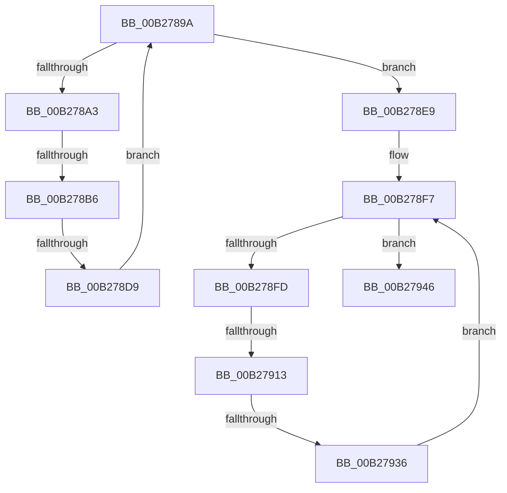

# sub_00B2789A

- RVA: `0x00B2789A`–`0x00B2794D` (길이 `179` bytes)
- VA: `0x0000000140B2789A`
- 실행 섹션: `PAGE`
- PDB 이름 있음: `아니요`; PDB Function 태그: `아니요`
- unwind 정보 RVA: `0x00092BB8`
- 디코드: `51`개 명령, `179/179` bytes 표시
- 미해석 바이트: `0` (있으면 어셈블리에 `.byte`로 보존)

> 이 문서는 커널 이미지의 기계어와 PDB 기호를 분석해 생성했습니다. 4번과 5번은 함수 원형과 자료형을 바이너리 사용 방식에서 추정한 C 해석이며 원본 소스 복구 결과는 아닙니다.

## 1. Dependencies

- 직접 호출 지점: **7**; 고유 호출 대상: **5**
- 직접 호출자로 확인된 함수: **0**
- RIP 상대 이미지 참조: **0**

### Outgoing calls
- `0x00B278A9` → [KsepDbReadKFlag](../74/KsepDbReadKFlag_function_00749404.md) (function, `0x00749404`)
- `0x00B278CC` → [KsepCacheDeviceInsertData](../74/KsepCacheDeviceInsertData_function_0074AD9C.md) (function, `0x0074AD9C`)
- `0x00B278E2` → [SdbFindNextTag](../95/SdbFindNextTag_function_0095D7F4.md) (function, `0x0095D7F4`)
- `0x00B278F2` → [SdbFindFirstTag](../95/SdbFindFirstTag_function_0095E34C.md) (function, `0x0095E34C`)
- `0x00B27906` → [KsepDbReadKData](../74/KsepDbReadKData_function_0074923C.md) (function, `0x0074923C`)
- `0x00B27929` → [KsepCacheDeviceInsertData](../74/KsepCacheDeviceInsertData_function_0074AD9C.md) (function, `0x0074AD9C`)
- `0x00B2793F` → [SdbFindNextTag](../95/SdbFindNextTag_function_0095D7F4.md) (function, `0x0095D7F4`)

### Direct callers
- 이 함수 시작 RVA로 연결되는 직접 call은 확인되지 않았습니다. 간접 호출은 완전히 역산할 수 없습니다.

### Static image references
- 디코드된 RIP-relative 메모리 참조가 없습니다.

## 2. Other-region calls and transfers

- 다른 실행 섹션으로 향하는 call: **0**
- call이 아닌 외부 분기/꼬리 이동: **5**
  - `0x00B278B0` → [KsepDbCacheReadDeviceInternal + 0x57](../95/KsepDbCacheReadDeviceInternal_function_0095B774.md) (`tail-transfer`)
  - `0x00B278D3` → [KsepDbCacheReadDeviceInternal + 0x57](../95/KsepDbCacheReadDeviceInternal_function_0095B774.md) (`tail-transfer`)
  - `0x00B2790D` → [KsepDbCacheReadDeviceInternal + 0x57](../95/KsepDbCacheReadDeviceInternal_function_0095B774.md) (`tail-transfer`)
  - `0x00B27930` → [KsepDbCacheReadDeviceInternal + 0x57](../95/KsepDbCacheReadDeviceInternal_function_0095B774.md) (`tail-transfer`)
  - `0x00B27948` → [KsepDbCacheReadDeviceInternal + 0x57](../95/KsepDbCacheReadDeviceInternal_function_0095B774.md) (`tail-transfer`)

## 3. Assembly (complete function range)

```asm
00B2789A  8B F8                           mov edi, eax
00B2789C  48 8B CB                        mov rcx, rbx
00B2789F  85 C0                           test eax, eax
00B278A1  74 46                           je 0x140b278e9
00B278A3  4C 8D 45 D0                     lea r8, [rbp - 0x30]
00B278A7  8B D0                           mov edx, eax
00B278A9  E8 56 1B C2 FF                  call 0x140749404
00B278AE  85 C0                           test eax, eax
00B278B0  0F 88 15 3F E3 FF               js 0x14095b7cb
00B278B6  8B 45 DC                        mov eax, dword ptr [rbp - 0x24]
00B278B9  49 8B CE                        mov rcx, r14
00B278BC  44 8B 4D D8                     mov r9d, dword ptr [rbp - 0x28]
00B278C0  4C 8B 45 E0                     mov r8, qword ptr [rbp - 0x20]
00B278C4  48 8B 55 D0                     mov rdx, qword ptr [rbp - 0x30]
00B278C8  89 44 24 20                     mov dword ptr [rsp + 0x20], eax
00B278CC  E8 CB 34 C2 FF                  call 0x14074ad9c
00B278D1  85 C0                           test eax, eax
00B278D3  0F 88 F2 3E E3 FF               js 0x14095b7cb
00B278D9  8B 55 C0                        mov edx, dword ptr [rbp - 0x40]
00B278DC  44 8B C7                        mov r8d, edi
00B278DF  48 8B CB                        mov rcx, rbx
00B278E2  E8 0D 5F E3 FF                  call 0x14095d7f4
00B278E7  EB B1                           jmp 0x140b2789a
00B278E9  8B 55 C0                        mov edx, dword ptr [rbp - 0x40]
00B278EC  41 B8 28 70 00 00               mov r8d, 0x7028
00B278F2  E8 55 6A E3 FF                  call 0x14095e34c
00B278F7  8B F8                           mov edi, eax
00B278F9  85 C0                           test eax, eax
00B278FB  74 49                           je 0x140b27946
00B278FD  4C 8D 45 D0                     lea r8, [rbp - 0x30]
00B27901  8B D0                           mov edx, eax
00B27903  48 8B CB                        mov rcx, rbx
00B27906  E8 31 19 C2 FF                  call 0x14074923c
00B2790B  85 C0                           test eax, eax
00B2790D  0F 88 B8 3E E3 FF               js 0x14095b7cb
00B27913  8B 45 DC                        mov eax, dword ptr [rbp - 0x24]
00B27916  49 8B CE                        mov rcx, r14
00B27919  44 8B 4D D8                     mov r9d, dword ptr [rbp - 0x28]
00B2791D  4C 8B 45 E0                     mov r8, qword ptr [rbp - 0x20]
00B27921  48 8B 55 D0                     mov rdx, qword ptr [rbp - 0x30]
00B27925  89 44 24 20                     mov dword ptr [rsp + 0x20], eax
00B27929  E8 6E 34 C2 FF                  call 0x14074ad9c
00B2792E  85 C0                           test eax, eax
00B27930  0F 88 95 3E E3 FF               js 0x14095b7cb
00B27936  8B 55 C0                        mov edx, dword ptr [rbp - 0x40]
00B27939  44 8B C7                        mov r8d, edi
00B2793C  48 8B CB                        mov rcx, rbx
00B2793F  E8 B0 5E E3 FF                  call 0x14095d7f4
00B27944  EB B1                           jmp 0x140b278f7
00B27946  33 C0                           xor eax, eax
00B27948  E9 7E 3E E3 FF                  jmp 0x14095b7cb
```

## 4. C-style interpretation (structured pseudocode)

```c
__int64 __fastcall sub_00B2789A(void)
{
    __int64 result;
    unsigned int v_stack_p20;

    if ((unsigned int)(result) == 0) goto loc_00B278E9;
    result = KsepDbReadKFlag(v_rbx, (unsigned int)((unsigned int)(result)), v_rbp - 48, a4);
    v_stack_p20 = (unsigned int)((unsigned int)(*(unsigned int *)(v_rbp - 36)));
    result = KsepCacheDeviceInsertData(v_r14, *(unsigned __int64 *)(v_rbp - 48), *(unsigned __int64 *)(v_rbp - 32), (unsigned int)(*(unsigned int *)(v_rbp - 40)));
    result = SdbFindNextTag(v_rbx, (unsigned int)(*(unsigned int *)(v_rbp - 64)), (unsigned int)((unsigned int)((unsigned int)((unsigned int)(result)))), (unsigned int)(*(unsigned int *)(v_rbp - 40)));
    goto loc_00B2789A;
loc_00B278E9:
    result = SdbFindFirstTag(v_rbx, (unsigned int)(*(unsigned int *)(v_rbp - 64)), (unsigned int)(0x7028ULL), (unsigned int)(*(unsigned int *)(v_rbp - 40)));
loc_00B278F7:
    if ((unsigned int)(result) == 0) goto loc_00B27946;
    result = KsepDbReadKData(v_rbx, (unsigned int)((unsigned int)(result)), v_rbp - 48, (unsigned int)(*(unsigned int *)(v_rbp - 40)));
    v_stack_p20 = (unsigned int)((unsigned int)(*(unsigned int *)(v_rbp - 36)));
    result = KsepCacheDeviceInsertData(v_r14, *(unsigned __int64 *)(v_rbp - 48), *(unsigned __int64 *)(v_rbp - 32), (unsigned int)(*(unsigned int *)(v_rbp - 40)));
    result = SdbFindNextTag(v_rbx, (unsigned int)(*(unsigned int *)(v_rbp - 64)), (unsigned int)((unsigned int)((unsigned int)((unsigned int)(result)))), (unsigned int)(*(unsigned int *)(v_rbp - 40)));
    goto loc_00B278F7;
loc_00B27946:
    result = 0;
}
```

## 5. (Beta) C Style

```c
void sub_00B2789A(void)
{
    int64_t result;
    uint32_t v_stack_p20;

    if ((uint32_t)(result) == 0) goto loc_00B278E9;
    result = KsepDbReadKFlag(local_rbx, (uint32_t)((uint32_t)(result)), local_rbp - 48, a4);
    v_stack_p20 = (uint32_t)((uint32_t)(*(uint32_t *)(local_rbp - 0x24)));
    result = KsepCacheDeviceInsertData(local_r14, *(uint64_t *)(local_rbp - 0x30), *(uint64_t *)(local_rbp - 0x20), (uint32_t)(*(uint32_t *)(local_rbp - 0x28)));
    result = SdbFindNextTag(local_rbx, (uint32_t)(*(uint32_t *)(local_rbp - 0x40)), (uint32_t)((uint32_t)((uint32_t)((uint32_t)(result)))), (uint32_t)(*(uint32_t *)(local_rbp - 0x28)));
    goto loc_00B2789A;
loc_00B278E9:
    result = SdbFindFirstTag(local_rbx, (uint32_t)(*(uint32_t *)(local_rbp - 0x40)), (uint32_t)(0x7028ULL), (uint32_t)(*(uint32_t *)(local_rbp - 0x28)));
loc_00B278F7:
    if ((uint32_t)(result) == 0) goto loc_00B27946;
    result = KsepDbReadKData(local_rbx, (uint32_t)((uint32_t)(result)), local_rbp - 48, (uint32_t)(*(uint32_t *)(local_rbp - 0x28)));
    v_stack_p20 = (uint32_t)((uint32_t)(*(uint32_t *)(local_rbp - 0x24)));
    result = KsepCacheDeviceInsertData(local_r14, *(uint64_t *)(local_rbp - 0x30), *(uint64_t *)(local_rbp - 0x20), (uint32_t)(*(uint32_t *)(local_rbp - 0x28)));
    result = SdbFindNextTag(local_rbx, (uint32_t)(*(uint32_t *)(local_rbp - 0x40)), (uint32_t)((uint32_t)((uint32_t)((uint32_t)(result)))), (uint32_t)(*(uint32_t *)(local_rbp - 0x28)));
    goto loc_00B278F7;
loc_00B27946:
    result = 0;
}
```

## 6. Execution-region graph

[열기: 2D/3D 그래프와 함수 탐색 컨트롤 패널](../../../control-panel.html?section=page&rva=0x00B2789A&view=graph)

- 2D 그래프는 위에서 아래로 흐르고, 3D 그래프는 빈 공간을 드래그해 회전합니다. Shift+드래그는 이동, 휠은 확대·축소, 함수 노드 선택은 대상 보고서 이동입니다.

### Static fallback


