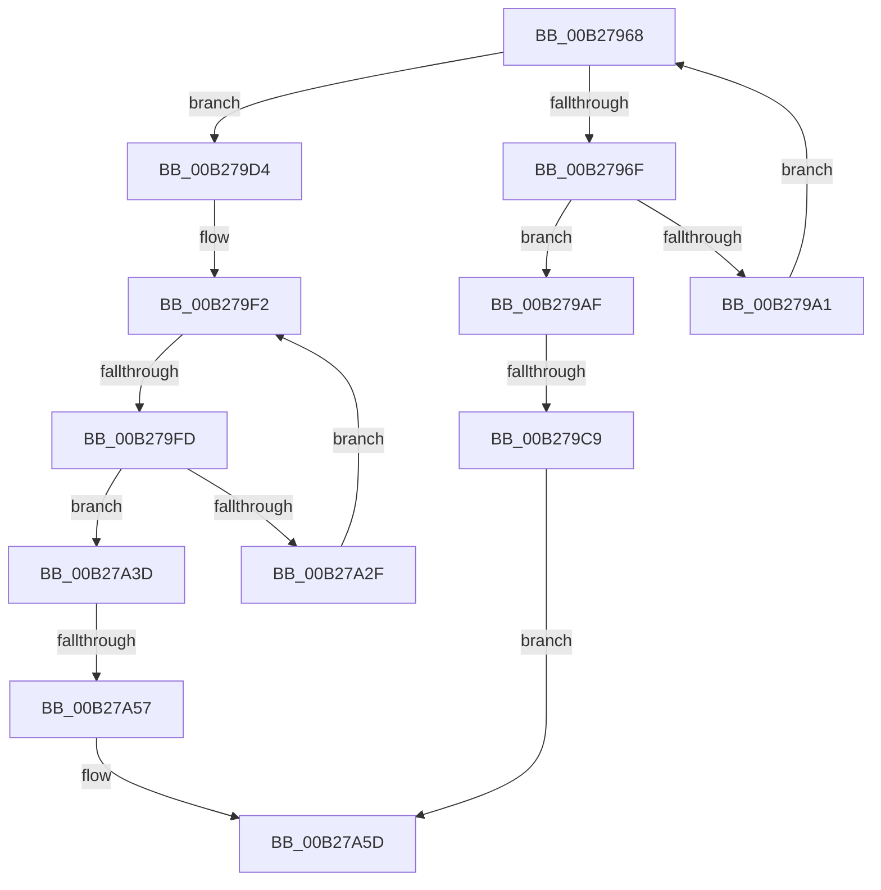

# sub_00B27968

- RVA: `0x00B27968`–`0x00B27A7B` (길이 `275` bytes)
- VA: `0x0000000140B27968`
- 실행 섹션: `PAGE`
- PDB 이름 있음: `아니요`; PDB Function 태그: `아니요`
- unwind 정보 RVA: `0x00092C3C`
- 디코드: `70`개 명령, `275/275` bytes 표시
- 미해석 바이트: `0` (있으면 어셈블리에 `.byte`로 보존)

> 이 문서는 커널 이미지의 기계어와 PDB 기호를 분석해 생성했습니다. 4번과 5번은 함수 원형과 자료형을 바이너리 사용 방식에서 추정한 C 해석이며 원본 소스 복구 결과는 아닙니다.

## 1. Dependencies

- 직접 호출 지점: **8**; 고유 호출 대상: **6**
- 직접 호출자로 확인된 함수: **0**
- RIP 상대 이미지 참조: **2**

### Outgoing calls
- `0x00B27998` → [SdbpCheckKObject](../95/SdbpCheckKObject_function_00959F04.md) (function, `0x00959F04`)
- `0x00B279A8` → [SdbpFindNextTagWithoutIndex](../81/SdbpFindNextTagWithoutIndex_function_00815784.md) (function, `0x00815784`)
- `0x00B279BC` → [SdbTagIDToTagRef](../81/SdbTagIDToTagRef_function_0081710C.md) (function, `0x0081710C`)
- `0x00B279ED` → [SdbpFindFirstWildcardTagWithoutIndex](../81/SdbpFindFirstWildcardTagWithoutIndex_function_008156C8.md) (function, `0x008156C8`)
- `0x00B27A26` → [SdbpCheckKObject](../95/SdbpCheckKObject_function_00959F04.md) (function, `0x00959F04`)
- `0x00B27A36` → [SdbpFindNextWildcardTagWithoutIndex](../81/SdbpFindNextWildcardTagWithoutIndex_function_00815800.md) (function, `0x00815800`)
- `0x00B27A4A` → [SdbTagIDToTagRef](../81/SdbTagIDToTagRef_function_0081710C.md) (function, `0x0081710C`)
- `0x00B27A70` → [AslLogCallPrintf](../95/AslLogCallPrintf_function_0095E4EC.md) (function, `0x0095E4EC`)

### Direct callers
- 이 함수 시작 RVA로 연결되는 직접 call은 확인되지 않았습니다. 간접 호출은 완전히 역산할 수 없습니다.

### Static image references
- `0x00B27A5D` → RVA `0x0003CFB8` (`.rdata`; read)
- `0x00B27A69` → RVA `0x0003CFA0` (`.rdata`; read)

## 2. Other-region calls and transfers

- 다른 실행 섹션으로 향하는 call: **0**
- call이 아닌 외부 분기/꼬리 이동: **4**
  - `0x00B279C3` → [SdbGetDatabaseMatchEx + 0xB1](../95/SdbGetDatabaseMatchEx_function_0095BD7C.md) (`tail-transfer`)
  - `0x00B279F7` → [SdbGetDatabaseMatchEx + 0x5F](../95/SdbGetDatabaseMatchEx_function_0095BD7C.md) (`tail-transfer`)
  - `0x00B27A51` → [SdbGetDatabaseMatchEx + 0xB1](../95/SdbGetDatabaseMatchEx_function_0095BD7C.md) (`tail-transfer`)
  - `0x00B27A76` → [SdbGetDatabaseMatchEx + 0xB1](../95/SdbGetDatabaseMatchEx_function_0095BD7C.md) (`tail-transfer`)

## 3. Assembly (complete function range)

```asm
00B27968  44 8B F0                        mov r14d, eax
00B2796B  85 C0                           test eax, eax
00B2796D  74 65                           je 0x140b279d4
00B2796F  48 8B 45 58                     mov rax, qword ptr [rbp + 0x58]
00B27973  4D 8B CC                        mov r9, r12
00B27976  4C 89 6C 24 38                  mov qword ptr [rsp + 0x38], r13
00B2797B  45 8B C6                        mov r8d, r14d
00B2797E  48 89 44 24 30                  mov qword ptr [rsp + 0x30], rax
00B27983  48 8B D7                        mov rdx, rdi
00B27986  48 8B 45 50                     mov rax, qword ptr [rbp + 0x50]
00B2798A  48 8B CE                        mov rcx, rsi
00B2798D  48 89 44 24 28                  mov qword ptr [rsp + 0x28], rax
00B27992  48 83 4C 24 20 FF               or qword ptr [rsp + 0x20], 0xffffffffffffffff
00B27998  E8 67 25 E3 FF                  call 0x140959f04
00B2799D  85 C0                           test eax, eax
00B2799F  75 0E                           jne 0x140b279af
00B279A1  48 8D 55 D0                     lea rdx, [rbp - 0x30]
00B279A5  48 8B CF                        mov rcx, rdi
00B279A8  E8 D7 DD CE FF                  call 0x140815784
00B279AD  EB B9                           jmp 0x140b27968
00B279AF  4C 8D 4D 38                     lea r9, [rbp + 0x38]
00B279B3  45 8B C6                        mov r8d, r14d
00B279B6  48 8B D7                        mov rdx, rdi
00B279B9  48 8B CE                        mov rcx, rsi
00B279BC  E8 4B F7 CE FF                  call 0x14081710c
00B279C1  85 C0                           test eax, eax
00B279C3  0F 85 64 44 E3 FF               jne 0x14095be2d
00B279C9  41 B8 93 1A 00 00               mov r8d, 0x1a93
00B279CF  E9 89 00 00 00                  jmp 0x140b27a5d
00B279D4  48 8D 45 D0                     lea rax, [rbp - 0x30]
00B279D8  41 B8 0B 60 00 00               mov r8d, 0x600b
00B279DE  4C 8B CB                        mov r9, rbx
00B279E1  48 89 44 24 20                  mov qword ptr [rsp + 0x20], rax
00B279E6  41 0F B7 D7                     movzx edx, r15w
00B279EA  48 8B CF                        mov rcx, rdi
00B279ED  E8 D6 DC CE FF                  call 0x1408156c8
00B279F2  44 8B F0                        mov r14d, eax
00B279F5  85 C0                           test eax, eax
00B279F7  0F 84 DE 43 E3 FF               je 0x14095bddb
00B279FD  48 8B 45 58                     mov rax, qword ptr [rbp + 0x58]
00B27A01  4D 8B CC                        mov r9, r12
00B27A04  4C 89 6C 24 38                  mov qword ptr [rsp + 0x38], r13
00B27A09  45 8B C6                        mov r8d, r14d
00B27A0C  48 89 44 24 30                  mov qword ptr [rsp + 0x30], rax
00B27A11  48 8B D7                        mov rdx, rdi
00B27A14  48 8B 45 50                     mov rax, qword ptr [rbp + 0x50]
00B27A18  48 8B CE                        mov rcx, rsi
00B27A1B  48 89 44 24 28                  mov qword ptr [rsp + 0x28], rax
00B27A20  48 83 4C 24 20 FF               or qword ptr [rsp + 0x20], 0xffffffffffffffff
00B27A26  E8 D9 24 E3 FF                  call 0x140959f04
00B27A2B  85 C0                           test eax, eax
00B27A2D  75 0E                           jne 0x140b27a3d
00B27A2F  48 8D 55 D0                     lea rdx, [rbp - 0x30]
00B27A33  48 8B CF                        mov rcx, rdi
00B27A36  E8 C5 DD CE FF                  call 0x140815800
00B27A3B  EB B5                           jmp 0x140b279f2
00B27A3D  4C 8D 4D 38                     lea r9, [rbp + 0x38]
00B27A41  45 8B C6                        mov r8d, r14d
00B27A44  48 8B D7                        mov rdx, rdi
00B27A47  48 8B CE                        mov rcx, rsi
00B27A4A  E8 BD F6 CE FF                  call 0x14081710c
00B27A4F  85 C0                           test eax, eax
00B27A51  0F 85 D6 43 E3 FF               jne 0x14095be2d
00B27A57  41 B8 A9 1A 00 00               mov r8d, 0x1aa9
00B27A5D  4C 8D 0D 54 55 51 FF            lea r9, [rip - 0xaeaaac]
00B27A64  B9 01 00 00 00                  mov ecx, 1
00B27A69  48 8D 15 30 55 51 FF            lea rdx, [rip - 0xaeaad0]
00B27A70  E8 77 6A E3 FF                  call 0x14095e4ec
00B27A75  90                              nop
00B27A76  E9 B2 43 E3 FF                  jmp 0x14095be2d
```

## 4. C-style interpretation (structured pseudocode)

```c
__int64 __fastcall sub_00B27968(void)
{
    __int64 result;
    unsigned __int64 v_stack_p20;
    unsigned __int64 v_stack_p28;
    unsigned __int64 v_stack_p30;
    unsigned __int64 v_stack_p38;

    if ((unsigned int)(result) == 0) goto loc_00B279D4;
    v_stack_p38 = v_r13;
    v_stack_p30 = *(unsigned __int64 *)(v_rbp + 88);
    v_stack_p28 = *(unsigned __int64 *)(v_rbp + 80);
    result = SdbpCheckKObject(v_rsi, v_rdi, (unsigned int)((unsigned int)((unsigned int)((unsigned int)(result)))), v_r12);
    if ((unsigned int)(result) != 0) goto loc_00B279AF;
    result = SdbpFindNextTagWithoutIndex(v_rdi, v_rbp - 48, (unsigned int)((unsigned int)((unsigned int)((unsigned int)(result)))), v_r12);
    goto loc_00B27968;
loc_00B279AF:
    result = SdbTagIDToTagRef(v_rsi, v_rdi, (unsigned int)((unsigned int)((unsigned int)((unsigned int)(result)))), v_rbp + 56);
    goto loc_00B27A5D;
loc_00B279D4:
    v_stack_p20 = v_rbp - 48;
    result = SdbpFindFirstWildcardTagWithoutIndex(v_rdi, (unsigned __int16)(v_r15), (unsigned int)(0x600BULL), v_rbx);
loc_00B279F2:
    v_stack_p38 = v_r13;
    v_stack_p30 = *(unsigned __int64 *)(v_rbp + 88);
    v_stack_p28 = *(unsigned __int64 *)(v_rbp + 80);
    result = SdbpCheckKObject(v_rsi, v_rdi, (unsigned int)((unsigned int)((unsigned int)((unsigned int)(result)))), v_r12);
    if ((unsigned int)(result) != 0) goto loc_00B27A3D;
    result = SdbpFindNextWildcardTagWithoutIndex(v_rdi, v_rbp - 48, (unsigned int)((unsigned int)((unsigned int)((unsigned int)(result)))), v_r12);
    goto loc_00B279F2;
loc_00B27A3D:
    result = SdbTagIDToTagRef(v_rsi, v_rdi, (unsigned int)((unsigned int)((unsigned int)((unsigned int)(result)))), v_rbp + 56);
loc_00B27A5D:
    result = AslLogCallPrintf(1, v_rip - 11446992, (unsigned int)(0x1AA9ULL), v_rip - 11446956);
}
```

## 5. (Beta) C Style

```c
void sub_00B27968(void)
{
    int64_t result;
    uint64_t v_stack_p20;
    uint64_t v_stack_p28;
    uint64_t v_stack_p30;
    uint64_t v_stack_p38;

    if ((uint32_t)(result) == 0) goto loc_00B279D4;
    v_stack_p38 = local_r13;
    v_stack_p30 = *(uint64_t *)(local_rbp + 0x58);
    v_stack_p28 = *(uint64_t *)(local_rbp + 0x50);
    result = SdbpCheckKObject(local_rsi, local_rdi, (uint32_t)((uint32_t)((uint32_t)((uint32_t)(result)))), local_r12);
    if ((uint32_t)(result) != 0) goto loc_00B279AF;
    result = SdbpFindNextTagWithoutIndex(local_rdi, local_rbp - 48, (uint32_t)((uint32_t)((uint32_t)((uint32_t)(result)))), local_r12);
    goto loc_00B27968;
loc_00B279AF:
    result = SdbTagIDToTagRef(local_rsi, local_rdi, (uint32_t)((uint32_t)((uint32_t)((uint32_t)(result)))), local_rbp + 56);
    goto loc_00B27A5D;
loc_00B279D4:
    v_stack_p20 = local_rbp - 48;
    result = SdbpFindFirstWildcardTagWithoutIndex(local_rdi, (uint16_t)(local_r15), (uint32_t)(0x600BULL), local_rbx);
loc_00B279F2:
    v_stack_p38 = local_r13;
    v_stack_p30 = *(uint64_t *)(local_rbp + 0x58);
    v_stack_p28 = *(uint64_t *)(local_rbp + 0x50);
    result = SdbpCheckKObject(local_rsi, local_rdi, (uint32_t)((uint32_t)((uint32_t)((uint32_t)(result)))), local_r12);
    if ((uint32_t)(result) != 0) goto loc_00B27A3D;
    result = SdbpFindNextWildcardTagWithoutIndex(local_rdi, local_rbp - 48, (uint32_t)((uint32_t)((uint32_t)((uint32_t)(result)))), local_r12);
    goto loc_00B279F2;
loc_00B27A3D:
    result = SdbTagIDToTagRef(local_rsi, local_rdi, (uint32_t)((uint32_t)((uint32_t)((uint32_t)(result)))), local_rbp + 56);
loc_00B27A5D:
    result = AslLogCallPrintf(1, v_rip - 11446992, (uint32_t)(0x1AA9ULL), v_rip - 11446956);
}
```

## 6. Execution-region graph

[열기: 2D/3D 그래프와 함수 탐색 컨트롤 패널](../../../control-panel.html?section=page&rva=0x00B27968&view=graph)

- 2D 그래프는 위에서 아래로 흐르고, 3D 그래프는 빈 공간을 드래그해 회전합니다. Shift+드래그는 이동, 휠은 확대·축소, 함수 노드 선택은 대상 보고서 이동입니다.

### Static fallback


