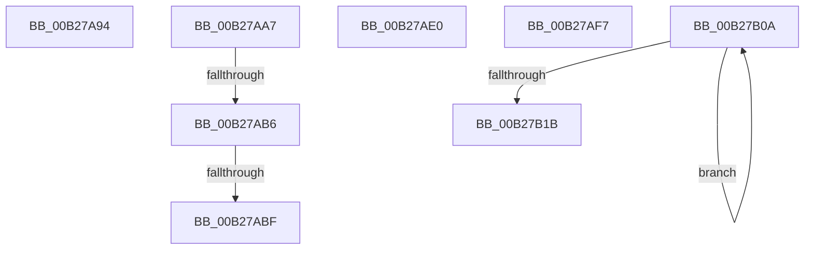

# sub_00B27A94

- RVA: `0x00B27A94`–`0x00B27B2E` (길이 `154` bytes)
- VA: `0x0000000140B27A94`
- 실행 섹션: `PAGE`
- PDB 이름 있음: `아니요`; PDB Function 태그: `아니요`
- unwind 정보 RVA: `0x00092D3C`
- 디코드: `39`개 명령, `154/154` bytes 표시
- 미해석 바이트: `0` (있으면 어셈블리에 `.byte`로 보존)

> 이 문서는 커널 이미지의 기계어와 PDB 기호를 분석해 생성했습니다. 4번과 5번은 함수 원형과 자료형을 바이너리 사용 방식에서 추정한 C 해석이며 원본 소스 복구 결과는 아닙니다.

## 1. Dependencies

- 직접 호출 지점: **8**; 고유 호출 대상: **6**
- 직접 호출자로 확인된 함수: **0**
- RIP 상대 이미지 참조: **0**

### Outgoing calls
- `0x00B27A9C` → [memset](../../text/6C/memset_function_006C6C40.md) (function, `0x006C6C40`)
- `0x00B27AD5` → [EtwpCoverageSamplerFreeTable](../A8/EtwpCoverageSamplerFreeTable_function_00A878A4.md) (function, `0x00A878A4`)
- `0x00B27AE7` → [KeAbPostRelease](../../text/2E/KeAbPostRelease_function_002E1600.md) (function, `0x002E1600`)
- `0x00B27AEC` → [KeLeaveCriticalRegion](../../text/25/KeLeaveCriticalRegion_function_0025D8B0.md) (function, `0x0025D8B0`)
- `0x00B27AFA` → [KeAbPostRelease](../../text/2E/KeAbPostRelease_function_002E1600.md) (function, `0x002E1600`)
- `0x00B27AFF` → [KeLeaveCriticalRegion](../../text/25/KeLeaveCriticalRegion_function_0025D8B0.md) (function, `0x0025D8B0`)
- `0x00B27B0D` → [EtwpCovSampModuleNameInfoCleanup](../97/EtwpCovSampModuleNameInfoCleanup_function_0097D96C.md) (function, `0x0097D96C`)
- `0x00B27B23` → [ExFreePoolWithTag](../../poolcode/B8/ExFreePoolWithTag_function_00B82870.md) (function, `0x00B82870`)

### Direct callers
- 이 함수 시작 RVA로 연결되는 직접 call은 확인되지 않았습니다. 간접 호출은 완전히 역산할 수 없습니다.

### Static image references
- 디코드된 RIP-relative 메모리 참조가 없습니다.

## 2. Other-region calls and transfers

- 다른 실행 섹션으로 향하는 call: **6**
  - `0x00B27A9C` → [memset](../../text/6C/memset_function_006C6C40.md) (`PAGE` → `.text`)
  - `0x00B27AE7` → [KeAbPostRelease](../../text/2E/KeAbPostRelease_function_002E1600.md) (`PAGE` → `.text`)
  - `0x00B27AEC` → [KeLeaveCriticalRegion](../../text/25/KeLeaveCriticalRegion_function_0025D8B0.md) (`PAGE` → `.text`)
  - `0x00B27AFA` → [KeAbPostRelease](../../text/2E/KeAbPostRelease_function_002E1600.md) (`PAGE` → `.text`)
  - `0x00B27AFF` → [KeLeaveCriticalRegion](../../text/25/KeLeaveCriticalRegion_function_0025D8B0.md) (`PAGE` → `.text`)
  - `0x00B27B23` → [ExFreePoolWithTag](../../poolcode/B8/ExFreePoolWithTag_function_00B82870.md) (`PAGE` → `POOLCODE`)
- call이 아닌 외부 분기/꼬리 이동: **7**
  - `0x00B27AA2` → [EtwpCoverageSamplerQuery + 0x42A](../95/EtwpCoverageSamplerQuery_function_0095C4A0.md) (`tail-transfer`)
  - `0x00B27AB0` → [EtwpCoverageSamplerQuery + 0x35A](../95/EtwpCoverageSamplerQuery_function_0095C4A0.md) (`tail-transfer`)
  - `0x00B27AB9` → [EtwpCoverageSamplerQuery + 0x35A](../95/EtwpCoverageSamplerQuery_function_0095C4A0.md) (`tail-transfer`)
  - `0x00B27ADB` → [EtwpCoverageSamplerQuery + 0xBCD](../95/EtwpCoverageSamplerQuery_function_0095C4A0.md) (`tail-transfer`)
  - `0x00B27AF2` → [EtwpCoverageSamplerQuery + 0xC51](../95/EtwpCoverageSamplerQuery_function_0095C4A0.md) (`tail-transfer`)
  - `0x00B27B05` → [EtwpCoverageSamplerQuery + 0xC67](../95/EtwpCoverageSamplerQuery_function_0095C4A0.md) (`tail-transfer`)
  - `0x00B27B29` → [EtwpCoverageSamplerQuery + 0xC70](../95/EtwpCoverageSamplerQuery_function_0095C4A0.md) (`tail-transfer`)

## 3. Assembly (complete function range)

```asm
00B27A94  4C 8B C7                        mov r8, rdi
00B27A97  33 D2                           xor edx, edx
00B27A99  48 8B C8                        mov rcx, rax
00B27A9C  E8 9F F1 B9 FF                  call 0x1406c6c40
00B27AA1  90                              nop
00B27AA2  E9 23 4E E3 FF                  jmp 0x14095c8ca
00B27AA7  49 8B 44 24 08                  mov rax, qword ptr [r12 + 8]
00B27AAC  4C 39 67 08                     cmp qword ptr [rdi + 8], r12
00B27AB0  0F 85 44 4D E3 FF               jne 0x14095c7fa
00B27AB6  4C 39 20                        cmp qword ptr [rax], r12
00B27AB9  0F 85 3B 4D E3 FF               jne 0x14095c7fa
00B27ABF  48 89 38                        mov qword ptr [rax], rdi
00B27AC2  48 89 47 08                     mov qword ptr [rdi + 8], rax
00B27AC6  B8 FF FF FF FF                  mov eax, 0xffffffff
00B27ACB  41 01 86 A0 06 00 00            add dword ptr [r14 + 0x6a0], eax
00B27AD2  49 8B CC                        mov rcx, r12
00B27AD5  E8 CA FD F5 FF                  call 0x140a878a4
00B27ADA  90                              nop
00B27ADB  E9 8D 55 E3 FF                  jmp 0x14095d06d
00B27AE0  49 8D 8D 98 04 00 00            lea rcx, [r13 + 0x498]
00B27AE7  E8 14 9B 7B FF                  call 0x1402e1600
00B27AEC  E8 BF 5D 73 FF                  call 0x14025d8b0
00B27AF1  90                              nop
00B27AF2  E9 FA 55 E3 FF                  jmp 0x14095d0f1
00B27AF7  49 8B CE                        mov rcx, r14
00B27AFA  E8 01 9B 7B FF                  call 0x1402e1600
00B27AFF  E8 AC 5D 73 FF                  call 0x14025d8b0
00B27B04  90                              nop
00B27B05  E9 FD 55 E3 FF                  jmp 0x14095d107
00B27B0A  48 8B CB                        mov rcx, rbx
00B27B0D  E8 5A 5E E5 FF                  call 0x14097d96c
00B27B12  48 83 C3 08                     add rbx, 8
00B27B16  49 2B F7                        sub rsi, r15
00B27B19  75 EF                           jne 0x140b27b0a
00B27B1B  BA 45 74 77 56                  mov edx, 0x56777445
00B27B20  49 8B CC                        mov rcx, r12
00B27B23  E8 48 AD 05 00                  call 0x140b82870
00B27B28  90                              nop
00B27B29  E9 E2 55 E3 FF                  jmp 0x14095d110
```

## 4. C-style interpretation (structured pseudocode)

```c
__int64 __fastcall sub_00B27A94(__int64 a1, int a2)
{
    __int64 result;

    a2 = 0;
    result = memset(result, a2, v_rdi, a4);
}
```

## 5. (Beta) C Style

```c
int64_t sub_00B27A94(int64_t Arg1, int32_t Arg2)
{
    int64_t result;

    Arg2 = 0;
    result = memset(result, Arg2, local_rdi, a4);
}
```

## 6. Execution-region graph

[열기: 2D/3D 그래프와 함수 탐색 컨트롤 패널](../../../control-panel.html?section=page&rva=0x00B27A94&view=graph)

- 2D 그래프는 위에서 아래로 흐르고, 3D 그래프는 빈 공간을 드래그해 회전합니다. Shift+드래그는 이동, 휠은 확대·축소, 함수 노드 선택은 대상 보고서 이동입니다.

### Static fallback


