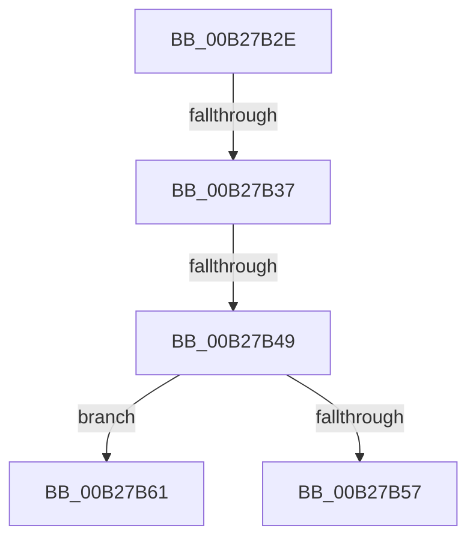

# sub_00B27B2E

- RVA: `0x00B27B2E`–`0x00B27B71` (길이 `67` bytes)
- VA: `0x0000000140B27B2E`
- 실행 섹션: `PAGE`
- PDB 이름 있음: `아니요`; PDB Function 태그: `아니요`
- unwind 정보 RVA: `0x00092D80`
- 디코드: `16`개 명령, `67/67` bytes 표시
- 미해석 바이트: `0` (있으면 어셈블리에 `.byte`로 보존)

> 이 문서는 커널 이미지의 기계어와 PDB 기호를 분석해 생성했습니다. 4번과 5번은 함수 원형과 자료형을 바이너리 사용 방식에서 추정한 C 해석이며 원본 소스 복구 결과는 아닙니다.

## 1. Dependencies

- 직접 호출 지점: **2**; 고유 호출 대상: **2**
- 직접 호출자로 확인된 함수: **0**
- RIP 상대 이미지 참조: **0**

### Outgoing calls
- `0x00B27B3A` → [ExCheckFullProcessInformationAccess](../95/ExCheckFullProcessInformationAccess_function_0095D93C.md) (function, `0x0095D93C`)
- `0x00B27B65` → [EtwpCoverageSamplerQueryStatusInformation](../7C/EtwpCoverageSamplerQueryStatusInformation_function_007C2058.md) (function, `0x007C2058`)

### Direct callers
- 이 함수 시작 RVA로 연결되는 직접 call은 확인되지 않았습니다. 간접 호출은 완전히 역산할 수 없습니다.

### Static image references
- 디코드된 RIP-relative 메모리 참조가 없습니다.

## 2. Other-region calls and transfers

- 다른 실행 섹션으로 향하는 call: **0**
- call이 아닌 외부 분기/꼬리 이동: **4**
  - `0x00B27B31` → [EtwpQueryCoverageSamplerInformation + 0x109](../95/EtwpQueryCoverageSamplerInformation_function_0095D2D8.md) (`tail-transfer`)
  - `0x00B27B43` → [EtwpQueryCoverageSamplerInformation + 0xD9](../95/EtwpQueryCoverageSamplerInformation_function_0095D2D8.md) (`tail-transfer`)
  - `0x00B27B5C` → [EtwpQueryCoverageSamplerInformation + 0xD9](../95/EtwpQueryCoverageSamplerInformation_function_0095D2D8.md) (`tail-transfer`)
  - `0x00B27B6C` → [EtwpQueryCoverageSamplerInformation + 0xD9](../95/EtwpQueryCoverageSamplerInformation_function_0095D2D8.md) (`tail-transfer`)

## 3. Assembly (complete function range)

```asm
00B27B2E  40 84 F6                        test sil, sil
00B27B31  0F 84 AA 58 E3 FF               je 0x14095d3e1
00B27B37  40 8A CE                        mov cl, sil
00B27B3A  E8 FD 5D E3 FF                  call 0x14095d93c
00B27B3F  8B D8                           mov ebx, eax
00B27B41  85 C0                           test eax, eax
00B27B43  0F 88 68 58 E3 FF               js 0x14095d3b1
00B27B49  41 C7 04 24 18 00 00 00         mov dword ptr [r12], 0x18
00B27B51  41 83 FF 18                     cmp r15d, 0x18
00B27B55  73 0A                           jae 0x140b27b61
00B27B57  BB 23 00 00 C0                  mov ebx, 0xc0000023
00B27B5C  E9 50 58 E3 FF                  jmp 0x14095d3b1
00B27B61  49 8D 4E 10                     lea rcx, [r14 + 0x10]
00B27B65  E8 EE A4 C9 FF                  call 0x1407c2058
00B27B6A  8B D8                           mov ebx, eax
00B27B6C  E9 40 58 E3 FF                  jmp 0x14095d3b1
```

## 4. C-style interpretation (structured pseudocode)

```c
__int64 __fastcall sub_00B27B2E(void)
{
    __int64 result;

    result = ExCheckFullProcessInformationAccess((unsigned __int8)(v_rsi), a2, a3, a4);
    *(unsigned int *)(v_r12) = 24;
    if (((unsigned int)(v_r15)) >= 24) goto loc_00B27B61;
loc_00B27B61:
    result = EtwpCoverageSamplerQueryStatusInformation(v_r14 + 16, a2, a3, a4);
}
```

## 5. (Beta) C Style

```c
void sub_00B27B2E(void)
{
    int64_t result;

    result = ExCheckFullProcessInformationAccess((uint8_t)(local_rsi), a2, a3, a4);
    *(uint32_t *)(local_r12) = 24;
    if (((uint32_t)(local_r15)) >= 24) goto loc_00B27B61;
loc_00B27B61:
    result = EtwpCoverageSamplerQueryStatusInformation(local_r14 + 16, a2, a3, a4);
}
```

## 6. Execution-region graph

[열기: 2D/3D 그래프와 함수 탐색 컨트롤 패널](../../../control-panel.html?section=page&rva=0x00B27B2E&view=graph)

- 2D 그래프는 위에서 아래로 흐르고, 3D 그래프는 빈 공간을 드래그해 회전합니다. Shift+드래그는 이동, 휠은 확대·축소, 함수 노드 선택은 대상 보고서 이동입니다.

### Static fallback


