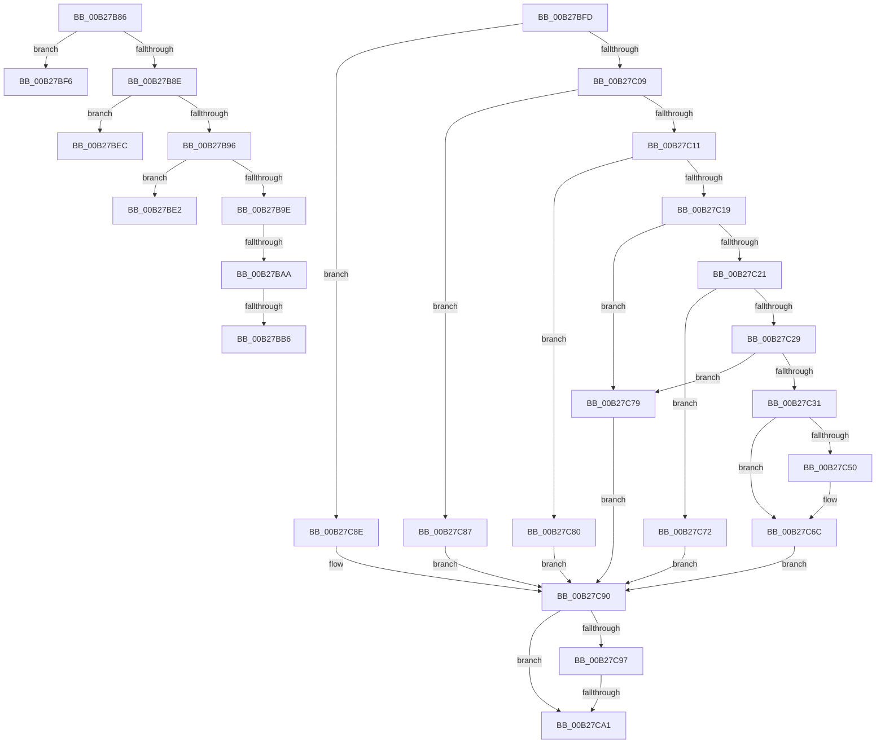

# sub_00B27B86

- RVA: `0x00B27B86`–`0x00B27CC5` (길이 `319` bytes)
- VA: `0x0000000140B27B86`
- 실행 섹션: `PAGE`
- PDB 이름 있음: `아니요`; PDB Function 태그: `아니요`
- unwind 정보 RVA: `0x00092EE8`
- 디코드: `72`개 명령, `319/319` bytes 표시
- 미해석 바이트: `0` (있으면 어셈블리에 `.byte`로 보존)

> 이 문서는 커널 이미지의 기계어와 PDB 기호를 분석해 생성했습니다. 4번과 5번은 함수 원형과 자료형을 바이너리 사용 방식에서 추정한 C 해석이며 원본 소스 복구 결과는 아닙니다.

## 1. Dependencies

- 직접 호출 지점: **4**; 고유 호출 대상: **2**
- 직접 호출자로 확인된 함수: **0**
- RIP 상대 이미지 참조: **3**

### Outgoing calls
- `0x00B27BD3` → [AslLogCallPrintf](../95/AslLogCallPrintf_function_0095E4EC.md) (function, `0x0095E4EC`)
- `0x00B27C47` → [SdbpReadMappedData](../95/SdbpReadMappedData_function_0095E460.md) (function, `0x0095E460`)
- `0x00B27C67` → [AslLogCallPrintf](../95/AslLogCallPrintf_function_0095E4EC.md) (function, `0x0095E4EC`)
- `0x00B27CBA` → [AslLogCallPrintf](../95/AslLogCallPrintf_function_0095E4EC.md) (function, `0x0095E4EC`)

### Direct callers
- 이 함수 시작 RVA로 연결되는 직접 call은 확인되지 않았습니다. 간접 호출은 완전히 역산할 수 없습니다.

### Static image references
- `0x00B27BB6` → RVA `0x0003D370` (`.rdata`; read)
- `0x00B27BC7` → RVA `0x00012588` (`.rdata`; read)
- `0x00B27C50` → RVA `0x0003D358` (`.rdata`; read)

## 2. Other-region calls and transfers

- 다른 실행 섹션으로 향하는 call: **0**
- call이 아닌 외부 분기/꼬리 이동: **8**
  - `0x00B27BA4` → [SdbGetTagDataSize + 0x3F](../95/SdbGetTagDataSize_function_0095E230.md) (`tail-transfer`)
  - `0x00B27BB0` → [SdbGetTagDataSize + 0x3F](../95/SdbGetTagDataSize_function_0095E230.md) (`tail-transfer`)
  - `0x00B27BDD` → [SdbGetTagDataSize + 0x75](../95/SdbGetTagDataSize_function_0095E230.md) (`tail-transfer`)
  - `0x00B27BE7` → [SdbGetTagDataSize + 0x66](../95/SdbGetTagDataSize_function_0095E230.md) (`tail-transfer`)
  - `0x00B27BF1` → [SdbGetTagDataSize + 0x66](../95/SdbGetTagDataSize_function_0095E230.md) (`tail-transfer`)
  - `0x00B27BF8` → [SdbGetTagDataSize + 0x66](../95/SdbGetTagDataSize_function_0095E230.md) (`tail-transfer`)
  - `0x00B27C9B` → [SdbGetTagDataSize + 0x73](../95/SdbGetTagDataSize_function_0095E230.md) (`tail-transfer`)
  - `0x00B27CC0` → [SdbGetTagDataSize + 0xB2](../95/SdbGetTagDataSize_function_0095E230.md) (`tail-transfer`)

## 3. Assembly (complete function range)

```asm
00B27B86  81 FB 00 10 00 00               cmp ebx, 0x1000
00B27B8C  74 68                           je 0x140b27bf6
00B27B8E  81 FB 00 20 00 00               cmp ebx, 0x2000
00B27B94  74 56                           je 0x140b27bec
00B27B96  81 FB 00 50 00 00               cmp ebx, 0x5000
00B27B9C  74 44                           je 0x140b27be2
00B27B9E  81 FB 00 70 00 00               cmp ebx, 0x7000
00B27BA4  0F 84 C5 66 E3 FF               je 0x14095e26f
00B27BAA  81 FB 00 80 00 00               cmp ebx, 0x8000
00B27BB0  0F 84 B9 66 E3 FF               je 0x14095e26f
00B27BB6  4C 8D 0D B3 57 51 FF            lea r9, [rip - 0xaea84d]
00B27BBD  89 6C 24 20                     mov dword ptr [rsp + 0x20], ebp
00B27BC1  41 B8 3E 01 00 00               mov r8d, 0x13e
00B27BC7  48 8D 15 BA A9 4E FF            lea rdx, [rip - 0xb15646]
00B27BCE  B9 01 00 00 00                  mov ecx, 1
00B27BD3  E8 14 69 E3 FF                  call 0x14095e4ec
00B27BD8  B8 00 00 00 20                  mov eax, 0x20000000
00B27BDD  E9 C3 66 E3 FF                  jmp 0x14095e2a5
00B27BE2  BB 08 00 00 00                  mov ebx, 8
00B27BE7  E9 AA 66 E3 FF                  jmp 0x14095e296
00B27BEC  BB 01 00 00 00                  mov ebx, 1
00B27BF1  E9 A0 66 E3 FF                  jmp 0x14095e296
00B27BF6  33 DB                           xor ebx, ebx
00B27BF8  E9 99 66 E3 FF                  jmp 0x14095e296
00B27BFD  81 FB 00 10 00 00               cmp ebx, 0x1000
00B27C03  0F 84 85 00 00 00               je 0x140b27c8e
00B27C09  81 FB 00 20 00 00               cmp ebx, 0x2000
00B27C0F  74 76                           je 0x140b27c87
00B27C11  81 FB 00 30 00 00               cmp ebx, 0x3000
00B27C17  74 67                           je 0x140b27c80
00B27C19  81 FB 00 40 00 00               cmp ebx, 0x4000
00B27C1F  74 58                           je 0x140b27c79
00B27C21  81 FB 00 50 00 00               cmp ebx, 0x5000
00B27C27  74 49                           je 0x140b27c72
00B27C29  81 FB 00 60 00 00               cmp ebx, 0x6000
00B27C2F  74 48                           je 0x140b27c79
00B27C31  83 64 24 48 00                  and dword ptr [rsp + 0x48], 0
00B27C36  8D 56 02                        lea edx, [rsi + 2]
00B27C39  41 B9 04 00 00 00               mov r9d, 4
00B27C3F  4C 8D 44 24 48                  lea r8, [rsp + 0x48]
00B27C44  49 8B CE                        mov rcx, r14
00B27C47  E8 14 68 E3 FF                  call 0x14095e460
00B27C4C  85 C0                           test eax, eax
00B27C4E  75 1C                           jne 0x140b27c6c
00B27C50  4C 8D 0D 01 57 51 FF            lea r9, [rip - 0xaea8ff]
00B27C57  41 B8 6C 01 00 00               mov r8d, 0x16c
00B27C5D  48 8D 15 24 A9 4E FF            lea rdx, [rip - 0xb156dc]
00B27C64  8D 48 01                        lea ecx, [rax + 1]
00B27C67  E8 80 68 E3 FF                  call 0x14095e4ec
00B27C6C  8B 5C 24 48                     mov ebx, dword ptr [rsp + 0x48]
00B27C70  EB 1E                           jmp 0x140b27c90
00B27C72  BB 08 00 00 00                  mov ebx, 8
00B27C77  EB 17                           jmp 0x140b27c90
00B27C79  BB 04 00 00 00                  mov ebx, 4
00B27C7E  EB 10                           jmp 0x140b27c90
00B27C80  BB 02 00 00 00                  mov ebx, 2
00B27C85  EB 09                           jmp 0x140b27c90
00B27C87  BB 01 00 00 00                  mov ebx, 1
00B27C8C  EB 02                           jmp 0x140b27c90
00B27C8E  33 DB                           xor ebx, ebx
00B27C90  8D 04 33                        lea eax, [rbx + rsi]
00B27C93  3B C3                           cmp eax, ebx
00B27C95  72 0A                           jb 0x140b27ca1
00B27C97  41 3B 46 14                     cmp eax, dword ptr [r14 + 0x14]
00B27C9B  0F 86 02 66 E3 FF               jbe 0x14095e2a3
00B27CA1  4C 8D 0D B0 56 51 FF            lea r9, [rip - 0xaea950]
00B27CA8  41 B8 77 01 00 00               mov r8d, 0x177
00B27CAE  48 8D 15 D3 A8 4E FF            lea rdx, [rip - 0xb1572d]
00B27CB5  B9 01 00 00 00                  mov ecx, 1
00B27CBA  E8 2D 68 E3 FF                  call 0x14095e4ec
00B27CBF  90                              nop
00B27CC0  E9 1D 66 E3 FF                  jmp 0x14095e2e2
```

## 4. C-style interpretation (structured pseudocode)

```c
__int64 __fastcall sub_00B27B86(void)
{
    __int64 result;
    __int64 v_rbx;
    unsigned int v_stack_p20;
    unsigned int v_stack_p48;

    if (((unsigned int)(v_rbx)) == 0x1000ULL) goto loc_00B27BF6;
    if (((unsigned int)(v_rbx)) == 0x2000ULL) goto loc_00B27BEC;
    if (((unsigned int)(v_rbx)) == 0x5000ULL) goto loc_00B27BE2;
    v_stack_p20 = (unsigned int)(v_rbp);
    result = AslLogCallPrintf(1, v_rip - 11621958, 318, v_rip - 11446349);
loc_00B27BE2:
loc_00B27BEC:
loc_00B27BF6:
    v_rbx = 0;
}
```

## 5. (Beta) C Style

```c
void sub_00B27B86(void)
{
    int64_t result;
    int64_t local_rbx;
    uint32_t v_stack_p20;
    uint32_t v_stack_p48;

    if (((uint32_t)(local_rbx)) == 0x1000ULL) goto loc_00B27BF6;
    if (((uint32_t)(local_rbx)) == 0x2000ULL) goto loc_00B27BEC;
    if (((uint32_t)(local_rbx)) == 0x5000ULL) goto loc_00B27BE2;
    v_stack_p20 = (uint32_t)(local_rbp);
    result = AslLogCallPrintf(1, v_rip - 11621958, 318, v_rip - 11446349);
loc_00B27BE2:
loc_00B27BEC:
loc_00B27BF6:
    local_rbx = 0;
}
```

## 6. Execution-region graph

[열기: 2D/3D 그래프와 함수 탐색 컨트롤 패널](../../../control-panel.html?section=page&rva=0x00B27B86&view=graph)

- 2D 그래프는 위에서 아래로 흐르고, 3D 그래프는 빈 공간을 드래그해 회전합니다. Shift+드래그는 이동, 휠은 확대·축소, 함수 노드 선택은 대상 보고서 이동입니다.

### Static fallback


