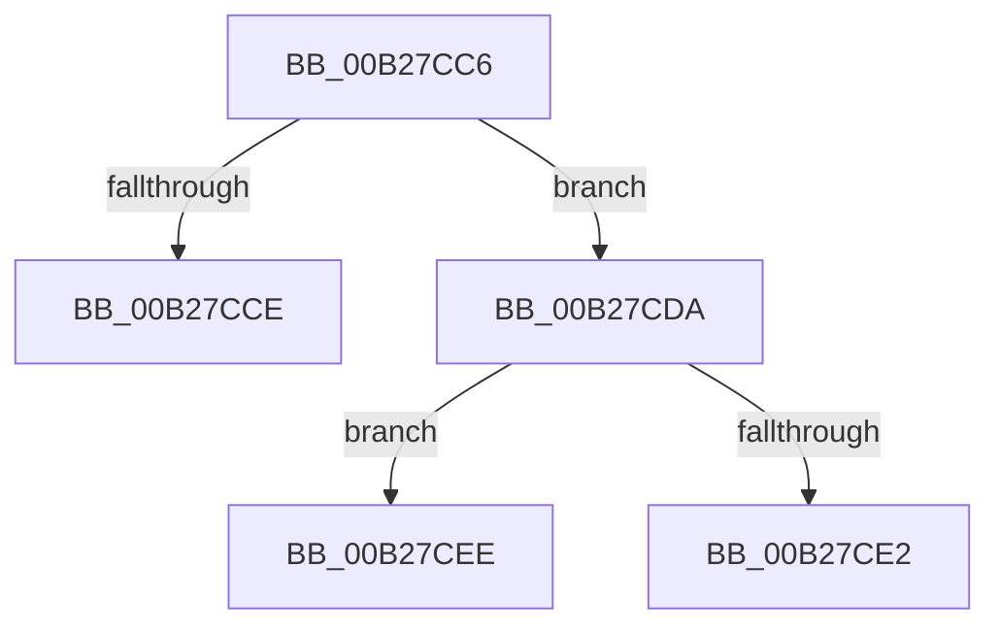

# sub_00B27CC6

- RVA: `0x00B27CC6`–`0x00B27D04` (길이 `62` bytes)
- VA: `0x0000000140B27CC6`
- 실행 섹션: `PAGE`
- PDB 이름 있음: `아니요`; PDB Function 태그: `아니요`
- unwind 정보 RVA: `0x00092FE0`
- 디코드: `14`개 명령, `62/62` bytes 표시
- 미해석 바이트: `0` (있으면 어셈블리에 `.byte`로 보존)

> 이 문서는 커널 이미지의 기계어와 PDB 기호를 분석해 생성했습니다. 4번과 5번은 함수 원형과 자료형을 바이너리 사용 방식에서 추정한 C 해석이며 원본 소스 복구 결과는 아닙니다.

## 1. Dependencies

- 직접 호출 지점: **0**; 고유 호출 대상: **0**
- 직접 호출자로 확인된 함수: **0**
- RIP 상대 이미지 참조: **0**

### Outgoing calls
- 직접 디코드된 call 명령이 없습니다.

### Direct callers
- 이 함수 시작 RVA로 연결되는 직접 call은 확인되지 않았습니다. 간접 호출은 완전히 역산할 수 없습니다.

### Static image references
- 디코드된 RIP-relative 메모리 참조가 없습니다.

## 2. Other-region calls and transfers

- 다른 실행 섹션으로 향하는 call: **0**
- call이 아닌 외부 분기/꼬리 이동: **3**
  - `0x00B27CD5` → [PfSnBeginScenario + 0x1C6](../95/PfSnBeginScenario_function_0095EFC0.md) (`tail-transfer`)
  - `0x00B27CE9` → [PfSnBeginScenario + 0x1C6](../95/PfSnBeginScenario_function_0095EFC0.md) (`tail-transfer`)
  - `0x00B27CFF` → [PfSnBeginScenario + 0x1C6](../95/PfSnBeginScenario_function_0095EFC0.md) (`tail-transfer`)

## 3. Assembly (complete function range)

```asm
00B27CC6  81 F9 06 00 1A C0               cmp ecx, 0xc01a0006
00B27CCC  75 0C                           jne 0x140b27cda
00B27CCE  C7 45 E4 12 00 00 00            mov dword ptr [rbp - 0x1c], 0x12
00B27CD5  E9 AC 74 E3 FF                  jmp 0x14095f186
00B27CDA  81 F9 21 00 00 C0               cmp ecx, 0xc0000021
00B27CE0  75 0C                           jne 0x140b27cee
00B27CE2  C7 45 E4 13 00 00 00            mov dword ptr [rbp - 0x1c], 0x13
00B27CE9  E9 98 74 E3 FF                  jmp 0x14095f186
00B27CEE  33 C0                           xor eax, eax
00B27CF0  81 F9 A3 00 00 C0               cmp ecx, 0xc00000a3
00B27CF6  0F 95 C0                        setne al
00B27CF9  83 C0 14                        add eax, 0x14
00B27CFC  89 45 E4                        mov dword ptr [rbp - 0x1c], eax
00B27CFF  E9 82 74 E3 FF                  jmp 0x14095f186
```

## 4. C-style interpretation (structured pseudocode)

```c
__int64 __fastcall sub_00B27CC6(int a1)
{
    __int64 result;

    if (a1 != 0xC01A0006ULL) goto loc_00B27CDA;
    *(unsigned int *)(v_rbp - 28) = 18;
loc_00B27CDA:
    if (a1 != 0xC0000021ULL) goto loc_00B27CEE;
    *(unsigned int *)(v_rbp - 28) = 19;
loc_00B27CEE:
    result = 0;
    result = (a1 != 0xC00000A3ULL) ? 1 : 0;
    result = (unsigned int)((result) + (20));
    *(unsigned int *)(v_rbp - 28) = (unsigned int)(result);
}
```

## 5. (Beta) C Style

```c
int64_t sub_00B27CC6(int32_t Arg1)
{
    int64_t result;

    if (Arg1 != 0xC01A0006ULL) goto loc_00B27CDA;
    *(uint32_t *)(local_rbp - 0x1C) = 18;
loc_00B27CDA:
    if (Arg1 != 0xC0000021ULL) goto loc_00B27CEE;
    *(uint32_t *)(local_rbp - 0x1C) = 19;
loc_00B27CEE:
    result = 0;
    result = (Arg1 != 0xC00000A3ULL) ? 1 : 0;
    result = (uint32_t)((result) + (20));
    *(uint32_t *)(local_rbp - 0x1C) = (uint32_t)(result);
}
```

## 6. Execution-region graph

[열기: 2D/3D 그래프와 함수 탐색 컨트롤 패널](../../../control-panel.html?section=page&rva=0x00B27CC6&view=graph)

- 2D 그래프는 위에서 아래로 흐르고, 3D 그래프는 빈 공간을 드래그해 회전합니다. Shift+드래그는 이동, 휠은 확대·축소, 함수 노드 선택은 대상 보고서 이동입니다.

### Static fallback


