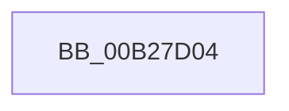

# sub_00B27D04

- RVA: `0x00B27D04`–`0x00B27DF7` (길이 `243` bytes)
- VA: `0x0000000140B27D04`
- 실행 섹션: `PAGE`
- PDB 이름 있음: `아니요`; PDB Function 태그: `아니요`
- unwind 정보 RVA: `0x00093014`
- 디코드: `42`개 명령, `243/243` bytes 표시
- 미해석 바이트: `0` (있으면 어셈블리에 `.byte`로 보존)

> 이 문서는 커널 이미지의 기계어와 PDB 기호를 분석해 생성했습니다. 4번과 5번은 함수 원형과 자료형을 바이너리 사용 방식에서 추정한 C 해석이며 원본 소스 복구 결과는 아닙니다.

## 1. Dependencies

- 직접 호출 지점: **2**; 고유 호출 대상: **2**
- 직접 호출자로 확인된 함수: **0**
- RIP 상대 이미지 참조: **2**

### Outgoing calls
- `0x00B27D25` → [tlgCreate1Sz_wchar_t](../../text/42/tlgCreate1Sz_wchar_t_function_00426198.md) (function, `0x00426198`)
- `0x00B27DEC` → [tlgWriteTransfer_EtwWriteTransfer](../../text/42/tlgWriteTransfer_EtwWriteTransfer_function_004260E0.md) (function, `0x004260E0`)

### Direct callers
- 이 함수 시작 RVA로 연결되는 직접 call은 확인되지 않았습니다. 간접 호출은 완전히 역산할 수 없습니다.

### Static image references
- `0x00B27D3C` → RVA `0x00048CA9` (`.rdata`; read)
- `0x00B27D53` → RVA `0x00E074D8` (`.data`; read)

## 2. Other-region calls and transfers

- 다른 실행 섹션으로 향하는 call: **2**
  - `0x00B27D25` → [tlgCreate1Sz_wchar_t](../../text/42/tlgCreate1Sz_wchar_t_function_00426198.md) (`PAGE` → `.text`)
  - `0x00B27DEC` → [tlgWriteTransfer_EtwWriteTransfer](../../text/42/tlgWriteTransfer_EtwWriteTransfer_function_004260E0.md) (`PAGE` → `.text`)
- call이 아닌 외부 분기/꼬리 이동: **1**
  - `0x00B27DF2` → [PfSnLogScenarioDecision + 0xF3](../95/PfSnLogScenarioDecision_function_0095F2BC.md) (`tail-transfer`)

## 3. Assembly (complete function range)

```asm
00B27D04  48 8D 44 24 58                  lea rax, [rsp + 0x58]
00B27D09  48 C7 85 88 00 00 00 10 00 00 00  mov qword ptr [rbp + 0x88], 0x10
00B27D14  48 8B D6                        mov rdx, rsi
00B27D17  48 89 85 80 00 00 00            mov qword ptr [rbp + 0x80], rax
00B27D1E  48 8D 8D 90 00 00 00            lea rcx, [rbp + 0x90]
00B27D25  E8 6E E4 8F FF                  call 0x140426198
00B27D2A  8A 8D 70 01 00 00               mov cl, byte ptr [rbp + 0x170]
00B27D30  48 8D 44 24 32                  lea rax, [rsp + 0x32]
00B27D35  48 89 85 A0 00 00 00            mov qword ptr [rbp + 0xa0], rax
00B27D3C  48 8D 15 66 0F 52 FF            lea rdx, [rip - 0xadf09a]
00B27D43  48 8D 44 24 44                  lea rax, [rsp + 0x44]
00B27D48  88 4C 24 32                     mov byte ptr [rsp + 0x32], cl
00B27D4C  48 89 85 B0 00 00 00            mov qword ptr [rbp + 0xb0], rax
00B27D53  48 8D 0D 7E F7 2D 00            lea rcx, [rip + 0x2df77e]
00B27D5A  48 8D 44 24 33                  lea rax, [rsp + 0x33]
00B27D5F  4C 89 8D A8 00 00 00            mov qword ptr [rbp + 0xa8], r9
00B27D66  48 89 85 C0 00 00 00            mov qword ptr [rbp + 0xc0], rax
00B27D6D  45 33 C0                        xor r8d, r8d
00B27D70  48 8D 44 24 34                  lea rax, [rsp + 0x34]
00B27D75  4C 89 8D C8 00 00 00            mov qword ptr [rbp + 0xc8], r9
00B27D7C  48 89 85 D0 00 00 00            mov qword ptr [rbp + 0xd0], rax
00B27D83  8B 85 90 01 00 00               mov eax, dword ptr [rbp + 0x190]
00B27D89  89 44 24 48                     mov dword ptr [rsp + 0x48], eax
00B27D8D  48 8D 44 24 48                  lea rax, [rsp + 0x48]
00B27D92  48 89 85 E0 00 00 00            mov qword ptr [rbp + 0xe0], rax
00B27D99  48 8D 44 24 50                  lea rax, [rsp + 0x50]
00B27D9E  48 89 85 F0 00 00 00            mov qword ptr [rbp + 0xf0], rax
00B27DA5  48 8D 45 60                     lea rax, [rbp + 0x60]
00B27DA9  4C 89 8D D8 00 00 00            mov qword ptr [rbp + 0xd8], r9
00B27DB0  45 33 C9                        xor r9d, r9d
00B27DB3  48 89 44 24 28                  mov qword ptr [rsp + 0x28], rax
00B27DB8  C7 44 24 20 0A 00 00 00         mov dword ptr [rsp + 0x20], 0xa
00B27DC0  89 5C 24 44                     mov dword ptr [rsp + 0x44], ebx
00B27DC4  4C 89 95 B8 00 00 00            mov qword ptr [rbp + 0xb8], r10
00B27DCB  44 88 7C 24 33                  mov byte ptr [rsp + 0x33], r15b
00B27DD0  44 88 64 24 34                  mov byte ptr [rsp + 0x34], r12b
00B27DD5  4C 89 95 E8 00 00 00            mov qword ptr [rbp + 0xe8], r10
00B27DDC  48 89 7C 24 50                  mov qword ptr [rsp + 0x50], rdi
00B27DE1  48 C7 85 F8 00 00 00 08 00 00 00  mov qword ptr [rbp + 0xf8], 8
00B27DEC  E8 EF E2 8F FF                  call 0x1404260e0
00B27DF1  90                              nop
00B27DF2  E9 B8 75 E3 FF                  jmp 0x14095f3af
```

## 4. C-style interpretation (structured pseudocode)

```c
__int64 __fastcall sub_00B27D04(__int64 a1, __int64 a2, int a3, __int64 a4, __int64 a5, __int64 a6, __int64 a7, __int64 a8, __int64 a9, __int64 a10, __int64 a11)
{
    __int64 result;
    unsigned int v_stack_p20;
    unsigned __int64 v_stack_p28;
    unsigned __int64 v_stack_p32;
    unsigned __int64 v_stack_p33;
    unsigned __int64 v_stack_p34;
    unsigned __int64 v_stack_p44;
    unsigned int v_stack_p48;
    unsigned __int64 v_stack_p50;

    *(unsigned __int64 *)(v_rbp + 136) = 16;
    *(unsigned __int64 *)(v_rbp + 128) = a11;
    result = tlgCreate1Sz_wchar_t(v_rbp + 144, v_rsi, a3, a4);
    *(unsigned __int64 *)(v_rbp + 160) = v_stack_p32;
    v_stack_p32 = (unsigned __int8)(*(unsigned __int8 *)(v_rbp + 368));
    *(unsigned __int64 *)(v_rbp + 176) = v_stack_p44;
    *(unsigned __int64 *)(v_rbp + 168) = a4;
    *(unsigned __int64 *)(v_rbp + 192) = v_stack_p33;
    a3 = 0;
    *(unsigned __int64 *)(v_rbp + 200) = a4;
    *(unsigned __int64 *)(v_rbp + 208) = v_stack_p34;
    v_stack_p48 = (unsigned int)((unsigned int)(*(unsigned int *)(v_rbp + 400)));
    *(unsigned __int64 *)(v_rbp + 224) = a9;
    *(unsigned __int64 *)(v_rbp + 240) = a10;
    *(unsigned __int64 *)(v_rbp + 216) = a4;
    a4 = 0;
    v_stack_p28 = v_rbp + 96;
    v_stack_p20 = 10;
    v_stack_p44 = (unsigned int)(v_rbx);
    *(unsigned __int64 *)(v_rbp + 184) = v_r10;
    v_stack_p33 = (unsigned __int8)(v_r15);
    v_stack_p34 = (unsigned __int8)(v_r12);
    *(unsigned __int64 *)(v_rbp + 232) = v_r10;
    v_stack_p50 = v_rdi;
    *(unsigned __int64 *)(v_rbp + 248) = 8;
    result = tlgWriteTransfer_EtwWriteTransfer(v_rip + 3012478, v_rip - 11399322, a3, a4);
}
```

## 5. (Beta) C Style

```c
int64_t sub_00B27D04(int64_t Arg1, int64_t Arg2, int32_t Arg3, int64_t Arg4, uint64_t Arg5, uint64_t Arg6, uint64_t Arg7, uint64_t Arg8, int64_t Arg9, int64_t Arg10, int64_t Arg11)
{
    int64_t result;
    uint32_t v_stack_p20;
    uint64_t v_stack_p28;
    uint64_t v_stack_p32;
    uint64_t v_stack_p33;
    uint64_t v_stack_p34;
    uint64_t v_stack_p44;
    uint32_t v_stack_p48;
    uint64_t v_stack_p50;

    *(uint64_t *)(local_rbp + 0x88) = 16;
    *(uint64_t *)(local_rbp + 0x80) = Arg11;
    result = tlgCreate1Sz_wchar_t(local_rbp + 144, local_rsi, Arg3, Arg4);
    *(uint64_t *)(local_rbp + 0xA0) = v_stack_p32;
    v_stack_p32 = (uint8_t)(*(uint8_t *)(local_rbp + 0x170));
    *(uint64_t *)(local_rbp + 0xB0) = v_stack_p44;
    *(uint64_t *)(local_rbp + 0xA8) = Arg4;
    *(uint64_t *)(local_rbp + 0xC0) = v_stack_p33;
    Arg3 = 0;
    *(uint64_t *)(local_rbp + 0xC8) = Arg4;
    *(uint64_t *)(local_rbp + 0xD0) = v_stack_p34;
    v_stack_p48 = (uint32_t)((uint32_t)(*(uint32_t *)(local_rbp + 0x190)));
    *(uint64_t *)(local_rbp + 0xE0) = Arg9;
    *(uint64_t *)(local_rbp + 0xF0) = Arg10;
    *(uint64_t *)(local_rbp + 0xD8) = Arg4;
    Arg4 = 0;
    v_stack_p28 = local_rbp + 96;
    v_stack_p20 = 10;
    v_stack_p44 = (uint32_t)(local_rbx);
    *(uint64_t *)(local_rbp + 0xB8) = local_r10;
    v_stack_p33 = (uint8_t)(local_r15);
    v_stack_p34 = (uint8_t)(local_r12);
    *(uint64_t *)(local_rbp + 0xE8) = local_r10;
    v_stack_p50 = local_rdi;
    *(uint64_t *)(local_rbp + 0xF8) = 8;
    result = tlgWriteTransfer_EtwWriteTransfer(v_rip + 3012478, v_rip - 11399322, Arg3, Arg4);
}
```

## 6. Execution-region graph

[열기: 2D/3D 그래프와 함수 탐색 컨트롤 패널](../../../control-panel.html?section=page&rva=0x00B27D04&view=graph)

- 2D 그래프는 위에서 아래로 흐르고, 3D 그래프는 빈 공간을 드래그해 회전합니다. Shift+드래그는 이동, 휠은 확대·축소, 함수 노드 선택은 대상 보고서 이동입니다.

### Static fallback


