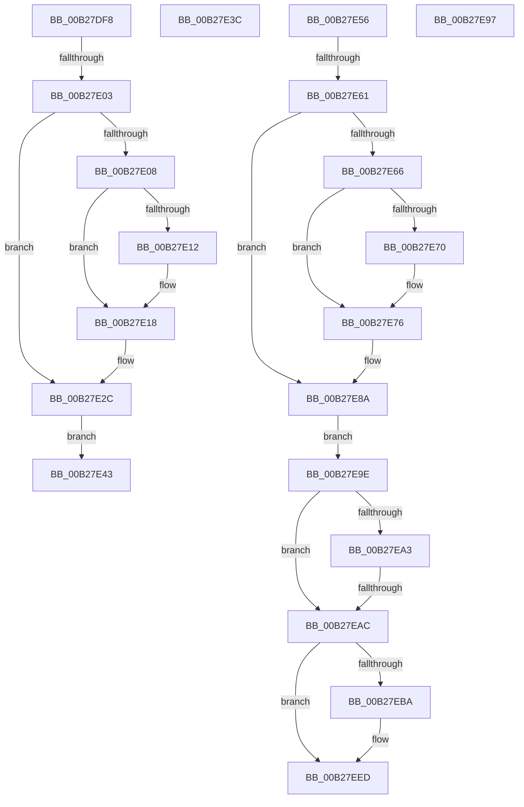

# sub_00B27DF8

- RVA: `0x00B27DF8`–`0x00B27EF4` (길이 `252` bytes)
- VA: `0x0000000140B27DF8`
- 실행 섹션: `PAGE`
- PDB 이름 있음: `아니요`; PDB Function 태그: `아니요`
- unwind 정보 RVA: `0x000932C4`
- 디코드: `65`개 명령, `252/252` bytes 표시
- 미해석 바이트: `0` (있으면 어셈블리에 `.byte`로 보존)

> 이 문서는 커널 이미지의 기계어와 PDB 기호를 분석해 생성했습니다. 4번과 5번은 함수 원형과 자료형을 바이너리 사용 방식에서 추정한 C 해석이며 원본 소스 복구 결과는 아닙니다.

## 1. Dependencies

- 직접 호출 지점: **5**; 고유 호출 대상: **4**
- 직접 호출자로 확인된 함수: **0**
- RIP 상대 이미지 참조: **0**

### Outgoing calls
- `0x00B27E12` → [ExRaiseDatatypeMisalignment](../89/ExRaiseDatatypeMisalignment_function_00899FD0.md) (function, `0x00899FD0`)
- `0x00B27E4B` → [PfSnAppLaunchScenarioControl](../75/PfSnAppLaunchScenarioControl_function_00752294.md) (function, `0x00752294`)
- `0x00B27E70` → [ExRaiseDatatypeMisalignment](../89/ExRaiseDatatypeMisalignment_function_00899FD0.md) (function, `0x00899FD0`)
- `0x00B27EAE` → [PfSnBeginBootPhase](../../pagelk/B6/PfSnBeginBootPhase_function_00B6BAC4.md) (function, `0x00B6BAC4`)
- `0x00B27EE8` → [PfpProcessScenarioPhase](../A9/PfpProcessScenarioPhase_function_00A96D44.md) (function, `0x00A96D44`)

### Direct callers
- 이 함수 시작 RVA로 연결되는 직접 call은 확인되지 않았습니다. 간접 호출은 완전히 역산할 수 없습니다.

### Static image references
- 디코드된 RIP-relative 메모리 참조가 없습니다.

## 2. Other-region calls and transfers

- 다른 실행 섹션으로 향하는 call: **1**
  - `0x00B27EAE` → [PfSnBeginBootPhase](../../pagelk/B6/PfSnBeginBootPhase_function_00B6BAC4.md) (`PAGE` → `PAGELK`)
- call이 아닌 외부 분기/꼬리 이동: **7**
  - `0x00B27DFD` → [PfSnSetPrefetcherInformation + 0x1F6](../96/PfSnSetPrefetcherInformation_function_0096139C.md) (`tail-transfer`)
  - `0x00B27E3E` → [PfSnSetPrefetcherInformation + 0x32](../96/PfSnSetPrefetcherInformation_function_0096139C.md) (`tail-transfer`)
  - `0x00B27E51` → [PfSnSetPrefetcherInformation + 0x1F0](../96/PfSnSetPrefetcherInformation_function_0096139C.md) (`tail-transfer`)
  - `0x00B27E5B` → [PfSnSetPrefetcherInformation + 0x1B7](../96/PfSnSetPrefetcherInformation_function_0096139C.md) (`tail-transfer`)
  - `0x00B27E99` → [PfSnSetPrefetcherInformation + 0x32](../96/PfSnSetPrefetcherInformation_function_0096139C.md) (`tail-transfer`)
  - `0x00B27EA6` → [PfSnSetPrefetcherInformation + 0x1C1](../96/PfSnSetPrefetcherInformation_function_0096139C.md) (`tail-transfer`)
  - `0x00B27EEF` → [PfSnSetPrefetcherInformation + 0x1CB](../96/PfSnSetPrefetcherInformation_function_0096139C.md) (`tail-transfer`)

## 3. Assembly (complete function range)

```asm
00B27DF8  83 7C 24 38 10                  cmp dword ptr [rsp + 0x38], 0x10
00B27DFD  0F 85 8F 97 E3 FF               jne 0x140961592
00B27E03  40 84 FF                        test dil, dil
00B27E06  74 24                           je 0x140b27e2c
00B27E08  48 8B 4C 24 30                  mov rcx, qword ptr [rsp + 0x30]
00B27E0D  F6 C1 07                        test cl, 7
00B27E10  74 06                           je 0x140b27e18
00B27E12  E8 B9 21 D7 FF                  call 0x140899fd0
00B27E17  CC                              int3
00B27E18  48 B8 00 00 FF FF FF 7F 00 00   movabs rax, 0x7fffffff0000
00B27E22  48 3B C8                        cmp rcx, rax
00B27E25  48 0F 43 C8                     cmovae rcx, rax
00B27E29  90                              nop
00B27E2A  8A 01                           mov al, byte ptr [rcx]
00B27E2C  48 8B 44 24 30                  mov rax, qword ptr [rsp + 0x30]
00B27E31  0F 10 00                        movups xmm0, xmmword ptr [rax]
00B27E34  F3 0F 7F 44 24 20               movdqu xmmword ptr [rsp + 0x20], xmm0
00B27E3A  EB 07                           jmp 0x140b27e43
00B27E3C  8B D8                           mov ebx, eax
00B27E3E  E9 8B 95 E3 FF                  jmp 0x1409613ce
00B27E43  40 8A D7                        mov dl, dil
00B27E46  48 8D 4C 24 20                  lea rcx, [rsp + 0x20]
00B27E4B  E8 44 A4 C2 FF                  call 0x140752294
00B27E50  90                              nop
00B27E51  E9 36 97 E3 FF                  jmp 0x14096158c
00B27E56  83 7C 24 38 04                  cmp dword ptr [rsp + 0x38], 4
00B27E5B  0F 85 F2 96 E3 FF               jne 0x140961553
00B27E61  40 84 FF                        test dil, dil
00B27E64  74 24                           je 0x140b27e8a
00B27E66  48 8B 4C 24 30                  mov rcx, qword ptr [rsp + 0x30]
00B27E6B  F6 C1 03                        test cl, 3
00B27E6E  74 06                           je 0x140b27e76
00B27E70  E8 5B 21 D7 FF                  call 0x140899fd0
00B27E75  CC                              int3
00B27E76  48 B8 00 00 FF FF FF 7F 00 00   movabs rax, 0x7fffffff0000
00B27E80  48 3B C8                        cmp rcx, rax
00B27E83  48 0F 43 C8                     cmovae rcx, rax
00B27E87  90                              nop
00B27E88  8A 01                           mov al, byte ptr [rcx]
00B27E8A  48 8B 44 24 30                  mov rax, qword ptr [rsp + 0x30]
00B27E8F  8B 30                           mov esi, dword ptr [rax]
00B27E91  89 74 24 40                     mov dword ptr [rsp + 0x40], esi
00B27E95  EB 07                           jmp 0x140b27e9e
00B27E97  8B D8                           mov ebx, eax
00B27E99  E9 30 95 E3 FF                  jmp 0x1409613ce
00B27E9E  83 FE 02                        cmp esi, 2
00B27EA1  74 09                           je 0x140b27eac
00B27EA3  40 84 FF                        test dil, dil
00B27EA6  0F 85 B1 96 E3 FF               jne 0x14096155d
00B27EAC  8B CE                           mov ecx, esi
00B27EAE  E8 11 3C 04 00                  call 0x140b6bac4
00B27EB3  8B D8                           mov ebx, eax
00B27EB5  83 FE 02                        cmp esi, 2
00B27EB8  75 33                           jne 0x140b27eed
00B27EBA  0F 57 C0                        xorps xmm0, xmm0
00B27EBD  F3 0F 7F 44 24 54               movdqu xmmword ptr [rsp + 0x54], xmm0
00B27EC3  83 64 24 64 00                  and dword ptr [rsp + 0x64], 0
00B27EC8  C7 44 24 48 04 00 00 00         mov dword ptr [rsp + 0x48], 4
00B27ED0  C7 44 24 4C 04 00 00 00         mov dword ptr [rsp + 0x4c], 4
00B27ED8  C7 44 24 50 01 00 00 00         mov dword ptr [rsp + 0x50], 1
00B27EE0  40 8A D7                        mov dl, dil
00B27EE3  48 8D 4C 24 48                  lea rcx, [rsp + 0x48]
00B27EE8  E8 57 EE F6 FF                  call 0x140a96d44
00B27EED  85 DB                           test ebx, ebx
00B27EEF  E9 73 96 E3 FF                  jmp 0x140961567
```

## 4. C-style interpretation (structured pseudocode)

```c
__int64 __fastcall sub_00B27DF8(__int64 a1, __int64 a2, __int64 a3, __int64 a4, __int64 a5, __int64 a6, unsigned int a7)
{
    __int64 result;
    unsigned __int64 v_stack_p20;
    unsigned __int64 v_stack_p30;
    unsigned int v_stack_p38;
    unsigned int v_stack_p40;
    unsigned int v_stack_p48;
    unsigned int v_stack_p4C;
    unsigned int v_stack_p50;
    unsigned __int64 v_stack_p54;
    unsigned int v_stack_p64;

    if ((unsigned __int8)(v_rdi) == 0) goto loc_00B27E2C;
    if ((((unsigned __int8)(a6)) & (7)) != 0) {
        result = ExRaiseDatatypeMisalignment(a6, a2, a3, a4);
    }
    if (a6 >= result) { a6 = result; }
loc_00B27E2C:
    v_stack_p20 = v_xmm0;
    goto loc_00B27E43;
loc_00B27E43:
    result = PfSnAppLaunchScenarioControl(v_stack_p20, (unsigned __int8)(v_rdi), a3, a4);
}
```

## 5. (Beta) C Style

```c
int64_t sub_00B27DF8(int64_t Arg1, int64_t Arg2, int64_t Arg3, int64_t Arg4, uint64_t Arg5, void *Arg6, uint32_t Arg7)
{
    uint8_t *arg6 = (uint8_t *)Arg6;

    int64_t result;
    uint64_t v_stack_p20;
    uint64_t v_stack_p30;
    uint32_t v_stack_p38;
    uint32_t v_stack_p40;
    uint32_t v_stack_p48;
    uint32_t v_stack_p4C;
    uint32_t v_stack_p50;
    uint64_t v_stack_p54;
    uint32_t v_stack_p64;

    if ((uint8_t)(local_rdi) == 0) goto loc_00B27E2C;
    if ((((uint8_t)(Arg6)) & (7)) != 0) {
        result = ExRaiseDatatypeMisalignment(Arg6, Arg2, Arg3, Arg4);
    }
    if (Arg6 >= result) { Arg6 = result; }
loc_00B27E2C:
    v_stack_p20 = v_xmm0;
    goto loc_00B27E43;
loc_00B27E43:
    result = PfSnAppLaunchScenarioControl(v_stack_p20, (uint8_t)(local_rdi), Arg3, Arg4);
}
```

### 관측된 메모리 오프셋

구조체 형식이 확인되지 않은 접근은 인자 기준의 오프셋으로만 기록했습니다.

| 기준 인자 | 오프셋 표현 | 폭 (bit) | 접근 |
|---|---:|---:|---|
| `Arg6` | `+ 0x0` | `128` | `R` |

## 6. Execution-region graph

[열기: 2D/3D 그래프와 함수 탐색 컨트롤 패널](../../../control-panel.html?section=page&rva=0x00B27DF8&view=graph)

- 2D 그래프는 위에서 아래로 흐르고, 3D 그래프는 빈 공간을 드래그해 회전합니다. Shift+드래그는 이동, 휠은 확대·축소, 함수 노드 선택은 대상 보고서 이동입니다.

### Static fallback


