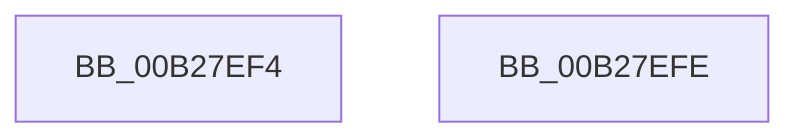

# sub_00B27EF4

- RVA: `0x00B27EF4`–`0x00B27F26` (길이 `50` bytes)
- VA: `0x0000000140B27EF4`
- 실행 섹션: `PAGE`
- PDB 이름 있음: `아니요`; PDB Function 태그: `아니요`
- unwind 정보 RVA: `0x00093320`
- 디코드: `11`개 명령, `50/50` bytes 표시
- 미해석 바이트: `0` (있으면 어셈블리에 `.byte`로 보존)

> 이 문서는 커널 이미지의 기계어와 PDB 기호를 분석해 생성했습니다. 4번과 5번은 함수 원형과 자료형을 바이너리 사용 방식에서 추정한 C 해석이며 원본 소스 복구 결과는 아닙니다.

## 1. Dependencies

- 직접 호출 지점: **1**; 고유 호출 대상: **1**
- 직접 호출자로 확인된 함수: **0**
- RIP 상대 이미지 참조: **1**

### Outgoing calls
- `0x00B27F1A` → [CmCreateInstallerClass](../82/CmCreateInstallerClass_function_00829594.md) (function, `0x00829594`)

### Direct callers
- 이 함수 시작 RVA로 연결되는 직접 call은 확인되지 않았습니다. 간접 호출은 완전히 역산할 수 없습니다.

### Static image references
- `0x00B27F10` → RVA `0x00E66398` (`.data`; read)

## 2. Other-region calls and transfers

- 다른 실행 섹션으로 향하는 call: **0**
- call이 아닌 외부 분기/꼬리 이동: **2**
  - `0x00B27EF9` → [PiCMOpenClassKey + 0x146](../96/PiCMOpenClassKey_function_009617A8.md) (`tail-transfer`)
  - `0x00B27F21` → [PiCMOpenClassKey + 0x128](../96/PiCMOpenClassKey_function_009617A8.md) (`tail-transfer`)

## 3. Assembly (complete function range)

```asm
00B27EF4  BB 22 00 00 C0                  mov ebx, 0xc0000022
00B27EF9  E9 F0 99 E3 FF                  jmp 0x1409618ee
00B27EFE  83 64 24 28 00                  and dword ptr [rsp + 0x28], 0
00B27F03  4C 8D 4D 7F                     lea r9, [rbp + 0x7f]
00B27F07  48 83 64 24 20 00               and qword ptr [rsp + 0x20], 0
00B27F0D  44 8B C7                        mov r8d, edi
00B27F10  48 8B 0D 81 E4 33 00            mov rcx, qword ptr [rip + 0x33e481]
00B27F17  48 8B D6                        mov rdx, rsi
00B27F1A  E8 75 16 D0 FF                  call 0x140829594
00B27F1F  8B D8                           mov ebx, eax
00B27F21  E9 AA 99 E3 FF                  jmp 0x1409618d0
```

## 4. C-style interpretation (structured pseudocode)

```c
__int64 __fastcall sub_00B27EF4(void)
{
    unsigned __int64 v_stack_p20;
    unsigned int v_stack_p28;
}
```

## 5. (Beta) C Style

```c
void sub_00B27EF4(void)
{
    uint64_t v_stack_p20;
    uint32_t v_stack_p28;
}
```

## 6. Execution-region graph

[열기: 2D/3D 그래프와 함수 탐색 컨트롤 패널](../../../control-panel.html?section=page&rva=0x00B27EF4&view=graph)

- 2D 그래프는 위에서 아래로 흐르고, 3D 그래프는 빈 공간을 드래그해 회전합니다. Shift+드래그는 이동, 휠은 확대·축소, 함수 노드 선택은 대상 보고서 이동입니다.

### Static fallback


