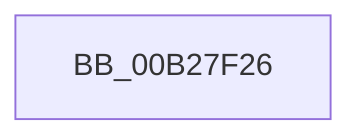

# sub_00B27F26

- RVA: `0x00B27F26`–`0x00B27F5B` (길이 `53` bytes)
- VA: `0x0000000140B27F26`
- 실행 섹션: `PAGE`
- PDB 이름 있음: `아니요`; PDB Function 태그: `아니요`
- unwind 정보 RVA: `0x00093350`
- 디코드: `11`개 명령, `53/53` bytes 표시
- 미해석 바이트: `0` (있으면 어셈블리에 `.byte`로 보존)

> 이 문서는 커널 이미지의 기계어와 PDB 기호를 분석해 생성했습니다. 4번과 5번은 함수 원형과 자료형을 바이너리 사용 방식에서 추정한 C 해석이며 원본 소스 복구 결과는 아닙니다.

## 1. Dependencies

- 직접 호출 지점: **1**; 고유 호출 대상: **1**
- 직접 호출자로 확인된 함수: **0**
- RIP 상대 이미지 참조: **1**

### Outgoing calls
- `0x00B27F4F` → [_CmOpenDeviceInterfaceRegKey](../8F/_CmOpenDeviceInterfaceRegKey_function_008F31F4.md) (function, `0x008F31F4`)

### Direct callers
- 이 함수 시작 RVA로 연결되는 직접 call은 확인되지 않았습니다. 간접 호출은 완전히 역산할 수 없습니다.

### Static image references
- `0x00B27F3A` → RVA `0x00E66398` (`.data`; read)

## 2. Other-region calls and transfers

- 다른 실행 섹션으로 향하는 call: **0**
- call이 아닌 외부 분기/꼬리 이동: **1**
  - `0x00B27F56` → [PiCMOpenDeviceInterfaceKey + 0xE2](../96/PiCMOpenDeviceInterfaceKey_function_00961A3C.md) (`tail-transfer`)

## 3. Assembly (complete function range)

```asm
00B27F26  48 83 64 24 38 00               and qword ptr [rsp + 0x38], 0
00B27F2C  48 8D 45 48                     lea rax, [rbp + 0x48]
00B27F30  48 8B 55 D8                     mov rdx, qword ptr [rbp - 0x28]
00B27F34  41 B8 32 00 00 00               mov r8d, 0x32
00B27F3A  48 8B 0D 57 E4 33 00            mov rcx, qword ptr [rip + 0x33e457]
00B27F41  48 89 44 24 30                  mov qword ptr [rsp + 0x30], rax
00B27F46  C6 44 24 28 01                  mov byte ptr [rsp + 0x28], 1
00B27F4B  89 7C 24 20                     mov dword ptr [rsp + 0x20], edi
00B27F4F  E8 A0 B2 DC FF                  call 0x1408f31f4
00B27F54  8B D8                           mov ebx, eax
00B27F56  E9 C3 9B E3 FF                  jmp 0x140961b1e
```

## 4. C-style interpretation (structured pseudocode)

```c
__int64 __fastcall sub_00B27F26(__int64 a1, __int64 a2, __int64 a3, __int64 a4, __int64 a5, __int64 a6, __int64 a7)
{
    __int64 result;
    unsigned int v_stack_p20;
    unsigned __int8 v_stack_p28;
    unsigned __int64 v_stack_p30;

    v_stack_p30 = v_rbp + 72;
    v_stack_p28 = 1;
    v_stack_p20 = (unsigned int)(v_rdi);
    result = _CmOpenDeviceInterfaceRegKey(*(unsigned __int64 *)(v_rip + 3400791), *(unsigned __int64 *)(v_rbp - 40), 50, a4);
}
```

## 5. (Beta) C Style

```c
int64_t sub_00B27F26(int64_t Arg1, int64_t Arg2, int64_t Arg3, int64_t Arg4, uint64_t Arg5, uint64_t Arg6, int64_t Arg7)
{
    int64_t result;
    uint32_t v_stack_p20;
    uint8_t v_stack_p28;
    uint64_t v_stack_p30;

    v_stack_p30 = local_rbp + 72;
    v_stack_p28 = 1;
    v_stack_p20 = (uint32_t)(local_rdi);
    result = _CmOpenDeviceInterfaceRegKey(*(uint64_t *)(v_rip + 0x33E457), *(uint64_t *)(local_rbp - 0x28), 50, Arg4);
}
```

## 6. Execution-region graph

[열기: 2D/3D 그래프와 함수 탐색 컨트롤 패널](../../../control-panel.html?section=page&rva=0x00B27F26&view=graph)

- 2D 그래프는 위에서 아래로 흐르고, 3D 그래프는 빈 공간을 드래그해 회전합니다. Shift+드래그는 이동, 휠은 확대·축소, 함수 노드 선택은 대상 보고서 이동입니다.

### Static fallback


