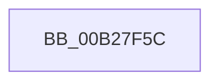

# sub_00B27F5C

- RVA: `0x00B27F5C`–`0x00B27F7C` (길이 `32` bytes)
- VA: `0x0000000140B27F5C`
- 실행 섹션: `PAGE`
- PDB 이름 있음: `아니요`; PDB Function 태그: `아니요`
- unwind 정보 RVA: `0x000933A0`
- 디코드: `8`개 명령, `32/32` bytes 표시
- 미해석 바이트: `0` (있으면 어셈블리에 `.byte`로 보존)

> 이 문서는 커널 이미지의 기계어와 PDB 기호를 분석해 생성했습니다. 4번과 5번은 함수 원형과 자료형을 바이너리 사용 방식에서 추정한 C 해석이며 원본 소스 복구 결과는 아닙니다.

## 1. Dependencies

- 직접 호출 지점: **1**; 고유 호출 대상: **1**
- 직접 호출자로 확인된 함수: **0**
- RIP 상대 이미지 참조: **0**

### Outgoing calls
- `0x00B27F70` → [PnpCreateObject](../82/PnpCreateObject_function_0082C27C.md) (function, `0x0082C27C`)

### Direct callers
- 이 함수 시작 RVA로 연결되는 직접 call은 확인되지 않았습니다. 간접 호출은 완전히 역산할 수 없습니다.

### Static image references
- 디코드된 RIP-relative 메모리 참조가 없습니다.

## 2. Other-region calls and transfers

- 다른 실행 섹션으로 향하는 call: **0**
- call이 아닌 외부 분기/꼬리 이동: **1**
  - `0x00B27F77` → [PiCMOpenObjectKey + 0xF8](../96/PiCMOpenObjectKey_function_00961E08.md) (`tail-transfer`)

## 3. Assembly (complete function range)

```asm
00B27F5C  44 8B 4D 1B                     mov r9d, dword ptr [rbp + 0x1b]
00B27F60  48 8D 45 EF                     lea rax, [rbp - 0x11]
00B27F64  48 8B 55 0F                     mov rdx, qword ptr [rbp + 0xf]
00B27F68  44 8B C3                        mov r8d, ebx
00B27F6B  48 89 44 24 20                  mov qword ptr [rsp + 0x20], rax
00B27F70  E8 07 43 D0 FF                  call 0x14082c27c
00B27F75  8B F8                           mov edi, eax
00B27F77  E9 84 9F E3 FF                  jmp 0x140961f00
```

## 4. C-style interpretation (structured pseudocode)

```c
__int64 __fastcall sub_00B27F5C(void)
{
    __int64 result;
    unsigned __int64 v_stack_p20;

    v_stack_p20 = v_rbp - 17;
    result = PnpCreateObject(a1, *(unsigned __int64 *)(v_rbp + 15), (unsigned int)((unsigned int)(v_rbx)), (unsigned int)(*(unsigned int *)(v_rbp + 27)));
}
```

## 5. (Beta) C Style

```c
void sub_00B27F5C(void)
{
    int64_t result;
    uint64_t v_stack_p20;

    v_stack_p20 = local_rbp - 17;
    result = PnpCreateObject(a1, *(uint64_t *)(local_rbp + 0xF), (uint32_t)((uint32_t)(local_rbx)), (uint32_t)(*(uint32_t *)(local_rbp + 0x1B)));
}
```

## 6. Execution-region graph

[열기: 2D/3D 그래프와 함수 탐색 컨트롤 패널](../../../control-panel.html?section=page&rva=0x00B27F5C&view=graph)

- 2D 그래프는 위에서 아래로 흐르고, 3D 그래프는 빈 공간을 드래그해 회전합니다. Shift+드래그는 이동, 휠은 확대·축소, 함수 노드 선택은 대상 보고서 이동입니다.

### Static fallback


