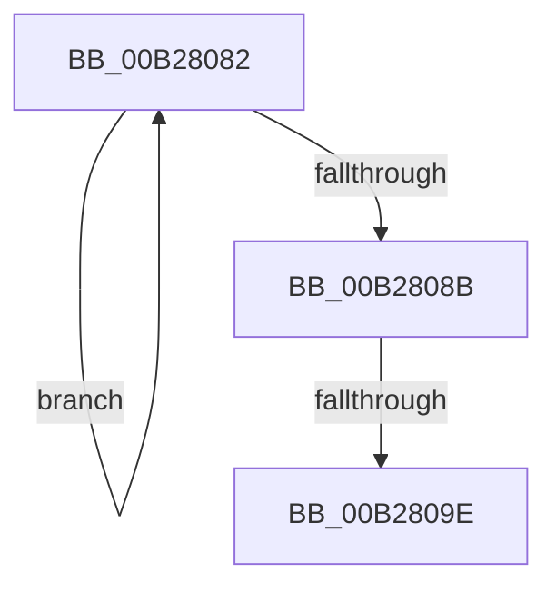

# sub_00B28082

- RVA: `0x00B28082`–`0x00B280AF` (길이 `45` bytes)
- VA: `0x0000000140B28082`
- 실행 섹션: `PAGE`
- PDB 이름 있음: `아니요`; PDB Function 태그: `아니요`
- unwind 정보 RVA: `0x000934D0`
- 디코드: `13`개 명령, `45/45` bytes 표시
- 미해석 바이트: `0` (있으면 어셈블리에 `.byte`로 보존)

> 이 문서는 커널 이미지의 기계어와 PDB 기호를 분석해 생성했습니다. 4번과 5번은 함수 원형과 자료형을 바이너리 사용 방식에서 추정한 C 해석이며 원본 소스 복구 결과는 아닙니다.

## 1. Dependencies

- 직접 호출 지점: **0**; 고유 호출 대상: **0**
- 직접 호출자로 확인된 함수: **0**
- RIP 상대 이미지 참조: **0**

### Outgoing calls
- 직접 디코드된 call 명령이 없습니다.

### Direct callers
- 이 함수 시작 RVA로 연결되는 직접 call은 확인되지 않았습니다. 간접 호출은 완전히 역산할 수 없습니다.

### Static image references
- 디코드된 RIP-relative 메모리 참조가 없습니다.

## 2. Other-region calls and transfers

- 다른 실행 섹션으로 향하는 call: **0**
- call이 아닌 외부 분기/꼬리 이동: **2**
  - `0x00B28098` → [PiCMRegisterDeviceInterface + 0x130](../96/PiCMRegisterDeviceInterface_function_00962A94.md) (`tail-transfer`)
  - `0x00B280AA` → [PiCMRegisterDeviceInterface + 0x87](../96/PiCMRegisterDeviceInterface_function_00962A94.md) (`tail-transfer`)

## 3. Assembly (complete function range)

```asm
00B28082  48 FF C3                        inc rbx
00B28085  66 39 04 5F                     cmp word ptr [rdi + rbx*2], ax
00B28089  75 F7                           jne 0x140b28082
00B2808B  FF C3                           inc ebx
00B2808D  41 8B C7                        mov eax, r15d
00B28090  8B CB                           mov ecx, ebx
00B28092  48 03 C9                        add rcx, rcx
00B28095  48 3B C8                        cmp rcx, rax
00B28098  0F 86 26 AB E3 FF               jbe 0x140962bc4
00B2809E  41 BA 23 00 00 C0               mov r10d, 0xc0000023
00B280A4  8D 14 1B                        lea edx, [rbx + rbx]
00B280A7  45 33 FF                        xor r15d, r15d
00B280AA  E9 6C AA E3 FF                  jmp 0x140962b1b
```

## 4. C-style interpretation (structured pseudocode)

```c
__int64 __fastcall sub_00B28082(void)
{
    __int64 v_r15;
    __int64 v_rbx;

    v_rbx = (v_rbx) + 1;
    if ((*(unsigned __int16 *)(v_rdi + v_rbx * 2)) != ((unsigned __int16)(result))) goto loc_00B28082;
    v_rbx = (unsigned int)((v_rbx) + 1);
    a1 = ((unsigned int)((unsigned int)(v_rbx))) + ((unsigned int)((unsigned int)(v_rbx)));
    v_r15 = 0;
}
```

## 5. (Beta) C Style

```c
void sub_00B28082(void)
{
    int64_t local_r15;
    int64_t local_rbx;

    local_rbx = (local_rbx) + 1;
    if ((*(uint16_t *)(local_rdi + local_rbx * 2)) != ((uint16_t)(result))) goto loc_00B28082;
    local_rbx = (uint32_t)((local_rbx) + 1);
    a1 = ((uint32_t)((uint32_t)(local_rbx))) + ((uint32_t)((uint32_t)(local_rbx)));
    local_r15 = 0;
}
```

## 6. Execution-region graph

[열기: 2D/3D 그래프와 함수 탐색 컨트롤 패널](../../../control-panel.html?section=page&rva=0x00B28082&view=graph)

- 2D 그래프는 위에서 아래로 흐르고, 3D 그래프는 빈 공간을 드래그해 회전합니다. Shift+드래그는 이동, 휠은 확대·축소, 함수 노드 선택은 대상 보고서 이동입니다.

### Static fallback


