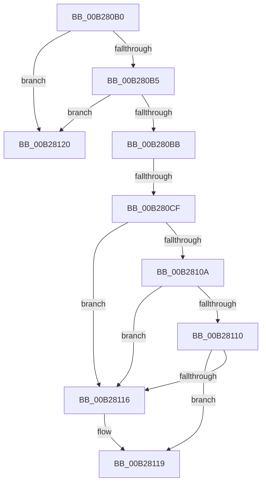

# sub_00B280B0

- RVA: `0x00B280B0`–`0x00B2812A` (길이 `122` bytes)
- VA: `0x0000000140B280B0`
- 실행 섹션: `PAGE`
- PDB 이름 있음: `아니요`; PDB Function 태그: `아니요`
- unwind 정보 RVA: `0x00093560`
- 디코드: `33`개 명령, `122/122` bytes 표시
- 미해석 바이트: `0` (있으면 어셈블리에 `.byte`로 보존)

> 이 문서는 커널 이미지의 기계어와 PDB 기호를 분석해 생성했습니다. 4번과 5번은 함수 원형과 자료형을 바이너리 사용 방식에서 추정한 C 해석이며 원본 소스 복구 결과는 아닙니다.

## 1. Dependencies

- 직접 호출 지점: **2**; 고유 호출 대상: **2**
- 직접 호출자로 확인된 함수: **0**
- RIP 상대 이미지 참조: **0**

### Outgoing calls
- `0x00B280C2` → [SeAuditingWithTokenForSubcategory](../90/SeAuditingWithTokenForSubcategory_function_009047D0.md) (function, `0x009047D0`)
- `0x00B28101` → [CmGetDeviceRegProp](../8E/CmGetDeviceRegProp_function_008ED870.md) (function, `0x008ED870`)

### Direct callers
- 이 함수 시작 RVA로 연결되는 직접 call은 확인되지 않았습니다. 간접 호출은 완전히 역산할 수 없습니다.

### Static image references
- 디코드된 RIP-relative 메모리 참조가 없습니다.

## 2. Other-region calls and transfers

- 다른 실행 섹션으로 향하는 call: **0**
- call이 아닌 외부 분기/꼬리 이동: **3**
  - `0x00B280C9` → [PiPnpRtlSetDeviceRegProperty + 0xC0](../96/PiPnpRtlSetDeviceRegProperty_function_0096360C.md) (`tail-transfer`)
  - `0x00B2811B` → [PiPnpRtlSetDeviceRegProperty + 0xC0](../96/PiPnpRtlSetDeviceRegProperty_function_0096360C.md) (`tail-transfer`)
  - `0x00B28125` → [PiPnpRtlSetDeviceRegProperty + 0x83](../96/PiPnpRtlSetDeviceRegProperty_function_0096360C.md) (`tail-transfer`)

## 3. Assembly (complete function range)

```asm
00B280B0  48 85 DB                        test rbx, rbx
00B280B3  74 6B                           je 0x140b28120
00B280B5  41 83 FC 04                     cmp r12d, 4
00B280B9  75 65                           jne 0x140b28120
00B280BB  33 D2                           xor edx, edx
00B280BD  B9 8A 00 00 00                  mov ecx, 0x8a
00B280C2  E8 09 C7 DD FF                  call 0x1409047d0
00B280C7  84 C0                           test al, al
00B280C9  0F 84 FD B5 E3 FF               je 0x1409636cc
00B280CF  21 74 24 38                     and dword ptr [rsp + 0x38], esi
00B280D3  48 8D 45 58                     lea rax, [rbp + 0x58]
00B280D7  48 8B 4D 40                     mov rcx, qword ptr [rbp + 0x40]
00B280DB  45 8D 4C 24 07                  lea r9d, [r12 + 7]
00B280E0  48 89 44 24 30                  mov qword ptr [rsp + 0x30], rax
00B280E5  4D 8B C5                        mov r8, r13
00B280E8  48 8D 45 E0                     lea rax, [rbp - 0x20]
00B280EC  44 89 65 58                     mov dword ptr [rbp + 0x58], r12d
00B280F0  48 89 44 24 28                  mov qword ptr [rsp + 0x28], rax
00B280F5  48 8B D7                        mov rdx, rdi
00B280F8  48 8D 45 E4                     lea rax, [rbp - 0x1c]
00B280FC  48 89 44 24 20                  mov qword ptr [rsp + 0x20], rax
00B28101  E8 6A 57 DC FF                  call 0x1408ed870
00B28106  85 C0                           test eax, eax
00B28108  78 0C                           js 0x140b28116
00B2810A  44 39 65 58                     cmp dword ptr [rbp + 0x58], r12d
00B2810E  75 06                           jne 0x140b28116
00B28110  44 39 65 E4                     cmp dword ptr [rbp - 0x1c], r12d
00B28114  74 03                           je 0x140b28119
00B28116  21 75 E0                        and dword ptr [rbp - 0x20], esi
00B28119  8B 33                           mov esi, dword ptr [rbx]
00B2811B  E9 AC B5 E3 FF                  jmp 0x1409636cc
00B28120  BB 0D 00 00 C0                  mov ebx, 0xc000000d
00B28125  E9 65 B5 E3 FF                  jmp 0x14096368f
```

## 4. C-style interpretation (structured pseudocode)

```c
__int64 __fastcall sub_00B280B0(__int64 a1, int a2, __int64 a3, __int64 a4, __int64 a5, __int64 a6, unsigned int a7)
{
    __int64 result;
    unsigned __int64 v_stack_p20;
    unsigned __int64 v_stack_p28;
    unsigned __int64 v_stack_p30;

    if (v_rbx == 0) goto loc_00B28120;
    if (((unsigned int)(v_r12)) != 4) goto loc_00B28120;
    a2 = 0;
    result = SeAuditingWithTokenForSubcategory(138, a2, a3, a4);
    v_stack_p30 = v_rbp + 88;
    *(unsigned int *)(v_rbp + 88) = (unsigned int)(v_r12);
    v_stack_p28 = v_rbp - 32;
    v_stack_p20 = v_rbp - 28;
    result = CmGetDeviceRegProp(*(unsigned __int64 *)(v_rbp + 64), v_rdi, v_r13, v_r12 + 7);
    if (sign_flag) goto loc_00B28116;
    if ((*(unsigned int *)(v_rbp + 88)) != ((unsigned int)(v_r12))) goto loc_00B28116;
    if ((*(unsigned int *)(v_rbp - 28)) != ((unsigned int)(v_r12))) {
    }
loc_00B28120:
}
```

## 5. (Beta) C Style

```c
int64_t sub_00B280B0(int64_t Arg1, int32_t Arg2, int64_t Arg3, int64_t Arg4, uint64_t Arg5, uint64_t Arg6, uint32_t Arg7)
{
    int64_t result;
    uint64_t v_stack_p20;
    uint64_t v_stack_p28;
    uint64_t v_stack_p30;

    if (local_rbx == 0) goto loc_00B28120;
    if (((uint32_t)(local_r12)) != 4) goto loc_00B28120;
    Arg2 = 0;
    result = SeAuditingWithTokenForSubcategory(138, Arg2, Arg3, Arg4);
    v_stack_p30 = local_rbp + 88;
    *(uint32_t *)(local_rbp + 0x58) = (uint32_t)(local_r12);
    v_stack_p28 = local_rbp - 32;
    v_stack_p20 = local_rbp - 28;
    result = CmGetDeviceRegProp(*(uint64_t *)(local_rbp + 0x40), local_rdi, local_r13, local_r12 + 7);
    if (sign_flag) goto loc_00B28116;
    if ((*(uint32_t *)(local_rbp + 0x58)) != ((uint32_t)(local_r12))) goto loc_00B28116;
    if ((*(uint32_t *)(local_rbp - 0x1C)) != ((uint32_t)(local_r12))) {
    }
loc_00B28120:
}
```

## 6. Execution-region graph

[열기: 2D/3D 그래프와 함수 탐색 컨트롤 패널](../../../control-panel.html?section=page&rva=0x00B280B0&view=graph)

- 2D 그래프는 위에서 아래로 흐르고, 3D 그래프는 빈 공간을 드래그해 회전합니다. Shift+드래그는 이동, 휠은 확대·축소, 함수 노드 선택은 대상 보고서 이동입니다.

### Static fallback


