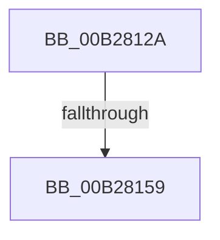

# sub_00B2812A

- RVA: `0x00B2812A`–`0x00B2819A` (길이 `112` bytes)
- VA: `0x0000000140B2812A`
- 실행 섹션: `PAGE`
- PDB 이름 있음: `아니요`; PDB Function 태그: `아니요`
- unwind 정보 RVA: `0x000935AC`
- 디코드: `24`개 명령, `112/112` bytes 표시
- 미해석 바이트: `0` (있으면 어셈블리에 `.byte`로 보존)

> 이 문서는 커널 이미지의 기계어와 PDB 기호를 분석해 생성했습니다. 4번과 5번은 함수 원형과 자료형을 바이너리 사용 방식에서 추정한 C 해석이며 원본 소스 복구 결과는 아닙니다.

## 1. Dependencies

- 직접 호출 지점: **2**; 고유 호출 대상: **2**
- 직접 호출자로 확인된 함수: **0**
- RIP 상대 이미지 참조: **1**

### Outgoing calls
- `0x00B2814A` → [PnpSetGenericStoreProperty](../99/PnpSetGenericStoreProperty_function_00991BC0.md) (function, `0x00991BC0`)
- `0x00B2818F` → [PiPnpRtlObjectEventWorker](../8F/PiPnpRtlObjectEventWorker_function_008F8630.md) (function, `0x008F8630`)

### Direct callers
- 이 함수 시작 RVA로 연결되는 직접 call은 확인되지 않았습니다. 간접 호출은 완전히 역산할 수 없습니다.

### Static image references
- `0x00B28143` → RVA `0x00E66398` (`.data`; read)

## 2. Other-region calls and transfers

- 다른 실행 섹션으로 향하는 call: **0**
- call이 아닌 외부 분기/꼬리 이동: **2**
  - `0x00B28153` → [PiDqIrpPropertySet + 0x22C](../96/PiDqIrpPropertySet_function_00963770.md) (`tail-transfer`)
  - `0x00B28195` → [PiDqIrpPropertySet + 0x22C](../96/PiDqIrpPropertySet_function_00963770.md) (`tail-transfer`)

## 3. Assembly (complete function range)

```asm
00B2812A  89 44 24 30                     mov dword ptr [rsp + 0x30], eax
00B2812E  48 89 54 24 28                  mov qword ptr [rsp + 0x28], rdx
00B28133  44 89 44 24 20                  mov dword ptr [rsp + 0x20], r8d
00B28138  4C 8B CE                        mov r9, rsi
00B2813B  4D 8B C2                        mov r8, r10
00B2813E  48 8B 54 24 58                  mov rdx, qword ptr [rsp + 0x58]
00B28143  48 8B 0D 4E E2 33 00            mov rcx, qword ptr [rip + 0x33e24e]
00B2814A  E8 71 9A E6 FF                  call 0x140991bc0
00B2814F  8B F8                           mov edi, eax
00B28151  85 C0                           test eax, eax
00B28153  0F 88 43 B8 E3 FF               js 0x14096399c
00B28159  48 83 64 24 70 00               and qword ptr [rsp + 0x70], 0
00B2815F  48 8B 46 18                     mov rax, qword ptr [rsi + 0x18]
00B28163  48 89 44 24 78                  mov qword ptr [rsp + 0x78], rax
00B28168  48 89 B4 24 80 00 00 00         mov qword ptr [rsp + 0x80], rsi
00B28170  44 89 74 24 20                  mov dword ptr [rsp + 0x20], r14d
00B28175  4C 8D 4C 24 70                  lea r9, [rsp + 0x70]
00B2817A  41 B8 04 00 00 00               mov r8d, 4
00B28180  41 8B D4                        mov edx, r12d
00B28183  48 8B 8C 24 E8 00 00 00         mov rcx, qword ptr [rsp + 0xe8]
00B2818B  48 8B 49 08                     mov rcx, qword ptr [rcx + 8]
00B2818F  E8 9C 04 DD FF                  call 0x1408f8630
00B28194  90                              nop
00B28195  E9 02 B8 E3 FF                  jmp 0x14096399c
```

## 4. C-style interpretation (structured pseudocode)

```c
__int64 __fastcall sub_00B2812A(__int64 a1, __int64 a2, int a3, __int64 a4, __int64 a5, __int64 a6, __int64 a7, __int64 a8, __int64 a9, __int64 a10, __int64 a11, __int64 a12, __int64 a13, __int64 a14, __int64 a15, __int64 a16, __int64 a17, __int64 a18, __int64 a19, __int64 a20, __int64 a21, __int64 a22, __int64 a23, __int64 a24, __int64 a25, __int64 a26, __int64 a27, __int64 a28, __int64 a29)
{
    __int64 result;
    unsigned int v_stack_p20;
    unsigned __int64 v_stack_p28;
    unsigned int v_stack_p30;
    unsigned __int64 v_stack_p78;
    unsigned __int64 v_stack_p80;

    v_stack_p30 = (unsigned int)(result);
    v_stack_p28 = a2;
    v_stack_p20 = a3;
    result = PnpSetGenericStoreProperty(*(unsigned __int64 *)(v_rip + 3400270), a11, v_r10, v_rsi);
    v_stack_p78 = *(unsigned __int64 *)(v_rsi + 24);
    v_stack_p80 = v_rsi;
    v_stack_p20 = (unsigned int)(v_r14);
    result = PiPnpRtlObjectEventWorker(*(unsigned __int64 *)(a29 + 8), (unsigned int)((unsigned int)(v_r12)), 4, a14);
}
```

## 5. (Beta) C Style

```c
int64_t sub_00B2812A(int64_t Arg1, int64_t Arg2, int32_t Arg3, int64_t Arg4, uint64_t Arg5, uint64_t Arg6, uint64_t Arg7, uint64_t Arg8, uint64_t Arg9, uint64_t Arg10, int64_t Arg11, uint64_t Arg12, uint64_t Arg13, int64_t Arg14, uint64_t Arg15, uint64_t Arg16, uint64_t Arg17, uint64_t Arg18, uint64_t Arg19, uint64_t Arg20, uint64_t Arg21, uint64_t Arg22, uint64_t Arg23, uint64_t Arg24, uint64_t Arg25, uint64_t Arg26, uint64_t Arg27, uint64_t Arg28, void *Arg29)
{
    uint8_t *arg29 = (uint8_t *)Arg29;

    int64_t result;
    uint32_t v_stack_p20;
    uint64_t v_stack_p28;
    uint32_t v_stack_p30;
    uint64_t v_stack_p78;
    uint64_t v_stack_p80;

    v_stack_p30 = (uint32_t)(result);
    v_stack_p28 = Arg2;
    v_stack_p20 = Arg3;
    result = PnpSetGenericStoreProperty(*(uint64_t *)(v_rip + 0x33E24E), Arg11, local_r10, local_rsi);
    v_stack_p78 = *(uint64_t *)(local_rsi + 0x18);
    v_stack_p80 = local_rsi;
    v_stack_p20 = (uint32_t)(local_r14);
    result = PiPnpRtlObjectEventWorker(*(uint64_t *)(arg29 + 0x8), (uint32_t)((uint32_t)(local_r12)), 4, Arg14);
}
```

### 관측된 메모리 오프셋

구조체 형식이 확인되지 않은 접근은 인자 기준의 오프셋으로만 기록했습니다.

| 기준 인자 | 오프셋 표현 | 폭 (bit) | 접근 |
|---|---:|---:|---|
| `Arg29` | `+ 0x8` | `64` | `R` |

## 6. Execution-region graph

[열기: 2D/3D 그래프와 함수 탐색 컨트롤 패널](../../../control-panel.html?section=page&rva=0x00B2812A&view=graph)

- 2D 그래프는 위에서 아래로 흐르고, 3D 그래프는 빈 공간을 드래그해 회전합니다. Shift+드래그는 이동, 휠은 확대·축소, 함수 노드 선택은 대상 보고서 이동입니다.

### Static fallback


