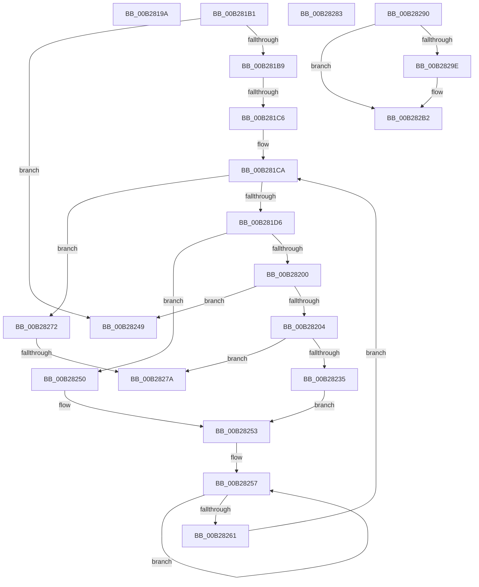

# sub_00B2819A

- RVA: `0x00B2819A`–`0x00B28306` (길이 `364` bytes)
- VA: `0x0000000140B2819A`
- 실행 섹션: `PAGE`
- PDB 이름 있음: `아니요`; PDB Function 태그: `아니요`
- unwind 정보 RVA: `0x00093618`
- 디코드: `87`개 명령, `364/364` bytes 표시
- 미해석 바이트: `0` (있으면 어셈블리에 `.byte`로 보존)

> 이 문서는 커널 이미지의 기계어와 PDB 기호를 분석해 생성했습니다. 4번과 5번은 함수 원형과 자료형을 바이너리 사용 방식에서 추정한 C 해석이며 원본 소스 복구 결과는 아닙니다.

## 1. Dependencies

- 직접 호출 지점: **6**; 고유 호출 대상: **6**
- 직접 호출자로 확인된 함수: **0**
- RIP 상대 이미지 참조: **3**

### Outgoing calls
- `0x00B281F4` → [PnpCtxRegOpenKey](../8E/PnpCtxRegOpenKey_function_008EF7B8.md) (function, `0x008EF7B8`)
- `0x00B2821E` → [PiDevCfgFindDeviceMigrationNode](../73/PiDevCfgFindDeviceMigrationNode_function_00732920.md) (function, `0x00732920`)
- `0x00B28229` → [ZwClose](../../text/6A/ZwClose_function_006AD2B0.md) (function, `0x006AD2B0`)
- `0x00B28285` → [ExFreePoolWithTag](../../poolcode/B8/ExFreePoolWithTag_function_00B82870.md) (function, `0x00B82870`)
- `0x00B282A9` → [PnpCtxRegDeleteValue](../8F/PnpCtxRegDeleteValue_function_008FE5E0.md) (function, `0x008FE5E0`)
- `0x00B282FB` → [PiDevCfgSetObjectProperty](../A8/PiDevCfgSetObjectProperty_function_00A8DB50.md) (function, `0x00A8DB50`)

### Direct callers
- 이 함수 시작 RVA로 연결되는 직접 call은 확인되지 않았습니다. 간접 호출은 완전히 역산할 수 없습니다.

### Static image references
- `0x00B281D6` → RVA `0x00E66398` (`.data`; read)
- `0x00B282A2` → RVA `0x00AFDEA0` (` ?? ::NNGAKEGL::`string'`; read)
- `0x00B282DE` → RVA `0x000129F0` (`.rdata`; read)

## 2. Other-region calls and transfers

- 다른 실행 섹션으로 향하는 call: **2**
  - `0x00B28229` → [ZwClose](../../text/6A/ZwClose_function_006AD2B0.md) (`PAGE` → `.text`)
  - `0x00B28285` → [ExFreePoolWithTag](../../poolcode/B8/ExFreePoolWithTag_function_00B82870.md) (`PAGE` → `POOLCODE`)
- call이 아닌 외부 분기/꼬리 이동: **7**
  - `0x00B281AC` → [PiDevCfgMigrateDevice + 0xFE](../96/PiDevCfgMigrateDevice_function_00963E60.md) (`tail-transfer`)
  - `0x00B281C0` → [PiDevCfgMigrateDevice + 0x122](../96/PiDevCfgMigrateDevice_function_00963E60.md) (`tail-transfer`)
  - `0x00B2824B` → [PiDevCfgMigrateDevice + 0x261](../96/PiDevCfgMigrateDevice_function_00963E60.md) (`tail-transfer`)
  - `0x00B28274` → [PiDevCfgMigrateDevice + 0x261](../96/PiDevCfgMigrateDevice_function_00963E60.md) (`tail-transfer`)
  - `0x00B2827E` → [PiDevCfgMigrateDevice + 0x122](../96/PiDevCfgMigrateDevice_function_00963E60.md) (`tail-transfer`)
  - `0x00B2828B` → [PiDevCfgMigrateDevice + 0x169](../96/PiDevCfgMigrateDevice_function_00963E60.md) (`tail-transfer`)
  - `0x00B28301` → [PiDevCfgMigrateDevice + 0x225](../96/PiDevCfgMigrateDevice_function_00963E60.md) (`tail-transfer`)

## 3. Assembly (complete function range)

```asm
00B2819A  81 FB 34 00 00 C0               cmp ebx, 0xc0000034
00B281A0  4C 89 4D C7                     mov qword ptr [rbp - 0x39], r9
00B281A4  41 8B C1                        mov eax, r9d
00B281A7  0F 45 C3                        cmovne eax, ebx
00B281AA  8B D8                           mov ebx, eax
00B281AC  E9 AD BD E3 FF                  jmp 0x140963f5e
00B281B1  85 C0                           test eax, eax
00B281B3  0F 88 90 00 00 00               js 0x140b28249
00B281B9  48 8B 55 07                     mov rdx, qword ptr [rbp + 7]
00B281BD  48 85 D2                        test rdx, rdx
00B281C0  0F 84 BC BD E3 FF               je 0x140963f82
00B281C6  48 8B 77 50                     mov rsi, qword ptr [rdi + 0x50]
00B281CA  8B C3                           mov eax, ebx
00B281CC  66 44 39 0E                     cmp word ptr [rsi], r9w
00B281D0  0F 84 9C 00 00 00               je 0x140b28272
00B281D6  48 8B 0D BB E1 33 00            mov rcx, qword ptr [rip + 0x33e1bb]
00B281DD  48 8D 45 D7                     lea rax, [rbp - 0x29]
00B281E1  48 89 44 24 28                  mov qword ptr [rsp + 0x28], rax
00B281E6  45 33 C9                        xor r9d, r9d
00B281E9  4C 8B C6                        mov r8, rsi
00B281EC  C7 44 24 20 19 00 02 00         mov dword ptr [rsp + 0x20], 0x20019
00B281F4  E8 BF 75 DC FF                  call 0x1408ef7b8
00B281F9  3D 34 00 00 C0                  cmp eax, 0xc0000034
00B281FE  74 50                           je 0x140b28250
00B28200  85 C0                           test eax, eax
00B28202  78 45                           js 0x140b28249
00B28204  4C 8B 45 D7                     mov r8, qword ptr [rbp - 0x29]
00B28208  48 8D 45 C7                     lea rax, [rbp - 0x39]
00B2820C  41 B9 01 12 01 00               mov r9d, 0x11201
00B28212  48 89 44 24 20                  mov qword ptr [rsp + 0x20], rax
00B28217  48 8B D7                        mov rdx, rdi
00B2821A  48 8D 4D E7                     lea rcx, [rbp - 0x19]
00B2821E  E8 FD A6 C0 FF                  call 0x140732920
00B28223  48 8B 4D D7                     mov rcx, qword ptr [rbp - 0x29]
00B28227  8B D8                           mov ebx, eax
00B28229  E8 82 50 B8 FF                  call 0x1406ad2b0
00B2822E  45 33 C9                        xor r9d, r9d
00B28231  85 DB                           test ebx, ebx
00B28233  79 45                           jns 0x140b2827a
00B28235  81 FB 25 02 00 C0               cmp ebx, 0xc0000225
00B2823B  4C 89 4D C7                     mov qword ptr [rbp - 0x39], r9
00B2823F  41 8B C1                        mov eax, r9d
00B28242  0F 45 C3                        cmovne eax, ebx
00B28245  8B D8                           mov ebx, eax
00B28247  EB 0A                           jmp 0x140b28253
00B28249  8B D8                           mov ebx, eax
00B2824B  E9 71 BE E3 FF                  jmp 0x1409640c1
00B28250  45 33 C9                        xor r9d, r9d
00B28253  48 83 C8 FF                     or rax, 0xffffffffffffffff
00B28257  48 FF C0                        inc rax
00B2825A  66 44 39 0C 46                  cmp word ptr [rsi + rax*2], r9w
00B2825F  75 F6                           jne 0x140b28257
00B28261  48 8B 55 07                     mov rdx, qword ptr [rbp + 7]
00B28265  48 8D 34 46                     lea rsi, [rsi + rax*2]
00B28269  48 83 C6 02                     add rsi, 2
00B2826D  E9 58 FF FF FF                  jmp 0x140b281ca
00B28272  85 C0                           test eax, eax
00B28274  0F 88 47 BE E3 FF               js 0x1409640c1
00B2827A  48 8B 75 57                     mov rsi, qword ptr [rbp + 0x57]
00B2827E  E9 FF BC E3 FF                  jmp 0x140963f82
00B28283  33 D2                           xor edx, edx
00B28285  E8 E6 A5 05 00                  call 0x140b82870
00B2828A  90                              nop
00B2828B  E9 39 BD E3 FF                  jmp 0x140963fc9
00B28290  48 8B 45 C7                     mov rax, qword ptr [rbp - 0x39]
00B28294  48 83 B8 B8 00 00 00 00         cmp qword ptr [rax + 0xb8], 0
00B2829C  74 14                           je 0x140b282b2
00B2829E  48 8B 57 10                     mov rdx, qword ptr [rdi + 0x10]
00B282A2  4C 8D 05 F7 5B FD FF            lea r8, [rip - 0x2a409]
00B282A9  E8 32 63 DD FF                  call 0x1408fe5e0
00B282AE  48 8B 45 C7                     mov rax, qword ptr [rbp - 0x39]
00B282B2  83 64 24 50 00                  and dword ptr [rsp + 0x50], 0
00B282B7  48 05 B8 00 00 00               add rax, 0xb8
00B282BD  4C 8B 47 08                     mov r8, qword ptr [rdi + 8]
00B282C1  41 B9 01 00 00 00               mov r9d, 1
00B282C7  48 8B 0D CA E0 33 00            mov rcx, qword ptr [rip + 0x33e0ca]
00B282CE  48 8B D7                        mov rdx, rdi
00B282D1  C7 44 24 48 08 00 00 00         mov dword ptr [rsp + 0x48], 8
00B282D9  48 89 44 24 40                  mov qword ptr [rsp + 0x40], rax
00B282DE  48 8D 05 0B A7 4E FF            lea rax, [rip - 0xb158f5]
00B282E5  C7 44 24 38 09 00 00 00         mov dword ptr [rsp + 0x38], 9
00B282ED  48 89 44 24 30                  mov qword ptr [rsp + 0x30], rax
00B282F2  48 8B 47 10                     mov rax, qword ptr [rdi + 0x10]
00B282F6  48 89 44 24 20                  mov qword ptr [rsp + 0x20], rax
00B282FB  E8 50 58 F6 FF                  call 0x140a8db50
00B28300  90                              nop
00B28301  E9 7F BD E3 FF                  jmp 0x140964085
```

## 4. C-style interpretation (structured pseudocode)

```c
__int64 __fastcall sub_00B2819A(__int64 a1, __int64 a2, __int64 a3, __int64 a4)
{
    __int64 result;
    unsigned int v_stack_p20;
    unsigned __int64 v_stack_p28;
    unsigned __int64 v_stack_p30;
    unsigned int v_stack_p38;
    unsigned __int64 v_stack_p40;
    unsigned int v_stack_p48;
    unsigned int v_stack_p50;

    *(unsigned __int64 *)(v_rbp - 57) = a4;
    result = (unsigned int)((unsigned int)(a4));
    if (((unsigned int)(v_rbx)) != 0xC0000034ULL) { result = (unsigned int)(v_rbx); }
}
```

## 5. (Beta) C Style

```c
int64_t sub_00B2819A(int64_t Arg1, int64_t Arg2, int64_t Arg3, int64_t Arg4)
{
    int64_t result;
    uint32_t v_stack_p20;
    uint64_t v_stack_p28;
    uint64_t v_stack_p30;
    uint32_t v_stack_p38;
    uint64_t v_stack_p40;
    uint32_t v_stack_p48;
    uint32_t v_stack_p50;

    *(uint64_t *)(local_rbp - 0x39) = Arg4;
    result = (uint32_t)((uint32_t)(Arg4));
    if (((uint32_t)(local_rbx)) != 0xC0000034ULL) { result = (uint32_t)(local_rbx); }
}
```

## 6. Execution-region graph

[열기: 2D/3D 그래프와 함수 탐색 컨트롤 패널](../../../control-panel.html?section=page&rva=0x00B2819A&view=graph)

- 2D 그래프는 위에서 아래로 흐르고, 3D 그래프는 빈 공간을 드래그해 회전합니다. Shift+드래그는 이동, 휠은 확대·축소, 함수 노드 선택은 대상 보고서 이동입니다.

### Static fallback


