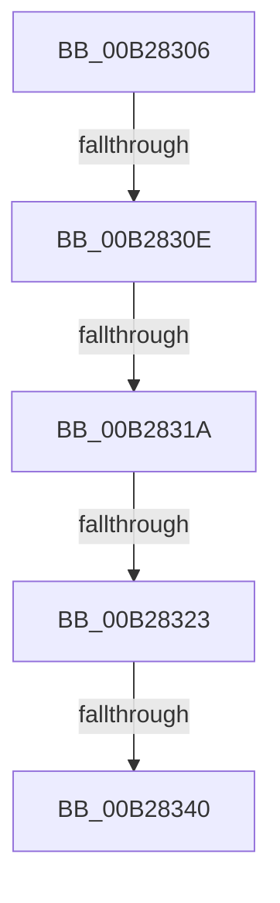

# sub_00B28306

- RVA: `0x00B28306`–`0x00B2834B` (길이 `69` bytes)
- VA: `0x0000000140B28306`
- 실행 섹션: `PAGE`
- PDB 이름 있음: `아니요`; PDB Function 태그: `아니요`
- unwind 정보 RVA: `0x00093644`
- 디코드: `17`개 명령, `69/69` bytes 표시
- 미해석 바이트: `0` (있으면 어셈블리에 `.byte`로 보존)

> 이 문서는 커널 이미지의 기계어와 PDB 기호를 분석해 생성했습니다. 4번과 5번은 함수 원형과 자료형을 바이너리 사용 방식에서 추정한 C 해석이며 원본 소스 복구 결과는 아닙니다.

## 1. Dependencies

- 직접 호출 지점: **1**; 고유 호출 대상: **1**
- 직접 호출자로 확인된 함수: **0**
- RIP 상대 이미지 참조: **0**

### Outgoing calls
- `0x00B28330` → [IopOpenRegistryKeyEx](../A5/IopOpenRegistryKeyEx_function_00A51B44.md) (function, `0x00A51B44`)

### Direct callers
- 이 함수 시작 RVA로 연결되는 직접 call은 확인되지 않았습니다. 간접 호출은 완전히 역산할 수 없습니다.

### Static image references
- 디코드된 RIP-relative 메모리 참조가 없습니다.

## 2. Other-region calls and transfers

- 다른 실행 섹션으로 향하는 call: **0**
- call이 아닌 외부 분기/꼬리 이동: **5**
  - `0x00B28308` → [PiDevCfgInitMigrationContext + 0x145](../96/PiDevCfgInitMigrationContext_function_009642E0.md) (`tail-transfer`)
  - `0x00B28314` → [PiDevCfgInitMigrationContext + 0x14D](../96/PiDevCfgInitMigrationContext_function_009642E0.md) (`tail-transfer`)
  - `0x00B2831D` → [PiDevCfgInitMigrationContext + 0x16E](../96/PiDevCfgInitMigrationContext_function_009642E0.md) (`tail-transfer`)
  - `0x00B2833A` → [PiDevCfgInitMigrationContext + 0x16E](../96/PiDevCfgInitMigrationContext_function_009642E0.md) (`tail-transfer`)
  - `0x00B28346` → [PiDevCfgInitMigrationContext + 0x14D](../96/PiDevCfgInitMigrationContext_function_009642E0.md) (`tail-transfer`)

## 3. Assembly (complete function range)

```asm
00B28306  85 C0                           test eax, eax
00B28308  0F 88 17 C1 E3 FF               js 0x140964425
00B2830E  48 8B 16                        mov rdx, qword ptr [rsi]
00B28311  48 85 D2                        test rdx, rdx
00B28314  0F 84 13 C1 E3 FF               je 0x14096442d
00B2831A  4D 85 F6                        test r14, r14
00B2831D  0F 84 2B C1 E3 FF               je 0x14096444e
00B28323  41 B9 19 00 02 00               mov r9d, 0x20019
00B28329  48 8D 4F 18                     lea rcx, [rdi + 0x18]
00B2832D  4D 8B C6                        mov r8, r14
00B28330  E8 0F 98 F2 FF                  call 0x140a51b44
00B28335  8B D8                           mov ebx, eax
00B28337  41 3B C5                        cmp eax, r13d
00B2833A  0F 85 0E C1 E3 FF               jne 0x14096444e
00B28340  33 DB                           xor ebx, ebx
00B28342  48 21 5F 18                     and qword ptr [rdi + 0x18], rbx
00B28346  E9 E2 C0 E3 FF                  jmp 0x14096442d
```

## 4. C-style interpretation (structured pseudocode)

```c
__int64 __fastcall sub_00B28306(void)
{
    __int64 result;
    __int64 v_rbx;

    result = IopOpenRegistryKeyEx(v_rdi + 24, *(unsigned __int64 *)(v_rsi), v_r14, (unsigned int)(0x20019ULL));
    v_rbx = 0;
}
```

## 5. (Beta) C Style

```c
void sub_00B28306(void)
{
    int64_t result;
    int64_t local_rbx;

    result = IopOpenRegistryKeyEx(local_rdi + 24, *(uint64_t *)(local_rsi), local_r14, (uint32_t)(0x20019ULL));
    local_rbx = 0;
}
```

## 6. Execution-region graph

[열기: 2D/3D 그래프와 함수 탐색 컨트롤 패널](../../../control-panel.html?section=page&rva=0x00B28306&view=graph)

- 2D 그래프는 위에서 아래로 흐르고, 3D 그래프는 빈 공간을 드래그해 회전합니다. Shift+드래그는 이동, 휠은 확대·축소, 함수 노드 선택은 대상 보고서 이동입니다.

### Static fallback


