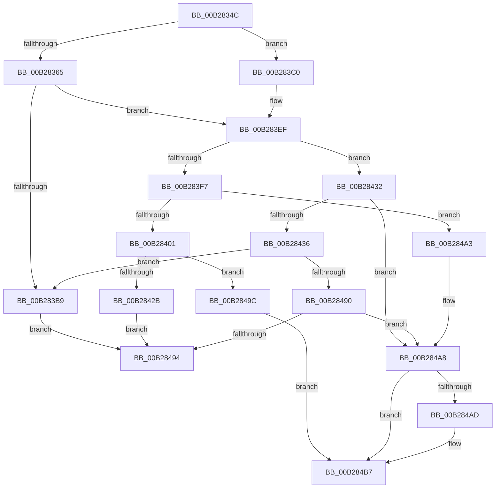

# sub_00B2834C

- RVA: `0x00B2834C`–`0x00B284C0` (길이 `372` bytes)
- VA: `0x0000000140B2834C`
- 실행 섹션: `PAGE`
- PDB 이름 있음: `아니요`; PDB Function 태그: `아니요`
- unwind 정보 RVA: `0x0009368C`
- 디코드: `98`개 명령, `372/372` bytes 표시
- 미해석 바이트: `0` (있으면 어셈블리에 `.byte`로 보존)

> 이 문서는 커널 이미지의 기계어와 PDB 기호를 분석해 생성했습니다. 4번과 5번은 함수 원형과 자료형을 바이너리 사용 방식에서 추정한 C 해석이며 원본 소스 복구 결과는 아닙니다.

## 1. Dependencies

- 직접 호출 지점: **6**; 고유 호출 대상: **5**
- 직접 호출자로 확인된 함수: **0**
- RIP 상대 이미지 참조: **0**

### Outgoing calls
- `0x00B283AB` → [PnpGetObjectProperty](../8E/PnpGetObjectProperty_function_008E2180.md) (function, `0x008E2180`)
- `0x00B283E8` → [PnpGetGenericStoreProperty](../8E/PnpGetGenericStoreProperty_function_008EFBA0.md) (function, `0x008EFBA0`)
- `0x00B28406` → [ExFreePoolWithTag](../../poolcode/B8/ExFreePoolWithTag_function_00B82870.md) (function, `0x00B82870`)
- `0x00B2841E` → [ExAllocatePool2](../../poolcode/B8/ExAllocatePool2_function_00B820F0.md) (function, `0x00B820F0`)
- `0x00B2847E` → [PiDevCfgSetObjectProperty](../A8/PiDevCfgSetObjectProperty_function_00A8DB50.md) (function, `0x00A8DB50`)
- `0x00B284B2` → [ExFreePoolWithTag](../../poolcode/B8/ExFreePoolWithTag_function_00B82870.md) (function, `0x00B82870`)

### Direct callers
- 이 함수 시작 RVA로 연결되는 직접 call은 확인되지 않았습니다. 간접 호출은 완전히 역산할 수 없습니다.

### Static image references
- 디코드된 RIP-relative 메모리 참조가 없습니다.

## 2. Other-region calls and transfers

- 다른 실행 섹션으로 향하는 call: **3**
  - `0x00B28406` → [ExFreePoolWithTag](../../poolcode/B8/ExFreePoolWithTag_function_00B82870.md) (`PAGE` → `POOLCODE`)
  - `0x00B2841E` → [ExAllocatePool2](../../poolcode/B8/ExAllocatePool2_function_00B820F0.md) (`PAGE` → `POOLCODE`)
  - `0x00B284B2` → [ExFreePoolWithTag](../../poolcode/B8/ExFreePoolWithTag_function_00B82870.md) (`PAGE` → `POOLCODE`)
- call이 아닌 외부 분기/꼬리 이동: **2**
  - `0x00B28497` → [PiDevCfgCopyObjectProperties + 0x250](../96/PiDevCfgCopyObjectProperties_function_009645D8.md) (`tail-transfer`)
  - `0x00B284BB` → [PiDevCfgCopyObjectProperties + 0x176](../96/PiDevCfgCopyObjectProperties_function_009645D8.md) (`tail-transfer`)

## 3. Assembly (complete function range)

```asm
00B2834C  48 8B 4D E7                     mov rcx, qword ptr [rbp - 0x19]
00B28350  4B 8D 04 BF                     lea rax, [r15 + r15*4]
00B28354  44 8B 7D D7                     mov r15d, dword ptr [rbp - 0x29]
00B28358  48 8D 04 81                     lea rax, [rcx + rax*4]
00B2835C  48 89 45 DF                     mov qword ptr [rbp - 0x21], rax
00B28360  45 85 F6                        test r14d, r14d
00B28363  74 5B                           je 0x140b283c0
00B28365  8B 8D 97 00 00 00               mov ecx, dword ptr [rbp + 0x97]
00B2836B  48 85 F6                        test rsi, rsi
00B2836E  4C 8B 4D EF                     mov r9, qword ptr [rbp - 0x11]
00B28372  45 8B C6                        mov r8d, r14d
00B28375  48 8B 55 4F                     mov rdx, qword ptr [rbp + 0x4f]
00B28379  4C 0F 45 CE                     cmovne r9, rsi
00B2837D  89 4C 24 50                     mov dword ptr [rsp + 0x50], ecx
00B28381  48 8D 4D 67                     lea rcx, [rbp + 0x67]
00B28385  48 89 4C 24 48                  mov qword ptr [rsp + 0x48], rcx
00B2838A  48 8D 4D DB                     lea rcx, [rbp - 0x25]
00B2838E  44 89 7C 24 40                  mov dword ptr [rsp + 0x40], r15d
00B28393  48 89 7C 24 38                  mov qword ptr [rsp + 0x38], rdi
00B28398  48 89 4C 24 30                  mov qword ptr [rsp + 0x30], rcx
00B2839D  49 8B CD                        mov rcx, r13
00B283A0  48 89 44 24 28                  mov qword ptr [rsp + 0x28], rax
00B283A5  48 83 64 24 20 00               and qword ptr [rsp + 0x20], 0
00B283AB  E8 D0 9D DB FF                  call 0x1408e2180
00B283B0  8B D8                           mov ebx, eax
00B283B2  3D 02 00 00 C0                  cmp eax, 0xc0000002
00B283B7  75 36                           jne 0x140b283ef
00B283B9  33 DB                           xor ebx, ebx
00B283BB  E9 D4 00 00 00                  jmp 0x140b28494
00B283C0  48 8D 4D 67                     lea rcx, [rbp + 0x67]
00B283C4  4C 8B C8                        mov r9, rax
00B283C7  48 89 4C 24 38                  mov qword ptr [rsp + 0x38], rcx
00B283CC  45 33 C0                        xor r8d, r8d
00B283CF  44 89 7C 24 30                  mov dword ptr [rsp + 0x30], r15d
00B283D4  48 8D 4D DB                     lea rcx, [rbp - 0x25]
00B283D8  48 89 7C 24 28                  mov qword ptr [rsp + 0x28], rdi
00B283DD  48 8B D6                        mov rdx, rsi
00B283E0  48 89 4C 24 20                  mov qword ptr [rsp + 0x20], rcx
00B283E5  49 8B CD                        mov rcx, r13
00B283E8  E8 B3 77 DC FF                  call 0x1408efba0
00B283ED  8B D8                           mov ebx, eax
00B283EF  81 FB 23 00 00 C0               cmp ebx, 0xc0000023
00B283F5  75 3B                           jne 0x140b28432
00B283F7  44 39 7D 67                     cmp dword ptr [rbp + 0x67], r15d
00B283FB  0F 86 A2 00 00 00               jbe 0x140b284a3
00B28401  33 D2                           xor edx, edx
00B28403  48 8B CF                        mov rcx, rdi
00B28406  E8 65 A4 05 00                  call 0x140b82870
00B2840B  8B 45 67                        mov eax, dword ptr [rbp + 0x67]
00B2840E  B9 00 01 00 00                  mov ecx, 0x100
00B28413  8B D0                           mov edx, eax
00B28415  89 45 D7                        mov dword ptr [rbp - 0x29], eax
00B28418  41 B8 50 70 64 63               mov r8d, 0x63647050
00B2841E  E8 CD 9C 05 00                  call 0x140b820f0
00B28423  48 8B F8                        mov rdi, rax
00B28426  48 85 C0                        test rax, rax
00B28429  74 71                           je 0x140b2849c
00B2842B  33 DB                           xor ebx, ebx
00B2842D  41 FF CC                        dec r12d
00B28430  EB 62                           jmp 0x140b28494
00B28432  85 DB                           test ebx, ebx
00B28434  78 72                           js 0x140b284a8
00B28436  48 8B 45 7F                     mov rax, qword ptr [rbp + 0x7f]
00B2843A  48 8B 4D F7                     mov rcx, qword ptr [rbp - 9]
00B2843E  48 85 C0                        test rax, rax
00B28441  44 8B 4D 77                     mov r9d, dword ptr [rbp + 0x77]
00B28445  4C 8B 45 6F                     mov r8, qword ptr [rbp + 0x6f]
00B28449  48 0F 45 C8                     cmovne rcx, rax
00B2844D  8B 85 97 00 00 00               mov eax, dword ptr [rbp + 0x97]
00B28453  33 D2                           xor edx, edx
00B28455  89 44 24 50                     mov dword ptr [rsp + 0x50], eax
00B28459  8B 45 67                        mov eax, dword ptr [rbp + 0x67]
00B2845C  89 44 24 48                     mov dword ptr [rsp + 0x48], eax
00B28460  8B 45 DB                        mov eax, dword ptr [rbp - 0x25]
00B28463  48 89 7C 24 40                  mov qword ptr [rsp + 0x40], rdi
00B28468  89 44 24 38                     mov dword ptr [rsp + 0x38], eax
00B2846C  48 8B 45 DF                     mov rax, qword ptr [rbp - 0x21]
00B28470  48 89 44 24 30                  mov qword ptr [rsp + 0x30], rax
00B28475  48 89 4C 24 20                  mov qword ptr [rsp + 0x20], rcx
00B2847A  48 8B 4D FF                     mov rcx, qword ptr [rbp - 1]
00B2847E  E8 CD 56 F6 FF                  call 0x140a8db50
00B28483  8B D8                           mov ebx, eax
00B28485  3D 22 00 00 C0                  cmp eax, 0xc0000022
00B2848A  0F 84 29 FF FF FF               je 0x140b283b9
00B28490  85 C0                           test eax, eax
00B28492  78 14                           js 0x140b284a8
00B28494  41 FF C4                        inc r12d
00B28497  E9 8C C3 E3 FF                  jmp 0x140964828
00B2849C  BB 9A 00 00 C0                  mov ebx, 0xc000009a
00B284A1  EB 14                           jmp 0x140b284b7
00B284A3  BB E5 00 00 C0                  mov ebx, 0xc00000e5
00B284A8  48 85 FF                        test rdi, rdi
00B284AB  74 0A                           je 0x140b284b7
00B284AD  33 D2                           xor edx, edx
00B284AF  48 8B CF                        mov rcx, rdi
00B284B2  E8 B9 A3 05 00                  call 0x140b82870
00B284B7  4C 8B 7D E7                     mov r15, qword ptr [rbp - 0x19]
00B284BB  E9 8E C2 E3 FF                  jmp 0x14096474e
```

## 4. C-style interpretation (structured pseudocode)

```c
__int64 __fastcall sub_00B2834C(void)
{
    __int64 result;
    __int64 v_r12;
    __int64 v_rbx;
    unsigned __int64 v_stack_p20;
    unsigned __int64 v_stack_p28;
    unsigned __int64 v_stack_p30;
    unsigned __int64 v_stack_p38;
    unsigned int v_stack_p40;
    unsigned __int64 v_stack_p48;
    unsigned int v_stack_p50;

    *(unsigned __int64 *)(v_rbp - 33) = *(unsigned __int64 *)(v_rbp - 25) + v_r15 + v_r15 * 4 * 4;
    if ((unsigned int)(v_r14) == 0) goto loc_00B283C0;
    a4 = *(unsigned __int64 *)(v_rbp - 17);
    if (v_rsi != 0) { a4 = v_rsi; }
    v_stack_p50 = (unsigned int)((unsigned int)(*(unsigned int *)(v_rbp + 151)));
    v_stack_p48 = v_rbp + 103;
    v_stack_p40 = (unsigned int)((unsigned int)(*(unsigned int *)(v_rbp - 41)));
    v_stack_p38 = v_rdi;
    v_stack_p30 = v_rbp - 37;
    v_stack_p28 = *(unsigned __int64 *)(v_rbp - 25) + v_r15 + v_r15 * 4 * 4;
    result = PnpGetObjectProperty(v_r13, *(unsigned __int64 *)(v_rbp + 79), (unsigned int)((unsigned int)(v_r14)), a4);
    if (((unsigned int)(result)) != 0xC0000002ULL) goto loc_00B283EF;
loc_00B283B9:
    v_rbx = 0;
    goto loc_00B28494;
loc_00B283C0:
    v_stack_p38 = v_rbp + 103;
    a3 = 0;
    v_stack_p30 = (unsigned int)((unsigned int)(*(unsigned int *)(v_rbp - 41)));
    v_stack_p28 = v_rdi;
    v_stack_p20 = v_rbp - 37;
    result = PnpGetGenericStoreProperty(v_r13, v_rsi, a3, result);
loc_00B283EF:
    if (((unsigned int)((unsigned int)((unsigned int)(result)))) != 0xC0000023ULL) goto loc_00B28432;
    if ((*(unsigned int *)(v_rbp + 103)) <= ((unsigned int)((unsigned int)(*(unsigned int *)(v_rbp - 41))))) goto loc_00B284A3;
    a2 = 0;
    result = ExFreePoolWithTag(v_rdi, a2, a3, result);
    *(unsigned int *)(v_rbp - 41) = (unsigned int)((unsigned int)(*(unsigned int *)(v_rbp + 103)));
    result = ExAllocatePool2(256, (unsigned int)((unsigned int)((unsigned int)(*(unsigned int *)(v_rbp + 103)))), (unsigned int)(0x63647050ULL), result);
    if (result == 0) goto loc_00B2849C;
    v_rbx = 0;
    v_r12 = (unsigned int)((v_r12) - 1);
    goto loc_00B28494;
loc_00B28432:
    if (sign_flag) goto loc_00B284A8;
    a1 = *(unsigned __int64 *)(v_rbp - 9);
    if (*(unsigned __int64 *)(v_rbp + 127) != 0) { a1 = *(unsigned __int64 *)(v_rbp + 127); }
    a2 = 0;
    v_stack_p50 = (unsigned int)((unsigned int)(*(unsigned int *)(v_rbp + 151)));
    v_stack_p48 = (unsigned int)((unsigned int)(*(unsigned int *)(v_rbp + 103)));
    v_stack_p40 = result;
    v_stack_p38 = (unsigned int)((unsigned int)(*(unsigned int *)(v_rbp - 37)));
    v_stack_p30 = *(unsigned __int64 *)(v_rbp - 33);
    v_stack_p20 = a1;
    result = PiDevCfgSetObjectProperty(*(unsigned __int64 *)(v_rbp - 1), a2, *(unsigned __int64 *)(v_rbp + 111), (unsigned int)(*(unsigned int *)(v_rbp + 119)));
    if (((unsigned int)(result)) == 0xC0000022ULL) goto loc_00B283B9;
    if (sign_flag) goto loc_00B284A8;
loc_00B28494:
    v_r12 = (unsigned int)((v_r12) + 1);
loc_00B2849C:
    goto loc_00B284B7;
loc_00B284A3:
loc_00B284A8:
    if (result != 0) {
        a2 = 0;
        a1 = result;
        result = ExFreePoolWithTag(a1, a2, *(unsigned __int64 *)(v_rbp + 111), (unsigned int)(*(unsigned int *)(v_rbp + 119)));
    }
}
```

## 5. (Beta) C Style

```c
void sub_00B2834C(void)
{
    int64_t result;
    int64_t local_r12;
    int64_t local_rbx;
    uint64_t v_stack_p20;
    uint64_t v_stack_p28;
    uint64_t v_stack_p30;
    uint64_t v_stack_p38;
    uint32_t v_stack_p40;
    uint64_t v_stack_p48;
    uint32_t v_stack_p50;

    *(uint64_t *)(local_rbp - 0x21) = *(uint64_t *)(local_rbp - 0x19) + local_r15 + local_r15 * 4 * 4;
    if ((uint32_t)(local_r14) == 0) goto loc_00B283C0;
    a4 = *(uint64_t *)(local_rbp - 0x11);
    if (local_rsi != 0) { a4 = local_rsi; }
    v_stack_p50 = (uint32_t)((uint32_t)(*(uint32_t *)(local_rbp + 0x97)));
    v_stack_p48 = local_rbp + 103;
    v_stack_p40 = (uint32_t)((uint32_t)(*(uint32_t *)(local_rbp - 0x29)));
    v_stack_p38 = local_rdi;
    v_stack_p30 = local_rbp - 37;
    v_stack_p28 = *(uint64_t *)(local_rbp - 0x19) + local_r15 + local_r15 * 4 * 4;
    result = PnpGetObjectProperty(local_r13, *(uint64_t *)(local_rbp + 0x4F), (uint32_t)((uint32_t)(local_r14)), a4);
    if (((uint32_t)(result)) != 0xC0000002ULL) goto loc_00B283EF;
loc_00B283B9:
    local_rbx = 0;
    goto loc_00B28494;
loc_00B283C0:
    v_stack_p38 = local_rbp + 103;
    a3 = 0;
    v_stack_p30 = (uint32_t)((uint32_t)(*(uint32_t *)(local_rbp - 0x29)));
    v_stack_p28 = local_rdi;
    v_stack_p20 = local_rbp - 37;
    result = PnpGetGenericStoreProperty(local_r13, local_rsi, a3, result);
loc_00B283EF:
    if (((uint32_t)((uint32_t)((uint32_t)(result)))) != 0xC0000023ULL) goto loc_00B28432;
    if ((*(uint32_t *)(local_rbp + 0x67)) <= ((uint32_t)((uint32_t)(*(uint32_t *)(local_rbp - 0x29))))) goto loc_00B284A3;
    a2 = 0;
    result = ExFreePoolWithTag(local_rdi, a2, a3, result);
    *(uint32_t *)(local_rbp - 0x29) = (uint32_t)((uint32_t)(*(uint32_t *)(local_rbp + 0x67)));
    result = ExAllocatePool2(256, (uint32_t)((uint32_t)((uint32_t)(*(uint32_t *)(local_rbp + 0x67)))), (uint32_t)(0x63647050ULL), result);
    if (result == 0) goto loc_00B2849C;
    local_rbx = 0;
    local_r12 = (uint32_t)((local_r12) - 1);
    goto loc_00B28494;
loc_00B28432:
    if (sign_flag) goto loc_00B284A8;
    a1 = *(uint64_t *)(local_rbp - 0x9);
    if (*(uint64_t *)(local_rbp + 0x7F) != 0) { a1 = *(uint64_t *)(local_rbp + 0x7F); }
    a2 = 0;
    v_stack_p50 = (uint32_t)((uint32_t)(*(uint32_t *)(local_rbp + 0x97)));
    v_stack_p48 = (uint32_t)((uint32_t)(*(uint32_t *)(local_rbp + 0x67)));
    v_stack_p40 = result;
    v_stack_p38 = (uint32_t)((uint32_t)(*(uint32_t *)(local_rbp - 0x25)));
    v_stack_p30 = *(uint64_t *)(local_rbp - 0x21);
    v_stack_p20 = a1;
    result = PiDevCfgSetObjectProperty(*(uint64_t *)(local_rbp - 0x1), a2, *(uint64_t *)(local_rbp + 0x6F), (uint32_t)(*(uint32_t *)(local_rbp + 0x77)));
    if (((uint32_t)(result)) == 0xC0000022ULL) goto loc_00B283B9;
    if (sign_flag) goto loc_00B284A8;
loc_00B28494:
    local_r12 = (uint32_t)((local_r12) + 1);
loc_00B2849C:
    goto loc_00B284B7;
loc_00B284A3:
loc_00B284A8:
    if (result != 0) {
        a2 = 0;
        a1 = result;
        result = ExFreePoolWithTag(a1, a2, *(uint64_t *)(local_rbp + 0x6F), (uint32_t)(*(uint32_t *)(local_rbp + 0x77)));
    }
}
```

## 6. Execution-region graph

[열기: 2D/3D 그래프와 함수 탐색 컨트롤 패널](../../../control-panel.html?section=page&rva=0x00B2834C&view=graph)

- 2D 그래프는 위에서 아래로 흐르고, 3D 그래프는 빈 공간을 드래그해 회전합니다. Shift+드래그는 이동, 휠은 확대·축소, 함수 노드 선택은 대상 보고서 이동입니다.

### Static fallback


