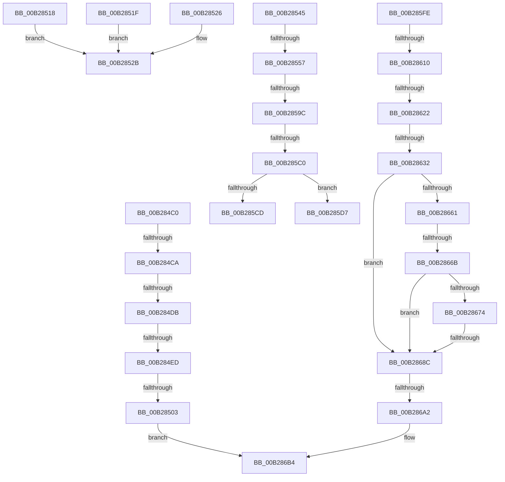

# sub_00B284C0

- RVA: `0x00B284C0`–`0x00B286C7` (길이 `519` bytes)
- VA: `0x0000000140B284C0`
- 실행 섹션: `PAGE`
- PDB 이름 있음: `아니요`; PDB Function 태그: `아니요`
- unwind 정보 RVA: `0x000936C0`
- 디코드: `129`개 명령, `519/519` bytes 표시
- 미해석 바이트: `0` (있으면 어셈블리에 `.byte`로 보존)

> 이 문서는 커널 이미지의 기계어와 PDB 기호를 분석해 생성했습니다. 4번과 5번은 함수 원형과 자료형을 바이너리 사용 방식에서 추정한 C 해석이며 원본 소스 복구 결과는 아닙니다.

## 1. Dependencies

- 직접 호출 지점: **17**; 고유 호출 대상: **12**
- 직접 호출자로 확인된 함수: **0**
- RIP 상대 이미지 참조: **1**

### Outgoing calls
- `0x00B284CE` → [PiAuDoesClientHaveAccess](../96/PiAuDoesClientHaveAccess_function_00962940.md) (function, `0x00962940`)
- `0x00B284E0` → [PiAuDoesClientHavePrivilege](../96/PiAuDoesClientHavePrivilege_function_00964ADC.md) (function, `0x00964ADC`)
- `0x00B284F4` → [RtlInitUnicodeStringEx](../../text/46/RtlInitUnicodeStringEx_function_00463960.md) (function, `0x00463960`)
- `0x00B28539` → [PiQueueDeviceRequest](../AD/PiQueueDeviceRequest_function_00AD1878.md) (function, `0x00AD1878`)
- `0x00B28560` → [KeInitializeEvent](../../text/40/KeInitializeEvent_function_0040DD10.md) (function, `0x0040DD10`)
- `0x00B2858D` → [PnpRequestDeviceAction](../../text/47/PnpRequestDeviceAction_function_00477FF8.md) (function, `0x00477FF8`)
- `0x00B285AE` → [KeWaitForSingleObject](../../text/20/KeWaitForSingleObject_function_0020E6B0.md) (function, `0x0020E6B0`)
- `0x00B285C4` → [PnpRemoveDeviceActionRequestFromQueue](../../text/5A/PnpRemoveDeviceActionRequestFromQueue_function_005A83E0.md) (function, `0x005A83E0`)
- `0x00B285DB` → [PnpCancelDeviceActionRequest](../../text/5A/PnpCancelDeviceActionRequest_function_005A8330.md) (function, `0x005A8330`)
- `0x00B285F2` → [KeWaitForSingleObject](../../text/20/KeWaitForSingleObject_function_0020E6B0.md) (function, `0x0020E6B0`)
- `0x00B28603` → [PiAuDoesClientHaveAccess](../96/PiAuDoesClientHaveAccess_function_00962940.md) (function, `0x00962940`)
- `0x00B28615` → [PiAuDoesClientHavePrivilege](../96/PiAuDoesClientHavePrivilege_function_00964ADC.md) (function, `0x00964ADC`)
- `0x00B28625` → [CmIsRootDevice](../93/CmIsRootDevice_function_009325E4.md) (function, `0x009325E4`)
- `0x00B28655` → [CmGetDeviceStatus](../9D/CmGetDeviceStatus_function_009D154C.md) (function, `0x009D154C`)
- `0x00B2867D` → [PiCMSetProblem](../73/PiCMSetProblem_function_0073B9E4.md) (function, `0x0073B9E4`)
- `0x00B28693` → [RtlInitUnicodeStringEx](../../text/46/RtlInitUnicodeStringEx_function_00463960.md) (function, `0x00463960`)
- `0x00B286BB` → [PiQueueDeviceRequest](../AD/PiQueueDeviceRequest_function_00AD1878.md) (function, `0x00AD1878`)

### Direct callers
- 이 함수 시작 RVA로 연결되는 직접 call은 확인되지 않았습니다. 간접 호출은 완전히 역산할 수 없습니다.

### Static image references
- `0x00B28632` → RVA `0x00E66398` (`.data`; read)

## 2. Other-region calls and transfers

- 다른 실행 섹션으로 향하는 call: **8**
  - `0x00B284F4` → [RtlInitUnicodeStringEx](../../text/46/RtlInitUnicodeStringEx_function_00463960.md) (`PAGE` → `.text`)
  - `0x00B28560` → [KeInitializeEvent](../../text/40/KeInitializeEvent_function_0040DD10.md) (`PAGE` → `.text`)
  - `0x00B2858D` → [PnpRequestDeviceAction](../../text/47/PnpRequestDeviceAction_function_00477FF8.md) (`PAGE` → `.text`)
  - `0x00B285AE` → [KeWaitForSingleObject](../../text/20/KeWaitForSingleObject_function_0020E6B0.md) (`PAGE` → `.text`)
  - `0x00B285C4` → [PnpRemoveDeviceActionRequestFromQueue](../../text/5A/PnpRemoveDeviceActionRequestFromQueue_function_005A83E0.md) (`PAGE` → `.text`)
  - `0x00B285DB` → [PnpCancelDeviceActionRequest](../../text/5A/PnpCancelDeviceActionRequest_function_005A8330.md) (`PAGE` → `.text`)
  - `0x00B285F2` → [KeWaitForSingleObject](../../text/20/KeWaitForSingleObject_function_0020E6B0.md) (`PAGE` → `.text`)
  - `0x00B28693` → [RtlInitUnicodeStringEx](../../text/46/RtlInitUnicodeStringEx_function_00463960.md) (`PAGE` → `.text`)
- call이 아닌 외부 분기/꼬리 이동: **17**
  - `0x00B284C4` → [PiCMDeviceAction + 0x102](../96/PiCMDeviceAction_function_0096488C.md) (`tail-transfer`)
  - `0x00B284D5` → [PiCMDeviceAction + 0x23D](../96/PiCMDeviceAction_function_0096488C.md) (`tail-transfer`)
  - `0x00B284E7` → [PiCMDeviceAction + 0x23D](../96/PiCMDeviceAction_function_0096488C.md) (`tail-transfer`)
  - `0x00B284FD` → [PiCMDeviceAction + 0x8C](../96/PiCMDeviceAction_function_0096488C.md) (`tail-transfer`)
  - `0x00B28540` → [PiCMDeviceAction + 0x1E1](../96/PiCMDeviceAction_function_0096488C.md) (`tail-transfer`)
  - `0x00B28551` → [PiCMDeviceAction + 0x1CE](../96/PiCMDeviceAction_function_0096488C.md) (`tail-transfer`)
  - `0x00B28596` → [PiCMDeviceAction + 0x1D3](../96/PiCMDeviceAction_function_0096488C.md) (`tail-transfer`)
  - `0x00B285BA` → [PiCMDeviceAction + 0x1D3](../96/PiCMDeviceAction_function_0096488C.md) (`tail-transfer`)
  - `0x00B285D2` → [PiCMDeviceAction + 0x1D3](../96/PiCMDeviceAction_function_0096488C.md) (`tail-transfer`)
  - `0x00B285F9` → [PiCMDeviceAction + 0x1D3](../96/PiCMDeviceAction_function_0096488C.md) (`tail-transfer`)
  - `0x00B2860A` → [PiCMDeviceAction + 0x23D](../96/PiCMDeviceAction_function_0096488C.md) (`tail-transfer`)
  - `0x00B2861C` → [PiCMDeviceAction + 0x23D](../96/PiCMDeviceAction_function_0096488C.md) (`tail-transfer`)
  - `0x00B2862C` → [PiCMDeviceAction + 0x102](../96/PiCMDeviceAction_function_0096488C.md) (`tail-transfer`)
  - `0x00B28665` → [PiCMDeviceAction + 0x8C](../96/PiCMDeviceAction_function_0096488C.md) (`tail-transfer`)
  - `0x00B28686` → [PiCMDeviceAction + 0x8C](../96/PiCMDeviceAction_function_0096488C.md) (`tail-transfer`)
  - `0x00B2869C` → [PiCMDeviceAction + 0x8C](../96/PiCMDeviceAction_function_0096488C.md) (`tail-transfer`)
  - `0x00B286C2` → [PiCMDeviceAction + 0x8C](../96/PiCMDeviceAction_function_0096488C.md) (`tail-transfer`)

## 3. Assembly (complete function range)

```asm
00B284C0  41 83 FA 01                     cmp r10d, 1
00B284C4  0F 85 C4 C4 E3 FF               jne 0x14096498e
00B284CA  41 8D 4A 1F                     lea ecx, [r10 + 0x1f]
00B284CE  E8 6D A4 E3 FF                  call 0x140962940
00B284D3  84 C0                           test al, al
00B284D5  0F 84 EE C5 E3 FF               je 0x140964ac9
00B284DB  B9 0A 00 00 00                  mov ecx, 0xa
00B284E0  E8 F7 C5 E3 FF                  call 0x140964adc
00B284E5  84 C0                           test al, al
00B284E7  0F 84 DC C5 E3 FF               je 0x140964ac9
00B284ED  49 8B D6                        mov rdx, r14
00B284F0  48 8D 4D C7                     lea rcx, [rbp - 0x39]
00B284F4  E8 67 B4 93 FF                  call 0x140463960
00B284F9  8B D8                           mov ebx, eax
00B284FB  85 C0                           test eax, eax
00B284FD  0F 88 15 C4 E3 FF               js 0x140964918
00B28503  45 33 C0                        xor r8d, r8d
00B28506  BA 09 00 00 00                  mov edx, 9
00B2850B  41 83 FF 02                     cmp r15d, 2
00B2850F  41 0F 95 C0                     setne r8b
00B28513  E9 9C 01 00 00                  jmp 0x140b286b4
00B28518  BA 18 00 00 00                  mov edx, 0x18
00B2851D  EB 0C                           jmp 0x140b2852b
00B2851F  BA 17 00 00 00                  mov edx, 0x17
00B28524  EB 05                           jmp 0x140b2852b
00B28526  BA 16 00 00 00                  mov edx, 0x16
00B2852B  4C 8D 4D B7                     lea r9, [rbp - 0x49]
00B2852F  41 B8 01 00 00 00               mov r8d, 1
00B28535  48 8D 4D C7                     lea rcx, [rbp - 0x39]
00B28539  E8 3A 93 FA FF                  call 0x140ad1878
00B2853E  8B D8                           mov ebx, eax
00B28540  E9 28 C5 E3 FF                  jmp 0x140964a6d
00B28545  48 8B 80 38 01 00 00            mov rax, qword ptr [rax + 0x138]
00B2854C  48 83 78 28 00                  cmp qword ptr [rax + 0x28], 0
00B28551  0F 84 03 C5 E3 FF               je 0x140964a5a
00B28557  45 33 C0                        xor r8d, r8d
00B2855A  48 8D 4D 07                     lea rcx, [rbp + 7]
00B2855E  33 D2                           xor edx, edx
00B28560  E8 AB 57 8E FF                  call 0x14040dd10
00B28565  48 8D 45 BF                     lea rax, [rbp - 0x41]
00B28569  45 33 C9                        xor r9d, r9d
00B2856C  48 89 44 24 30                  mov qword ptr [rsp + 0x30], rax
00B28571  45 33 C0                        xor r8d, r8d
00B28574  48 8D 45 B7                     lea rax, [rbp - 0x49]
00B28578  48 8B CF                        mov rcx, rdi
00B2857B  48 89 44 24 28                  mov qword ptr [rsp + 0x28], rax
00B28580  48 8D 45 07                     lea rax, [rbp + 7]
00B28584  41 8D 51 15                     lea edx, [r9 + 0x15]
00B28588  48 89 44 24 20                  mov qword ptr [rsp + 0x20], rax
00B2858D  E8 66 FA 94 FF                  call 0x140477ff8
00B28592  8B D8                           mov ebx, eax
00B28594  85 C0                           test eax, eax
00B28596  0F 88 C3 C4 E3 FF               js 0x140964a5f
00B2859C  48 83 64 24 20 00               and qword ptr [rsp + 0x20], 0
00B285A2  48 8D 4D 07                     lea rcx, [rbp + 7]
00B285A6  41 B1 01                        mov r9b, 1
00B285A9  45 33 C0                        xor r8d, r8d
00B285AC  33 D2                           xor edx, edx
00B285AE  E8 FD 60 6E FF                  call 0x14020e6b0
00B285B3  8B D8                           mov ebx, eax
00B285B5  3D 01 01 00 00                  cmp eax, 0x101
00B285BA  0F 85 9F C4 E3 FF               jne 0x140964a5f
00B285C0  48 8B 4D BF                     mov rcx, qword ptr [rbp - 0x41]
00B285C4  E8 17 FE A7 FF                  call 0x1405a83e0
00B285C9  85 C0                           test eax, eax
00B285CB  74 0A                           je 0x140b285d7
00B285CD  BB 20 01 00 C0                  mov ebx, 0xc0000120
00B285D2  E9 88 C4 E3 FF                  jmp 0x140964a5f
00B285D7  48 8B 4D BF                     mov rcx, qword ptr [rbp - 0x41]
00B285DB  E8 50 FD A7 FF                  call 0x1405a8330
00B285E0  48 83 64 24 20 00               and qword ptr [rsp + 0x20], 0
00B285E6  48 8D 4D 07                     lea rcx, [rbp + 7]
00B285EA  45 33 C9                        xor r9d, r9d
00B285ED  45 33 C0                        xor r8d, r8d
00B285F0  33 D2                           xor edx, edx
00B285F2  E8 B9 60 6E FF                  call 0x14020e6b0
00B285F7  8B D8                           mov ebx, eax
00B285F9  E9 61 C4 E3 FF                  jmp 0x140964a5f
00B285FE  B9 20 00 00 00                  mov ecx, 0x20
00B28603  E8 38 A3 E3 FF                  call 0x140962940
00B28608  84 C0                           test al, al
00B2860A  0F 84 B9 C4 E3 FF               je 0x140964ac9
00B28610  B9 0A 00 00 00                  mov ecx, 0xa
00B28615  E8 C2 C4 E3 FF                  call 0x140964adc
00B2861A  84 C0                           test al, al
00B2861C  0F 84 A7 C4 E3 FF               je 0x140964ac9
00B28622  49 8B CE                        mov rcx, r14
00B28625  E8 BA 9F E0 FF                  call 0x1409325e4
00B2862A  84 C0                           test al, al
00B2862C  0F 85 5C C3 E3 FF               jne 0x14096498e
00B28632  48 8B 0D 5F DD 33 00            mov rcx, qword ptr [rip + 0x33dd5f]
00B28639  48 8D 45 D7                     lea rax, [rbp - 0x29]
00B2863D  48 89 44 24 28                  mov qword ptr [rsp + 0x28], rax
00B28642  4C 8D 4D BB                     lea r9, [rbp - 0x45]
00B28646  48 8D 45 DB                     lea rax, [rbp - 0x25]
00B2864A  45 33 C0                        xor r8d, r8d
00B2864D  49 8B D6                        mov rdx, r14
00B28650  48 89 44 24 20                  mov qword ptr [rsp + 0x20], rax
00B28655  E8 F2 8E EA FF                  call 0x1409d154c
00B2865A  89 45 B7                        mov dword ptr [rbp - 0x49], eax
00B2865D  85 C0                           test eax, eax
00B2865F  78 2B                           js 0x140b2868c
00B28661  F6 45 BB 08                     test byte ptr [rbp - 0x45], 8
00B28665  0F 85 AD C2 E3 FF               jne 0x140964918
00B2866B  F7 45 BB 00 04 00 00            test dword ptr [rbp - 0x45], 0x400
00B28672  74 18                           je 0x140b2868c
00B28674  33 D2                           xor edx, edx
00B28676  49 8B CE                        mov rcx, r14
00B28679  44 8D 42 01                     lea r8d, [rdx + 1]
00B2867D  E8 62 33 C1 FF                  call 0x14073b9e4
00B28682  8B D8                           mov ebx, eax
00B28684  85 C0                           test eax, eax
00B28686  0F 88 8C C2 E3 FF               js 0x140964918
00B2868C  49 8B D6                        mov rdx, r14
00B2868F  48 8D 4D C7                     lea rcx, [rbp - 0x39]
00B28693  E8 C8 B2 93 FF                  call 0x140463960
00B28698  8B D8                           mov ebx, eax
00B2869A  85 C0                           test eax, eax
00B2869C  0F 88 76 C2 E3 FF               js 0x140964918
00B286A2  BA 10 00 00 00                  mov edx, 0x10
00B286A7  83 FE 01                        cmp esi, 1
00B286AA  8D 42 FC                        lea eax, [rdx - 4]
00B286AD  0F 45 D0                        cmovne edx, eax
00B286B0  44 8D 40 F5                     lea r8d, [rax - 0xb]
00B286B4  45 33 C9                        xor r9d, r9d
00B286B7  48 8D 4D C7                     lea rcx, [rbp - 0x39]
00B286BB  E8 B8 91 FA FF                  call 0x140ad1878
00B286C0  8B D8                           mov ebx, eax
00B286C2  E9 51 C2 E3 FF                  jmp 0x140964918
```

## 4. C-style interpretation (structured pseudocode)

```c
__int64 __fastcall sub_00B284C0(__int64 a1, __int64 a2, int a3)
{
    __int64 result;
    unsigned __int64 v_stack_p20;
    unsigned __int64 v_stack_p28;
    unsigned __int64 v_stack_p30;

    result = PiAuDoesClientHaveAccess(v_r10 + 31, a2, a3, a4);
    result = PiAuDoesClientHavePrivilege(10, a2, a3, a4);
    result = RtlInitUnicodeStringEx(v_rbp - 57, v_r14, a3, a4);
    a3 = 0;
    a3 = (((unsigned int)(v_r15)) != 2) ? 1 : 0;
    goto loc_00B286B4;
loc_00B286B4:
    a4 = 0;
    result = PiQueueDeviceRequest(v_rbp - 57, 9, a3, a4);
}
```

## 5. (Beta) C Style

```c
int64_t sub_00B284C0(int64_t Arg1, int64_t Arg2, int32_t Arg3)
{
    int64_t result;
    uint64_t v_stack_p20;
    uint64_t v_stack_p28;
    uint64_t v_stack_p30;

    result = PiAuDoesClientHaveAccess(local_r10 + 31, Arg2, Arg3, a4);
    result = PiAuDoesClientHavePrivilege(10, Arg2, Arg3, a4);
    result = RtlInitUnicodeStringEx(local_rbp - 57, local_r14, Arg3, a4);
    Arg3 = 0;
    Arg3 = (((uint32_t)(local_r15)) != 2) ? 1 : 0;
    goto loc_00B286B4;
loc_00B286B4:
    a4 = 0;
    result = PiQueueDeviceRequest(local_rbp - 57, 9, Arg3, a4);
}
```

## 6. Execution-region graph

[열기: 2D/3D 그래프와 함수 탐색 컨트롤 패널](../../../control-panel.html?section=page&rva=0x00B284C0&view=graph)

- 2D 그래프는 위에서 아래로 흐르고, 3D 그래프는 빈 공간을 드래그해 회전합니다. Shift+드래그는 이동, 휠은 확대·축소, 함수 노드 선택은 대상 보고서 이동입니다.

### Static fallback


