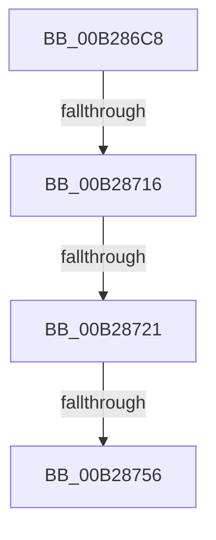

# sub_00B286C8

- RVA: `0x00B286C8`–`0x00B2876F` (길이 `167` bytes)
- VA: `0x0000000140B286C8`
- 실행 섹션: `PAGE`
- PDB 이름 있음: `아니요`; PDB Function 태그: `아니요`
- unwind 정보 RVA: `0x00093734`
- 디코드: `34`개 명령, `167/167` bytes 표시
- 미해석 바이트: `0` (있으면 어셈블리에 `.byte`로 보존)

> 이 문서는 커널 이미지의 기계어와 PDB 기호를 분석해 생성했습니다. 4번과 5번은 함수 원형과 자료형을 바이너리 사용 방식에서 추정한 C 해석이며 원본 소스 복구 결과는 아닙니다.

## 1. Dependencies

- 직접 호출 지점: **4**; 고유 호출 대상: **4**
- 직접 호출자로 확인된 함수: **0**
- RIP 상대 이미지 참조: **1**

### Outgoing calls
- `0x00B28706` → [CmGetDeviceRegProp](../8E/CmGetDeviceRegProp_function_008ED870.md) (function, `0x008ED870`)
- `0x00B2872F` → [RtlInitUnicodeString](../../text/42/RtlInitUnicodeString_function_0042A780.md) (function, `0x0042A780`)
- `0x00B28749` → [IopOpenRegistryKeyEx](../A5/IopOpenRegistryKeyEx_function_00A51B44.md) (function, `0x00A51B44`)
- `0x00B2875B` → [ZwClose](../../text/6A/ZwClose_function_006AD2B0.md) (function, `0x006AD2B0`)

### Direct callers
- 이 함수 시작 RVA로 연결되는 직접 call은 확인되지 않았습니다. 간접 호출은 완전히 역산할 수 없습니다.

### Static image references
- `0x00B286D1` → RVA `0x00E66398` (`.data`; read)

## 2. Other-region calls and transfers

- 다른 실행 섹션으로 향하는 call: **2**
  - `0x00B2872F` → [RtlInitUnicodeString](../../text/42/RtlInitUnicodeString_function_0042A780.md) (`PAGE` → `.text`)
  - `0x00B2875B` → [ZwClose](../../text/6A/ZwClose_function_006AD2B0.md) (`PAGE` → `.text`)
- call이 아닌 외부 분기/꼬리 이동: **4**
  - `0x00B28710` → [PiDevCfgEnumDeviceKeys + 0x140](../96/PiDevCfgEnumDeviceKeys_function_00964EE8.md) (`tail-transfer`)
  - `0x00B2871B` → [PiDevCfgEnumDeviceKeys + 0x240](../96/PiDevCfgEnumDeviceKeys_function_00964EE8.md) (`tail-transfer`)
  - `0x00B28750` → [PiDevCfgEnumDeviceKeys + 0x140](../96/PiDevCfgEnumDeviceKeys_function_00964EE8.md) (`tail-transfer`)
  - `0x00B2876A` → [PiDevCfgEnumDeviceKeys + 0x154](../96/PiDevCfgEnumDeviceKeys_function_00964EE8.md) (`tail-transfer`)

## 3. Assembly (complete function range)

```asm
00B286C8  49 8B 56 08                     mov rdx, qword ptr [r14 + 8]
00B286CC  48 8D 44 24 50                  lea rax, [rsp + 0x50]
00B286D1  48 8B 0D C0 DC 33 00            mov rcx, qword ptr [rip + 0x33dcc0]
00B286D8  45 33 C0                        xor r8d, r8d
00B286DB  44 89 4C 24 38                  mov dword ptr [rsp + 0x38], r9d
00B286E0  41 B9 09 00 00 00               mov r9d, 9
00B286E6  48 89 44 24 30                  mov qword ptr [rsp + 0x30], rax
00B286EB  48 8D 45 C0                     lea rax, [rbp - 0x40]
00B286EF  48 89 44 24 28                  mov qword ptr [rsp + 0x28], rax
00B286F4  48 8D 44 24 54                  lea rax, [rsp + 0x54]
00B286F9  48 89 44 24 20                  mov qword ptr [rsp + 0x20], rax
00B286FE  C7 44 24 50 4E 00 00 00         mov dword ptr [rsp + 0x50], 0x4e
00B28706  E8 65 51 DC FF                  call 0x1408ed870
00B2870B  45 33 C9                        xor r9d, r9d
00B2870E  85 C0                           test eax, eax
00B28710  0F 88 12 C9 E3 FF               js 0x140965028
00B28716  83 7C 24 54 01                  cmp dword ptr [rsp + 0x54], 1
00B2871B  0F 85 07 CA E3 FF               jne 0x140965128
00B28721  66 44 89 4D 0C                  mov word ptr [rbp + 0xc], r9w
00B28726  48 8D 55 C0                     lea rdx, [rbp - 0x40]
00B2872A  48 8D 4C 24 60                  lea rcx, [rsp + 0x60]
00B2872F  E8 4C 20 90 FF                  call 0x14042a780
00B28734  48 8B 54 24 40                  mov rdx, qword ptr [rsp + 0x40]
00B28739  4C 8D 44 24 60                  lea r8, [rsp + 0x60]
00B2873E  41 B9 3F 00 0F 00               mov r9d, 0xf003f
00B28744  48 8D 4C 24 58                  lea rcx, [rsp + 0x58]
00B28749  E8 F6 93 F2 FF                  call 0x140a51b44
00B2874E  85 C0                           test eax, eax
00B28750  0F 88 D2 C8 E3 FF               js 0x140965028
00B28756  48 8B 4C 24 40                  mov rcx, qword ptr [rsp + 0x40]
00B2875B  E8 50 4B B8 FF                  call 0x1406ad2b0
00B28760  48 8B 44 24 58                  mov rax, qword ptr [rsp + 0x58]
00B28765  48 89 44 24 40                  mov qword ptr [rsp + 0x40], rax
00B2876A  E9 CD C8 E3 FF                  jmp 0x14096503c
```

## 4. C-style interpretation (structured pseudocode)

```c
__int64 __fastcall sub_00B286C8(__int64 a1, __int64 a2, int a3, int a4, __int64 a5, __int64 a6, __int64 a7, __int64 a8, __int64 a9, __int64 a10, __int64 a11, __int64 a12)
{
    __int64 result;
    unsigned __int64 v_stack_p20;
    unsigned __int64 v_stack_p28;
    unsigned __int64 v_stack_p30;
    unsigned int v_stack_p38;
    unsigned __int64 v_stack_p40;
    unsigned int v_stack_p50;
    unsigned __int64 v_stack_p54;

    a3 = 0;
    v_stack_p38 = a4;
    v_stack_p30 = a10;
    v_stack_p28 = v_rbp - 64;
    v_stack_p20 = v_stack_p54;
    v_stack_p50 = 78;
    result = CmGetDeviceRegProp(*(unsigned __int64 *)(v_rip + 3398848), *(unsigned __int64 *)(v_r14 + 8), a3, 9);
    a4 = 0;
    *(unsigned __int16 *)(v_rbp + 12) = 0;
    result = RtlInitUnicodeString(a12, v_rbp - 64, a3, a4);
    result = IopOpenRegistryKeyEx(a11, a8, a12, (unsigned int)(0xF003FULL));
    result = ZwClose(a8, a8, a12, (unsigned int)(0xF003FULL));
    v_stack_p40 = a11;
}
```

## 5. (Beta) C Style

```c
int64_t sub_00B286C8(int64_t Arg1, int64_t Arg2, int32_t Arg3, int32_t Arg4, uint64_t Arg5, uint64_t Arg6, uint64_t Arg7, int64_t Arg8, uint64_t Arg9, int64_t Arg10, int64_t Arg11, int64_t Arg12)
{
    int64_t result;
    uint64_t v_stack_p20;
    uint64_t v_stack_p28;
    uint64_t v_stack_p30;
    uint32_t v_stack_p38;
    uint64_t v_stack_p40;
    uint32_t v_stack_p50;
    uint64_t v_stack_p54;

    Arg3 = 0;
    v_stack_p38 = Arg4;
    v_stack_p30 = Arg10;
    v_stack_p28 = local_rbp - 64;
    v_stack_p20 = v_stack_p54;
    v_stack_p50 = 78;
    result = CmGetDeviceRegProp(*(uint64_t *)(v_rip + 0x33DCC0), *(uint64_t *)(local_r14 + 0x8), Arg3, 9);
    Arg4 = 0;
    *(uint16_t *)(local_rbp + 0xC) = 0;
    result = RtlInitUnicodeString(Arg12, local_rbp - 64, Arg3, Arg4);
    result = IopOpenRegistryKeyEx(Arg11, Arg8, Arg12, (uint32_t)(0xF003FULL));
    result = ZwClose(Arg8, Arg8, Arg12, (uint32_t)(0xF003FULL));
    v_stack_p40 = Arg11;
}
```

## 6. Execution-region graph

[열기: 2D/3D 그래프와 함수 탐색 컨트롤 패널](../../../control-panel.html?section=page&rva=0x00B286C8&view=graph)

- 2D 그래프는 위에서 아래로 흐르고, 3D 그래프는 빈 공간을 드래그해 회전합니다. Shift+드래그는 이동, 휠은 확대·축소, 함수 노드 선택은 대상 보고서 이동입니다.

### Static fallback


