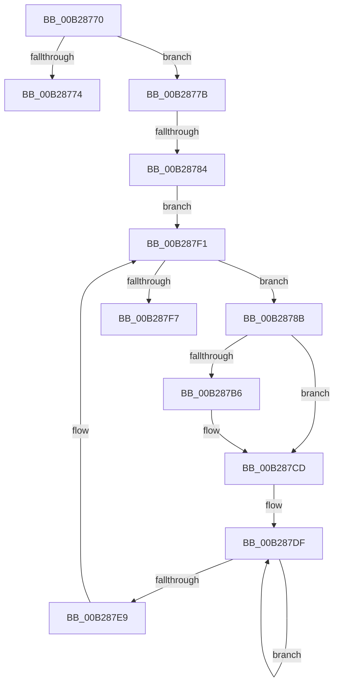

# sub_00B28770

- RVA: `0x00B28770`–`0x00B287FC` (길이 `140` bytes)
- VA: `0x0000000140B28770`
- 실행 섹션: `PAGE`
- PDB 이름 있음: `아니요`; PDB Function 태그: `아니요`
- unwind 정보 RVA: `0x000937C4`
- 디코드: `36`개 명령, `140/140` bytes 표시
- 미해석 바이트: `0` (있으면 어셈블리에 `.byte`로 보존)

> 이 문서는 커널 이미지의 기계어와 PDB 기호를 분석해 생성했습니다. 4번과 5번은 함수 원형과 자료형을 바이너리 사용 방식에서 추정한 C 해석이며 원본 소스 복구 결과는 아닙니다.

## 1. Dependencies

- 직접 호출 지점: **4**; 고유 호출 대상: **4**
- 직접 호출자로 확인된 함수: **0**
- RIP 상대 이미지 참조: **1**

### Outgoing calls
- `0x00B287AD` → [PnpCtxRegOpenKey](../8E/PnpCtxRegOpenKey_function_008EF7B8.md) (function, `0x008EF7B8`)
- `0x00B287BE` → [PnpCtxRegDeleteValue](../8F/PnpCtxRegDeleteValue_function_008FE5E0.md) (function, `0x008FE5E0`)
- `0x00B287C8` → [ZwClose](../../text/6A/ZwClose_function_006AD2B0.md) (function, `0x006AD2B0`)
- `0x00B287D6` → [PnpCtxRegDeletePath](../96/PnpCtxRegDeletePath_function_00965AD8.md) (function, `0x00965AD8`)

### Direct callers
- 이 함수 시작 RVA로 연결되는 직접 call은 확인되지 않았습니다. 간접 호출은 완전히 역산할 수 없습니다.

### Static image references
- `0x00B28793` → RVA `0x00E66398` (`.data`; read)

## 2. Other-region calls and transfers

- 다른 실행 섹션으로 향하는 call: **1**
  - `0x00B287C8` → [ZwClose](../../text/6A/ZwClose_function_006AD2B0.md) (`PAGE` → `.text`)
- call이 아닌 외부 분기/꼬리 이동: **3**
  - `0x00B28776` → [PiDevCfgClearDeviceMigrationNode + 0x236](../96/PiDevCfgClearDeviceMigrationNode_function_00965780.md) (`tail-transfer`)
  - `0x00B2877E` → [PiDevCfgClearDeviceMigrationNode + 0x236](../96/PiDevCfgClearDeviceMigrationNode_function_00965780.md) (`tail-transfer`)
  - `0x00B287F7` → [PiDevCfgClearDeviceMigrationNode + 0x236](../96/PiDevCfgClearDeviceMigrationNode_function_00965780.md) (`tail-transfer`)

## 3. Assembly (complete function range)

```asm
00B28770  85 C0                           test eax, eax
00B28772  79 07                           jns 0x140b2877b
00B28774  8B F0                           mov esi, eax
00B28776  E9 3B D2 E3 FF                  jmp 0x1409659b6
00B2877B  4C 39 27                        cmp qword ptr [rdi], r12
00B2877E  0F 84 32 D2 E3 FF               je 0x1409659b6
00B28784  48 8B 5C 24 58                  mov rbx, qword ptr [rsp + 0x58]
00B28789  EB 66                           jmp 0x140b287f1
00B2878B  48 8B 17                        mov rdx, qword ptr [rdi]
00B2878E  48 8D 44 24 68                  lea rax, [rsp + 0x68]
00B28793  48 8B 0D FE DB 33 00            mov rcx, qword ptr [rip + 0x33dbfe]
00B2879A  45 33 C9                        xor r9d, r9d
00B2879D  48 89 44 24 28                  mov qword ptr [rsp + 0x28], rax
00B287A2  4C 8B C3                        mov r8, rbx
00B287A5  C7 44 24 20 3F 00 0F 00         mov dword ptr [rsp + 0x20], 0xf003f
00B287AD  E8 06 70 DC FF                  call 0x1408ef7b8
00B287B2  85 C0                           test eax, eax
00B287B4  78 17                           js 0x140b287cd
00B287B6  48 8B 54 24 68                  mov rdx, qword ptr [rsp + 0x68]
00B287BB  4D 8B C7                        mov r8, r15
00B287BE  E8 1D 5E DD FF                  call 0x1408fe5e0
00B287C3  48 8B 4C 24 68                  mov rcx, qword ptr [rsp + 0x68]
00B287C8  E8 E3 4A B8 FF                  call 0x1406ad2b0
00B287CD  48 8B 17                        mov rdx, qword ptr [rdi]
00B287D0  45 33 C9                        xor r9d, r9d
00B287D3  4C 8B C3                        mov r8, rbx
00B287D6  E8 FD D2 E3 FF                  call 0x140965ad8
00B287DB  48 83 C8 FF                     or rax, 0xffffffffffffffff
00B287DF  48 FF C0                        inc rax
00B287E2  66 44 39 24 43                  cmp word ptr [rbx + rax*2], r12w
00B287E7  75 F6                           jne 0x140b287df
00B287E9  48 8D 1C 43                     lea rbx, [rbx + rax*2]
00B287ED  48 83 C3 02                     add rbx, 2
00B287F1  66 44 39 23                     cmp word ptr [rbx], r12w
00B287F5  75 94                           jne 0x140b2878b
00B287F7  E9 BA D1 E3 FF                  jmp 0x1409659b6
```

## 4. C-style interpretation (structured pseudocode)

```c
__int64 __fastcall sub_00B28770(__int64 a1, __int64 a2, __int64 a3, int a4, __int64 a5, __int64 a6, __int64 a7, __int64 a8, __int64 a9, __int64 a10, __int64 a11, __int64 a12, __int64 a13)
{
    __int64 result;
    __int64 v_rbx;
    unsigned int v_stack_p20;
    unsigned __int64 v_stack_p28;

    if (!sign_flag) goto loc_00B2877B;
loc_00B2877B:
    goto loc_00B287F1;
loc_00B2878B:
    a4 = 0;
    v_stack_p28 = a13;
    v_stack_p20 = 0xF003FULL;
    result = PnpCtxRegOpenKey(*(unsigned __int64 *)(v_rip + 3398654), *(unsigned __int64 *)(v_rdi), a11, a4);
    if (!(sign_flag)) {
        a2 = a13;
        a3 = v_r15;
        result = PnpCtxRegDeleteValue(*(unsigned __int64 *)(v_rip + 3398654), a2, a3, a4);
        a1 = a13;
        result = ZwClose(a1, a2, a3, a4);
    }
    a4 = 0;
    result = PnpCtxRegDeletePath(a1, *(unsigned __int64 *)(v_rdi), a11, a4);
    result = (result) | (-1);
loc_00B287DF:
    result = (result) + 1;
    if ((*(unsigned __int16 *)(a11 + result * 2)) != ((unsigned __int16)(v_r12))) goto loc_00B287DF;
    v_rbx = (a11 + result * 2) + (2);
loc_00B287F1:
    if ((*(unsigned __int16 *)(v_rbx)) != ((unsigned __int16)(v_r12))) goto loc_00B2878B;
}
```

## 5. (Beta) C Style

```c
int64_t sub_00B28770(int64_t Arg1, int64_t Arg2, int64_t Arg3, int32_t Arg4, uint64_t Arg5, uint64_t Arg6, uint64_t Arg7, uint64_t Arg8, uint64_t Arg9, uint64_t Arg10, void *Arg11, uint64_t Arg12, int64_t Arg13)
{
    uint8_t *arg11 = (uint8_t *)Arg11;

    int64_t result;
    int64_t local_rbx;
    uint32_t v_stack_p20;
    uint64_t v_stack_p28;

    if (!sign_flag) goto loc_00B2877B;
loc_00B2877B:
    goto loc_00B287F1;
loc_00B2878B:
    Arg4 = 0;
    v_stack_p28 = Arg13;
    v_stack_p20 = 0xF003FULL;
    result = PnpCtxRegOpenKey(*(uint64_t *)(v_rip + 0x33DBFE), *(uint64_t *)(local_rdi), Arg11, Arg4);
    if (!(sign_flag)) {
        Arg2 = Arg13;
        Arg3 = local_r15;
        result = PnpCtxRegDeleteValue(*(uint64_t *)(v_rip + 0x33DBFE), Arg2, Arg3, Arg4);
        Arg1 = Arg13;
        result = ZwClose(Arg1, Arg2, Arg3, Arg4);
    }
    Arg4 = 0;
    result = PnpCtxRegDeletePath(Arg1, *(uint64_t *)(local_rdi), Arg11, Arg4);
    result = (result) | (-1);
loc_00B287DF:
    result = (result) + 1;
    if ((*(uint16_t *)(arg11 + result * 2)) != ((uint16_t)(local_r12))) goto loc_00B287DF;
    local_rbx = (Arg11 + result * 2) + (2);
loc_00B287F1:
    if ((*(uint16_t *)(local_rbx)) != ((uint16_t)(local_r12))) goto loc_00B2878B;
}
```

### 관측된 메모리 오프셋

구조체 형식이 확인되지 않은 접근은 인자 기준의 오프셋으로만 기록했습니다.

| 기준 인자 | 오프셋 표현 | 폭 (bit) | 접근 |
|---|---:|---:|---|
| `Arg11` | `+ 0x0` | `16` | `R` |
| `Arg11` | `+ 0x0 + rax*2` | `16` | `R` |
| `Arg11` | `+ 0x0 + rax*2` | `64` | `R` |

## 6. Execution-region graph

[열기: 2D/3D 그래프와 함수 탐색 컨트롤 패널](../../../control-panel.html?section=page&rva=0x00B28770&view=graph)

- 2D 그래프는 위에서 아래로 흐르고, 3D 그래프는 빈 공간을 드래그해 회전합니다. Shift+드래그는 이동, 휠은 확대·축소, 함수 노드 선택은 대상 보고서 이동입니다.

### Static fallback


