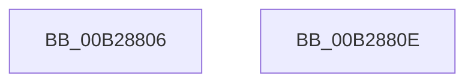

# sub_00B28806

- RVA: `0x00B28806`–`0x00B2884D` (길이 `71` bytes)
- VA: `0x0000000140B28806`
- 실행 섹션: `PAGE`
- PDB 이름 있음: `아니요`; PDB Function 태그: `아니요`
- unwind 정보 RVA: `0x0009527C`
- 디코드: `15`개 명령, `71/71` bytes 표시
- 미해석 바이트: `0` (있으면 어셈블리에 `.byte`로 보존)

> 이 문서는 커널 이미지의 기계어와 PDB 기호를 분석해 생성했습니다. 4번과 5번은 함수 원형과 자료형을 바이너리 사용 방식에서 추정한 C 해석이며 원본 소스 복구 결과는 아닙니다.

## 1. Dependencies

- 직접 호출 지점: **1**; 고유 호출 대상: **1**
- 직접 호출자로 확인된 함수: **0**
- RIP 상대 이미지 참조: **1**

### Outgoing calls
- `0x00B2881B` → [KeQueryTimeIncrement](../../text/44/KeQueryTimeIncrement_function_0044B4C0.md) (function, `0x0044B4C0`)

### Direct callers
- 이 함수 시작 RVA로 연결되는 직접 call은 확인되지 않았습니다. 간접 호출은 완전히 역산할 수 없습니다.

### Static image references
- `0x00B28841` → RVA `0x00FD8118` (`PAGEDATA`; write)

## 2. Other-region calls and transfers

- 다른 실행 섹션으로 향하는 call: **1**
  - `0x00B2881B` → [KeQueryTimeIncrement](../../text/44/KeQueryTimeIncrement_function_0044B4C0.md) (`PAGE` → `.text`)
- call이 아닌 외부 분기/꼬리 이동: **2**
  - `0x00B28809` → [SPCallServerHandleQueryPolicy + 0xA2D](../96/SPCallServerHandleQueryPolicy_function_0096AF24.md) (`tail-transfer`)
  - `0x00B28848` → [SPCallServerHandleQueryPolicy + 0x5A4](../96/SPCallServerHandleQueryPolicy_function_0096AF24.md) (`tail-transfer`)

## 3. Assembly (complete function range)

```asm
00B28806  45 33 ED                        xor r13d, r13d
00B28809  E9 43 31 E4 FF                  jmp 0x14096b951
00B2880E  48 BB 20 03 00 00 80 F7 FF FF   movabs rbx, 0xfffff78000000320
00B28818  48 8B 1B                        mov rbx, qword ptr [rbx]
00B2881B  E8 A0 2C 92 FF                  call 0x14044b4c0
00B28820  8B C8                           mov ecx, eax
00B28822  48 B8 4B 59 86 38 D6 C5 6D 34   movabs rax, 0x346dc5d63886594b
00B2882C  48 0F AF CB                     imul rcx, rbx
00B28830  48 F7 E9                        imul rcx
00B28833  48 C1 FA 0B                     sar rdx, 0xb
00B28837  48 8B C2                        mov rax, rdx
00B2883A  48 C1 E8 3F                     shr rax, 0x3f
00B2883E  48 03 D0                        add rdx, rax
00B28841  48 89 15 D0 F8 4A 00            mov qword ptr [rip + 0x4af8d0], rdx
00B28848  E9 7B 2C E4 FF                  jmp 0x14096b4c8
```

## 4. C-style interpretation (structured pseudocode)

```c
__int64 __fastcall sub_00B28806(__int64 a1, __int64 a2)
{
    __int64 v_r13;

    v_r13 = 0;
}
```

## 5. (Beta) C Style

```c
int64_t sub_00B28806(int64_t Arg1, int64_t Arg2)
{
    int64_t local_r13;

    local_r13 = 0;
}
```

## 6. Execution-region graph

[열기: 2D/3D 그래프와 함수 탐색 컨트롤 패널](../../../control-panel.html?section=page&rva=0x00B28806&view=graph)

- 2D 그래프는 위에서 아래로 흐르고, 3D 그래프는 빈 공간을 드래그해 회전합니다. Shift+드래그는 이동, 휠은 확대·축소, 함수 노드 선택은 대상 보고서 이동입니다.

### Static fallback


