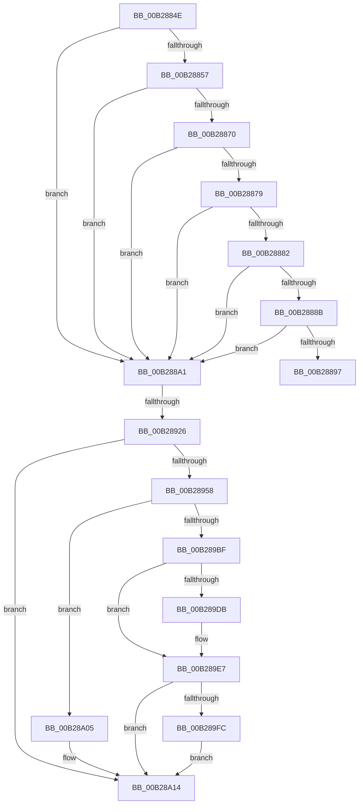

# sub_00B2884E

- RVA: `0x00B2884E`–`0x00B28A25` (길이 `471` bytes)
- VA: `0x0000000140B2884E`
- 실행 섹션: `PAGE`
- PDB 이름 있음: `아니요`; PDB Function 태그: `아니요`
- unwind 정보 RVA: `0x00095CFC`
- 디코드: `107`개 명령, `471/471` bytes 표시
- 미해석 바이트: `0` (있으면 어셈블리에 `.byte`로 보존)

> 이 문서는 커널 이미지의 기계어와 PDB 기호를 분석해 생성했습니다. 4번과 5번은 함수 원형과 자료형을 바이너리 사용 방식에서 추정한 C 해석이며 원본 소스 복구 결과는 아닙니다.

## 1. Dependencies

- 직접 호출 지점: **14**; 고유 호출 대상: **10**
- 직접 호출자로 확인된 함수: **0**
- RIP 상대 이미지 참조: **3**

### Outgoing calls
- `0x00B2884E` → [Feature_ShadowAdmin__private_IsEnabledDeviceUsageNoInline](../../text/4C/Feature_ShadowAdmin__private_IsEnabledDeviceUsageNoInline_function_004C78E8.md) (function, `0x004C78E8`)
- `0x00B28861` → [RtlQueryElevationFlags](../A6/RtlQueryElevationFlags_function_00A60CB0.md) (function, `0x00A60CB0`)
- `0x00B288A8` → [PsGetServerSiloServiceSessionId](../../text/45/PsGetServerSiloServiceSessionId_function_0045ED00.md) (function, `0x0045ED00`)
- `0x00B288CE` → [swprintf_s](../../text/50/swprintf_s_function_00504B20.md) (function, `0x00504B20`)
- `0x00B288DC` → [RtlInitUnicodeString](../../text/42/RtlInitUnicodeString_function_0042A780.md) (function, `0x0042A780`)
- `0x00B28919` → [ZwCreateDirectoryObject](../../text/6A/ZwCreateDirectoryObject_function_006AE650.md) (function, `0x006AE650`)
- `0x00B28949` → [ObpSetDeviceMap](../A9/ObpSetDeviceMap_function_00A925D0.md) (function, `0x00A925D0`)
- `0x00B28963` → [RtlInitUnicodeString](../../text/42/RtlInitUnicodeString_function_0042A780.md) (function, `0x0042A780`)
- `0x00B28974` → [RtlInitUnicodeString](../../text/42/RtlInitUnicodeString_function_0042A780.md) (function, `0x0042A780`)
- `0x00B289B4` → [ZwCreateSymbolicLinkObject](../../text/6A/ZwCreateSymbolicLinkObject_function_006AE9D0.md) (function, `0x006AE9D0`)
- `0x00B289C4` → [ZwClose](../../text/6A/ZwClose_function_006AD2B0.md) (function, `0x006AD2B0`)
- `0x00B289E2` → [ObDereferenceDeviceMap](../96/ObDereferenceDeviceMap_function_0096D0E8.md) (function, `0x0096D0E8`)
- `0x00B28A0F` → [ObDereferenceDeviceMap](../96/ObDereferenceDeviceMap_function_0096D0E8.md) (function, `0x0096D0E8`)
- `0x00B28A19` → [ZwClose](../../text/6A/ZwClose_function_006AD2B0.md) (function, `0x006AD2B0`)

### Direct callers
- 이 함수 시작 RVA로 연결되는 직접 call은 확인되지 않았습니다. 간접 호출은 완전히 역산할 수 없습니다.

### Static image references
- `0x00B288B0` → RVA `0x00B060B0` (` ?? ::NNGAKEGL::`string'`; read)
- `0x00B28958` → RVA `0x00B013F0` (` ?? ::NNGAKEGL::`string'`; read)
- `0x00B28968` → RVA `0x00B06090` (` ?? ::NNGAKEGL::`string'`; read)

## 2. Other-region calls and transfers

- 다른 실행 섹션으로 향하는 call: **10**
  - `0x00B2884E` → [Feature_ShadowAdmin__private_IsEnabledDeviceUsageNoInline](../../text/4C/Feature_ShadowAdmin__private_IsEnabledDeviceUsageNoInline_function_004C78E8.md) (`PAGE` → `.text`)
  - `0x00B288A8` → [PsGetServerSiloServiceSessionId](../../text/45/PsGetServerSiloServiceSessionId_function_0045ED00.md) (`PAGE` → `.text`)
  - `0x00B288CE` → [swprintf_s](../../text/50/swprintf_s_function_00504B20.md) (`PAGE` → `.text`)
  - `0x00B288DC` → [RtlInitUnicodeString](../../text/42/RtlInitUnicodeString_function_0042A780.md) (`PAGE` → `.text`)
  - `0x00B28919` → [ZwCreateDirectoryObject](../../text/6A/ZwCreateDirectoryObject_function_006AE650.md) (`PAGE` → `.text`)
  - `0x00B28963` → [RtlInitUnicodeString](../../text/42/RtlInitUnicodeString_function_0042A780.md) (`PAGE` → `.text`)
  - `0x00B28974` → [RtlInitUnicodeString](../../text/42/RtlInitUnicodeString_function_0042A780.md) (`PAGE` → `.text`)
  - `0x00B289B4` → [ZwCreateSymbolicLinkObject](../../text/6A/ZwCreateSymbolicLinkObject_function_006AE9D0.md) (`PAGE` → `.text`)
  - `0x00B289C4` → [ZwClose](../../text/6A/ZwClose_function_006AD2B0.md) (`PAGE` → `.text`)
  - `0x00B28A19` → [ZwClose](../../text/6A/ZwClose_function_006AD2B0.md) (`PAGE` → `.text`)
- call이 아닌 외부 분기/꼬리 이동: **3**
  - `0x00B2889C` → [SeGetTokenDeviceMap + 0x9D](../96/SeGetTokenDeviceMap_function_0096CE8C.md) (`tail-transfer`)
  - `0x00B28920` → [SeGetTokenDeviceMap + 0x9D](../96/SeGetTokenDeviceMap_function_0096CE8C.md) (`tail-transfer`)
  - `0x00B28A20` → [SeGetTokenDeviceMap + 0x9D](../96/SeGetTokenDeviceMap_function_0096CE8C.md) (`tail-transfer`)

## 3. Assembly (complete function range)

```asm
00B2884E  E8 95 F0 99 FF                  call 0x1404c78e8
00B28853  85 C0                           test eax, eax
00B28855  74 4A                           je 0x140b288a1
00B28857  83 64 24 30 00                  and dword ptr [rsp + 0x30], 0
00B2885C  48 8D 4C 24 30                  lea rcx, [rsp + 0x30]
00B28861  E8 4A 84 F3 FF                  call 0x140a60cb0
00B28866  8B 44 24 30                     mov eax, dword ptr [rsp + 0x30]
00B2886A  24 18                           and al, 0x18
00B2886C  3C 10                           cmp al, 0x10
00B2886E  75 31                           jne 0x140b288a1
00B28870  83 BB C0 00 00 00 02            cmp dword ptr [rbx + 0xc0], 2
00B28877  75 28                           jne 0x140b288a1
00B28879  83 BB C4 00 00 00 02            cmp dword ptr [rbx + 0xc4], 2
00B28880  7D 1F                           jge 0x140b288a1
00B28882  48 8B 47 38                     mov rax, qword ptr [rdi + 0x38]
00B28886  48 85 C0                        test rax, rax
00B28889  74 16                           je 0x140b288a1
00B2888B  F7 80 C8 00 00 00 00 00 00 08   test dword ptr [rax + 0xc8], 0x8000000
00B28895  74 0A                           je 0x140b288a1
00B28897  B8 22 00 00 C0                  mov eax, 0xc0000022
00B2889C  E9 88 46 E4 FF                  jmp 0x14096cf29
00B288A1  48 8B 8F A8 00 00 00            mov rcx, qword ptr [rdi + 0xa8]
00B288A8  E8 53 64 93 FF                  call 0x14045ed00
00B288AD  44 8B C8                        mov r9d, eax
00B288B0  4C 8D 05 F9 D7 FD FF            lea r8, [rip - 0x22807]
00B288B7  8B 43 18                        mov eax, dword ptr [rbx + 0x18]
00B288BA  48 8D 4D A0                     lea rcx, [rbp - 0x60]
00B288BE  89 44 24 28                     mov dword ptr [rsp + 0x28], eax
00B288C2  BA 40 00 00 00                  mov edx, 0x40
00B288C7  8B 43 1C                        mov eax, dword ptr [rbx + 0x1c]
00B288CA  89 44 24 20                     mov dword ptr [rsp + 0x20], eax
00B288CE  E8 4D C2 9D FF                  call 0x140504b20
00B288D3  48 8D 55 A0                     lea rdx, [rbp - 0x60]
00B288D7  48 8D 4C 24 50                  lea rcx, [rsp + 0x50]
00B288DC  E8 9F 1E 90 FF                  call 0x14042a780
00B288E1  48 83 64 24 68 00               and qword ptr [rsp + 0x68], 0
00B288E7  48 8D 44 24 50                  lea rax, [rsp + 0x50]
00B288EC  0F 57 C0                        xorps xmm0, xmm0
00B288EF  48 89 44 24 70                  mov qword ptr [rsp + 0x70], rax
00B288F4  BB 30 00 00 00                  mov ebx, 0x30
00B288F9  C7 44 24 78 C0 02 00 00         mov dword ptr [rsp + 0x78], 0x2c0
00B28901  4C 8D 44 24 60                  lea r8, [rsp + 0x60]
00B28906  89 5C 24 60                     mov dword ptr [rsp + 0x60], ebx
00B2890A  BA 0F 00 0F 00                  mov edx, 0xf000f
00B2890F  48 8D 4C 24 40                  lea rcx, [rsp + 0x40]
00B28914  F3 0F 7F 45 80                  movdqu xmmword ptr [rbp - 0x80], xmm0
00B28919  E8 32 5D B8 FF                  call 0x1406ae650
00B2891E  85 C0                           test eax, eax
00B28920  0F 88 03 46 E4 FF               js 0x14096cf29
00B28926  48 8B 8F A8 00 00 00            mov rcx, qword ptr [rdi + 0xa8]
00B2892D  48 8D 44 24 38                  lea rax, [rsp + 0x38]
00B28932  4C 8B 44 24 40                  mov r8, qword ptr [rsp + 0x40]
00B28937  45 33 C9                        xor r9d, r9d
00B2893A  48 89 44 24 28                  mov qword ptr [rsp + 0x28], rax
00B2893F  33 D2                           xor edx, edx
00B28941  C7 44 24 20 02 00 00 00         mov dword ptr [rsp + 0x20], 2
00B28949  E8 82 9C F6 FF                  call 0x140a925d0
00B2894E  8B F0                           mov esi, eax
00B28950  85 C0                           test eax, eax
00B28952  0F 88 BC 00 00 00               js 0x140b28a14
00B28958  48 8D 15 91 8A FD FF            lea rdx, [rip - 0x2756f]
00B2895F  48 8D 4D 90                     lea rcx, [rbp - 0x70]
00B28963  E8 18 1E 90 FF                  call 0x14042a780
00B28968  48 8D 15 21 D7 FD FF            lea rdx, [rip - 0x228df]
00B2896F  48 8D 4C 24 50                  lea rcx, [rsp + 0x50]
00B28974  E8 07 1E 90 FF                  call 0x14042a780
00B28979  48 8B 44 24 40                  mov rax, qword ptr [rsp + 0x40]
00B2897E  4C 8D 4C 24 50                  lea r9, [rsp + 0x50]
00B28983  48 89 44 24 68                  mov qword ptr [rsp + 0x68], rax
00B28988  4C 8D 44 24 60                  lea r8, [rsp + 0x60]
00B2898D  48 8D 45 90                     lea rax, [rbp - 0x70]
00B28991  89 5C 24 60                     mov dword ptr [rsp + 0x60], ebx
00B28995  0F 57 C0                        xorps xmm0, xmm0
00B28998  48 89 44 24 70                  mov qword ptr [rsp + 0x70], rax
00B2899D  BA 01 00 0F 00                  mov edx, 0xf0001
00B289A2  C7 44 24 78 D0 02 00 00         mov dword ptr [rsp + 0x78], 0x2d0
00B289AA  48 8D 4C 24 48                  lea rcx, [rsp + 0x48]
00B289AF  F3 0F 7F 45 80                  movdqu xmmword ptr [rbp - 0x80], xmm0
00B289B4  E8 17 60 B8 FF                  call 0x1406ae9d0
00B289B9  8B F0                           mov esi, eax
00B289BB  85 C0                           test eax, eax
00B289BD  78 46                           js 0x140b28a05
00B289BF  48 8B 4C 24 48                  mov rcx, qword ptr [rsp + 0x48]
00B289C4  E8 E7 48 B8 FF                  call 0x1406ad2b0
00B289C9  48 8B 4C 24 38                  mov rcx, qword ptr [rsp + 0x38]
00B289CE  33 C0                           xor eax, eax
00B289D0  8D 58 01                        lea ebx, [rax + 1]
00B289D3  F0 48 0F B1 4F 30               lock cmpxchg qword ptr [rdi + 0x30], rcx
00B289D9  74 0C                           je 0x140b289e7
00B289DB  48 8B 4C 24 38                  mov rcx, qword ptr [rsp + 0x38]
00B289E0  8B D3                           mov edx, ebx
00B289E2  E8 01 47 E4 FF                  call 0x14096d0e8
00B289E7  48 8B 47 30                     mov rax, qword ptr [rdi + 0x30]
00B289EB  49 89 06                        mov qword ptr [r14], rax
00B289EE  F0 48 0F C1 98 F0 00 00 00      lock xadd qword ptr [rax + 0xf0], rbx
00B289F7  48 85 DB                        test rbx, rbx
00B289FA  7F 18                           jg 0x140b28a14
00B289FC  B9 0E 00 00 00                  mov ecx, 0xe
00B28A01  CD 29                           int 0x29
00B28A03  EB 0F                           jmp 0x140b28a14
00B28A05  48 8B 4C 24 38                  mov rcx, qword ptr [rsp + 0x38]
00B28A0A  BA 01 00 00 00                  mov edx, 1
00B28A0F  E8 D4 46 E4 FF                  call 0x14096d0e8
00B28A14  48 8B 4C 24 40                  mov rcx, qword ptr [rsp + 0x40]
00B28A19  E8 92 48 B8 FF                  call 0x1406ad2b0
00B28A1E  8B C6                           mov eax, esi
00B28A20  E9 04 45 E4 FF                  jmp 0x14096cf29
```

## 4. C-style interpretation (structured pseudocode)

```c
__int64 __fastcall sub_00B2884E(__int64 a1, __int64 a2, __int64 a3, __int64 a4, __int64 a5, unsigned int a6, __int64 a7, __int64 a8, __int64 a9, __int64 a10, __int64 a11, __int64 a12, __int64 a13)
{
    __int64 result;
    unsigned int v_stack_p20;
    unsigned int v_stack_p28;
    unsigned int v_stack_p60;
    unsigned __int64 v_stack_p68;
    unsigned __int64 v_stack_p70;
    unsigned int v_stack_p78;

    result = Feature_ShadowAdmin__private_IsEnabledDeviceUsageNoInline(a1, a2, a3, a4);
    if ((unsigned int)(result) == 0) goto loc_00B288A1;
    result = RtlQueryElevationFlags(a6, a2, a3, a4);
    result = (unsigned __int8)(((unsigned int)(a6)) & (24));
    if (((unsigned __int8)(result)) != 16) goto loc_00B288A1;
    if ((*(unsigned int *)(v_rbx + 192)) != 2) goto loc_00B288A1;
    if ((*(unsigned int *)(v_rbx + 196)) >= 2) goto loc_00B288A1;
    if (*(unsigned __int64 *)(v_rdi + 56) == 0) goto loc_00B288A1;
    if (((*(unsigned int *)(*(unsigned __int64 *)(v_rdi + 56) + 200)) & (0x8000000ULL)) == 0) goto loc_00B288A1;
loc_00B288A1:
    result = PsGetServerSiloServiceSessionId(*(unsigned __int64 *)(v_rdi + 168), a2, a3, a4);
    v_stack_p28 = (unsigned int)((unsigned int)(*(unsigned int *)(v_rbx + 24)));
    v_stack_p20 = (unsigned int)((unsigned int)(*(unsigned int *)(v_rbx + 28)));
    result = swprintf_s(v_rbp - 96, 64, v_rip - 141319, (unsigned int)((unsigned int)(result)));
    result = RtlInitUnicodeString(a10, v_rbp - 96, v_rip - 141319, (unsigned int)((unsigned int)(result)));
    v_stack_p70 = a10;
    v_stack_p78 = 704;
    v_stack_p60 = 48;
    *(unsigned __int64 *)(v_rbp - 128) = v_xmm0;
    result = ZwCreateDirectoryObject(a8, (unsigned int)(0xF000FULL), a12, (unsigned int)((unsigned int)(result)));
    a4 = 0;
    v_stack_p28 = a7;
    a2 = 0;
    v_stack_p20 = 2;
    result = ObpSetDeviceMap(*(unsigned __int64 *)(v_rdi + 168), a2, a8, a4);
    if (sign_flag) goto loc_00B28A14;
    result = RtlInitUnicodeString(v_rbp - 112, v_rip - 161135, a8, a4);
    result = RtlInitUnicodeString(a10, v_rip - 141535, a8, a4);
    v_stack_p68 = a8;
    v_stack_p60 = 48;
    v_stack_p70 = v_rbp - 112;
    v_stack_p78 = 720;
    *(unsigned __int64 *)(v_rbp - 128) = v_xmm0;
    result = ZwCreateSymbolicLinkObject(a9, (unsigned int)(0xF0001ULL), a12, a10);
    if (sign_flag) goto loc_00B28A05;
    result = ZwClose(a9, (unsigned int)(0xF0001ULL), a12, a10);
    result = 0;
    if (!(condition_is_equal)) {
        a1 = a7;
        a2 = (unsigned int)(result + 1);
        result = ObDereferenceDeviceMap(a1, a2, a12, a10);
    }
    *(unsigned __int64 *)(v_r14) = *(unsigned __int64 *)(v_rdi + 48);
    if (condition_is_greater) goto loc_00B28A14;
    goto loc_00B28A14;
loc_00B28A05:
    result = ObDereferenceDeviceMap(a7, 1, a12, a10);
loc_00B28A14:
    result = ZwClose(a8, 1, a12, a10);
}
```

## 5. (Beta) C Style

```c
int64_t sub_00B2884E(int64_t Arg1, int64_t Arg2, int64_t Arg3, int64_t Arg4, uint64_t Arg5, uint32_t Arg6, int64_t Arg7, int64_t Arg8, int64_t Arg9, int64_t Arg10, uint64_t Arg11, int64_t Arg12, int64_t Arg13)
{
    int64_t result;
    uint32_t v_stack_p20;
    uint32_t v_stack_p28;
    uint32_t v_stack_p60;
    uint64_t v_stack_p68;
    uint64_t v_stack_p70;
    uint32_t v_stack_p78;

    result = Feature_ShadowAdmin__private_IsEnabledDeviceUsageNoInline(Arg1, Arg2, Arg3, Arg4);
    if ((uint32_t)(result) == 0) goto loc_00B288A1;
    result = RtlQueryElevationFlags(Arg6, Arg2, Arg3, Arg4);
    result = (uint8_t)(((uint32_t)(Arg6)) & (24));
    if (((uint8_t)(result)) != 16) goto loc_00B288A1;
    if ((*(uint32_t *)(local_rbx + 0xC0)) != 2) goto loc_00B288A1;
    if ((*(uint32_t *)(local_rbx + 0xC4)) >= 2) goto loc_00B288A1;
    if (*(uint64_t *)(local_rdi + 0x38) == 0) goto loc_00B288A1;
    if (((*(uint32_t *)(*(uint64_t *)(local_rdi + 0x38) + 0xC8)) & (0x8000000ULL)) == 0) goto loc_00B288A1;
loc_00B288A1:
    result = PsGetServerSiloServiceSessionId(*(uint64_t *)(local_rdi + 0xA8), Arg2, Arg3, Arg4);
    v_stack_p28 = (uint32_t)((uint32_t)(*(uint32_t *)(local_rbx + 0x18)));
    v_stack_p20 = (uint32_t)((uint32_t)(*(uint32_t *)(local_rbx + 0x1C)));
    result = swprintf_s(local_rbp - 96, 64, v_rip - 141319, (uint32_t)((uint32_t)(result)));
    result = RtlInitUnicodeString(Arg10, local_rbp - 96, v_rip - 141319, (uint32_t)((uint32_t)(result)));
    v_stack_p70 = Arg10;
    v_stack_p78 = 704;
    v_stack_p60 = 48;
    *(uint64_t *)(local_rbp - 0x80) = v_xmm0;
    result = ZwCreateDirectoryObject(Arg8, (uint32_t)(0xF000FULL), Arg12, (uint32_t)((uint32_t)(result)));
    Arg4 = 0;
    v_stack_p28 = Arg7;
    Arg2 = 0;
    v_stack_p20 = 2;
    result = ObpSetDeviceMap(*(uint64_t *)(local_rdi + 0xA8), Arg2, Arg8, Arg4);
    if (sign_flag) goto loc_00B28A14;
    result = RtlInitUnicodeString(local_rbp - 112, v_rip - 161135, Arg8, Arg4);
    result = RtlInitUnicodeString(Arg10, v_rip - 141535, Arg8, Arg4);
    v_stack_p68 = Arg8;
    v_stack_p60 = 48;
    v_stack_p70 = local_rbp - 112;
    v_stack_p78 = 720;
    *(uint64_t *)(local_rbp - 0x80) = v_xmm0;
    result = ZwCreateSymbolicLinkObject(Arg9, (uint32_t)(0xF0001ULL), Arg12, Arg10);
    if (sign_flag) goto loc_00B28A05;
    result = ZwClose(Arg9, (uint32_t)(0xF0001ULL), Arg12, Arg10);
    result = 0;
    if (!(condition_is_equal)) {
        Arg1 = Arg7;
        Arg2 = (uint32_t)(result + 1);
        result = ObDereferenceDeviceMap(Arg1, Arg2, Arg12, Arg10);
    }
    *(uint64_t *)(local_r14) = *(uint64_t *)(local_rdi + 0x30);
    if (condition_is_greater) goto loc_00B28A14;
    goto loc_00B28A14;
loc_00B28A05:
    result = ObDereferenceDeviceMap(Arg7, 1, Arg12, Arg10);
loc_00B28A14:
    result = ZwClose(Arg8, 1, Arg12, Arg10);
}
```

## 6. Execution-region graph

[열기: 2D/3D 그래프와 함수 탐색 컨트롤 패널](../../../control-panel.html?section=page&rva=0x00B2884E&view=graph)

- 2D 그래프는 위에서 아래로 흐르고, 3D 그래프는 빈 공간을 드래그해 회전합니다. Shift+드래그는 이동, 휠은 확대·축소, 함수 노드 선택은 대상 보고서 이동입니다.

### Static fallback


