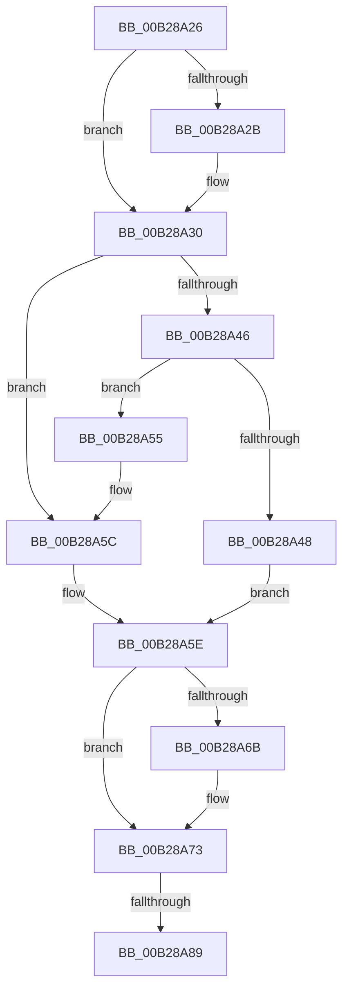

# sub_00B28A26

- RVA: `0x00B28A26`–`0x00B28A97` (길이 `113` bytes)
- VA: `0x0000000140B28A26`
- 실행 섹션: `PAGE`
- PDB 이름 있음: `아니요`; PDB Function 태그: `아니요`
- unwind 정보 RVA: `0x00095D24`
- 디코드: `31`개 명령, `113/113` bytes 표시
- 미해석 바이트: `0` (있으면 어셈블리에 `.byte`로 보존)

> 이 문서는 커널 이미지의 기계어와 PDB 기호를 분석해 생성했습니다. 4번과 5번은 함수 원형과 자료형을 바이너리 사용 방식에서 추정한 C 해석이며 원본 소스 복구 결과는 아닙니다.

## 1. Dependencies

- 직접 호출 지점: **4**; 고유 호출 대상: **4**
- 직접 호출자로 확인된 함수: **0**
- RIP 상대 이미지 참조: **0**

### Outgoing calls
- `0x00B28A6E` → [ExfTryToWakePushLock](../../text/26/ExfTryToWakePushLock_function_00265DD0.md) (function, `0x00265DD0`)
- `0x00B28A76` → [KeAbPostRelease](../../text/2E/KeAbPostRelease_function_002E1600.md) (function, `0x002E1600`)
- `0x00B28A7B` → [KeLeaveGuardedRegion](../../text/2E/KeLeaveGuardedRegion_function_002E2C40.md) (function, `0x002E2C40`)
- `0x00B28A8C` → [ObpDeleteDeviceMap](../74/ObpDeleteDeviceMap_function_0074F2F0.md) (function, `0x0074F2F0`)

### Direct callers
- 이 함수 시작 RVA로 연결되는 직접 call은 확인되지 않았습니다. 간접 호출은 완전히 역산할 수 없습니다.

### Static image references
- 디코드된 RIP-relative 메모리 참조가 없습니다.

## 2. Other-region calls and transfers

- 다른 실행 섹션으로 향하는 call: **3**
  - `0x00B28A6E` → [ExfTryToWakePushLock](../../text/26/ExfTryToWakePushLock_function_00265DD0.md) (`PAGE` → `.text`)
  - `0x00B28A76` → [KeAbPostRelease](../../text/2E/KeAbPostRelease_function_002E1600.md) (`PAGE` → `.text`)
  - `0x00B28A7B` → [KeLeaveGuardedRegion](../../text/2E/KeLeaveGuardedRegion_function_002E2C40.md) (`PAGE` → `.text`)
- call이 아닌 외부 분기/꼬리 이동: **2**
  - `0x00B28A83` → [ObDereferenceDeviceMap + 0x44](../96/ObDereferenceDeviceMap_function_0096D0E8.md) (`tail-transfer`)
  - `0x00B28A92` → [ObDereferenceDeviceMap + 0x44](../96/ObDereferenceDeviceMap_function_0096D0E8.md) (`tail-transfer`)

## 3. Assembly (complete function range)

```asm
00B28A26  4D 85 F6                        test r14, r14
00B28A29  74 05                           je 0x140b28a30
00B28A2B  41 C6 46 0A 01                  mov byte ptr [r14 + 0xa], 1
00B28A30  F7 DD                           neg ebp
00B28A32  48 63 C5                        movsxd rax, ebp
00B28A35  F0 48 0F C1 87 F0 00 00 00      lock xadd qword ptr [rdi + 0xf0], rax
00B28A3E  49 2B C7                        sub rax, r15
00B28A41  48 85 C0                        test rax, rax
00B28A44  7F 16                           jg 0x140b28a5c
00B28A46  75 0D                           jne 0x140b28a55
00B28A48  48 8B 07                        mov rax, qword ptr [rdi]
00B28A4B  48 83 A0 30 01 00 00 00         and qword ptr [rax + 0x130], 0
00B28A53  EB 09                           jmp 0x140b28a5e
00B28A55  B9 0E 00 00 00                  mov ecx, 0xe
00B28A5A  CD 29                           int 0x29
00B28A5C  33 FF                           xor edi, edi
00B28A5E  F0 48 0F C1 1E                  lock xadd qword ptr [rsi], rbx
00B28A63  80 E3 06                        and bl, 6
00B28A66  80 FB 02                        cmp bl, 2
00B28A69  75 08                           jne 0x140b28a73
00B28A6B  48 8B CE                        mov rcx, rsi
00B28A6E  E8 5D D3 73 FF                  call 0x140265dd0
00B28A73  48 8B CE                        mov rcx, rsi
00B28A76  E8 85 8B 7B FF                  call 0x1402e1600
00B28A7B  E8 C0 A1 7B FF                  call 0x1402e2c40
00B28A80  48 85 FF                        test rdi, rdi
00B28A83  0F 84 A3 46 E4 FF               je 0x14096d12c
00B28A89  48 8B CF                        mov rcx, rdi
00B28A8C  E8 5F 68 C2 FF                  call 0x14074f2f0
00B28A91  90                              nop
00B28A92  E9 95 46 E4 FF                  jmp 0x14096d12c
```

## 4. C-style interpretation (structured pseudocode)

```c
__int64 __fastcall sub_00B28A26(void)
{
    __int64 result;
    __int64 v_rbp;
    __int64 v_rbx;
    __int64 v_rdi;

    if (v_r14 != 0) {
        *(unsigned __int8 *)(v_r14 + 10) = 1;
    }
    v_rbp = (unsigned int)(-(v_rbp));
    result = ((int)((unsigned int)(v_rbp))) - (v_r15);
    if (condition_is_greater) goto loc_00B28A5C;
    if (result != 0) goto loc_00B28A55;
    goto loc_00B28A5E;
loc_00B28A55:
loc_00B28A5C:
    v_rdi = 0;
loc_00B28A5E:
    v_rbx = (unsigned __int8)((v_rbx) & (6));
    result = *(unsigned __int64 *)(v_rdi);
    if (((unsigned __int8)(v_rbx)) == 2) {
        a1 = v_rsi;
        result = ExfTryToWakePushLock(a1, a2, a3, a4);
    }
    result = KeAbPostRelease(v_rsi, a2, a3, a4);
    result = KeLeaveGuardedRegion(v_rsi, a2, a3, a4);
    result = ObpDeleteDeviceMap(0, a2, a3, a4);
}
```

## 5. (Beta) C Style

```c
void sub_00B28A26(void)
{
    int64_t result;
    int64_t local_rbp;
    int64_t local_rbx;
    int64_t local_rdi;

    if (local_r14 != 0) {
        *(uint8_t *)(local_r14 + 0xA) = 1;
    }
    local_rbp = (uint32_t)(-(local_rbp));
    result = ((int32_t)((uint32_t)(local_rbp))) - (local_r15);
    if (condition_is_greater) goto loc_00B28A5C;
    if (result != 0) goto loc_00B28A55;
    goto loc_00B28A5E;
loc_00B28A55:
loc_00B28A5C:
    local_rdi = 0;
loc_00B28A5E:
    local_rbx = (uint8_t)((local_rbx) & (6));
    result = *(uint64_t *)(local_rdi);
    if (((uint8_t)(local_rbx)) == 2) {
        a1 = local_rsi;
        result = ExfTryToWakePushLock(a1, a2, a3, a4);
    }
    result = KeAbPostRelease(local_rsi, a2, a3, a4);
    result = KeLeaveGuardedRegion(local_rsi, a2, a3, a4);
    result = ObpDeleteDeviceMap(0, a2, a3, a4);
}
```

## 6. Execution-region graph

[열기: 2D/3D 그래프와 함수 탐색 컨트롤 패널](../../../control-panel.html?section=page&rva=0x00B28A26&view=graph)

- 2D 그래프는 위에서 아래로 흐르고, 3D 그래프는 빈 공간을 드래그해 회전합니다. Shift+드래그는 이동, 휠은 확대·축소, 함수 노드 선택은 대상 보고서 이동입니다.

### Static fallback


