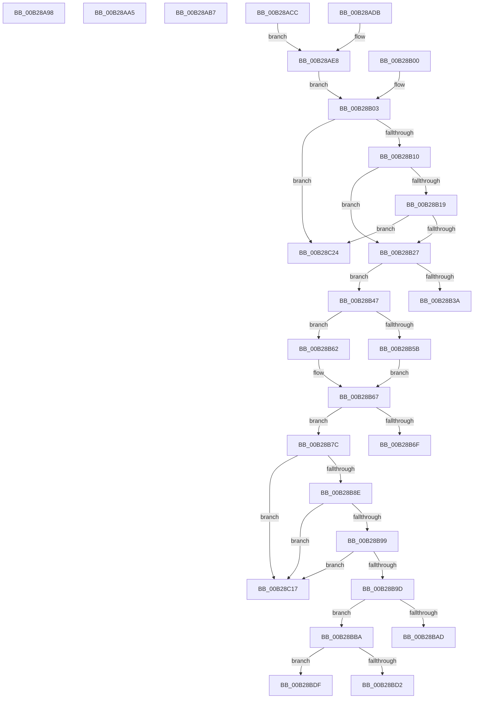

# sub_00B28A98

- RVA: `0x00B28A98`–`0x00B28C31` (길이 `409` bytes)
- VA: `0x0000000140B28A98`
- 실행 섹션: `PAGE`
- PDB 이름 있음: `아니요`; PDB Function 태그: `아니요`
- unwind 정보 RVA: `0x00095E14`
- 디코드: `94`개 명령, `409/409` bytes 표시
- 미해석 바이트: `0` (있으면 어셈블리에 `.byte`로 보존)

> 이 문서는 커널 이미지의 기계어와 PDB 기호를 분석해 생성했습니다. 4번과 5번은 함수 원형과 자료형을 바이너리 사용 방식에서 추정한 C 해석이며 원본 소스 복구 결과는 아닙니다.

## 1. Dependencies

- 직접 호출 지점: **10**; 고유 호출 대상: **9**
- 직접 호출자로 확인된 함수: **0**
- RIP 상대 이미지 참조: **2**

### Outgoing calls
- `0x00B28ACC` → [HvpReleaseCellPaged](../85/HvpReleaseCellPaged_function_00855F40.md) (function, `0x00855F40`)
- `0x00B28ADB` → [HvpReleaseCellPaged](../85/HvpReleaseCellPaged_function_00855F40.md) (function, `0x00855F40`)
- `0x00B28AF9` → [SetFailureLocation](../../text/46/SetFailureLocation_function_0046EF54.md) (function, `0x0046EF54`)
- `0x00B28B31` → [HvIsCellAllocated](../85/HvIsCellAllocated_function_00855D60.md) (function, `0x00855D60`)
- `0x00B28B5B` → [HvpGetCellFlat](../85/HvpGetCellFlat_function_00854C60.md) (function, `0x00854C60`)
- `0x00B28B62` → [HvpGetCellPaged](../85/HvpGetCellPaged_function_00854CB0.md) (function, `0x00854CB0`)
- `0x00B28BA4` → [RtlValidRelativeSecurityDescriptor](../8B/RtlValidRelativeSecurityDescriptor_function_008BDC70.md) (function, `0x008BDC70`)
- `0x00B28BC7` → [HvpMarkCellDirty](../85/HvpMarkCellDirty_function_00858080.md) (function, `0x00858080`)
- `0x00B28BEE` → [CmpDestroySecurityCache](../9B/CmpDestroySecurityCache_function_009B3808.md) (function, `0x009B3808`)
- `0x00B28BF6` → [CmpInitSecurityCache](../87/CmpInitSecurityCache_function_0087B870.md) (function, `0x0087B870`)

### Direct callers
- 이 함수 시작 RVA로 연결되는 직접 call은 확인되지 않았습니다. 간접 호출은 완전히 역산할 수 없습니다.

### Static image references
- `0x00B28B10` → RVA `0x00FD8002` (`PAGEDATA`; read)
- `0x00B28B19` → RVA `0x00EF7C60` (`.data`; read)

## 2. Other-region calls and transfers

- 다른 실행 섹션으로 향하는 call: **1**
  - `0x00B28AF9` → [SetFailureLocation](../../text/46/SetFailureLocation_function_0046EF54.md) (`PAGE` → `.text`)
- call이 아닌 외부 분기/꼬리 이동: **10**
  - `0x00B28AA0` → [CmpValidateHiveSecurityDescriptors + 0x264](../96/CmpValidateHiveSecurityDescriptors_function_0096DAFC.md) (`tail-transfer`)
  - `0x00B28AB2` → [CmpValidateHiveSecurityDescriptors + 0x2A0](../96/CmpValidateHiveSecurityDescriptors_function_0096DAFC.md) (`tail-transfer`)
  - `0x00B28AC7` → [CmpValidateHiveSecurityDescriptors + 0x286](../96/CmpValidateHiveSecurityDescriptors_function_0096DAFC.md) (`tail-transfer`)
  - `0x00B28B42` → [CmpValidateHiveSecurityDescriptors + 0x29D](../96/CmpValidateHiveSecurityDescriptors_function_0096DAFC.md) (`tail-transfer`)
  - `0x00B28B77` → [CmpValidateHiveSecurityDescriptors + 0x29D](../96/CmpValidateHiveSecurityDescriptors_function_0096DAFC.md) (`tail-transfer`)
  - `0x00B28BB5` → [CmpValidateHiveSecurityDescriptors + 0x29D](../96/CmpValidateHiveSecurityDescriptors_function_0096DAFC.md) (`tail-transfer`)
  - `0x00B28BDA` → [CmpValidateHiveSecurityDescriptors + 0x283](../96/CmpValidateHiveSecurityDescriptors_function_0096DAFC.md) (`tail-transfer`)
  - `0x00B28C12` → [CmpValidateHiveSecurityDescriptors + 0x1F3](../96/CmpValidateHiveSecurityDescriptors_function_0096DAFC.md) (`tail-transfer`)
  - `0x00B28C1F` → [CmpValidateHiveSecurityDescriptors + 0x29D](../96/CmpValidateHiveSecurityDescriptors_function_0096DAFC.md) (`tail-transfer`)
  - `0x00B28C2C` → [CmpValidateHiveSecurityDescriptors + 0x29D](../96/CmpValidateHiveSecurityDescriptors_function_0096DAFC.md) (`tail-transfer`)

## 3. Assembly (complete function range)

```asm
00B28A98  C7 44 24 20 10 00 00 00         mov dword ptr [rsp + 0x20], 0x10
00B28AA0  E9 BB 52 E4 FF                  jmp 0x14096dd60
00B28AA5  BF 4C 01 00 C0                  mov edi, 0xc000014c
00B28AAA  C7 44 24 20 18 00 00 00         mov dword ptr [rsp + 0x20], 0x18
00B28AB2  E9 E5 52 E4 FF                  jmp 0x14096dd9c
00B28AB7  BE 25 02 00 C0                  mov esi, 0xc0000225
00B28ABC  C7 44 24 20 B8 00 00 00         mov dword ptr [rsp + 0x20], 0xb8
00B28AC4  44 8B CE                        mov r9d, esi
00B28AC7  E9 B6 52 E4 FF                  jmp 0x14096dd82
00B28ACC  E8 6F D4 D2 FF                  call 0x140855f40
00B28AD1  C7 44 24 20 A8 00 00 00         mov dword ptr [rsp + 0x20], 0xa8
00B28AD9  EB 0D                           jmp 0x140b28ae8
00B28ADB  E8 60 D4 D2 FF                  call 0x140855f40
00B28AE0  C7 44 24 20 98 00 00 00         mov dword ptr [rsp + 0x20], 0x98
00B28AE8  45 33 F6                        xor r14d, r14d
00B28AEB  44 8B CF                        mov r9d, edi
00B28AEE  49 8B CC                        mov rcx, r12
00B28AF1  41 8D 56 01                     lea edx, [r14 + 1]
00B28AF5  45 8D 46 09                     lea r8d, [r14 + 9]
00B28AF9  E8 56 64 94 FF                  call 0x14046ef54
00B28AFE  EB 03                           jmp 0x140b28b03
00B28B00  45 33 F6                        xor r14d, r14d
00B28B03  F7 45 50 00 00 02 00            test dword ptr [rbp + 0x50], 0x20000
00B28B0A  0F 85 14 01 00 00               jne 0x140b28c24
00B28B10  80 3D EB F4 4A 00 00            cmp byte ptr [rip + 0x4af4eb], 0
00B28B17  75 0E                           jne 0x140b28b27
00B28B19  8B 05 41 F1 3C 00               mov eax, dword ptr [rip + 0x3cf141]
00B28B1F  A8 06                           test al, 6
00B28B21  0F 84 FD 00 00 00               je 0x140b28c24
00B28B27  41 8B 55 2C                     mov edx, dword ptr [r13 + 0x2c]
00B28B2B  45 33 C0                        xor r8d, r8d
00B28B2E  48 8B CB                        mov rcx, rbx
00B28B31  E8 2A D2 D2 FF                  call 0x140855d60
00B28B36  84 C0                           test al, al
00B28B38  75 0D                           jne 0x140b28b47
00B28B3A  C7 44 24 20 20 00 00 00         mov dword ptr [rsp + 0x20], 0x20
00B28B42  E9 52 52 E4 FF                  jmp 0x14096dd99
00B28B47  F6 83 8C 00 00 00 01            test byte ptr [rbx + 0x8c], 1
00B28B4E  4C 8D 45 E0                     lea r8, [rbp - 0x20]
00B28B52  41 8B 55 2C                     mov edx, dword ptr [r13 + 0x2c]
00B28B56  48 8B CB                        mov rcx, rbx
00B28B59  74 07                           je 0x140b28b62
00B28B5B  E8 00 C1 D2 FF                  call 0x140854c60
00B28B60  EB 05                           jmp 0x140b28b67
00B28B62  E8 49 C1 D2 FF                  call 0x140854cb0
00B28B67  4C 8B F0                        mov r14, rax
00B28B6A  48 85 C0                        test rax, rax
00B28B6D  75 0D                           jne 0x140b28b7c
00B28B6F  C7 44 24 20 30 00 00 00         mov dword ptr [rsp + 0x20], 0x30
00B28B77  E9 1D 52 E4 FF                  jmp 0x14096dd99
00B28B7C  B9 FC FF FF FF                  mov ecx, 0xfffffffc
00B28B81  41 2B 4E FC                     sub ecx, dword ptr [r14 - 4]
00B28B85  83 F9 14                        cmp ecx, 0x14
00B28B88  0F 82 89 00 00 00               jb 0x140b28c17
00B28B8E  41 8B 56 10                     mov edx, dword ptr [r14 + 0x10]
00B28B92  8D 42 14                        lea eax, [rdx + 0x14]
00B28B95  3B C2                           cmp eax, edx
00B28B97  72 7E                           jb 0x140b28c17
00B28B99  3B C1                           cmp eax, ecx
00B28B9B  77 7A                           ja 0x140b28c17
00B28B9D  49 8D 4E 14                     lea rcx, [r14 + 0x14]
00B28BA1  45 33 C0                        xor r8d, r8d
00B28BA4  E8 C7 50 D9 FF                  call 0x1408bdc70
00B28BA9  84 C0                           test al, al
00B28BAB  75 0D                           jne 0x140b28bba
00B28BAD  C7 44 24 20 40 00 00 00         mov dword ptr [rsp + 0x20], 0x40
00B28BB5  E9 DF 51 E4 FF                  jmp 0x14096dd99
00B28BBA  41 8B 55 2C                     mov edx, dword ptr [r13 + 0x2c]
00B28BBE  45 33 C9                        xor r9d, r9d
00B28BC1  45 33 C0                        xor r8d, r8d
00B28BC4  48 8B CB                        mov rcx, rbx
00B28BC7  E8 B4 F4 D2 FF                  call 0x140858080
00B28BCC  8B F0                           mov esi, eax
00B28BCE  85 C0                           test eax, eax
00B28BD0  79 0D                           jns 0x140b28bdf
00B28BD2  C7 44 24 20 60 00 00 00         mov dword ptr [rsp + 0x20], 0x60
00B28BDA  E9 A0 51 E4 FF                  jmp 0x14096dd7f
00B28BDF  41 8B 45 2C                     mov eax, dword ptr [r13 + 0x2c]
00B28BE3  48 8B CB                        mov rcx, rbx
00B28BE6  41 89 46 08                     mov dword ptr [r14 + 8], eax
00B28BEA  41 89 46 04                     mov dword ptr [r14 + 4], eax
00B28BEE  E8 15 AC E8 FF                  call 0x1409b3808
00B28BF3  48 8B CB                        mov rcx, rbx
00B28BF6  E8 75 2C D5 FF                  call 0x14087b870
00B28BFB  48 8B 45 58                     mov rax, qword ptr [rbp + 0x58]
00B28BFF  BE 2D 02 00 C0                  mov esi, 0xc000022d
00B28C04  48 8B 53 40                     mov rdx, qword ptr [rbx + 0x40]
00B28C08  C6 00 01                        mov byte ptr [rax], 1
00B28C0B  83 8A F8 0F 00 00 04            or dword ptr [rdx + 0xff8], 4
00B28C12  E9 D8 50 E4 FF                  jmp 0x14096dcef
00B28C17  C7 44 24 20 50 00 00 00         mov dword ptr [rsp + 0x20], 0x50
00B28C1F  E9 75 51 E4 FF                  jmp 0x14096dd99
00B28C24  C7 44 24 20 70 00 00 00         mov dword ptr [rsp + 0x20], 0x70
00B28C2C  E9 68 51 E4 FF                  jmp 0x14096dd99
```

## 4. C-style interpretation (structured pseudocode)

```c
__int64 __fastcall sub_00B28A98(void)
{
    unsigned int v_stack_p20;

    v_stack_p20 = 16;
}
```

## 5. (Beta) C Style

```c
void sub_00B28A98(void)
{
    uint32_t v_stack_p20;

    v_stack_p20 = 16;
}
```

## 6. Execution-region graph

[열기: 2D/3D 그래프와 함수 탐색 컨트롤 패널](../../../control-panel.html?section=page&rva=0x00B28A98&view=graph)

- 2D 그래프는 위에서 아래로 흐르고, 3D 그래프는 빈 공간을 드래그해 회전합니다. Shift+드래그는 이동, 휠은 확대·축소, 함수 노드 선택은 대상 보고서 이동입니다.

### Static fallback


