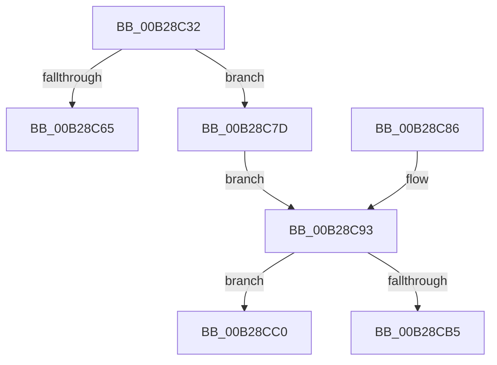

# sub_00B28C32

- RVA: `0x00B28C32`–`0x00B28CCB` (길이 `153` bytes)
- VA: `0x0000000140B28C32`
- 실행 섹션: `PAGE`
- PDB 이름 있음: `아니요`; PDB Function 태그: `아니요`
- unwind 정보 RVA: `0x00095E88`
- 디코드: `41`개 명령, `153/153` bytes 표시
- 미해석 바이트: `0` (있으면 어셈블리에 `.byte`로 보존)

> 이 문서는 커널 이미지의 기계어와 PDB 기호를 분석해 생성했습니다. 4번과 5번은 함수 원형과 자료형을 바이너리 사용 방식에서 추정한 C 해석이며 원본 소스 복구 결과는 아닙니다.

## 1. Dependencies

- 직접 호출 지점: **5**; 고유 호출 대상: **4**
- 직접 호출자로 확인된 함수: **0**
- RIP 상대 이미지 참조: **0**

### Outgoing calls
- `0x00B28C49` → [SetFailureLocation](../../text/46/SetFailureLocation_function_0046EF54.md) (function, `0x0046EF54`)
- `0x00B28C5A` → [HvpMarkCellDirty](../85/HvpMarkCellDirty_function_00858080.md) (function, `0x00858080`)
- `0x00B28CA3` → [SetFailureLocation](../../text/46/SetFailureLocation_function_0046EF54.md) (function, `0x0046EF54`)
- `0x00B28CB5` → [HvpReleaseCellFlat](../85/HvpReleaseCellFlat_function_0085CC20.md) (function, `0x0085CC20`)
- `0x00B28CC0` → [HvpReleaseCellPaged](../85/HvpReleaseCellPaged_function_00855F40.md) (function, `0x00855F40`)

### Direct callers
- 이 함수 시작 RVA로 연결되는 직접 call은 확인되지 않았습니다. 간접 호출은 완전히 역산할 수 없습니다.

### Static image references
- 디코드된 RIP-relative 메모리 참조가 없습니다.

## 2. Other-region calls and transfers

- 다른 실행 섹션으로 향하는 call: **2**
  - `0x00B28C49` → [SetFailureLocation](../../text/46/SetFailureLocation_function_0046EF54.md) (`PAGE` → `.text`)
  - `0x00B28CA3` → [SetFailureLocation](../../text/46/SetFailureLocation_function_0046EF54.md) (`PAGE` → `.text`)
- call이 아닌 외부 분기/꼬리 이동: **3**
  - `0x00B28C78` → [CmpCheckLeaf + 0x137](../96/CmpCheckLeaf_function_0096E5BC.md) (`tail-transfer`)
  - `0x00B28CBB` → [CmpCheckLeaf + 0x15C](../96/CmpCheckLeaf_function_0096E5BC.md) (`tail-transfer`)
  - `0x00B28CC6` → [CmpCheckLeaf + 0x15C](../96/CmpCheckLeaf_function_0096E5BC.md) (`tail-transfer`)

## 3. Assembly (complete function range)

```asm
00B28C32  44 8B C9                        mov r9d, ecx
00B28C35  C7 44 24 20 20 00 00 00         mov dword ptr [rsp + 0x20], 0x20
00B28C3D  48 8B 4D 60                     mov rcx, qword ptr [rbp + 0x60]
00B28C41  45 8B C5                        mov r8d, r13d
00B28C44  BA 01 00 00 00                  mov edx, 1
00B28C49  E8 06 63 94 FF                  call 0x14046ef54
00B28C4E  8B 55 58                        mov edx, dword ptr [rbp + 0x58]
00B28C51  45 33 C9                        xor r9d, r9d
00B28C54  45 33 C0                        xor r8d, r8d
00B28C57  48 8B CE                        mov rcx, rsi
00B28C5A  E8 21 F4 D2 FF                  call 0x140858080
00B28C5F  8B D8                           mov ebx, eax
00B28C61  85 C0                           test eax, eax
00B28C63  78 18                           js 0x140b28c7d
00B28C65  8B 4D E0                        mov ecx, dword ptr [rbp - 0x20]
00B28C68  45 89 74 CC 08                  mov dword ptr [r12 + rcx*8 + 8], r14d
00B28C6D  48 8B 46 40                     mov rax, qword ptr [rsi + 0x40]
00B28C71  83 88 F8 0F 00 00 04            or dword ptr [rax + 0xff8], 4
00B28C78  E9 76 5A E4 FF                  jmp 0x14096e6f3
00B28C7D  8B C8                           mov ecx, eax
00B28C7F  B8 30 00 00 00                  mov eax, 0x30
00B28C84  EB 0D                           jmp 0x140b28c93
00B28C86  48 8B 45 60                     mov rax, qword ptr [rbp + 0x60]
00B28C8A  48 89 45 60                     mov qword ptr [rbp + 0x60], rax
00B28C8E  B8 10 00 00 00                  mov eax, 0x10
00B28C93  44 8B C9                        mov r9d, ecx
00B28C96  89 44 24 20                     mov dword ptr [rsp + 0x20], eax
00B28C9A  48 8B 4D 60                     mov rcx, qword ptr [rbp + 0x60]
00B28C9E  45 8B C5                        mov r8d, r13d
00B28CA1  8B D7                           mov edx, edi
00B28CA3  E8 AC 62 94 FF                  call 0x14046ef54
00B28CA8  41 F6 07 01                     test byte ptr [r15], 1
00B28CAC  48 8D 55 E8                     lea rdx, [rbp - 0x18]
00B28CB0  48 8B CE                        mov rcx, rsi
00B28CB3  74 0B                           je 0x140b28cc0
00B28CB5  E8 66 3F D3 FF                  call 0x14085cc20
00B28CBA  90                              nop
00B28CBB  E9 58 5A E4 FF                  jmp 0x14096e718
00B28CC0  E8 7B D2 D2 FF                  call 0x140855f40
00B28CC5  90                              nop
00B28CC6  E9 4D 5A E4 FF                  jmp 0x14096e718
```

## 4. C-style interpretation (structured pseudocode)

```c
__int64 __fastcall sub_00B28C32(int a1)
{
    __int64 result;
    unsigned int v_stack_p20;

    v_stack_p20 = 32;
    result = SetFailureLocation(*(unsigned __int64 *)(v_rbp + 96), 1, (unsigned int)((unsigned int)(v_r13)), (unsigned int)(a1));
    a4 = 0;
    a3 = 0;
    result = HvpMarkCellDirty(v_rsi, (unsigned int)(*(unsigned int *)(v_rbp + 88)), a3, a4);
    if (sign_flag) goto loc_00B28C7D;
    *(unsigned int *)(v_r12 + (unsigned int)(*(unsigned int *)(v_rbp - 32)) * 8 + 8) = (unsigned int)(v_r14);
loc_00B28C7D:
    goto loc_00B28C93;
loc_00B28C93:
    v_stack_p20 = 48;
    result = SetFailureLocation(*(unsigned __int64 *)(v_rbp + 96), (unsigned int)((unsigned int)(v_rdi)), (unsigned int)((unsigned int)(v_r13)), (unsigned int)((unsigned int)((unsigned int)((unsigned int)(*(unsigned __int64 *)(v_rsi + 64))))));
    if (((*(unsigned __int8 *)(v_r15)) & (1)) == 0) goto loc_00B28CC0;
    result = HvpReleaseCellFlat(v_rsi, v_rbp - 24, (unsigned int)((unsigned int)(v_r13)), (unsigned int)((unsigned int)((unsigned int)((unsigned int)(*(unsigned __int64 *)(v_rsi + 64))))));
loc_00B28CC0:
    result = HvpReleaseCellPaged(v_rsi, v_rbp - 24, (unsigned int)((unsigned int)(v_r13)), (unsigned int)((unsigned int)((unsigned int)((unsigned int)(*(unsigned __int64 *)(v_rsi + 64))))));
}
```

## 5. (Beta) C Style

```c
int64_t sub_00B28C32(int32_t Arg1)
{
    int64_t result;
    uint32_t v_stack_p20;

    v_stack_p20 = 32;
    result = SetFailureLocation(*(uint64_t *)(local_rbp + 0x60), 1, (uint32_t)((uint32_t)(local_r13)), (uint32_t)(Arg1));
    a4 = 0;
    a3 = 0;
    result = HvpMarkCellDirty(local_rsi, (uint32_t)(*(uint32_t *)(local_rbp + 0x58)), a3, a4);
    if (sign_flag) goto loc_00B28C7D;
    *(uint32_t *)(local_r12 + (uint32_t)(*(uint32_t *)(local_rbp - 0x20)) * 8 + 0x8) = (uint32_t)(local_r14);
loc_00B28C7D:
    goto loc_00B28C93;
loc_00B28C93:
    v_stack_p20 = 48;
    result = SetFailureLocation(*(uint64_t *)(local_rbp + 0x60), (uint32_t)((uint32_t)(local_rdi)), (uint32_t)((uint32_t)(local_r13)), (uint32_t)((uint32_t)((uint32_t)((uint32_t)(*(uint64_t *)(local_rsi + 0x40))))));
    if (((*(uint8_t *)(local_r15)) & (1)) == 0) goto loc_00B28CC0;
    result = HvpReleaseCellFlat(local_rsi, local_rbp - 24, (uint32_t)((uint32_t)(local_r13)), (uint32_t)((uint32_t)((uint32_t)((uint32_t)(*(uint64_t *)(local_rsi + 0x40))))));
loc_00B28CC0:
    result = HvpReleaseCellPaged(local_rsi, local_rbp - 24, (uint32_t)((uint32_t)(local_r13)), (uint32_t)((uint32_t)((uint32_t)((uint32_t)(*(uint64_t *)(local_rsi + 0x40))))));
}
```

## 6. Execution-region graph

[열기: 2D/3D 그래프와 함수 탐색 컨트롤 패널](../../../control-panel.html?section=page&rva=0x00B28C32&view=graph)

- 2D 그래프는 위에서 아래로 흐르고, 3D 그래프는 빈 공간을 드래그해 회전합니다. Shift+드래그는 이동, 휠은 확대·축소, 함수 노드 선택은 대상 보고서 이동입니다.

### Static fallback


