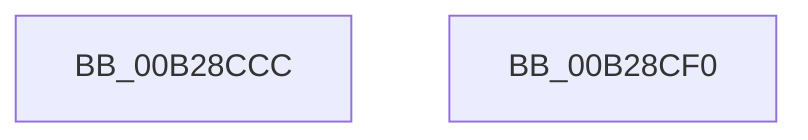

# sub_00B28CCC

- RVA: `0x00B28CCC`–`0x00B28CFB` (길이 `47` bytes)
- VA: `0x0000000140B28CCC`
- 실행 섹션: `PAGE`
- PDB 이름 있음: `아니요`; PDB Function 태그: `아니요`
- unwind 정보 RVA: `0x00095EB4`
- 디코드: `13`개 명령, `47/47` bytes 표시
- 미해석 바이트: `0` (있으면 어셈블리에 `.byte`로 보존)

> 이 문서는 커널 이미지의 기계어와 PDB 기호를 분석해 생성했습니다. 4번과 5번은 함수 원형과 자료형을 바이너리 사용 방식에서 추정한 C 해석이며 원본 소스 복구 결과는 아닙니다.

## 1. Dependencies

- 직접 호출 지점: **4**; 고유 호출 대상: **3**
- 직접 호출자로 확인된 함수: **0**
- RIP 상대 이미지 참조: **0**

### Outgoing calls
- `0x00B28CCC` → [HvpReleaseCellPaged](../85/HvpReleaseCellPaged_function_00855F40.md) (function, `0x00855F40`)
- `0x00B28CD9` → [CmpRemoveSecurityCellList](../../text/4B/CmpRemoveSecurityCellList_function_004BC1FC.md) (function, `0x004BC1FC`)
- `0x00B28CE4` → [HvFreeCell](../85/HvFreeCell_function_0085A72C.md) (function, `0x0085A72C`)
- `0x00B28CF0` → [HvpReleaseCellPaged](../85/HvpReleaseCellPaged_function_00855F40.md) (function, `0x00855F40`)

### Direct callers
- 이 함수 시작 RVA로 연결되는 직접 call은 확인되지 않았습니다. 간접 호출은 완전히 역산할 수 없습니다.

### Static image references
- 디코드된 RIP-relative 메모리 참조가 없습니다.

## 2. Other-region calls and transfers

- 다른 실행 섹션으로 향하는 call: **1**
  - `0x00B28CD9` → [CmpRemoveSecurityCellList](../../text/4B/CmpRemoveSecurityCellList_function_004BC1FC.md) (`PAGE` → `.text`)
- call이 아닌 외부 분기/꼬리 이동: **2**
  - `0x00B28CEB` → [CmpCheckAndFixSecurityCellsRefcount + 0xA7](../96/CmpCheckAndFixSecurityCellsRefcount_function_0096E7FC.md) (`tail-transfer`)
  - `0x00B28CF6` → [CmpCheckAndFixSecurityCellsRefcount + 0xB7](../96/CmpCheckAndFixSecurityCellsRefcount_function_0096E7FC.md) (`tail-transfer`)

## 3. Assembly (complete function range)

```asm
00B28CCC  E8 6F D2 D2 FF                  call 0x140855f40
00B28CD1  41 8B D4                        mov edx, r12d
00B28CD4  48 8B CB                        mov rcx, rbx
00B28CD7  33 F6                           xor esi, esi
00B28CD9  E8 1E 35 99 FF                  call 0x1404bc1fc
00B28CDE  41 8B D4                        mov edx, r12d
00B28CE1  48 8B CB                        mov rcx, rbx
00B28CE4  E8 43 1A D3 FF                  call 0x14085a72c
00B28CE9  FF CD                           dec ebp
00B28CEB  E9 B3 5B E4 FF                  jmp 0x14096e8a3
00B28CF0  E8 4B D2 D2 FF                  call 0x140855f40
00B28CF5  90                              nop
00B28CF6  E9 B8 5B E4 FF                  jmp 0x14096e8b3
```

## 4. C-style interpretation (structured pseudocode)

```c
__int64 __fastcall sub_00B28CCC(void)
{
    __int64 result;
    __int64 v_rbp;
    __int64 v_rsi;

    result = HvpReleaseCellPaged(a1, a2, a3, a4);
    v_rsi = 0;
    result = CmpRemoveSecurityCellList(v_rbx, (unsigned int)((unsigned int)(v_r12)), a3, a4);
    result = HvFreeCell(v_rbx, (unsigned int)((unsigned int)(v_r12)), a3, a4);
    v_rbp = (unsigned int)((v_rbp) - 1);
}
```

## 5. (Beta) C Style

```c
void sub_00B28CCC(void)
{
    int64_t result;
    int64_t local_rbp;
    int64_t local_rsi;

    result = HvpReleaseCellPaged(a1, a2, a3, a4);
    local_rsi = 0;
    result = CmpRemoveSecurityCellList(local_rbx, (uint32_t)((uint32_t)(local_r12)), a3, a4);
    result = HvFreeCell(local_rbx, (uint32_t)((uint32_t)(local_r12)), a3, a4);
    local_rbp = (uint32_t)((local_rbp) - 1);
}
```

## 6. Execution-region graph

[열기: 2D/3D 그래프와 함수 탐색 컨트롤 패널](../../../control-panel.html?section=page&rva=0x00B28CCC&view=graph)

- 2D 그래프는 위에서 아래로 흐르고, 3D 그래프는 빈 공간을 드래그해 회전합니다. Shift+드래그는 이동, 휠은 확대·축소, 함수 노드 선택은 대상 보고서 이동입니다.

### Static fallback


