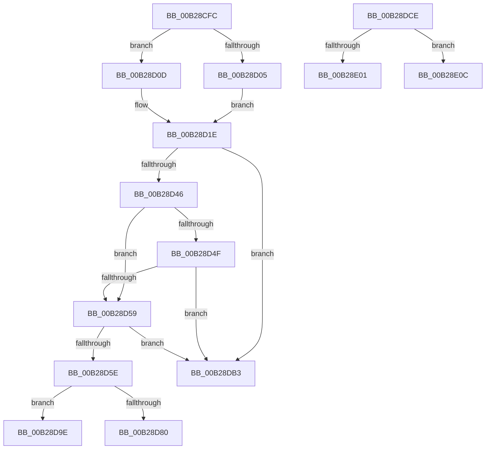

# sub_00B28CFC

- RVA: `0x00B28CFC`–`0x00B28E17` (길이 `283` bytes)
- VA: `0x0000000140B28CFC`
- 실행 섹션: `PAGE`
- PDB 이름 있음: `아니요`; PDB Function 태그: `아니요`
- unwind 정보 RVA: `0x00095F4C`
- 디코드: `72`개 명령, `283/283` bytes 표시
- 미해석 바이트: `0` (있으면 어셈블리에 `.byte`로 보존)

> 이 문서는 커널 이미지의 기계어와 PDB 기호를 분석해 생성했습니다. 4번과 5번은 함수 원형과 자료형을 바이너리 사용 방식에서 추정한 C 해석이며 원본 소스 복구 결과는 아닙니다.

## 1. Dependencies

- 직접 호출 지점: **6**; 고유 호출 대상: **4**
- 직접 호출자로 확인된 함수: **0**
- RIP 상대 이미지 참조: **2**

### Outgoing calls
- `0x00B28D3C` → [SetFailureLocation](../../text/46/SetFailureLocation_function_0046EF54.md) (function, `0x0046EF54`)
- `0x00B28D75` → [CmpRemoveSubKeyCellNoCellRef](../7F/CmpRemoveSubKeyCellNoCellRef_function_007F3284.md) (function, `0x007F3284`)
- `0x00B28D93` → [SetFailureLocation](../../text/46/SetFailureLocation_function_0046EF54.md) (function, `0x0046EF54`)
- `0x00B28DEC` → [SetFailureLocation](../../text/46/SetFailureLocation_function_0046EF54.md) (function, `0x0046EF54`)
- `0x00B28E01` → [HvpReleaseCellFlat](../85/HvpReleaseCellFlat_function_0085CC20.md) (function, `0x0085CC20`)
- `0x00B28E0C` → [HvpReleaseCellPaged](../85/HvpReleaseCellPaged_function_00855F40.md) (function, `0x00855F40`)

### Direct callers
- 이 함수 시작 RVA로 연결되는 직접 call은 확인되지 않았습니다. 간접 호출은 완전히 역산할 수 없습니다.

### Static image references
- `0x00B28CFC` → RVA `0x00FD8002` (`PAGEDATA`; read)
- `0x00B28D0D` → RVA `0x00EF7C60` (`.data`; read)

## 2. Other-region calls and transfers

- 다른 실행 섹션으로 향하는 call: **3**
  - `0x00B28D3C` → [SetFailureLocation](../../text/46/SetFailureLocation_function_0046EF54.md) (`PAGE` → `.text`)
  - `0x00B28D93` → [SetFailureLocation](../../text/46/SetFailureLocation_function_0046EF54.md) (`PAGE` → `.text`)
  - `0x00B28DEC` → [SetFailureLocation](../../text/46/SetFailureLocation_function_0046EF54.md) (`PAGE` → `.text`)
- call이 아닌 외부 분기/꼬리 이동: **5**
  - `0x00B28D99` → [sub_0096E9E9 + 0x335](../96/Unknown_function_0096E9E9.md) (`tail-transfer`)
  - `0x00B28DAE` → [sub_0096E9E9 + 0x335](../96/Unknown_function_0096E9E9.md) (`tail-transfer`)
  - `0x00B28DC9` → [sub_0096ED4F + 0x1C](../96/Unknown_function_0096ED4F.md) (`tail-transfer`)
  - `0x00B28E07` → [sub_0096ED4F + 0x23](../96/Unknown_function_0096ED4F.md) (`tail-transfer`)
  - `0x00B28E12` → [sub_0096ED4F + 0x23](../96/Unknown_function_0096ED4F.md) (`tail-transfer`)

## 3. Assembly (complete function range)

```asm
00B28CFC  80 3D FF F2 4A 00 00            cmp byte ptr [rip + 0x4af2ff], 0
00B28D03  74 08                           je 0x140b28d0d
00B28D05  41 BF 01 00 00 00               mov r15d, 1
00B28D0B  EB 11                           jmp 0x140b28d1e
00B28D0D  F6 05 4C EF 3C 00 06            test byte ptr [rip + 0x3cef4c], 6
00B28D14  41 BF 00 00 00 00               mov r15d, 0
00B28D1A  41 0F 95 C7                     setne r15b
00B28D1E  B8 10 00 00 00                  mov eax, 0x10
00B28D23  41 8B D7                        mov edx, r15d
00B28D26  89 44 24 20                     mov dword ptr [rsp + 0x20], eax
00B28D2A  4C 8B 7D 60                     mov r15, qword ptr [rbp + 0x60]
00B28D2E  BB 0D 00 00 00                  mov ebx, 0xd
00B28D33  49 8B CF                        mov rcx, r15
00B28D36  44 8B CF                        mov r9d, edi
00B28D39  44 8B C3                        mov r8d, ebx
00B28D3C  E8 13 62 94 FF                  call 0x14046ef54
00B28D41  45 85 E4                        test r12d, r12d
00B28D44  75 6D                           jne 0x140b28db3
00B28D46  44 38 25 B5 F2 4A 00            cmp byte ptr [rip + 0x4af2b5], r12b
00B28D4D  75 0A                           jne 0x140b28d59
00B28D4F  8B 05 0B EF 3C 00               mov eax, dword ptr [rip + 0x3cef0b]
00B28D55  A8 06                           test al, 6
00B28D57  74 5A                           je 0x140b28db3
00B28D59  45 85 F6                        test r14d, r14d
00B28D5C  74 55                           je 0x140b28db3
00B28D5E  49 63 C6                        movsxd rax, r14d
00B28D61  4C 8B 75 D8                     mov r14, qword ptr [rbp - 0x28]
00B28D65  48 8D 0C 80                     lea rcx, [rax + rax*4]
00B28D69  45 8B 04 8E                     mov r8d, dword ptr [r14 + rcx*4]
00B28D6D  41 8B 54 8E 04                  mov edx, dword ptr [r14 + rcx*4 + 4]
00B28D72  48 8B CE                        mov rcx, rsi
00B28D75  E8 0A A5 CC FF                  call 0x1407f3284
00B28D7A  8B F8                           mov edi, eax
00B28D7C  85 C0                           test eax, eax
00B28D7E  79 1E                           jns 0x140b28d9e
00B28D80  44 8B C8                        mov r9d, eax
00B28D83  C7 44 24 20 20 00 00 00         mov dword ptr [rsp + 0x20], 0x20
00B28D8B  44 8B C3                        mov r8d, ebx
00B28D8E  33 D2                           xor edx, edx
00B28D90  49 8B CF                        mov rcx, r15
00B28D93  E8 BC 61 94 FF                  call 0x14046ef54
00B28D98  90                              nop
00B28D99  E9 80 5F E4 FF                  jmp 0x14096ed1e
00B28D9E  48 8B 46 40                     mov rax, qword ptr [rsi + 0x40]
00B28DA2  BF 2D 02 00 C0                  mov edi, 0xc000022d
00B28DA7  83 88 F8 0F 00 00 04            or dword ptr [rax + 0xff8], 4
00B28DAE  E9 6B 5F E4 FF                  jmp 0x14096ed1e
00B28DB3  BF 4C 01 00 C0                  mov edi, 0xc000014c
00B28DB8  C7 44 24 20 18 00 00 00         mov dword ptr [rsp + 0x20], 0x18
00B28DC0  44 8B CF                        mov r9d, edi
00B28DC3  44 8B C3                        mov r8d, ebx
00B28DC6  49 8B CF                        mov rcx, r15
00B28DC9  E9 9D 5F E4 FF                  jmp 0x14096ed6b
00B28DCE  BF 9A 00 00 C0                  mov edi, 0xc000009a
00B28DD3  4C 8B 7D 60                     mov r15, qword ptr [rbp + 0x60]
00B28DD7  BB 0D 00 00 00                  mov ebx, 0xd
00B28DDC  44 8B CF                        mov r9d, edi
00B28DDF  89 44 24 20                     mov dword ptr [rsp + 0x20], eax
00B28DE3  44 8B C3                        mov r8d, ebx
00B28DE6  41 8B D6                        mov edx, r14d
00B28DE9  49 8B CF                        mov rcx, r15
00B28DEC  E8 63 61 94 FF                  call 0x14046ef54
00B28DF1  F6 86 8C 00 00 00 01            test byte ptr [rsi + 0x8c], 1
00B28DF8  48 8D 55 E0                     lea rdx, [rbp - 0x20]
00B28DFC  48 8B CE                        mov rcx, rsi
00B28DFF  74 0B                           je 0x140b28e0c
00B28E01  E8 1A 3E D3 FF                  call 0x14085cc20
00B28E06  90                              nop
00B28E07  E9 66 5F E4 FF                  jmp 0x14096ed72
00B28E0C  E8 2F D1 D2 FF                  call 0x140855f40
00B28E11  90                              nop
00B28E12  E9 5B 5F E4 FF                  jmp 0x14096ed72
```

## 4. C-style interpretation (structured pseudocode)

```c
__int64 __fastcall sub_00B28CFC(void)
{
    __int64 result;
    __int64 v_r15;
    unsigned int v_stack_p20;

    if ((*(unsigned __int8 *)(v_rip + 4911871)) == 0) goto loc_00B28D0D;
    goto loc_00B28D1E;
loc_00B28D0D:
    v_r15 = (((*(unsigned __int8 *)(v_rip + 3993420)) & (6)) != 0) ? 1 : 0;
loc_00B28D1E:
    v_stack_p20 = 16;
    result = SetFailureLocation(*(unsigned __int64 *)(v_rbp + 96), (unsigned int)((unsigned int)(v_r15)), 13, (unsigned int)((unsigned int)(v_rdi)));
    if ((unsigned int)(v_r12) != 0) goto loc_00B28DB3;
    if ((*(unsigned __int8 *)(v_rip + 4911797)) != ((unsigned __int8)(v_r12))) goto loc_00B28D59;
    if ((((unsigned __int8)((unsigned int)(*(unsigned int *)(v_rip + 3993355)))) & (6)) == 0) goto loc_00B28DB3;
loc_00B28D59:
    if ((unsigned int)(v_r14) == 0) goto loc_00B28DB3;
    result = CmpRemoveSubKeyCellNoCellRef(v_rsi, (unsigned int)(*(unsigned int *)(*(unsigned __int64 *)(v_rbp - 40) + (int)((unsigned int)(v_r14)) + (int)((unsigned int)(v_r14)) * 4 * 4 + 4)), (unsigned int)(*(unsigned int *)(*(unsigned __int64 *)(v_rbp - 40) + (int)((unsigned int)(v_r14)) + (int)((unsigned int)(v_r14)) * 4 * 4)), (unsigned int)((unsigned int)(v_rdi)));
    if (!sign_flag) goto loc_00B28D9E;
    v_stack_p20 = 32;
    a2 = 0;
    result = SetFailureLocation(*(unsigned __int64 *)(v_rbp + 96), a2, 13, (unsigned int)((unsigned int)(result)));
loc_00B28D9E:
loc_00B28DB3:
    v_stack_p20 = 24;
}
```

## 5. (Beta) C Style

```c
void sub_00B28CFC(void)
{
    int64_t result;
    int64_t local_r15;
    uint32_t v_stack_p20;

    if ((*(uint8_t *)(v_rip + 0x4AF2FF)) == 0) goto loc_00B28D0D;
    goto loc_00B28D1E;
loc_00B28D0D:
    local_r15 = (((*(uint8_t *)(v_rip + 0x3CEF4C)) & (6)) != 0) ? 1 : 0;
loc_00B28D1E:
    v_stack_p20 = 16;
    result = SetFailureLocation(*(uint64_t *)(local_rbp + 0x60), (uint32_t)((uint32_t)(local_r15)), 13, (uint32_t)((uint32_t)(local_rdi)));
    if ((uint32_t)(local_r12) != 0) goto loc_00B28DB3;
    if ((*(uint8_t *)(v_rip + 0x4AF2B5)) != ((uint8_t)(local_r12))) goto loc_00B28D59;
    if ((((uint8_t)((uint32_t)(*(uint32_t *)(v_rip + 0x3CEF0B)))) & (6)) == 0) goto loc_00B28DB3;
loc_00B28D59:
    if ((uint32_t)(local_r14) == 0) goto loc_00B28DB3;
    result = CmpRemoveSubKeyCellNoCellRef(local_rsi, (uint32_t)(*(uint32_t *)(*(uint64_t *)(local_rbp - 0x28) + (int32_t)((uint32_t)(local_r14)) + (int32_t)((uint32_t)(local_r14)) * 4 * 4 + 0x4)), (uint32_t)(*(uint32_t *)(*(uint64_t *)(local_rbp - 0x28) + (int32_t)((uint32_t)(local_r14)) + (int32_t)((uint32_t)(local_r14)) * 4 * 4)), (uint32_t)((uint32_t)(local_rdi)));
    if (!sign_flag) goto loc_00B28D9E;
    v_stack_p20 = 32;
    a2 = 0;
    result = SetFailureLocation(*(uint64_t *)(local_rbp + 0x60), a2, 13, (uint32_t)((uint32_t)(result)));
loc_00B28D9E:
loc_00B28DB3:
    v_stack_p20 = 24;
}
```

## 6. Execution-region graph

[열기: 2D/3D 그래프와 함수 탐색 컨트롤 패널](../../../control-panel.html?section=page&rva=0x00B28CFC&view=graph)

- 2D 그래프는 위에서 아래로 흐르고, 3D 그래프는 빈 공간을 드래그해 회전합니다. Shift+드래그는 이동, 휠은 확대·축소, 함수 노드 선택은 대상 보고서 이동입니다.

### Static fallback


