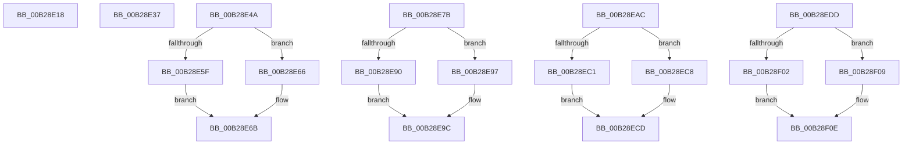

# sub_00B28E18

- RVA: `0x00B28E18`–`0x00B28F1E` (길이 `262` bytes)
- VA: `0x0000000140B28E18`
- 실행 섹션: `PAGE`
- PDB 이름 있음: `아니요`; PDB Function 태그: `아니요`
- unwind 정보 RVA: `0x00095F88`
- 디코드: `63`개 명령, `262/262` bytes 표시
- 미해석 바이트: `0` (있으면 어셈블리에 `.byte`로 보존)

> 이 문서는 커널 이미지의 기계어와 PDB 기호를 분석해 생성했습니다. 4번과 5번은 함수 원형과 자료형을 바이너리 사용 방식에서 추정한 C 해석이며 원본 소스 복구 결과는 아닙니다.

## 1. Dependencies

- 직접 호출 지점: **14**; 고유 호출 대상: **3**
- 직접 호출자로 확인된 함수: **0**
- RIP 상대 이미지 참조: **0**

### Outgoing calls
- `0x00B28E18` → [HvpReleaseCellPaged](../85/HvpReleaseCellPaged_function_00855F40.md) (function, `0x00855F40`)
- `0x00B28E37` → [HvpReleaseCellPaged](../85/HvpReleaseCellPaged_function_00855F40.md) (function, `0x00855F40`)
- `0x00B28E4A` → [HvpReleaseCellPaged](../85/HvpReleaseCellPaged_function_00855F40.md) (function, `0x00855F40`)
- `0x00B28E5F` → [HvpReleaseCellFlat](../85/HvpReleaseCellFlat_function_0085CC20.md) (function, `0x0085CC20`)
- `0x00B28E66` → [HvpReleaseCellPaged](../85/HvpReleaseCellPaged_function_00855F40.md) (function, `0x00855F40`)
- `0x00B28E7B` → [HvpReleaseCellPaged](../85/HvpReleaseCellPaged_function_00855F40.md) (function, `0x00855F40`)
- `0x00B28E90` → [HvpReleaseCellFlat](../85/HvpReleaseCellFlat_function_0085CC20.md) (function, `0x0085CC20`)
- `0x00B28E97` → [HvpReleaseCellPaged](../85/HvpReleaseCellPaged_function_00855F40.md) (function, `0x00855F40`)
- `0x00B28EAC` → [HvpReleaseCellPaged](../85/HvpReleaseCellPaged_function_00855F40.md) (function, `0x00855F40`)
- `0x00B28EC1` → [HvpReleaseCellFlat](../85/HvpReleaseCellFlat_function_0085CC20.md) (function, `0x0085CC20`)
- `0x00B28EC8` → [HvpReleaseCellPaged](../85/HvpReleaseCellPaged_function_00855F40.md) (function, `0x00855F40`)
- `0x00B28EE8` → [SetFailureLocation](../../text/46/SetFailureLocation_function_0046EF54.md) (function, `0x0046EF54`)
- `0x00B28F02` → [HvpReleaseCellFlat](../85/HvpReleaseCellFlat_function_0085CC20.md) (function, `0x0085CC20`)
- `0x00B28F09` → [HvpReleaseCellPaged](../85/HvpReleaseCellPaged_function_00855F40.md) (function, `0x00855F40`)

### Direct callers
- 이 함수 시작 RVA로 연결되는 직접 call은 확인되지 않았습니다. 간접 호출은 완전히 역산할 수 없습니다.

### Static image references
- 디코드된 RIP-relative 메모리 참조가 없습니다.

## 2. Other-region calls and transfers

- 다른 실행 섹션으로 향하는 call: **1**
  - `0x00B28EE8` → [SetFailureLocation](../../text/46/SetFailureLocation_function_0046EF54.md) (`PAGE` → `.text`)
- call이 아닌 외부 분기/꼬리 이동: **6**
  - `0x00B28E32` → [CmpCheckKey + 0xEAF](../96/CmpCheckKey_function_0096EE2C.md) (`tail-transfer`)
  - `0x00B28E45` → [CmpCheckKey + 0x1053](../96/CmpCheckKey_function_0096EE2C.md) (`tail-transfer`)
  - `0x00B28E76` → [CmpCheckKey + 0xCF0](../96/CmpCheckKey_function_0096EE2C.md) (`tail-transfer`)
  - `0x00B28EA7` → [CmpCheckKey + 0xCF0](../96/CmpCheckKey_function_0096EE2C.md) (`tail-transfer`)
  - `0x00B28ED8` → [CmpCheckKey + 0xCF0](../96/CmpCheckKey_function_0096EE2C.md) (`tail-transfer`)
  - `0x00B28F19` → [CmpCheckKey + 0x5C2](../96/CmpCheckKey_function_0096EE2C.md) (`tail-transfer`)

## 3. Assembly (complete function range)

```asm
00B28E18  E8 23 D1 D2 FF                  call 0x140855f40
00B28E1D  B8 01 00 00 00                  mov eax, 1
00B28E22  C7 44 24 20 E0 00 00 00         mov dword ptr [rsp + 0x20], 0xe0
00B28E2A  44 8A E8                        mov r13b, al
00B28E2D  88 45 7F                        mov byte ptr [rbp + 0x7f], al
00B28E30  8B D0                           mov edx, eax
00B28E32  E9 A4 6E E4 FF                  jmp 0x14096fcdb
00B28E37  E8 04 D1 D2 FF                  call 0x140855f40
00B28E3C  44 88 6D 7F                     mov byte ptr [rbp + 0x7f], r13b
00B28E40  B9 20 02 00 00                  mov ecx, 0x220
00B28E45  E9 35 70 E4 FF                  jmp 0x14096fe7f
00B28E4A  E8 F1 D0 D2 FF                  call 0x140855f40
00B28E4F  48 8D 55 AF                     lea rdx, [rbp - 0x51]
00B28E53  48 8B CB                        mov rcx, rbx
00B28E56  44 84 A3 8C 00 00 00            test byte ptr [rbx + 0x8c], r12b
00B28E5D  74 07                           je 0x140b28e66
00B28E5F  E8 BC 3D D3 FF                  call 0x14085cc20
00B28E64  EB 05                           jmp 0x140b28e6b
00B28E66  E8 D5 D0 D2 FF                  call 0x140855f40
00B28E6B  33 C0                           xor eax, eax
00B28E6D  48 89 45 B7                     mov qword ptr [rbp - 0x49], rax
00B28E71  B8 B8 03 00 00                  mov eax, 0x3b8
00B28E76  E9 A1 6C E4 FF                  jmp 0x14096fb1c
00B28E7B  E8 C0 D0 D2 FF                  call 0x140855f40
00B28E80  48 8D 55 AF                     lea rdx, [rbp - 0x51]
00B28E84  48 8B CB                        mov rcx, rbx
00B28E87  44 84 A3 8C 00 00 00            test byte ptr [rbx + 0x8c], r12b
00B28E8E  74 07                           je 0x140b28e97
00B28E90  E8 8B 3D D3 FF                  call 0x14085cc20
00B28E95  EB 05                           jmp 0x140b28e9c
00B28E97  E8 A4 D0 D2 FF                  call 0x140855f40
00B28E9C  33 C0                           xor eax, eax
00B28E9E  48 89 45 B7                     mov qword ptr [rbp - 0x49], rax
00B28EA2  B8 B0 03 00 00                  mov eax, 0x3b0
00B28EA7  E9 70 6C E4 FF                  jmp 0x14096fb1c
00B28EAC  E8 8F D0 D2 FF                  call 0x140855f40
00B28EB1  48 8D 55 AF                     lea rdx, [rbp - 0x51]
00B28EB5  48 8B CB                        mov rcx, rbx
00B28EB8  44 84 A3 8C 00 00 00            test byte ptr [rbx + 0x8c], r12b
00B28EBF  74 07                           je 0x140b28ec8
00B28EC1  E8 5A 3D D3 FF                  call 0x14085cc20
00B28EC6  EB 05                           jmp 0x140b28ecd
00B28EC8  E8 73 D0 D2 FF                  call 0x140855f40
00B28ECD  33 C0                           xor eax, eax
00B28ECF  48 89 45 B7                     mov qword ptr [rbp - 0x49], rax
00B28ED3  B8 90 03 00 00                  mov eax, 0x390
00B28ED8  E9 3F 6C E4 FF                  jmp 0x14096fb1c
00B28EDD  44 8B CF                        mov r9d, edi
00B28EE0  45 8B C6                        mov r8d, r14d
00B28EE3  33 D2                           xor edx, edx
00B28EE5  49 8B CF                        mov rcx, r15
00B28EE8  E8 67 60 94 FF                  call 0x14046ef54
00B28EED  BE 01 00 00 00                  mov esi, 1
00B28EF2  48 8D 55 A7                     lea rdx, [rbp - 0x59]
00B28EF6  48 8B CB                        mov rcx, rbx
00B28EF9  40 84 B3 8C 00 00 00            test byte ptr [rbx + 0x8c], sil
00B28F00  74 07                           je 0x140b28f09
00B28F02  E8 19 3D D3 FF                  call 0x14085cc20
00B28F07  EB 05                           jmp 0x140b28f0e
00B28F09  E8 32 D0 D2 FF                  call 0x140855f40
00B28F0E  40 84 B3 8C 00 00 00            test byte ptr [rbx + 0x8c], sil
00B28F15  48 8D 55 CF                     lea rdx, [rbp - 0x31]
00B28F19  E9 D0 64 E4 FF                  jmp 0x14096f3ee
```

## 4. C-style interpretation (structured pseudocode)

```c
__int64 __fastcall sub_00B28E18(void)
{
    __int64 result;
    unsigned int v_stack_p20;

    result = HvpReleaseCellPaged(a1, a2, a3, a4);
    v_stack_p20 = 224;
    *(unsigned __int8 *)(v_rbp + 127) = 1;
}
```

## 5. (Beta) C Style

```c
void sub_00B28E18(void)
{
    int64_t result;
    uint32_t v_stack_p20;

    result = HvpReleaseCellPaged(a1, a2, a3, a4);
    v_stack_p20 = 224;
    *(uint8_t *)(local_rbp + 0x7F) = 1;
}
```

## 6. Execution-region graph

[열기: 2D/3D 그래프와 함수 탐색 컨트롤 패널](../../../control-panel.html?section=page&rva=0x00B28E18&view=graph)

- 2D 그래프는 위에서 아래로 흐르고, 3D 그래프는 빈 공간을 드래그해 회전합니다. Shift+드래그는 이동, 휠은 확대·축소, 함수 노드 선택은 대상 보고서 이동입니다.

### Static fallback


