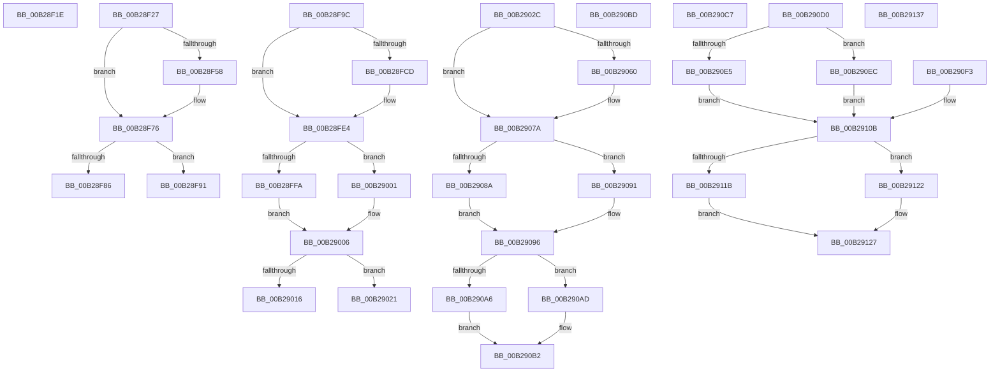

# sub_00B28F1E

- RVA: `0x00B28F1E`–`0x00B29154` (길이 `566` bytes)
- VA: `0x0000000140B28F1E`
- 실행 섹션: `PAGE`
- PDB 이름 있음: `아니요`; PDB Function 태그: `아니요`
- unwind 정보 RVA: `0x000960A4`
- 디코드: `135`개 명령, `566/566` bytes 표시
- 미해석 바이트: `0` (있으면 어셈블리에 `.byte`로 보존)

> 이 문서는 커널 이미지의 기계어와 PDB 기호를 분석해 생성했습니다. 4번과 5번은 함수 원형과 자료형을 바이너리 사용 방식에서 추정한 C 해석이며 원본 소스 복구 결과는 아닙니다.

## 1. Dependencies

- 직접 호출 지점: **18**; 고유 호출 대상: **3**
- 직접 호출자로 확인된 함수: **0**
- RIP 상대 이미지 참조: **0**

### Outgoing calls
- `0x00B28F4E` → [SetFailureLocation](../../text/46/SetFailureLocation_function_0046EF54.md) (function, `0x0046EF54`)
- `0x00B28F86` → [HvpReleaseCellFlat](../85/HvpReleaseCellFlat_function_0085CC20.md) (function, `0x0085CC20`)
- `0x00B28F91` → [HvpReleaseCellPaged](../85/HvpReleaseCellPaged_function_00855F40.md) (function, `0x00855F40`)
- `0x00B28FC3` → [SetFailureLocation](../../text/46/SetFailureLocation_function_0046EF54.md) (function, `0x0046EF54`)
- `0x00B28FFA` → [HvpReleaseCellFlat](../85/HvpReleaseCellFlat_function_0085CC20.md) (function, `0x0085CC20`)
- `0x00B29001` → [HvpReleaseCellPaged](../85/HvpReleaseCellPaged_function_00855F40.md) (function, `0x00855F40`)
- `0x00B29016` → [HvpReleaseCellFlat](../85/HvpReleaseCellFlat_function_0085CC20.md) (function, `0x0085CC20`)
- `0x00B29021` → [HvpReleaseCellPaged](../85/HvpReleaseCellPaged_function_00855F40.md) (function, `0x00855F40`)
- `0x00B29056` → [SetFailureLocation](../../text/46/SetFailureLocation_function_0046EF54.md) (function, `0x0046EF54`)
- `0x00B2908A` → [HvpReleaseCellFlat](../85/HvpReleaseCellFlat_function_0085CC20.md) (function, `0x0085CC20`)
- `0x00B29091` → [HvpReleaseCellPaged](../85/HvpReleaseCellPaged_function_00855F40.md) (function, `0x00855F40`)
- `0x00B290A6` → [HvpReleaseCellFlat](../85/HvpReleaseCellFlat_function_0085CC20.md) (function, `0x0085CC20`)
- `0x00B290AD` → [HvpReleaseCellPaged](../85/HvpReleaseCellPaged_function_00855F40.md) (function, `0x00855F40`)
- `0x00B290E5` → [HvpReleaseCellFlat](../85/HvpReleaseCellFlat_function_0085CC20.md) (function, `0x0085CC20`)
- `0x00B290EC` → [HvpReleaseCellPaged](../85/HvpReleaseCellPaged_function_00855F40.md) (function, `0x00855F40`)
- `0x00B2911B` → [HvpReleaseCellFlat](../85/HvpReleaseCellFlat_function_0085CC20.md) (function, `0x0085CC20`)
- `0x00B29122` → [HvpReleaseCellPaged](../85/HvpReleaseCellPaged_function_00855F40.md) (function, `0x00855F40`)
- `0x00B29146` → [SetFailureLocation](../../text/46/SetFailureLocation_function_0046EF54.md) (function, `0x0046EF54`)

### Direct callers
- 이 함수 시작 RVA로 연결되는 직접 call은 확인되지 않았습니다. 간접 호출은 완전히 역산할 수 없습니다.

### Static image references
- 디코드된 RIP-relative 메모리 참조가 없습니다.

## 2. Other-region calls and transfers

- 다른 실행 섹션으로 향하는 call: **4**
  - `0x00B28F4E` → [SetFailureLocation](../../text/46/SetFailureLocation_function_0046EF54.md) (`PAGE` → `.text`)
  - `0x00B28FC3` → [SetFailureLocation](../../text/46/SetFailureLocation_function_0046EF54.md) (`PAGE` → `.text`)
  - `0x00B29056` → [SetFailureLocation](../../text/46/SetFailureLocation_function_0046EF54.md) (`PAGE` → `.text`)
  - `0x00B29146` → [SetFailureLocation](../../text/46/SetFailureLocation_function_0046EF54.md) (`PAGE` → `.text`)
- call이 아닌 외부 분기/꼬리 이동: **10**
  - `0x00B28F22` → [CmpCheckValueList + 0x19C](../97/CmpCheckValueList_function_00970F6C.md) (`tail-transfer`)
  - `0x00B28F8C` → [CmpCheckValueList + 0xAAA](../97/CmpCheckValueList_function_00970F6C.md) (`tail-transfer`)
  - `0x00B28F97` → [CmpCheckValueList + 0xAAA](../97/CmpCheckValueList_function_00970F6C.md) (`tail-transfer`)
  - `0x00B2901C` → [CmpCheckValueList + 0x585](../97/CmpCheckValueList_function_00970F6C.md) (`tail-transfer`)
  - `0x00B29027` → [CmpCheckValueList + 0x585](../97/CmpCheckValueList_function_00970F6C.md) (`tail-transfer`)
  - `0x00B290B8` → [CmpCheckValueList + 0x402](../97/CmpCheckValueList_function_00970F6C.md) (`tail-transfer`)
  - `0x00B290C2` → [CmpCheckValueList + 0x5F3](../97/CmpCheckValueList_function_00970F6C.md) (`tail-transfer`)
  - `0x00B290CB` → [CmpCheckValueList + 0x6AA](../97/CmpCheckValueList_function_00970F6C.md) (`tail-transfer`)
  - `0x00B29132` → [CmpCheckValueList + 0xC0B](../97/CmpCheckValueList_function_00970F6C.md) (`tail-transfer`)
  - `0x00B2914F` → [CmpCheckValueList + 0xC00](../97/CmpCheckValueList_function_00970F6C.md) (`tail-transfer`)

## 3. Assembly (complete function range)

```asm
00B28F1E  44 8A 4D 4F                     mov r9b, byte ptr [rbp + 0x4f]
00B28F22  E9 E1 81 E4 FF                  jmp 0x140971108
00B28F27  41 BF 01 00 00 00               mov r15d, 1
00B28F2D  C7 44 24 20 80 01 00 00         mov dword ptr [rsp + 0x20], 0x180
00B28F35  B9 4C 01 00 C0                  mov ecx, 0xc000014c
00B28F3A  44 88 7D 7F                     mov byte ptr [rbp + 0x7f], r15b
00B28F3E  44 8B F1                        mov r14d, ecx
00B28F41  44 8B C9                        mov r9d, ecx
00B28F44  41 8B D7                        mov edx, r15d
00B28F47  48 8B CF                        mov rcx, rdi
00B28F4A  45 8D 47 0E                     lea r8d, [r15 + 0xe]
00B28F4E  E8 01 60 94 FF                  call 0x14046ef54
00B28F53  48 85 FF                        test rdi, rdi
00B28F56  74 1E                           je 0x140b28f76
00B28F58  48 8B 4D CF                     mov rcx, qword ptr [rbp - 0x31]
00B28F5C  41 8B C4                        mov eax, r12d
00B28F5F  44 89 A7 18 01 00 00            mov dword ptr [rdi + 0x118], r12d
00B28F66  8B 04 81                        mov eax, dword ptr [rcx + rax*4]
00B28F69  89 87 1C 01 00 00               mov dword ptr [rdi + 0x11c], eax
00B28F6F  4C 89 AF 20 01 00 00            mov qword ptr [rdi + 0x120], r13
00B28F76  48 8D 55 BF                     lea rdx, [rbp - 0x41]
00B28F7A  48 8B CB                        mov rcx, rbx
00B28F7D  44 84 BB 8C 00 00 00            test byte ptr [rbx + 0x8c], r15b
00B28F84  74 0B                           je 0x140b28f91
00B28F86  E8 95 3C D3 FF                  call 0x14085cc20
00B28F8B  90                              nop
00B28F8C  E9 85 8A E4 FF                  jmp 0x140971a16
00B28F91  E8 AA CF D2 FF                  call 0x140855f40
00B28F96  90                              nop
00B28F97  E9 7A 8A E4 FF                  jmp 0x140971a16
00B28F9C  C7 44 24 20 40 01 00 00         mov dword ptr [rsp + 0x20], 0x140
00B28FA4  B9 01 00 00 00                  mov ecx, 1
00B28FA9  BA 4C 01 00 C0                  mov edx, 0xc000014c
00B28FAE  44 8B F2                        mov r14d, edx
00B28FB1  88 4D 7F                        mov byte ptr [rbp + 0x7f], cl
00B28FB4  44 8B CA                        mov r9d, edx
00B28FB7  8B D1                           mov edx, ecx
00B28FB9  44 8D 69 0E                     lea r13d, [rcx + 0xe]
00B28FBD  48 8B CF                        mov rcx, rdi
00B28FC0  45 8B C5                        mov r8d, r13d
00B28FC3  E8 8C 5F 94 FF                  call 0x14046ef54
00B28FC8  48 85 FF                        test rdi, rdi
00B28FCB  74 17                           je 0x140b28fe4
00B28FCD  8B 45 9F                        mov eax, dword ptr [rbp - 0x61]
00B28FD0  89 87 18 01 00 00               mov dword ptr [rdi + 0x118], eax
00B28FD6  44 89 A7 1C 01 00 00            mov dword ptr [rdi + 0x11c], r12d
00B28FDD  4C 89 BF 20 01 00 00            mov qword ptr [rdi + 0x120], r15
00B28FE4  41 BF 01 00 00 00               mov r15d, 1
00B28FEA  48 8D 55 AF                     lea rdx, [rbp - 0x51]
00B28FEE  48 8B CB                        mov rcx, rbx
00B28FF1  44 84 BB 8C 00 00 00            test byte ptr [rbx + 0x8c], r15b
00B28FF8  74 07                           je 0x140b29001
00B28FFA  E8 21 3C D3 FF                  call 0x14085cc20
00B28FFF  EB 05                           jmp 0x140b29006
00B29001  E8 3A CF D2 FF                  call 0x140855f40
00B29006  48 8D 55 A7                     lea rdx, [rbp - 0x59]
00B2900A  48 8B CB                        mov rcx, rbx
00B2900D  44 84 BB 8C 00 00 00            test byte ptr [rbx + 0x8c], r15b
00B29014  74 0B                           je 0x140b29021
00B29016  E8 05 3C D3 FF                  call 0x14085cc20
00B2901B  90                              nop
00B2901C  E9 D0 84 E4 FF                  jmp 0x1409714f1
00B29021  E8 1A CF D2 FF                  call 0x140855f40
00B29026  90                              nop
00B29027  E9 C5 84 E4 FF                  jmp 0x1409714f1
00B2902C  41 BF 01 00 00 00               mov r15d, 1
00B29032  C7 44 24 20 20 01 00 00         mov dword ptr [rsp + 0x20], 0x120
00B2903A  B8 4C 01 00 C0                  mov eax, 0xc000014c
00B2903F  44 88 7D 7F                     mov byte ptr [rbp + 0x7f], r15b
00B29043  44 8B C8                        mov r9d, eax
00B29046  41 8B D7                        mov edx, r15d
00B29049  48 8B CF                        mov rcx, rdi
00B2904C  44 8B F0                        mov r14d, eax
00B2904F  45 8D 47 0E                     lea r8d, [r15 + 0xe]
00B29053  45 8A E7                        mov r12b, r15b
00B29056  E8 F9 5E 94 FF                  call 0x14046ef54
00B2905B  48 85 FF                        test rdi, rdi
00B2905E  74 1A                           je 0x140b2907a
00B29060  8B 45 9F                        mov eax, dword ptr [rbp - 0x61]
00B29063  89 87 18 01 00 00               mov dword ptr [rdi + 0x118], eax
00B29069  41 8B 45 04                     mov eax, dword ptr [r13 + 4]
00B2906D  89 87 1C 01 00 00               mov dword ptr [rdi + 0x11c], eax
00B29073  4C 89 AF 20 01 00 00            mov qword ptr [rdi + 0x120], r13
00B2907A  48 8D 55 A7                     lea rdx, [rbp - 0x59]
00B2907E  48 8B CB                        mov rcx, rbx
00B29081  44 84 BB 8C 00 00 00            test byte ptr [rbx + 0x8c], r15b
00B29088  74 07                           je 0x140b29091
00B2908A  E8 91 3B D3 FF                  call 0x14085cc20
00B2908F  EB 05                           jmp 0x140b29096
00B29091  E8 AA CE D2 FF                  call 0x140855f40
00B29096  48 8D 55 97                     lea rdx, [rbp - 0x69]
00B2909A  48 8B CB                        mov rcx, rbx
00B2909D  44 84 BB 8C 00 00 00            test byte ptr [rbx + 0x8c], r15b
00B290A4  74 07                           je 0x140b290ad
00B290A6  E8 75 3B D3 FF                  call 0x14085cc20
00B290AB  EB 05                           jmp 0x140b290b2
00B290AD  E8 8E CE D2 FF                  call 0x140855f40
00B290B2  41 BD 0F 00 00 00               mov r13d, 0xf
00B290B8  E9 B1 82 E4 FF                  jmp 0x14097136e
00B290BD  B9 01 00 00 00                  mov ecx, 1
00B290C2  E9 98 84 E4 FF                  jmp 0x14097155f
00B290C7  44 8A 65 7F                     mov r12b, byte ptr [rbp + 0x7f]
00B290CB  E9 46 85 E4 FF                  jmp 0x140971616
00B290D0  BF 01 00 00 00                  mov edi, 1
00B290D5  48 8D 55 AF                     lea rdx, [rbp - 0x51]
00B290D9  48 8B CB                        mov rcx, rbx
00B290DC  40 84 BB 8C 00 00 00            test byte ptr [rbx + 0x8c], dil
00B290E3  74 07                           je 0x140b290ec
00B290E5  E8 36 3B D3 FF                  call 0x14085cc20
00B290EA  EB 1F                           jmp 0x140b2910b
00B290EC  E8 4F CE D2 FF                  call 0x140855f40
00B290F1  EB 18                           jmp 0x140b2910b
00B290F3  8B 45 9F                        mov eax, dword ptr [rbp - 0x61]
00B290F6  89 87 18 01 00 00               mov dword ptr [rdi + 0x118], eax
00B290FC  41 8B 45 04                     mov eax, dword ptr [r13 + 4]
00B29100  89 87 1C 01 00 00               mov dword ptr [rdi + 0x11c], eax
00B29106  BF 01 00 00 00                  mov edi, 1
00B2910B  48 8D 55 A7                     lea rdx, [rbp - 0x59]
00B2910F  48 8B CB                        mov rcx, rbx
00B29112  40 84 BB 8C 00 00 00            test byte ptr [rbx + 0x8c], dil
00B29119  74 07                           je 0x140b29122
00B2911B  E8 00 3B D3 FF                  call 0x14085cc20
00B29120  EB 05                           jmp 0x140b29127
00B29122  E8 19 CE D2 FF                  call 0x140855f40
00B29127  40 84 BB 8C 00 00 00            test byte ptr [rbx + 0x8c], dil
00B2912E  48 8D 55 97                     lea rdx, [rbp - 0x69]
00B29132  E9 40 8A E4 FF                  jmp 0x140971b77
00B29137  45 8B CE                        mov r9d, r14d
00B2913A  89 44 24 20                     mov dword ptr [rsp + 0x20], eax
00B2913E  45 8B C5                        mov r8d, r13d
00B29141  8B D6                           mov edx, esi
00B29143  48 8B CF                        mov rcx, rdi
00B29146  E8 09 5E 94 FF                  call 0x14046ef54
00B2914B  48 8D 55 C7                     lea rdx, [rbp - 0x39]
00B2914F  E9 18 8A E4 FF                  jmp 0x140971b6c
```

## 4. C-style interpretation (structured pseudocode)

```c
__int64 __fastcall sub_00B28F1E(void)
{
    unsigned int v_stack_p20;
}
```

## 5. (Beta) C Style

```c
void sub_00B28F1E(void)
{
    uint32_t v_stack_p20;
}
```

## 6. Execution-region graph

[열기: 2D/3D 그래프와 함수 탐색 컨트롤 패널](../../../control-panel.html?section=page&rva=0x00B28F1E&view=graph)

- 2D 그래프는 위에서 아래로 흐르고, 3D 그래프는 빈 공간을 드래그해 회전합니다. Shift+드래그는 이동, 휠은 확대·축소, 함수 노드 선택은 대상 보고서 이동입니다.

### Static fallback


