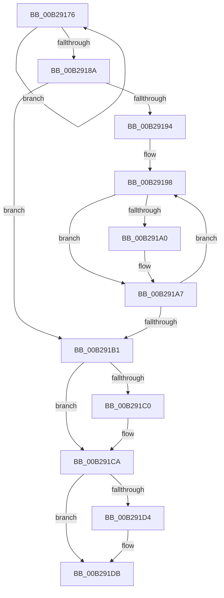

# sub_00B29176

- RVA: `0x00B29176`–`0x00B291EB` (길이 `117` bytes)
- VA: `0x0000000140B29176`
- 실행 섹션: `PAGE`
- PDB 이름 있음: `아니요`; PDB Function 태그: `아니요`
- unwind 정보 RVA: `0x00096124`
- 디코드: `36`개 명령, `117/117` bytes 표시
- 미해석 바이트: `0` (있으면 어셈블리에 `.byte`로 보존)

> 이 문서는 커널 이미지의 기계어와 PDB 기호를 분석해 생성했습니다. 4번과 5번은 함수 원형과 자료형을 바이너리 사용 방식에서 추정한 C 해석이며 원본 소스 복구 결과는 아닙니다.

## 1. Dependencies

- 직접 호출 지점: **6**; 고유 호출 대상: **1**
- 직접 호출자로 확인된 함수: **0**
- RIP 상대 이미지 참조: **0**

### Outgoing calls
- `0x00B2917B` → [ExFreePoolWithTag](../../poolcode/B8/ExFreePoolWithTag_function_00B82870.md) (function, `0x00B82870`)
- `0x00B291A2` → [ExFreePoolWithTag](../../poolcode/B8/ExFreePoolWithTag_function_00B82870.md) (function, `0x00B82870`)
- `0x00B291B6` → [ExFreePoolWithTag](../../poolcode/B8/ExFreePoolWithTag_function_00B82870.md) (function, `0x00B82870`)
- `0x00B291C5` → [ExFreePoolWithTag](../../poolcode/B8/ExFreePoolWithTag_function_00B82870.md) (function, `0x00B82870`)
- `0x00B291D6` → [ExFreePoolWithTag](../../poolcode/B8/ExFreePoolWithTag_function_00B82870.md) (function, `0x00B82870`)
- `0x00B291E0` → [ExFreePoolWithTag](../../poolcode/B8/ExFreePoolWithTag_function_00B82870.md) (function, `0x00B82870`)

### Direct callers
- 이 함수 시작 RVA로 연결되는 직접 call은 확인되지 않았습니다. 간접 호출은 완전히 역산할 수 없습니다.

### Static image references
- 디코드된 RIP-relative 메모리 참조가 없습니다.

## 2. Other-region calls and transfers

- 다른 실행 섹션으로 향하는 call: **6**
  - `0x00B2917B` → [ExFreePoolWithTag](../../poolcode/B8/ExFreePoolWithTag_function_00B82870.md) (`PAGE` → `POOLCODE`)
  - `0x00B291A2` → [ExFreePoolWithTag](../../poolcode/B8/ExFreePoolWithTag_function_00B82870.md) (`PAGE` → `POOLCODE`)
  - `0x00B291B6` → [ExFreePoolWithTag](../../poolcode/B8/ExFreePoolWithTag_function_00B82870.md) (`PAGE` → `POOLCODE`)
  - `0x00B291C5` → [ExFreePoolWithTag](../../poolcode/B8/ExFreePoolWithTag_function_00B82870.md) (`PAGE` → `POOLCODE`)
  - `0x00B291D6` → [ExFreePoolWithTag](../../poolcode/B8/ExFreePoolWithTag_function_00B82870.md) (`PAGE` → `POOLCODE`)
  - `0x00B291E0` → [ExFreePoolWithTag](../../poolcode/B8/ExFreePoolWithTag_function_00B82870.md) (`PAGE` → `POOLCODE`)
- call이 아닌 외부 분기/꼬리 이동: **1**
  - `0x00B291E6` → [SepCaptureTokenSecurityAttributesInformation + 0x4F3](../97/SepCaptureTokenSecurityAttributesInformation_function_00971FB8.md) (`tail-transfer`)

## 3. Assembly (complete function range)

```asm
00B29176  33 D2                           xor edx, edx
00B29178  49 8B 0F                        mov rcx, qword ptr [r15]
00B2917B  E8 F0 96 05 00                  call 0x140b82870
00B29180  4D 8D 7F 28                     lea r15, [r15 + 0x28]
00B29184  49 83 EE 01                     sub r14, 1
00B29188  75 EC                           jne 0x140b29176
00B2918A  4C 8B 74 24 68                  mov r14, qword ptr [rsp + 0x68]
00B2918F  45 85 ED                        test r13d, r13d
00B29192  74 1D                           je 0x140b291b1
00B29194  4C 8D 7E 20                     lea r15, [rsi + 0x20]
00B29198  49 8B 0F                        mov rcx, qword ptr [r15]
00B2919B  48 85 C9                        test rcx, rcx
00B2919E  74 07                           je 0x140b291a7
00B291A0  33 D2                           xor edx, edx
00B291A2  E8 C9 96 05 00                  call 0x140b82870
00B291A7  49 83 C7 28                     add r15, 0x28
00B291AB  49 83 ED 01                     sub r13, 1
00B291AF  75 E7                           jne 0x140b29198
00B291B1  33 D2                           xor edx, edx
00B291B3  48 8B CE                        mov rcx, rsi
00B291B6  E8 B5 96 05 00                  call 0x140b82870
00B291BB  4D 85 E4                        test r12, r12
00B291BE  74 0A                           je 0x140b291ca
00B291C0  33 D2                           xor edx, edx
00B291C2  49 8B CC                        mov rcx, r12
00B291C5  E8 A6 96 05 00                  call 0x140b82870
00B291CA  48 8B 4C 24 40                  mov rcx, qword ptr [rsp + 0x40]
00B291CF  48 85 C9                        test rcx, rcx
00B291D2  74 07                           je 0x140b291db
00B291D4  33 D2                           xor edx, edx
00B291D6  E8 95 96 05 00                  call 0x140b82870
00B291DB  33 D2                           xor edx, edx
00B291DD  49 8B CE                        mov rcx, r14
00B291E0  E8 8B 96 05 00                  call 0x140b82870
00B291E5  90                              nop
00B291E6  E9 C0 92 E4 FF                  jmp 0x1409724ab
```

## 4. C-style interpretation (structured pseudocode)

```c
__int64 __fastcall sub_00B29176(__int64 a1, int a2, __int64 a3, __int64 a4, __int64 a5, __int64 a6, __int64 a7, __int64 a8, __int64 a9, __int64 a10, __int64 a11, __int64 a12, __int64 a13)
{
    __int64 result;
    __int64 v_r13;
    __int64 v_r14;
    __int64 v_r15;

    a2 = 0;
    result = ExFreePoolWithTag(*(unsigned __int64 *)(v_r15), a2, a3, a4);
    v_r14 = (v_r14) - (1);
    if (condition_is_not_equal) goto loc_00B29176;
    if ((unsigned int)(v_r13) == 0) goto loc_00B291B1;
loc_00B29198:
    if (*(unsigned __int64 *)(v_rsi + 32) != 0) {
        a2 = 0;
        result = ExFreePoolWithTag(*(unsigned __int64 *)(v_rsi + 32), a2, a3, a4);
    }
    v_r15 = (v_rsi + 32) + (40);
    v_r13 = (v_r13) - (1);
    if (condition_is_not_equal) goto loc_00B29198;
loc_00B291B1:
    a2 = 0;
    result = ExFreePoolWithTag(v_rsi, a2, a3, a4);
    if (v_r12 != 0) {
        a2 = 0;
        a1 = v_r12;
        result = ExFreePoolWithTag(a1, a2, a3, a4);
    }
    if (a8 != 0) {
        a2 = 0;
        result = ExFreePoolWithTag(a8, a2, a3, a4);
    }
    a2 = 0;
    result = ExFreePoolWithTag(a13, a2, a3, a4);
}
```

## 5. (Beta) C Style

```c
int64_t sub_00B29176(int64_t Arg1, int32_t Arg2, int64_t Arg3, int64_t Arg4, uint64_t Arg5, uint64_t Arg6, uint64_t Arg7, int64_t Arg8, uint64_t Arg9, uint64_t Arg10, uint64_t Arg11, uint64_t Arg12, int64_t Arg13)
{
    int64_t result;
    int64_t local_r13;
    int64_t local_r14;
    int64_t local_r15;

    Arg2 = 0;
    result = ExFreePoolWithTag(*(uint64_t *)(local_r15), Arg2, Arg3, Arg4);
    local_r14 = (local_r14) - (1);
    if (condition_is_not_equal) goto loc_00B29176;
    if ((uint32_t)(local_r13) == 0) goto loc_00B291B1;
loc_00B29198:
    if (*(uint64_t *)(local_rsi + 0x20) != 0) {
        Arg2 = 0;
        result = ExFreePoolWithTag(*(uint64_t *)(local_rsi + 0x20), Arg2, Arg3, Arg4);
    }
    local_r15 = (local_rsi + 32) + (40);
    local_r13 = (local_r13) - (1);
    if (condition_is_not_equal) goto loc_00B29198;
loc_00B291B1:
    Arg2 = 0;
    result = ExFreePoolWithTag(local_rsi, Arg2, Arg3, Arg4);
    if (local_r12 != 0) {
        Arg2 = 0;
        Arg1 = local_r12;
        result = ExFreePoolWithTag(Arg1, Arg2, Arg3, Arg4);
    }
    if (Arg8 != 0) {
        Arg2 = 0;
        result = ExFreePoolWithTag(Arg8, Arg2, Arg3, Arg4);
    }
    Arg2 = 0;
    result = ExFreePoolWithTag(Arg13, Arg2, Arg3, Arg4);
}
```

## 6. Execution-region graph

[열기: 2D/3D 그래프와 함수 탐색 컨트롤 패널](../../../control-panel.html?section=page&rva=0x00B29176&view=graph)

- 2D 그래프는 위에서 아래로 흐르고, 3D 그래프는 빈 공간을 드래그해 회전합니다. Shift+드래그는 이동, 휠은 확대·축소, 함수 노드 선택은 대상 보고서 이동입니다.

### Static fallback


