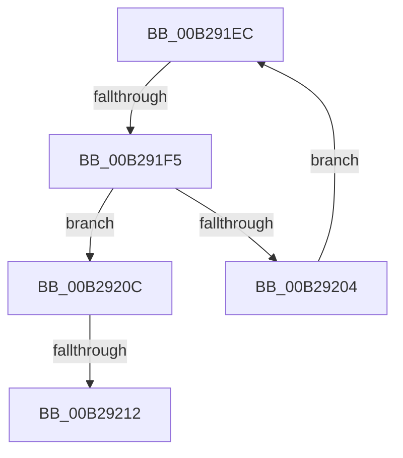

# sub_00B291EC

- RVA: `0x00B291EC`–`0x00B29217` (길이 `43` bytes)
- VA: `0x0000000140B291EC`
- 실행 섹션: `PAGE`
- PDB 이름 있음: `아니요`; PDB Function 태그: `아니요`
- unwind 정보 RVA: `0x00096158`
- 디코드: `11`개 명령, `43/43` bytes 표시
- 미해석 바이트: `0` (있으면 어셈블리에 `.byte`로 보존)

> 이 문서는 커널 이미지의 기계어와 PDB 기호를 분석해 생성했습니다. 4번과 5번은 함수 원형과 자료형을 바이너리 사용 방식에서 추정한 C 해석이며 원본 소스 복구 결과는 아닙니다.

## 1. Dependencies

- 직접 호출 지점: **0**; 고유 호출 대상: **0**
- 직접 호출자로 확인된 함수: **0**
- RIP 상대 이미지 참조: **0**

### Outgoing calls
- 직접 디코드된 call 명령이 없습니다.

### Direct callers
- 이 함수 시작 RVA로 연결되는 직접 call은 확인되지 않았습니다. 간접 호출은 완전히 역산할 수 없습니다.

### Static image references
- 디코드된 RIP-relative 메모리 참조가 없습니다.

## 2. Other-region calls and transfers

- 다른 실행 섹션으로 향하는 call: **0**
- call이 아닌 외부 분기/꼬리 이동: **3**
  - `0x00B291EF` → [SshpCacheDatabaseCompare + 0x1A6](../97/SshpCacheDatabaseCompare_function_009725D0.md) (`tail-transfer`)
  - `0x00B2920C` → [SshpCacheDatabaseCompare + 0x14E](../97/SshpCacheDatabaseCompare_function_009725D0.md) (`tail-transfer`)
  - `0x00B29212` → [SshpCacheDatabaseCompare + 0x15A](../97/SshpCacheDatabaseCompare_function_009725D0.md) (`tail-transfer`)

## 3. Assembly (complete function range)

```asm
00B291EC  44 3B D1                        cmp r10d, ecx
00B291EF  0F 83 81 95 E4 FF               jae 0x140972776
00B291F5  41 8B C2                        mov eax, r10d
00B291F8  45 8B 5C 81 0C                  mov r11d, dword ptr [r9 + rax*4 + 0xc]
00B291FD  44 3B 5C 82 0C                  cmp r11d, dword ptr [rdx + rax*4 + 0xc]
00B29202  75 08                           jne 0x140b2920c
00B29204  45 03 C3                        add r8d, r11d
00B29207  41 FF C2                        inc r10d
00B2920A  EB E0                           jmp 0x140b291ec
00B2920C  0F 83 0C 95 E4 FF               jae 0x14097271e
00B29212  E9 13 95 E4 FF                  jmp 0x14097272a
```

## 4. C-style interpretation (structured pseudocode)

```c
__int64 __fastcall sub_00B291EC(int a1, __int64 a2, int a3, __int64 a4)
{
    __int64 v_r10;

    if (((unsigned int)((unsigned int)(*(unsigned int *)(a4 + (unsigned int)((unsigned int)(v_r10)) * 4 + 12)))) != (*(unsigned int *)(a2 + (unsigned int)((unsigned int)(v_r10)) * 4 + 12))) goto loc_00B2920C;
    a3 = (unsigned int)((a3) + ((unsigned int)((unsigned int)(*(unsigned int *)(a4 + (unsigned int)((unsigned int)(v_r10)) * 4 + 12)))));
    v_r10 = (unsigned int)((v_r10) + 1);
    goto loc_00B291EC;
loc_00B2920C:
}
```

## 5. (Beta) C Style

```c
int64_t sub_00B291EC(int32_t Arg1, void *Arg2, int32_t Arg3, void *Arg4)
{
    uint8_t *arg2 = (uint8_t *)Arg2;
    uint8_t *arg4 = (uint8_t *)Arg4;

    int64_t local_r10;

    if (((uint32_t)((uint32_t)(*(uint32_t *)(arg4 + (uint32_t)((uint32_t)(local_r10)) * 4 + 0xC)))) != (*(uint32_t *)(arg2 + (uint32_t)((uint32_t)(local_r10)) * 4 + 0xC))) goto loc_00B2920C;
    Arg3 = (uint32_t)((Arg3) + ((uint32_t)((uint32_t)(*(uint32_t *)(arg4 + (uint32_t)((uint32_t)(local_r10)) * 4 + 0xC)))));
    local_r10 = (uint32_t)((local_r10) + 1);
    goto loc_00B291EC;
loc_00B2920C:
}
```

### 관측된 메모리 오프셋

구조체 형식이 확인되지 않은 접근은 인자 기준의 오프셋으로만 기록했습니다.

| 기준 인자 | 오프셋 표현 | 폭 (bit) | 접근 |
|---|---:|---:|---|
| `Arg2` | `+ 0xC + rax*4` | `32` | `R` |
| `Arg4` | `+ 0xC + rax*4` | `32` | `R` |

## 6. Execution-region graph

[열기: 2D/3D 그래프와 함수 탐색 컨트롤 패널](../../../control-panel.html?section=page&rva=0x00B291EC&view=graph)

- 2D 그래프는 위에서 아래로 흐르고, 3D 그래프는 빈 공간을 드래그해 회전합니다. Shift+드래그는 이동, 휠은 확대·축소, 함수 노드 선택은 대상 보고서 이동입니다.

### Static fallback


