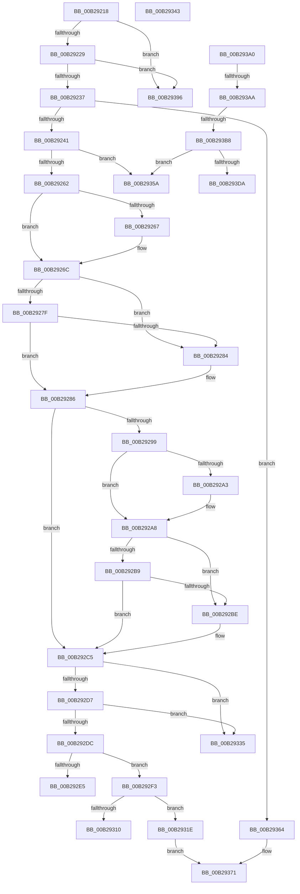

# sub_00B29218

- RVA: `0x00B29218`–`0x00B2940B` (길이 `499` bytes)
- VA: `0x0000000140B29218`
- 실행 섹션: `PAGE`
- PDB 이름 있음: `아니요`; PDB Function 태그: `아니요`
- unwind 정보 RVA: `0x0009632C`
- 디코드: `113`개 명령, `499/499` bytes 표시
- 미해석 바이트: `0` (있으면 어셈블리에 `.byte`로 보존)

> 이 문서는 커널 이미지의 기계어와 PDB 기호를 분석해 생성했습니다. 4번과 5번은 함수 원형과 자료형을 바이너리 사용 방식에서 추정한 C 해석이며 원본 소스 복구 결과는 아닙니다.

## 1. Dependencies

- 직접 호출 지점: **6**; 고유 호출 대상: **5**
- 직접 호출자로 확인된 함수: **0**
- RIP 상대 이미지 참조: **1**

### Outgoing calls
- `0x00B29267` → [ExRaiseDatatypeMisalignment](../89/ExRaiseDatatypeMisalignment_function_00899FD0.md) (function, `0x00899FD0`)
- `0x00B292A3` → [ExRaiseDatatypeMisalignment](../89/ExRaiseDatatypeMisalignment_function_00899FD0.md) (function, `0x00899FD0`)
- `0x00B29301` → [ExAllocatePool2](../../poolcode/B8/ExAllocatePool2_function_00B820F0.md) (function, `0x00B820F0`)
- `0x00B2932E` → [memcpy](../../text/6C/memcpy_function_006C6840.md) (function, `0x006C6840`)
- `0x00B2938B` → [guard_dispatch_icall](../../text/6B/guard_dispatch_icall_function_006BAAD0.md) (function, `0x006BAAD0`)
- `0x00B293F4` → [SeCompareSigningLevels](../A1/SeCompareSigningLevels_function_00A13760.md) (function, `0x00A13760`)

### Direct callers
- 이 함수 시작 RVA로 연결되는 직접 call은 확인되지 않았습니다. 간접 호출은 완전히 역산할 수 없습니다.

### Static image references
- `0x00B29371` → RVA `0x00F04F28` (`.data`; read)

## 2. Other-region calls and transfers

- 다른 실행 섹션으로 향하는 call: **3**
  - `0x00B29301` → [ExAllocatePool2](../../poolcode/B8/ExAllocatePool2_function_00B820F0.md) (`PAGE` → `POOLCODE`)
  - `0x00B2932E` → [memcpy](../../text/6C/memcpy_function_006C6840.md) (`PAGE` → `.text`)
  - `0x00B2938B` → [guard_dispatch_icall](../../text/6B/guard_dispatch_icall_function_006BAAD0.md) (`PAGE` → `.text`)
- call이 아닌 외부 분기/꼬리 이동: **10**
  - `0x00B292EE` → [NtSetCachedSigningLevel2 + 0xE3](../97/NtSetCachedSigningLevel2_function_00973720.md) (`tail-transfer`)
  - `0x00B29319` → [NtSetCachedSigningLevel2 + 0xE3](../97/NtSetCachedSigningLevel2_function_00973720.md) (`tail-transfer`)
  - `0x00B2933E` → [NtSetCachedSigningLevel2 + 0xE3](../97/NtSetCachedSigningLevel2_function_00973720.md) (`tail-transfer`)
  - `0x00B29355` → [NtSetCachedSigningLevel2 + 0xE3](../97/NtSetCachedSigningLevel2_function_00973720.md) (`tail-transfer`)
  - `0x00B2935F` → [NtSetCachedSigningLevel2 + 0xE3](../97/NtSetCachedSigningLevel2_function_00973720.md) (`tail-transfer`)
  - `0x00B29391` → [NtSetCachedSigningLevel2 + 0x28D](../97/NtSetCachedSigningLevel2_function_00973720.md) (`tail-transfer`)
  - `0x00B2939B` → [NtSetCachedSigningLevel2 + 0xE3](../97/NtSetCachedSigningLevel2_function_00973720.md) (`tail-transfer`)
  - `0x00B293A4` → [NtSetCachedSigningLevel2 + 0x126](../97/NtSetCachedSigningLevel2_function_00973720.md) (`tail-transfer`)
  - `0x00B293B2` → [NtSetCachedSigningLevel2 + 0xB6](../97/NtSetCachedSigningLevel2_function_00973720.md) (`tail-transfer`)
  - `0x00B29406` → [NtSetCachedSigningLevel2 + 0xB6](../97/NtSetCachedSigningLevel2_function_00973720.md) (`tail-transfer`)

## 3. Assembly (complete function range)

```asm
00B29218  48 8B 94 24 08 01 00 00         mov rdx, qword ptr [rsp + 0x108]
00B29220  48 85 D2                        test rdx, rdx
00B29223  0F 84 6D 01 00 00               je 0x140b29396
00B29229  48 39 B4 24 00 01 00 00         cmp qword ptr [rsp + 0x100], rsi
00B29231  0F 84 5F 01 00 00               je 0x140b29396
00B29237  41 80 FF 01                     cmp r15b, 1
00B2923B  0F 85 23 01 00 00               jne 0x140b29364
00B29241  65 48 8B 04 25 88 01 00 00      mov rax, qword ptr gs:[0x188]
00B2924A  48 8B 80 B8 00 00 00            mov rax, qword ptr [rax + 0xb8]
00B29251  8A 80 FA 05 00 00               mov al, byte ptr [rax + 0x5fa]
00B29257  24 07                           and al, 7
00B29259  41 3A C7                        cmp al, r15b
00B2925C  0F 85 F8 00 00 00               jne 0x140b2935a
00B29262  F6 C2 03                        test dl, 3
00B29265  74 05                           je 0x140b2926c
00B29267  E8 64 0D D7 FF                  call 0x140899fd0
00B2926C  48 8D 42 18                     lea rax, [rdx + 0x18]
00B29270  48 B9 00 00 FF FF FF 7F 00 00   movabs rcx, 0x7fffffff0000
00B2927A  48 3B C1                        cmp rax, rcx
00B2927D  77 05                           ja 0x140b29284
00B2927F  48 3B C2                        cmp rax, rdx
00B29282  73 02                           jae 0x140b29286
00B29284  8A 01                           mov al, byte ptr [rcx]
00B29286  0F 10 42 08                     movups xmm0, xmmword ptr [rdx + 8]
00B2928A  0F 11 44 24 78                  movups xmmword ptr [rsp + 0x78], xmm0
00B2928F  66 48 0F 7E C3                  movq rbx, xmm0
00B29294  48 85 DB                        test rbx, rbx
00B29297  74 2C                           je 0x140b292c5
00B29299  F6 84 24 80 00 00 00 03         test byte ptr [rsp + 0x80], 3
00B292A1  74 05                           je 0x140b292a8
00B292A3  E8 28 0D D7 FF                  call 0x140899fd0
00B292A8  48 8B 84 24 80 00 00 00         mov rax, qword ptr [rsp + 0x80]
00B292B0  48 8D 14 18                     lea rdx, [rax + rbx]
00B292B4  48 3B D1                        cmp rdx, rcx
00B292B7  77 05                           ja 0x140b292be
00B292B9  48 3B D0                        cmp rdx, rax
00B292BC  73 07                           jae 0x140b292c5
00B292BE  8A 01                           mov al, byte ptr [rcx]
00B292C0  48 8B 5C 24 78                  mov rbx, qword ptr [rsp + 0x78]
00B292C5  48 89 9C 24 98 00 00 00         mov qword ptr [rsp + 0x98], rbx
00B292CD  48 39 B4 24 80 00 00 00         cmp qword ptr [rsp + 0x80], rsi
00B292D5  74 5E                           je 0x140b29335
00B292D7  48 85 DB                        test rbx, rbx
00B292DA  74 59                           je 0x140b29335
00B292DC  48 81 FB FF FF 00 00            cmp rbx, 0xffff
00B292E3  76 0E                           jbe 0x140b292f3
00B292E5  BB 0D 00 00 C0                  mov ebx, 0xc000000d
00B292EA  89 5C 24 54                     mov dword ptr [rsp + 0x54], ebx
00B292EE  E9 10 A5 E4 FF                  jmp 0x140973803
00B292F3  41 B8 43 49 73 63               mov r8d, 0x63734943
00B292F9  48 8B D3                        mov rdx, rbx
00B292FC  B9 03 01 00 00                  mov ecx, 0x103
00B29301  E8 EA 8D 05 00                  call 0x140b820f0
00B29306  48 89 44 24 60                  mov qword ptr [rsp + 0x60], rax
00B2930B  48 85 C0                        test rax, rax
00B2930E  75 0E                           jne 0x140b2931e
00B29310  BB 9A 00 00 C0                  mov ebx, 0xc000009a
00B29315  89 5C 24 54                     mov dword ptr [rsp + 0x54], ebx
00B29319  E9 E5 A4 E4 FF                  jmp 0x140973803
00B2931E  4C 8B C3                        mov r8, rbx
00B29321  48 8B 94 24 80 00 00 00         mov rdx, qword ptr [rsp + 0x80]
00B29329  48 8B 4C 24 60                  mov rcx, qword ptr [rsp + 0x60]
00B2932E  E8 0D D5 B9 FF                  call 0x1406c6840
00B29333  EB 3C                           jmp 0x140b29371
00B29335  BB 0D 00 00 C0                  mov ebx, 0xc000000d
00B2933A  89 5C 24 54                     mov dword ptr [rsp + 0x54], ebx
00B2933E  E9 C0 A4 E4 FF                  jmp 0x140973803
00B29343  8B D8                           mov ebx, eax
00B29345  89 44 24 54                     mov dword ptr [rsp + 0x54], eax
00B29349  33 F6                           xor esi, esi
00B2934B  8B FE                           mov edi, esi
00B2934D  44 8A BC 24 E0 00 00 00         mov r15b, byte ptr [rsp + 0xe0]
00B29355  E9 A9 A4 E4 FF                  jmp 0x140973803
00B2935A  BB 22 00 00 C0                  mov ebx, 0xc0000022
00B2935F  E9 9F A4 E4 FF                  jmp 0x140973803
00B29364  48 8B 5A 08                     mov rbx, qword ptr [rdx + 8]
00B29368  48 8B 42 10                     mov rax, qword ptr [rdx + 0x10]
00B2936C  48 89 44 24 60                  mov qword ptr [rsp + 0x60], rax
00B29371  48 8B 05 B0 BB 3D 00            mov rax, qword ptr [rip + 0x3dbbb0]
00B29378  4C 8B 4C 24 60                  mov r9, qword ptr [rsp + 0x60]
00B2937D  4C 8B C3                        mov r8, rbx
00B29380  48 8B 94 24 00 01 00 00         mov rdx, qword ptr [rsp + 0x100]
00B29388  41 8A CF                        mov cl, r15b
00B2938B  E8 40 17 B9 FF                  call 0x1406baad0
00B29390  90                              nop
00B29391  E9 17 A6 E4 FF                  jmp 0x1409739ad
00B29396  BB 0D 00 00 C0                  mov ebx, 0xc000000d
00B2939B  E9 63 A4 E4 FF                  jmp 0x140973803
00B293A0  41 F6 C6 02                     test r14b, 2
00B293A4  0F 85 9C A4 E4 FF               jne 0x140973846
00B293AA  41 83 CE 01                     or r14d, 1
00B293AE  41 F6 C6 04                     test r14b, 4
00B293B2  0F 85 1E A4 E4 FF               jne 0x1409737d6
00B293B8  65 48 8B 04 25 88 01 00 00      mov rax, qword ptr gs:[0x188]
00B293C1  48 8B 88 B8 00 00 00            mov rcx, qword ptr [rax + 0xb8]
00B293C8  8A 91 F9 05 00 00               mov dl, byte ptr [rcx + 0x5f9]
00B293CE  8A 81 FA 05 00 00               mov al, byte ptr [rcx + 0x5fa]
00B293D4  24 07                           and al, 7
00B293D6  3C 01                           cmp al, 1
00B293D8  75 80                           jne 0x140b2935a
00B293DA  40 8A B9 F8 05 00 00            mov dil, byte ptr [rcx + 0x5f8]
00B293E1  40 80 E7 0F                     and dil, 0xf
00B293E5  80 E2 0F                        and dl, 0xf
00B293E8  0F B6 DA                        movzx ebx, dl
00B293EB  88 5C 24 5C                     mov byte ptr [rsp + 0x5c], bl
00B293EF  40 8A D7                        mov dl, dil
00B293F2  8A CB                           mov cl, bl
00B293F4  E8 67 A3 EE FF                  call 0x140a13760
00B293F9  40 0F B6 CF                     movzx ecx, dil
00B293FD  85 C0                           test eax, eax
00B293FF  0F 44 CB                        cmove ecx, ebx
00B29402  89 4C 24 58                     mov dword ptr [rsp + 0x58], ecx
00B29406  E9 CB A3 E4 FF                  jmp 0x1409737d6
```

## 4. C-style interpretation (structured pseudocode)

```c
__int64 __fastcall sub_00B29218(__int64 a1, __int64 a2, __int64 a3, __int64 a4, __int64 a5, __int64 a6, __int64 a7, __int64 a8, __int64 a9, __int64 a10, __int64 a11, __int64 a12, __int64 a13, __int64 a14, __int64 a15, unsigned __int8 a16, __int64 a17, __int64 a18, __int64 a19, __int64 a20, __int64 a21, __int64 a22, __int64 a23, __int64 a24, __int64 a25, __int64 a26, __int64 a27, __int64 a28, __int64 a29, __int64 a30, __int64 a31, __int64 a32, __int64 a33)
{
    __int64 result;
    __int64 v_rbx;
    unsigned int v_stack_p54;
    unsigned int v_stack_p58;
    unsigned __int8 v_stack_p5C;
    unsigned __int64 v_stack_p60;
    unsigned __int64 v_stack_p98;
    unsigned __int8 v_stack_pE0;

    if (a33 == 0) goto loc_00B29396;
    if (a32 == v_rsi) goto loc_00B29396;
    if (((unsigned __int8)(v_r15)) != 1) goto loc_00B29364;
    result = (unsigned __int8)((*(unsigned __int8 *)(*(unsigned __int64 *)(*(unsigned __int64 *)(gs_base + (0 + 392)) + 184) + 1530)) & (7));
    if (((unsigned __int8)(result)) != ((unsigned __int8)(v_r15))) goto loc_00B2935A;
    if ((((unsigned __int8)(a33)) & (3)) != 0) {
        result = ExRaiseDatatypeMisalignment(a1, a33, a3, a4);
    }
    if ((a33 + 24) > a1) goto loc_00B29284;
    result = a33 + 24;
    if ((a33 + 24) < a33) {
        result = *(unsigned __int8 *)(a1);
    }
    a15 = v_xmm0;
    if (v_rbx == 0) goto loc_00B292C5;
    if (((a16) & (3)) != 0) {
        result = ExRaiseDatatypeMisalignment(a1, a33, a3, a4);
    }
    if ((a16 + v_rbx * 1) > a1) goto loc_00B292BE;
    result = a16;
    if ((a16 + v_rbx * 1) < a16) {
        result = *(unsigned __int8 *)(a1);
        v_rbx = a15;
    }
    v_stack_p98 = v_rbx;
    if (a16 == v_rsi) goto loc_00B29335;
    if (v_rbx == 0) goto loc_00B29335;
    if (v_rbx <= 0xFFFFULL) goto loc_00B292F3;
    v_stack_p54 = (unsigned int)((unsigned int)(0xC000000DULL));
loc_00B292F3:
    result = ExAllocatePool2(259, (unsigned int)(0xC000000DULL), (unsigned int)(0x63734943ULL), a4);
    v_stack_p60 = result;
    if (result != 0) goto loc_00B2931E;
    v_stack_p54 = (unsigned int)((unsigned int)(0xC000009AULL));
loc_00B2931E:
    result = memcpy(a12, a16, (unsigned int)(0xC000009AULL), a4);
    goto loc_00B29371;
loc_00B29335:
    v_stack_p54 = (unsigned int)((unsigned int)(0xC000000DULL));
loc_00B2935A:
loc_00B29364:
    v_stack_p60 = *(unsigned __int64 *)(a16 + 16);
loc_00B29371:
    result = guard_dispatch_icall((unsigned __int8)(v_r15), a32, *(unsigned __int64 *)(a16 + 8), a12);
loc_00B29396:
}
```

## 5. (Beta) C Style

```c
int64_t sub_00B29218(int64_t Arg1, int64_t Arg2, int64_t Arg3, int64_t Arg4, uint64_t Arg5, uint64_t Arg6, uint64_t Arg7, uint64_t Arg8, uint64_t Arg9, uint64_t Arg10, uint64_t Arg11, int64_t Arg12, uint64_t Arg13, uint64_t Arg14, int64_t Arg15, void *Arg16, uint64_t Arg17, uint64_t Arg18, uint64_t Arg19, uint64_t Arg20, uint64_t Arg21, uint64_t Arg22, uint64_t Arg23, uint64_t Arg24, uint64_t Arg25, uint64_t Arg26, uint64_t Arg27, uint64_t Arg28, uint64_t Arg29, uint64_t Arg30, uint64_t Arg31, int64_t Arg32, int64_t Arg33)
{
    uint8_t *arg16 = (uint8_t *)Arg16;

    int64_t result;
    int64_t local_rbx;
    uint32_t v_stack_p54;
    uint32_t v_stack_p58;
    uint8_t v_stack_p5C;
    uint64_t v_stack_p60;
    uint64_t v_stack_p98;
    uint8_t v_stack_pE0;

    if (Arg33 == 0) goto loc_00B29396;
    if (Arg32 == local_rsi) goto loc_00B29396;
    if (((uint8_t)(local_r15)) != 1) goto loc_00B29364;
    result = (uint8_t)((*(uint8_t *)(*(uint64_t *)(*(uint64_t *)(gs_base + (0 + 0x188)) + 0xB8) + 0x5FA)) & (7));
    if (((uint8_t)(result)) != ((uint8_t)(local_r15))) goto loc_00B2935A;
    if ((((uint8_t)(Arg33)) & (3)) != 0) {
        result = ExRaiseDatatypeMisalignment(Arg1, Arg33, Arg3, Arg4);
    }
    if ((Arg33 + 24) > Arg1) goto loc_00B29284;
    result = Arg33 + 24;
    if ((Arg33 + 24) < Arg33) {
        result = *(uint8_t *)(Arg1);
    }
    Arg15 = v_xmm0;
    if (local_rbx == 0) goto loc_00B292C5;
    if (((Arg16) & (3)) != 0) {
        result = ExRaiseDatatypeMisalignment(Arg1, Arg33, Arg3, Arg4);
    }
    if ((Arg16 + local_rbx * 1) > Arg1) goto loc_00B292BE;
    result = Arg16;
    if ((Arg16 + local_rbx * 1) < Arg16) {
        result = *(uint8_t *)(Arg1);
        local_rbx = Arg15;
    }
    v_stack_p98 = local_rbx;
    if (Arg16 == local_rsi) goto loc_00B29335;
    if (local_rbx == 0) goto loc_00B29335;
    if (local_rbx <= 0xFFFFULL) goto loc_00B292F3;
    v_stack_p54 = (uint32_t)((uint32_t)(0xC000000DULL));
loc_00B292F3:
    result = ExAllocatePool2(259, (uint32_t)(0xC000000DULL), (uint32_t)(0x63734943ULL), Arg4);
    v_stack_p60 = result;
    if (result != 0) goto loc_00B2931E;
    v_stack_p54 = (uint32_t)((uint32_t)(0xC000009AULL));
loc_00B2931E:
    result = memcpy(Arg12, Arg16, (uint32_t)(0xC000009AULL), Arg4);
    goto loc_00B29371;
loc_00B29335:
    v_stack_p54 = (uint32_t)((uint32_t)(0xC000000DULL));
loc_00B2935A:
loc_00B29364:
    v_stack_p60 = *(uint64_t *)(arg16 + 0x10);
loc_00B29371:
    result = guard_dispatch_icall((uint8_t)(local_r15), Arg32, *(uint64_t *)(arg16 + 0x8), Arg12);
loc_00B29396:
}
```

### 관측된 메모리 오프셋

구조체 형식이 확인되지 않은 접근은 인자 기준의 오프셋으로만 기록했습니다.

| 기준 인자 | 오프셋 표현 | 폭 (bit) | 접근 |
|---|---:|---:|---|
| `Arg16` | `+ 0x0 + rbx*1` | `64` | `R` |

## 6. Execution-region graph

[열기: 2D/3D 그래프와 함수 탐색 컨트롤 패널](../../../control-panel.html?section=page&rva=0x00B29218&view=graph)

- 2D 그래프는 위에서 아래로 흐르고, 3D 그래프는 빈 공간을 드래그해 회전합니다. Shift+드래그는 이동, 휠은 확대·축소, 함수 노드 선택은 대상 보고서 이동입니다.

### Static fallback


