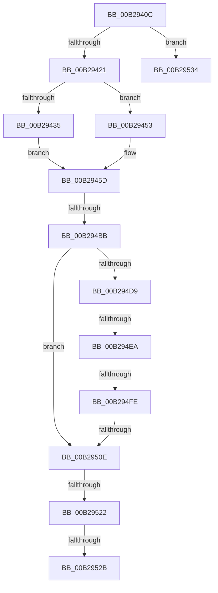

# sub_00B2940C

- RVA: `0x00B2940C`–`0x00B29541` (길이 `309` bytes)
- VA: `0x0000000140B2940C`
- 실행 섹션: `PAGE`
- PDB 이름 있음: `아니요`; PDB Function 태그: `아니요`
- unwind 정보 RVA: `0x00096358`
- 디코드: `67`개 명령, `309/309` bytes 표시
- 미해석 바이트: `0` (있으면 어셈블리에 `.byte`로 보존)

> 이 문서는 커널 이미지의 기계어와 PDB 기호를 분석해 생성했습니다. 4번과 5번은 함수 원형과 자료형을 바이너리 사용 방식에서 추정한 C 해석이며 원본 소스 복구 결과는 아닙니다.

## 1. Dependencies

- 직접 호출 지점: **3**; 고유 호출 대상: **3**
- 직접 호출자로 확인된 함수: **0**
- RIP 상대 이미지 참조: **1**

### Outgoing calls
- `0x00B294A5` → [AuthzBasepEvaluateAceCondition](../../text/2F/AuthzBasepEvaluateAceCondition_function_002FEBD0.md) (function, `0x002FEBD0`)
- `0x00B294D0` → [SepSidInToken](../../text/3D/SepSidInToken_function_003D0430.md) (function, `0x003D0430`)
- `0x00B29501` → [memcmp](../../text/6C/memcmp_function_006C6B10.md) (function, `0x006C6B10`)

### Direct callers
- 이 함수 시작 RVA로 연결되는 직접 call은 확인되지 않았습니다. 간접 호출은 완전히 역산할 수 없습니다.

### Static image references
- `0x00B294EA` → RVA `0x00E67D48` (`.data`; read)

## 2. Other-region calls and transfers

- 다른 실행 섹션으로 향하는 call: **3**
  - `0x00B294A5` → [AuthzBasepEvaluateAceCondition](../../text/2F/AuthzBasepEvaluateAceCondition_function_002FEBD0.md) (`PAGE` → `.text`)
  - `0x00B294D0` → [SepSidInToken](../../text/3D/SepSidInToken_function_003D0430.md) (`PAGE` → `.text`)
  - `0x00B29501` → [memcmp](../../text/6C/memcmp_function_006C6B10.md) (`PAGE` → `.text`)
- call이 아닌 외부 분기/꼬리 이동: **8**
  - `0x00B294B5` → [SeExamineSacl + 0x1B1](../97/SeExamineSacl_function_00973A30.md) (`tail-transfer`)
  - `0x00B294E4` → [SeExamineSacl + 0x1B1](../97/SeExamineSacl_function_00973A30.md) (`tail-transfer`)
  - `0x00B294F8` → [SeExamineSacl + 0x1B1](../97/SeExamineSacl_function_00973A30.md) (`tail-transfer`)
  - `0x00B29508` → [SeExamineSacl + 0x1B1](../97/SeExamineSacl_function_00973A30.md) (`tail-transfer`)
  - `0x00B2951C` → [SeExamineSacl + 0x1A6](../97/SeExamineSacl_function_00973A30.md) (`tail-transfer`)
  - `0x00B29525` → [SeExamineSacl + 0x1B1](../97/SeExamineSacl_function_00973A30.md) (`tail-transfer`)
  - `0x00B2952F` → [SeExamineSacl + 0x1B1](../97/SeExamineSacl_function_00973A30.md) (`tail-transfer`)
  - `0x00B2953C` → [SeExamineSacl + 0x124](../97/SeExamineSacl_function_00973A30.md) (`tail-transfer`)

## 3. Assembly (complete function range)

```asm
00B2940C  44 0F B7 53 02                  movzx r10d, word ptr [rbx + 2]
00B29411  45 2B D5                        sub r10d, r13d
00B29414  41 83 C2 F8                     add r10d, -8
00B29418  45 85 D2                        test r10d, r10d
00B2941B  0F 8E 13 01 00 00               jle 0x140b29534
00B29421  48 8B 84 24 D0 00 00 00         mov rax, qword ptr [rsp + 0xd0]
00B29429  48 8B 80 48 04 00 00            mov rax, qword ptr [rax + 0x448]
00B29430  48 85 C0                        test rax, rax
00B29433  74 1E                           je 0x140b29453
00B29435  4C 8B 88 40 02 00 00            mov r9, qword ptr [rax + 0x240]
00B2943C  48 8B 88 50 02 00 00            mov rcx, qword ptr [rax + 0x250]
00B29443  48 8B 90 48 02 00 00            mov rdx, qword ptr [rax + 0x248]
00B2944A  4C 8B 80 58 02 00 00            mov r8, qword ptr [rax + 0x258]
00B29451  EB 0A                           jmp 0x140b2945d
00B29453  45 33 C9                        xor r9d, r9d
00B29456  33 C9                           xor ecx, ecx
00B29458  33 D2                           xor edx, edx
00B2945A  45 33 C0                        xor r8d, r8d
00B2945D  4C 8D 5C 24 60                  lea r11, [rsp + 0x60]
00B29462  41 8B C5                        mov eax, r13d
00B29465  4C 8B AC 24 D0 00 00 00         mov r13, qword ptr [rsp + 0xd0]
00B2946D  49 03 C7                        add rax, r15
00B29470  4C 89 5C 24 58                  mov qword ptr [rsp + 0x58], r11
00B29475  C6 44 24 50 00                  mov byte ptr [rsp + 0x50], 0
00B2947A  C6 44 24 48 01                  mov byte ptr [rsp + 0x48], 1
00B2947F  44 89 54 24 40                  mov dword ptr [rsp + 0x40], r10d
00B29484  48 89 44 24 38                  mov qword ptr [rsp + 0x38], rax
00B29489  4C 89 44 24 30                  mov qword ptr [rsp + 0x30], r8
00B2948E  4C 8B C5                        mov r8, rbp
00B29491  48 89 54 24 28                  mov qword ptr [rsp + 0x28], rdx
00B29496  49 8B 95 08 03 00 00            mov rdx, qword ptr [r13 + 0x308]
00B2949D  48 89 4C 24 20                  mov qword ptr [rsp + 0x20], rcx
00B294A2  49 8B CD                        mov rcx, r13
00B294A5  E8 26 57 7D FF                  call 0x1402febd0
00B294AA  8B 44 24 60                     mov eax, dword ptr [rsp + 0x60]
00B294AE  FF C0                           inc eax
00B294B0  A9 FD FF FF FF                  test eax, 0xfffffffd
00B294B5  0F 85 26 A7 E4 FF               jne 0x140973be1
00B294BB  C6 44 24 28 00                  mov byte ptr [rsp + 0x28], 0
00B294C0  41 B1 01                        mov r9b, 1
00B294C3  4D 8B C7                        mov r8, r15
00B294C6  C6 44 24 20 00                  mov byte ptr [rsp + 0x20], 0
00B294CB  33 D2                           xor edx, edx
00B294CD  49 8B CD                        mov rcx, r13
00B294D0  E8 5B 6F 8A FF                  call 0x1403d0430
00B294D5  84 C0                           test al, al
00B294D7  75 35                           jne 0x140b2950e
00B294D9  44 8B 84 24 C0 00 00 00         mov r8d, dword ptr [rsp + 0xc0]
00B294E1  45 85 C0                        test r8d, r8d
00B294E4  0F 84 F7 A6 E4 FF               je 0x140973be1
00B294EA  48 8B 0D 57 E8 33 00            mov rcx, qword ptr [rip + 0x33e857]
00B294F1  41 0F B7 07                     movzx eax, word ptr [r15]
00B294F5  66 39 01                        cmp word ptr [rcx], ax
00B294F8  0F 85 E3 A6 E4 FF               jne 0x140973be1
00B294FE  49 8B D7                        mov rdx, r15
00B29501  E8 0A D6 B9 FF                  call 0x1406c6b10
00B29506  85 C0                           test eax, eax
00B29508  0F 85 D3 A6 E4 FF               jne 0x140973be1
00B2950E  8B 84 24 D8 00 00 00            mov eax, dword ptr [rsp + 0xd8]
00B29515  85 84 24 F0 00 00 00            test dword ptr [rsp + 0xf0], eax
00B2951C  0F 85 B4 A6 E4 FF               jne 0x140973bd6
00B29522  40 84 F7                        test dil, sil
00B29525  0F 84 B6 A6 E4 FF               je 0x140973be1
00B2952B  41 C6 06 01                     mov byte ptr [r14], 1
00B2952F  E9 AD A6 E4 FF                  jmp 0x140973be1
00B29534  4C 8B AC 24 D0 00 00 00         mov r13, qword ptr [rsp + 0xd0]
00B2953C  E9 13 A6 E4 FF                  jmp 0x140973b54
```

## 4. C-style interpretation (structured pseudocode)

```c
__int64 __fastcall sub_00B2940C(__int64 a1, __int64 a2, __int64 a3, __int64 a4, __int64 a5, __int64 a6, __int64 a7, __int64 a8, __int64 a9, __int64 a10, __int64 a11, unsigned int a12, __int64 a13, __int64 a14, __int64 a15, __int64 a16, __int64 a17, __int64 a18, __int64 a19, __int64 a20, __int64 a21, __int64 a22, __int64 a23, unsigned int a24, __int64 a25, __int64 a26, unsigned int a27)
{
    __int64 result;
    __int64 v_r10;
    unsigned __int64 v_stack_p20;
    unsigned __int64 v_stack_p28;
    unsigned __int64 v_stack_p30;
    unsigned __int64 v_stack_p38;
    unsigned int v_stack_p40;
    unsigned __int8 v_stack_p48;
    unsigned __int8 v_stack_p50;
    unsigned __int64 v_stack_p58;
    unsigned int v_stack_pF0;

    v_r10 = (unsigned int)((*(unsigned __int16 *)(v_rbx + 2)) - ((unsigned int)(v_r13)));
    v_r10 = (unsigned int)((v_r10) + (-8));
    if (condition_is_less_or_equal) goto loc_00B29534;
    if (*(unsigned __int64 *)(a26 + 1096) == 0) goto loc_00B29453;
    goto loc_00B2945D;
loc_00B29453:
    a4 = 0;
    a1 = 0;
    a2 = 0;
    a3 = 0;
loc_00B2945D:
    result = ((unsigned int)((unsigned int)(v_r13))) + (v_r15);
    v_stack_p58 = a12;
    v_stack_p50 = 0;
    v_stack_p48 = 1;
    v_stack_p40 = (unsigned int)(v_r10);
    v_stack_p38 = result;
    v_stack_p30 = 0;
    v_stack_p28 = 0;
    v_stack_p20 = 0;
    result = AuthzBasepEvaluateAceCondition(a26, *(unsigned __int64 *)(a26 + 776), v_rbp, a4);
    result = (unsigned int)(((unsigned int)(a12)) + 1);
    v_stack_p28 = 0;
    v_stack_p20 = 0;
    a2 = 0;
    result = SepSidInToken(a26, a2, v_r15, 1);
    if ((unsigned __int8)(result) != 0) goto loc_00B2950E;
    result = memcmp(*(unsigned __int64 *)(v_rip + 3401815), v_r15, (unsigned int)(a24), 1);
loc_00B2950E:
    *(unsigned __int8 *)(v_r14) = 1;
loc_00B29534:
}
```

## 5. (Beta) C Style

```c
int64_t sub_00B2940C(int64_t Arg1, int64_t Arg2, int64_t Arg3, int64_t Arg4, uint64_t Arg5, uint64_t Arg6, uint64_t Arg7, uint64_t Arg8, uint64_t Arg9, uint64_t Arg10, uint64_t Arg11, uint32_t Arg12, uint64_t Arg13, uint64_t Arg14, uint64_t Arg15, uint64_t Arg16, uint64_t Arg17, uint64_t Arg18, uint64_t Arg19, uint64_t Arg20, uint64_t Arg21, uint64_t Arg22, uint64_t Arg23, uint32_t Arg24, uint64_t Arg25, void *Arg26, uint32_t Arg27)
{
    uint8_t *arg26 = (uint8_t *)Arg26;

    int64_t result;
    int64_t local_r10;
    uint64_t v_stack_p20;
    uint64_t v_stack_p28;
    uint64_t v_stack_p30;
    uint64_t v_stack_p38;
    uint32_t v_stack_p40;
    uint8_t v_stack_p48;
    uint8_t v_stack_p50;
    uint64_t v_stack_p58;
    uint32_t v_stack_pF0;

    local_r10 = (uint32_t)((*(uint16_t *)(local_rbx + 0x2)) - ((uint32_t)(local_r13)));
    local_r10 = (uint32_t)((local_r10) + (-8));
    if (condition_is_less_or_equal) goto loc_00B29534;
    if (*(uint64_t *)(arg26 + 0x448) == 0) goto loc_00B29453;
    goto loc_00B2945D;
loc_00B29453:
    Arg4 = 0;
    Arg1 = 0;
    Arg2 = 0;
    Arg3 = 0;
loc_00B2945D:
    result = ((uint32_t)((uint32_t)(local_r13))) + (local_r15);
    v_stack_p58 = Arg12;
    v_stack_p50 = 0;
    v_stack_p48 = 1;
    v_stack_p40 = (uint32_t)(local_r10);
    v_stack_p38 = result;
    v_stack_p30 = 0;
    v_stack_p28 = 0;
    v_stack_p20 = 0;
    result = AuthzBasepEvaluateAceCondition(Arg26, *(uint64_t *)(arg26 + 0x308), local_rbp, Arg4);
    result = (uint32_t)(((uint32_t)(Arg12)) + 1);
    v_stack_p28 = 0;
    v_stack_p20 = 0;
    Arg2 = 0;
    result = SepSidInToken(Arg26, Arg2, local_r15, 1);
    if ((uint8_t)(result) != 0) goto loc_00B2950E;
    result = memcmp(*(uint64_t *)(v_rip + 0x33E857), local_r15, (uint32_t)(Arg24), 1);
loc_00B2950E:
    *(uint8_t *)(local_r14) = 1;
loc_00B29534:
}
```

### 관측된 메모리 오프셋

구조체 형식이 확인되지 않은 접근은 인자 기준의 오프셋으로만 기록했습니다.

| 기준 인자 | 오프셋 표현 | 폭 (bit) | 접근 |
|---|---:|---:|---|
| `Arg26` | `+ 0x308` | `64` | `R` |
| `Arg26` | `+ 0x448` | `64` | `R` |

## 6. Execution-region graph

[열기: 2D/3D 그래프와 함수 탐색 컨트롤 패널](../../../control-panel.html?section=page&rva=0x00B2940C&view=graph)

- 2D 그래프는 위에서 아래로 흐르고, 3D 그래프는 빈 공간을 드래그해 회전합니다. Shift+드래그는 이동, 휠은 확대·축소, 함수 노드 선택은 대상 보고서 이동입니다.

### Static fallback


