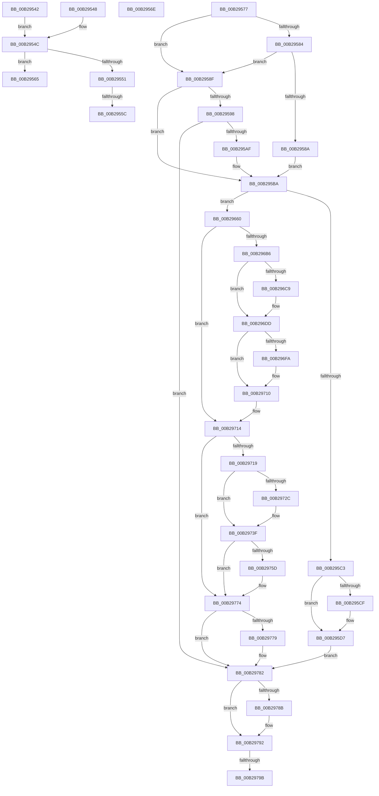

# sub_00B29542

- RVA: `0x00B29542`–`0x00B297AB` (길이 `617` bytes)
- VA: `0x0000000140B29542`
- 실행 섹션: `PAGE`
- PDB 이름 있음: `아니요`; PDB Function 태그: `아니요`
- unwind 정보 RVA: `0x000963C4`
- 디코드: `150`개 명령, `617/617` bytes 표시
- 미해석 바이트: `0` (있으면 어셈블리에 `.byte`로 보존)

> 이 문서는 커널 이미지의 기계어와 PDB 기호를 분석해 생성했습니다. 4번과 5번은 함수 원형과 자료형을 바이너리 사용 방식에서 추정한 C 해석이며 원본 소스 복구 결과는 아닙니다.

## 1. Dependencies

- 직접 호출 지점: **11**; 고유 호출 대상: **6**
- 직접 호출자로 확인된 함수: **0**
- RIP 상대 이미지 참조: **1**

### Outgoing calls
- `0x00B2959C` → [SepQueryNameString](../8F/SepQueryNameString_function_008F5DE8.md) (function, `0x008F5DE8`)
- `0x00B29656` → [SepAdtOpenObjectAuditAlarm](../91/SepAdtOpenObjectAuditAlarm_function_0091F23C.md) (function, `0x0091F23C`)
- `0x00B296A6` → [SepAdtOpenObjectForDeleteAuditAlarm](../79/SepAdtOpenObjectForDeleteAuditAlarm_function_0079F5EC.md) (function, `0x0079F5EC`)
- `0x00B296CB` → [ExFreePoolWithTag](../../poolcode/B8/ExFreePoolWithTag_function_00B82870.md) (function, `0x00B82870`)
- `0x00B296E9` → [ExAllocatePool2](../../poolcode/B8/ExAllocatePool2_function_00B820F0.md) (function, `0x00B820F0`)
- `0x00B2970B` → [RtlCopyUnicodeString](../../text/3F/RtlCopyUnicodeString_function_003FEF30.md) (function, `0x003FEF30`)
- `0x00B2972E` → [ExFreePoolWithTag](../../poolcode/B8/ExFreePoolWithTag_function_00B82870.md) (function, `0x00B82870`)
- `0x00B2974C` → [ExAllocatePool2](../../poolcode/B8/ExAllocatePool2_function_00B820F0.md) (function, `0x00B820F0`)
- `0x00B2976F` → [RtlCopyUnicodeString](../../text/3F/RtlCopyUnicodeString_function_003FEF30.md) (function, `0x003FEF30`)
- `0x00B2978D` → [ExFreePoolWithTag](../../poolcode/B8/ExFreePoolWithTag_function_00B82870.md) (function, `0x00B82870`)
- `0x00B297A0` → [ExFreePoolWithTag](../../poolcode/B8/ExFreePoolWithTag_function_00B82870.md) (function, `0x00B82870`)

### Direct callers
- 이 함수 시작 RVA로 연결되는 직접 call은 확인되지 않았습니다. 간접 호출은 완전히 역산할 수 없습니다.

### Static image references
- `0x00B295DB` → RVA `0x000013A8` (`.rdata`; read)

## 2. Other-region calls and transfers

- 다른 실행 섹션으로 향하는 call: **8**
  - `0x00B296CB` → [ExFreePoolWithTag](../../poolcode/B8/ExFreePoolWithTag_function_00B82870.md) (`PAGE` → `POOLCODE`)
  - `0x00B296E9` → [ExAllocatePool2](../../poolcode/B8/ExAllocatePool2_function_00B820F0.md) (`PAGE` → `POOLCODE`)
  - `0x00B2970B` → [RtlCopyUnicodeString](../../text/3F/RtlCopyUnicodeString_function_003FEF30.md) (`PAGE` → `.text`)
  - `0x00B2972E` → [ExFreePoolWithTag](../../poolcode/B8/ExFreePoolWithTag_function_00B82870.md) (`PAGE` → `POOLCODE`)
  - `0x00B2974C` → [ExAllocatePool2](../../poolcode/B8/ExAllocatePool2_function_00B820F0.md) (`PAGE` → `POOLCODE`)
  - `0x00B2976F` → [RtlCopyUnicodeString](../../text/3F/RtlCopyUnicodeString_function_003FEF30.md) (`PAGE` → `.text`)
  - `0x00B2978D` → [ExFreePoolWithTag](../../poolcode/B8/ExFreePoolWithTag_function_00B82870.md) (`PAGE` → `POOLCODE`)
  - `0x00B297A0` → [ExFreePoolWithTag](../../poolcode/B8/ExFreePoolWithTag_function_00B82870.md) (`PAGE` → `POOLCODE`)
- call이 아닌 외부 분기/꼬리 이동: **6**
  - `0x00B29556` → [SeOpenObjectForDeleteAuditAlarmWithTransaction + 0x19E](../97/SeOpenObjectForDeleteAuditAlarmWithTransaction_function_00973EC0.md) (`tail-transfer`)
  - `0x00B29560` → [SeOpenObjectForDeleteAuditAlarmWithTransaction + 0x1A1](../97/SeOpenObjectForDeleteAuditAlarmWithTransaction_function_00973EC0.md) (`tail-transfer`)
  - `0x00B29569` → [SeOpenObjectForDeleteAuditAlarmWithTransaction + 0x1A1](../97/SeOpenObjectForDeleteAuditAlarmWithTransaction_function_00973EC0.md) (`tail-transfer`)
  - `0x00B29572` → [SeOpenObjectForDeleteAuditAlarmWithTransaction + 0x104](../97/SeOpenObjectForDeleteAuditAlarmWithTransaction_function_00973EC0.md) (`tail-transfer`)
  - `0x00B29795` → [SeOpenObjectForDeleteAuditAlarmWithTransaction + 0xD0](../97/SeOpenObjectForDeleteAuditAlarmWithTransaction_function_00973EC0.md) (`tail-transfer`)
  - `0x00B297A6` → [SeOpenObjectForDeleteAuditAlarmWithTransaction + 0xD0](../97/SeOpenObjectForDeleteAuditAlarmWithTransaction_function_00973EC0.md) (`tail-transfer`)

## 3. Assembly (complete function range)

```asm
00B29542  48 8D 14 06                     lea rdx, [rsi + rax]
00B29546  EB 04                           jmp 0x140b2954c
00B29548  48 8B 56 18                     mov rdx, qword ptr [rsi + 0x18]
00B2954C  66 85 C9                        test cx, cx
00B2954F  74 14                           je 0x140b29565
00B29551  8B 46 0C                        mov eax, dword ptr [rsi + 0xc]
00B29554  85 C0                           test eax, eax
00B29556  0F 84 02 AB E4 FF               je 0x14097405e
00B2955C  48 8D 0C 06                     lea rcx, [rsi + rax]
00B29560  E9 FC AA E4 FF                  jmp 0x140974061
00B29565  48 8B 4E 18                     mov rcx, qword ptr [rsi + 0x18]
00B29569  E9 F3 AA E4 FF                  jmp 0x140974061
00B2956E  48 8B 56 18                     mov rdx, qword ptr [rsi + 0x18]
00B29572  E9 4D AA E4 FF                  jmp 0x140973fc4
00B29577  48 8B 45 57                     mov rax, qword ptr [rbp + 0x57]
00B2957B  C6 43 09 01                     mov byte ptr [rbx + 9], 1
00B2957F  48 85 C0                        test rax, rax
00B29582  74 0B                           je 0x140b2958f
00B29584  66 44 39 08                     cmp word ptr [rax], r9w
00B29588  74 05                           je 0x140b2958f
00B2958A  48 8B F8                        mov rdi, rax
00B2958D  EB 2B                           jmp 0x140b295ba
00B2958F  48 8B 4D 4F                     mov rcx, qword ptr [rbp + 0x4f]
00B29593  48 85 C9                        test rcx, rcx
00B29596  74 22                           je 0x140b295ba
00B29598  48 8D 55 F7                     lea rdx, [rbp - 9]
00B2959C  E8 47 C8 DC FF                  call 0x1408f5de8
00B295A1  45 33 C9                        xor r9d, r9d
00B295A4  89 45 DF                        mov dword ptr [rbp - 0x21], eax
00B295A7  85 C0                           test eax, eax
00B295A9  0F 88 D3 01 00 00               js 0x140b29782
00B295AF  48 8B 45 F7                     mov rax, qword ptr [rbp - 9]
00B295B3  48 85 C0                        test rax, rax
00B295B6  48 0F 45 F8                     cmovne rdi, rax
00B295BA  45 84 E4                        test r12b, r12b
00B295BD  0F 85 9D 00 00 00               jne 0x140b29660
00B295C3  48 8B 85 87 00 00 00            mov rax, qword ptr [rbp + 0x87]
00B295CA  48 85 C0                        test rax, rax
00B295CD  75 08                           jne 0x140b295d7
00B295CF  48 8B 45 E7                     mov rax, qword ptr [rbp - 0x19]
00B295D3  48 83 C0 20                     add rax, 0x20
00B295D7  0F B7 4D DB                     movzx ecx, word ptr [rbp - 0x25]
00B295DB  48 8D 15 C6 7D 4D FF            lea rdx, [rip - 0xb2823a]
00B295E2  48 89 9C 24 90 00 00 00         mov qword ptr [rsp + 0x90], rbx
00B295EA  45 33 C0                        xor r8d, r8d
00B295ED  48 89 84 24 88 00 00 00         mov qword ptr [rsp + 0x88], rax
00B295F5  48 8B 43 38                     mov rax, qword ptr [rbx + 0x38]
00B295F9  4C 89 8C 24 80 00 00 00         mov qword ptr [rsp + 0x80], r9
00B29601  44 89 4C 24 78                  mov dword ptr [rsp + 0x78], r9d
00B29606  4C 89 4C 24 70                  mov qword ptr [rsp + 0x70], r9
00B2960B  C7 44 24 68 02 00 00 00         mov dword ptr [rsp + 0x68], 2
00B29613  48 89 44 24 60                  mov qword ptr [rsp + 0x60], rax
00B29618  48 8B 45 E7                     mov rax, qword ptr [rbp - 0x19]
00B2961C  44 88 4C 24 58                  mov byte ptr [rsp + 0x58], r9b
00B29621  4D 8B CE                        mov r9, r14
00B29624  48 8B 00                        mov rax, qword ptr [rax]
00B29627  48 89 44 24 50                  mov qword ptr [rsp + 0x50], rax
00B2962C  8B 43 14                        mov eax, dword ptr [rbx + 0x14]
00B2962F  89 44 24 48                     mov dword ptr [rsp + 0x48], eax
00B29633  8B 43 18                        mov eax, dword ptr [rbx + 0x18]
00B29636  89 44 24 40                     mov dword ptr [rsp + 0x40], eax
00B2963A  48 8B 43 30                     mov rax, qword ptr [rbx + 0x30]
00B2963E  48 89 44 24 38                  mov qword ptr [rsp + 0x38], rax
00B29643  48 8B 43 20                     mov rax, qword ptr [rbx + 0x20]
00B29647  48 89 44 24 30                  mov qword ptr [rsp + 0x30], rax
00B2964C  48 89 74 24 28                  mov qword ptr [rsp + 0x28], rsi
00B29651  48 89 7C 24 20                  mov qword ptr [rsp + 0x20], rdi
00B29656  E8 E1 5B DF FF                  call 0x14091f23c
00B2965B  E9 22 01 00 00                  jmp 0x140b29782
00B29660  48 8B 43 38                     mov rax, qword ptr [rbx + 0x38]
00B29664  4D 8B CE                        mov r9, r14
00B29667  4C 8B 7D E7                     mov r15, qword ptr [rbp - 0x19]
00B2966B  48 8B B5 87 00 00 00            mov rsi, qword ptr [rbp + 0x87]
00B29672  0F B7 4D DB                     movzx ecx, word ptr [rbp - 0x25]
00B29676  48 89 74 24 60                  mov qword ptr [rsp + 0x60], rsi
00B2967B  48 89 44 24 58                  mov qword ptr [rsp + 0x58], rax
00B29680  49 8B 07                        mov rax, qword ptr [r15]
00B29683  48 89 44 24 48                  mov qword ptr [rsp + 0x48], rax
00B29688  8B 43 14                        mov eax, dword ptr [rbx + 0x14]
00B2968B  89 44 24 40                     mov dword ptr [rsp + 0x40], eax
00B2968F  48 8B 43 30                     mov rax, qword ptr [rbx + 0x30]
00B29693  48 89 44 24 30                  mov qword ptr [rsp + 0x30], rax
00B29698  48 8B 43 20                     mov rax, qword ptr [rbx + 0x20]
00B2969C  48 89 44 24 28                  mov qword ptr [rsp + 0x28], rax
00B296A1  48 89 7C 24 20                  mov qword ptr [rsp + 0x20], rdi
00B296A6  E8 41 5F C7 FF                  call 0x14079f5ec
00B296AB  41 BC 53 65 20 20               mov r12d, 0x20206553
00B296B1  48 85 FF                        test rdi, rdi
00B296B4  74 5E                           je 0x140b29714
00B296B6  48 8B 8B 88 00 00 00            mov rcx, qword ptr [rbx + 0x88]
00B296BD  4C 8D BB 80 00 00 00            lea r15, [rbx + 0x80]
00B296C4  48 85 C9                        test rcx, rcx
00B296C7  74 14                           je 0x140b296dd
00B296C9  33 D2                           xor edx, edx
00B296CB  E8 A0 91 05 00                  call 0x140b82870
00B296D0  33 C9                           xor ecx, ecx
00B296D2  66 41 89 0F                     mov word ptr [r15], cx
00B296D6  66 89 8B 82 00 00 00            mov word ptr [rbx + 0x82], cx
00B296DD  0F B7 57 02                     movzx edx, word ptr [rdi + 2]
00B296E1  45 8B C4                        mov r8d, r12d
00B296E4  B9 00 01 00 00                  mov ecx, 0x100
00B296E9  E8 02 8A 05 00                  call 0x140b820f0
00B296EE  48 89 83 88 00 00 00            mov qword ptr [rbx + 0x88], rax
00B296F5  48 85 C0                        test rax, rax
00B296F8  74 16                           je 0x140b29710
00B296FA  0F B7 47 02                     movzx eax, word ptr [rdi + 2]
00B296FE  48 8B D7                        mov rdx, rdi
00B29701  49 8B CF                        mov rcx, r15
00B29704  66 89 83 82 00 00 00            mov word ptr [rbx + 0x82], ax
00B2970B  E8 20 58 8D FF                  call 0x1403fef30
00B29710  4C 8B 7D E7                     mov r15, qword ptr [rbp - 0x19]
00B29714  4D 85 F6                        test r14, r14
00B29717  74 5B                           je 0x140b29774
00B29719  48 8B 8B 98 00 00 00            mov rcx, qword ptr [rbx + 0x98]
00B29720  48 8D BB 90 00 00 00            lea rdi, [rbx + 0x90]
00B29727  48 85 C9                        test rcx, rcx
00B2972A  74 13                           je 0x140b2973f
00B2972C  33 D2                           xor edx, edx
00B2972E  E8 3D 91 05 00                  call 0x140b82870
00B29733  33 C9                           xor ecx, ecx
00B29735  66 89 0F                        mov word ptr [rdi], cx
00B29738  66 89 8B 92 00 00 00            mov word ptr [rbx + 0x92], cx
00B2973F  41 0F B7 56 02                  movzx edx, word ptr [r14 + 2]
00B29744  45 8B C4                        mov r8d, r12d
00B29747  B9 00 01 00 00                  mov ecx, 0x100
00B2974C  E8 9F 89 05 00                  call 0x140b820f0
00B29751  48 89 83 98 00 00 00            mov qword ptr [rbx + 0x98], rax
00B29758  48 85 C0                        test rax, rax
00B2975B  74 17                           je 0x140b29774
00B2975D  41 0F B7 46 02                  movzx eax, word ptr [r14 + 2]
00B29762  49 8B D6                        mov rdx, r14
00B29765  48 8B CF                        mov rcx, rdi
00B29768  66 89 83 92 00 00 00            mov word ptr [rbx + 0x92], ax
00B2976F  E8 BC 57 8D FF                  call 0x1403fef30
00B29774  48 85 F6                        test rsi, rsi
00B29777  74 09                           je 0x140b29782
00B29779  0F 10 06                        movups xmm0, xmmword ptr [rsi]
00B2977C  F3 41 0F 7F 47 20               movdqu xmmword ptr [r15 + 0x20], xmm0
00B29782  48 8B 4D F7                     mov rcx, qword ptr [rbp - 9]
00B29786  48 85 C9                        test rcx, rcx
00B29789  74 07                           je 0x140b29792
00B2978B  33 D2                           xor edx, edx
00B2978D  E8 DE 90 05 00                  call 0x140b82870
00B29792  4D 85 ED                        test r13, r13
00B29795  0F 84 F5 A7 E4 FF               je 0x140973f90
00B2979B  33 D2                           xor edx, edx
00B2979D  49 8B CD                        mov rcx, r13
00B297A0  E8 CB 90 05 00                  call 0x140b82870
00B297A5  90                              nop
00B297A6  E9 E5 A7 E4 FF                  jmp 0x140973f90
```

## 4. C-style interpretation (structured pseudocode)

```c
__int64 __fastcall sub_00B29542(unsigned __int16 a1, __int64 a2, int a3, int a4)
{
    unsigned __int64 v_stack_p20;
    unsigned __int64 v_stack_p28;
    unsigned __int64 v_stack_p30;
    unsigned __int64 v_stack_p38;
    unsigned int v_stack_p40;
    unsigned int v_stack_p48;
    unsigned __int64 v_stack_p50;
    unsigned __int8 v_stack_p58;
    unsigned __int64 v_stack_p60;
    unsigned int v_stack_p68;
    unsigned __int64 v_stack_p70;
    unsigned int v_stack_p78;
    unsigned __int64 v_stack_p80;
    unsigned __int64 v_stack_p88;
    unsigned __int64 v_stack_p90;

    goto loc_00B2954C;
loc_00B2954C:
    if (a1 == 0) goto loc_00B29565;
loc_00B29565:
}
```

## 5. (Beta) C Style

```c
int64_t sub_00B29542(uint16_t Arg1, int64_t Arg2, int32_t Arg3, int32_t Arg4)
{
    uint64_t v_stack_p20;
    uint64_t v_stack_p28;
    uint64_t v_stack_p30;
    uint64_t v_stack_p38;
    uint32_t v_stack_p40;
    uint32_t v_stack_p48;
    uint64_t v_stack_p50;
    uint8_t v_stack_p58;
    uint64_t v_stack_p60;
    uint32_t v_stack_p68;
    uint64_t v_stack_p70;
    uint32_t v_stack_p78;
    uint64_t v_stack_p80;
    uint64_t v_stack_p88;
    uint64_t v_stack_p90;

    goto loc_00B2954C;
loc_00B2954C:
    if (Arg1 == 0) goto loc_00B29565;
loc_00B29565:
}
```

## 6. Execution-region graph

[열기: 2D/3D 그래프와 함수 탐색 컨트롤 패널](../../../control-panel.html?section=page&rva=0x00B29542&view=graph)

- 2D 그래프는 위에서 아래로 흐르고, 3D 그래프는 빈 공간을 드래그해 회전합니다. Shift+드래그는 이동, 휠은 확대·축소, 함수 노드 선택은 대상 보고서 이동입니다.

### Static fallback


