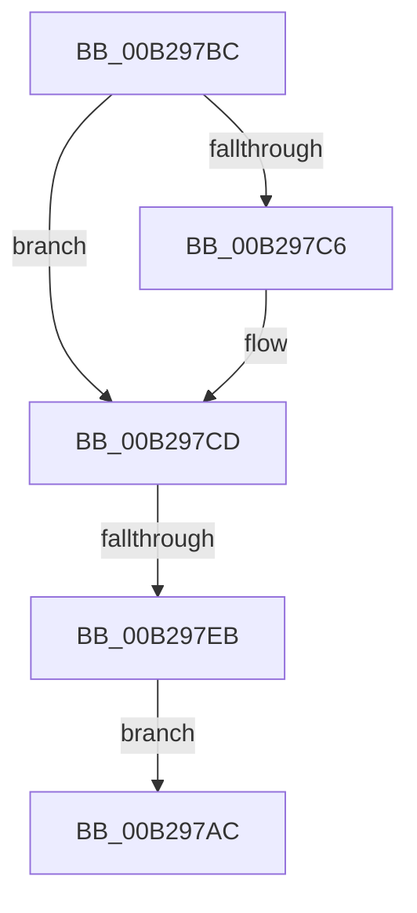

# sub_00B297AC

- RVA: `0x00B297AC`–`0x00B297ED` (길이 `65` bytes)
- VA: `0x0000000140B297AC`
- 실행 섹션: `PAGE`
- PDB 이름 있음: `아니요`; PDB Function 태그: `아니요`
- unwind 정보 RVA: `0x00096408`
- 디코드: `16`개 명령, `65/65` bytes 표시
- 미해석 바이트: `0` (있으면 어셈블리에 `.byte`로 보존)

> 이 문서는 커널 이미지의 기계어와 PDB 기호를 분석해 생성했습니다. 4번과 5번은 함수 원형과 자료형을 바이너리 사용 방식에서 추정한 C 해석이며 원본 소스 복구 결과는 아닙니다.

## 1. Dependencies

- 직접 호출 지점: **4**; 고유 호출 대상: **4**
- 직접 호출자로 확인된 함수: **0**
- RIP 상대 이미지 참조: **0**

### Outgoing calls
- `0x00B297B1` → [SepAuditFailed](../86/SepAuditFailed_function_0086EE20.md) (function, `0x0086EE20`)
- `0x00B297C8` → [ExFreePoolWithTag](../../poolcode/B8/ExFreePoolWithTag_function_00B82870.md) (function, `0x00B82870`)
- `0x00B297D2` → [SeReleaseSubjectContext](../86/SeReleaseSubjectContext_function_0086B710.md) (function, `0x0086B710`)
- `0x00B297DA` → [ObfDereferenceObject](../../text/2F/ObfDereferenceObject_function_002F9350.md) (function, `0x002F9350`)

### Direct callers
- 이 함수 시작 RVA로 연결되는 직접 call은 확인되지 않았습니다. 간접 호출은 완전히 역산할 수 없습니다.

### Static image references
- 디코드된 RIP-relative 메모리 참조가 없습니다.

## 2. Other-region calls and transfers

- 다른 실행 섹션으로 향하는 call: **2**
  - `0x00B297C8` → [ExFreePoolWithTag](../../poolcode/B8/ExFreePoolWithTag_function_00B82870.md) (`PAGE` → `POOLCODE`)
  - `0x00B297DA` → [ObfDereferenceObject](../../text/2F/ObfDereferenceObject_function_002F9350.md) (`PAGE` → `.text`)
- call이 아닌 외부 분기/꼬리 이동: **2**
  - `0x00B297B7` → [NtPrivilegeObjectAuditAlarm + 0xBD](../97/NtPrivilegeObjectAuditAlarm_function_00974170.md) (`tail-transfer`)
  - `0x00B297E5` → [NtPrivilegeObjectAuditAlarm + 0xBD](../97/NtPrivilegeObjectAuditAlarm_function_00974170.md) (`tail-transfer`)

## 3. Assembly (complete function range)

```asm
00B297AC  B9 9A 00 00 C0                  mov ecx, 0xc000009a
00B297B1  E8 6A 56 D4 FF                  call 0x14086ee20
00B297B6  90                              nop
00B297B7  E9 71 AA E4 FF                  jmp 0x14097422d
00B297BC  48 8B 4C 24 70                  mov rcx, qword ptr [rsp + 0x70]
00B297C1  48 85 C9                        test rcx, rcx
00B297C4  74 07                           je 0x140b297cd
00B297C6  33 D2                           xor edx, edx
00B297C8  E8 A3 90 05 00                  call 0x140b82870
00B297CD  48 8D 4C 24 78                  lea rcx, [rsp + 0x78]
00B297D2  E8 39 1F D4 FF                  call 0x14086b710
00B297D7  48 8B CE                        mov rcx, rsi
00B297DA  E8 71 FB 7C FF                  call 0x1402f9350
00B297DF  81 FB 9A 00 00 C0               cmp ebx, 0xc000009a
00B297E5  0F 85 42 AA E4 FF               jne 0x14097422d
00B297EB  EB BF                           jmp 0x140b297ac
```

## 4. C-style interpretation (structured pseudocode)

```c
__int64 __fastcall sub_00B297AC(__int64 a1, int a2)
{
    __int64 result;
    unsigned __int64 v_stack_p70;
    unsigned __int64 v_stack_p78;

    result = SepAuditFailed((unsigned int)(0xC000009AULL), a2, a3, a4);
}
```

## 5. (Beta) C Style

```c
int64_t sub_00B297AC(int64_t Arg1, int32_t Arg2)
{
    int64_t result;
    uint64_t v_stack_p70;
    uint64_t v_stack_p78;

    result = SepAuditFailed((uint32_t)(0xC000009AULL), Arg2, a3, a4);
}
```

## 6. Execution-region graph

[열기: 2D/3D 그래프와 함수 탐색 컨트롤 패널](../../../control-panel.html?section=page&rva=0x00B297AC&view=graph)

- 2D 그래프는 위에서 아래로 흐르고, 3D 그래프는 빈 공간을 드래그해 회전합니다. Shift+드래그는 이동, 휠은 확대·축소, 함수 노드 선택은 대상 보고서 이동입니다.

### Static fallback


