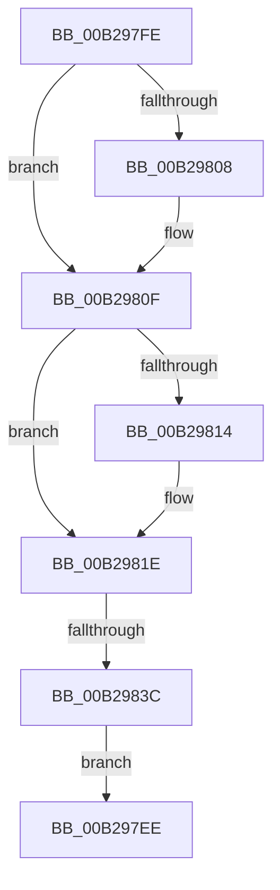

# sub_00B297EE

- RVA: `0x00B297EE`–`0x00B2983E` (길이 `80` bytes)
- VA: `0x0000000140B297EE`
- 실행 섹션: `PAGE`
- PDB 이름 있음: `아니요`; PDB Function 태그: `아니요`
- unwind 정보 RVA: `0x00096450`
- 디코드: `21`개 명령, `80/80` bytes 표시
- 미해석 바이트: `0` (있으면 어셈블리에 `.byte`로 보존)

> 이 문서는 커널 이미지의 기계어와 PDB 기호를 분석해 생성했습니다. 4번과 5번은 함수 원형과 자료형을 바이너리 사용 방식에서 추정한 C 해석이며 원본 소스 복구 결과는 아닙니다.

## 1. Dependencies

- 직접 호출 지점: **5**; 고유 호출 대상: **4**
- 직접 호출자로 확인된 함수: **0**
- RIP 상대 이미지 참조: **0**

### Outgoing calls
- `0x00B297F3` → [SepAuditFailed](../86/SepAuditFailed_function_0086EE20.md) (function, `0x0086EE20`)
- `0x00B2980A` → [ExFreePoolWithTag](../../poolcode/B8/ExFreePoolWithTag_function_00B82870.md) (function, `0x00B82870`)
- `0x00B29819` → [ExFreePoolWithTag](../../poolcode/B8/ExFreePoolWithTag_function_00B82870.md) (function, `0x00B82870`)
- `0x00B29823` → [SeReleaseSubjectContext](../86/SeReleaseSubjectContext_function_0086B710.md) (function, `0x0086B710`)
- `0x00B2982B` → [ObfDereferenceObject](../../text/2F/ObfDereferenceObject_function_002F9350.md) (function, `0x002F9350`)

### Direct callers
- 이 함수 시작 RVA로 연결되는 직접 call은 확인되지 않았습니다. 간접 호출은 완전히 역산할 수 없습니다.

### Static image references
- 디코드된 RIP-relative 메모리 참조가 없습니다.

## 2. Other-region calls and transfers

- 다른 실행 섹션으로 향하는 call: **3**
  - `0x00B2980A` → [ExFreePoolWithTag](../../poolcode/B8/ExFreePoolWithTag_function_00B82870.md) (`PAGE` → `POOLCODE`)
  - `0x00B29819` → [ExFreePoolWithTag](../../poolcode/B8/ExFreePoolWithTag_function_00B82870.md) (`PAGE` → `POOLCODE`)
  - `0x00B2982B` → [ObfDereferenceObject](../../text/2F/ObfDereferenceObject_function_002F9350.md) (`PAGE` → `.text`)
- call이 아닌 외부 분기/꼬리 이동: **2**
  - `0x00B297F9` → [NtPrivilegedServiceAuditAlarm + 0x281](../97/NtPrivilegedServiceAuditAlarm_function_00974430.md) (`tail-transfer`)
  - `0x00B29836` → [NtPrivilegedServiceAuditAlarm + 0x281](../97/NtPrivilegedServiceAuditAlarm_function_00974430.md) (`tail-transfer`)

## 3. Assembly (complete function range)

```asm
00B297EE  B9 9A 00 00 C0                  mov ecx, 0xc000009a
00B297F3  E8 28 56 D4 FF                  call 0x14086ee20
00B297F8  90                              nop
00B297F9  E9 B3 AE E4 FF                  jmp 0x1409746b1
00B297FE  48 8B 4C 24 60                  mov rcx, qword ptr [rsp + 0x60]
00B29803  48 85 C9                        test rcx, rcx
00B29806  74 07                           je 0x140b2980f
00B29808  33 D2                           xor edx, edx
00B2980A  E8 61 90 05 00                  call 0x140b82870
00B2980F  48 85 F6                        test rsi, rsi
00B29812  74 0A                           je 0x140b2981e
00B29814  33 D2                           xor edx, edx
00B29816  48 8B CE                        mov rcx, rsi
00B29819  E8 52 90 05 00                  call 0x140b82870
00B2981E  48 8D 4C 24 70                  lea rcx, [rsp + 0x70]
00B29823  E8 E8 1E D4 FF                  call 0x14086b710
00B29828  49 8B CE                        mov rcx, r14
00B2982B  E8 20 FB 7C FF                  call 0x1402f9350
00B29830  81 FF 9A 00 00 C0               cmp edi, 0xc000009a
00B29836  0F 85 75 AE E4 FF               jne 0x1409746b1
00B2983C  EB B0                           jmp 0x140b297ee
```

## 4. C-style interpretation (structured pseudocode)

```c
__int64 __fastcall sub_00B297EE(__int64 a1, int a2)
{
    __int64 result;
    unsigned __int64 v_stack_p60;
    unsigned __int64 v_stack_p70;

    result = SepAuditFailed((unsigned int)(0xC000009AULL), a2, a3, a4);
}
```

## 5. (Beta) C Style

```c
int64_t sub_00B297EE(int64_t Arg1, int32_t Arg2)
{
    int64_t result;
    uint64_t v_stack_p60;
    uint64_t v_stack_p70;

    result = SepAuditFailed((uint32_t)(0xC000009AULL), Arg2, a3, a4);
}
```

## 6. Execution-region graph

[열기: 2D/3D 그래프와 함수 탐색 컨트롤 패널](../../../control-panel.html?section=page&rva=0x00B297EE&view=graph)

- 2D 그래프는 위에서 아래로 흐르고, 3D 그래프는 빈 공간을 드래그해 회전합니다. Shift+드래그는 이동, 휠은 확대·축소, 함수 노드 선택은 대상 보고서 이동입니다.

### Static fallback


