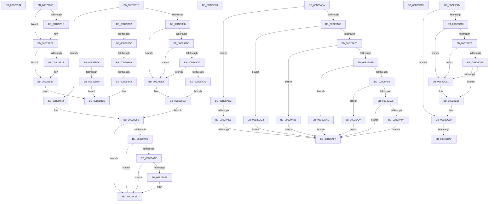

# sub_00B29934

- RVA: `0x00B29934`–`0x00B29CDC` (길이 `936` bytes)
- VA: `0x0000000140B29934`
- 실행 섹션: `PAGE`
- PDB 이름 있음: `아니요`; PDB Function 태그: `아니요`
- unwind 정보 RVA: `0x00096700`
- 디코드: `226`개 명령, `936/936` bytes 표시
- 미해석 바이트: `0` (있으면 어셈블리에 `.byte`로 보존)

> 이 문서는 커널 이미지의 기계어와 PDB 기호를 분석해 생성했습니다. 4번과 5번은 함수 원형과 자료형을 바이너리 사용 방식에서 추정한 C 해석이며 원본 소스 복구 결과는 아닙니다.

## 1. Dependencies

- 직접 호출 지점: **20**; 고유 호출 대상: **14**
- 직접 호출자로 확인된 함수: **0**
- RIP 상대 이미지 참조: **2**

### Outgoing calls
- `0x00B2996E` → [PiDevCfgSetObjectProperty](../A8/PiDevCfgSetObjectProperty_function_00A8DB50.md) (function, `0x00A8DB50`)
- `0x00B2997F` → [CmIsRootEnumeratedDevice](../8F/CmIsRootEnumeratedDevice_function_008F6E08.md) (function, `0x008F6E08`)
- `0x00B299C7` → [CmGetDeviceRegProp](../8E/CmGetDeviceRegProp_function_008ED870.md) (function, `0x008ED870`)
- `0x00B299FA` → [CmIsRootEnumeratedDevice](../8F/CmIsRootEnumeratedDevice_function_008F6E08.md) (function, `0x008F6E08`)
- `0x00B29A12` → [PiDevCfgMigrateRootDevice](../73/PiDevCfgMigrateRootDevice_function_00733DF0.md) (function, `0x00733DF0`)
- `0x00B29A53` → [PiDevCfgConfigureDevice](../97/PiDevCfgConfigureDevice_function_00977BB4.md) (function, `0x00977BB4`)
- `0x00B29B06` → [PipClearDevNodeProblem](../A2/PipClearDevNodeProblem_function_00A27C8C.md) (function, `0x00A27C8C`)
- `0x00B29B3F` → [PnpUpdateRebootRequiredReason](../72/PnpUpdateRebootRequiredReason_function_0072CE64.md) (function, `0x0072CE64`)
- `0x00B29B52` → [PipSetDevNodeProblem](../8F/PipSetDevNodeProblem_function_008FDE0C.md) (function, `0x008FDE0C`)
- `0x00B29B5F` → [PipSetDevNodeUserFlags](../8F/PipSetDevNodeUserFlags_function_008FB8FC.md) (function, `0x008FB8FC`)
- `0x00B29B7B` → [PipSetDevNodeProblem](../8F/PipSetDevNodeProblem_function_008FDE0C.md) (function, `0x008FDE0C`)
- `0x00B29BA7` → [PipClearDevNodeProblem](../A2/PipClearDevNodeProblem_function_00A27C8C.md) (function, `0x00A27C8C`)
- `0x00B29BB4` → [PipClearDevNodeUserFlags](../A2/PipClearDevNodeUserFlags_function_00A2ABC4.md) (function, `0x00A2ABC4`)
- `0x00B29BC7` → [PipSetDevNodeProblem](../8F/PipSetDevNodeProblem_function_008FDE0C.md) (function, `0x008FDE0C`)
- `0x00B29C0D` → [SeAuditingWithTokenForSubcategory](../90/SeAuditingWithTokenForSubcategory_function_009047D0.md) (function, `0x009047D0`)
- `0x00B29C4C` → [CmGetDeviceRegProp](../8E/CmGetDeviceRegProp_function_008ED870.md) (function, `0x008ED870`)
- `0x00B29C91` → [CmSetDeviceRegProp](../8F/CmSetDeviceRegProp_function_008FD68C.md) (function, `0x008FD68C`)
- `0x00B29C9F` → [SeAuditingWithTokenForSubcategory](../90/SeAuditingWithTokenForSubcategory_function_009047D0.md) (function, `0x009047D0`)
- `0x00B29CB6` → [RtlInitUnicodeString](../../text/42/RtlInitUnicodeString_function_0042A780.md) (function, `0x0042A780`)
- `0x00B29CCF` → [PiAuditDeviceEnableDisableRequest](../74/PiAuditDeviceEnableDisableRequest_function_00740AB8.md) (function, `0x00740AB8`)

### Direct callers
- 이 함수 시작 RVA로 연결되는 직접 call은 확인되지 않았습니다. 간접 호출은 완전히 역산할 수 없습니다.

### Static image references
- `0x00B29934` → RVA `0x00E66398` (`.data`; read)
- `0x00B2993B` → RVA `0x00012E80` (`.rdata`; read)

## 2. Other-region calls and transfers

- 다른 실행 섹션으로 향하는 call: **1**
  - `0x00B29CB6` → [RtlInitUnicodeString](../../text/42/RtlInitUnicodeString_function_0042A780.md) (`PAGE` → `.text`)
- call이 아닌 외부 분기/꼬리 이동: **14**
  - `0x00B29976` → [PiDevCfgProcessDevice + 0x17A](../97/PiDevCfgProcessDevice_function_00976D34.md) (`tail-transfer`)
  - `0x00B29A35` → [PiDevCfgProcessDevice + 0x392](../97/PiDevCfgProcessDevice_function_00976D34.md) (`tail-transfer`)
  - `0x00B29ADF` → [PiDevCfgProcessDevice + 0x1BC](../97/PiDevCfgProcessDevice_function_00976D34.md) (`tail-transfer`)
  - `0x00B29AF1` → [PiDevCfgProcessDevice + 0x1BC](../97/PiDevCfgProcessDevice_function_00976D34.md) (`tail-transfer`)
  - `0x00B29AFE` → [PiDevCfgProcessDevice + 0x1B5](../97/PiDevCfgProcessDevice_function_00976D34.md) (`tail-transfer`)
  - `0x00B29B0E` → [PiDevCfgProcessDevice + 0x3B3](../97/PiDevCfgProcessDevice_function_00976D34.md) (`tail-transfer`)
  - `0x00B29B6A` → [PiDevCfgProcessDevice + 0x3C6](../97/PiDevCfgProcessDevice_function_00976D34.md) (`tail-transfer`)
  - `0x00B29B86` → [PiDevCfgProcessDevice + 0x3C6](../97/PiDevCfgProcessDevice_function_00976D34.md) (`tail-transfer`)
  - `0x00B29B93` → [PiDevCfgProcessDevice + 0x3C6](../97/PiDevCfgProcessDevice_function_00976D34.md) (`tail-transfer`)
  - `0x00B29B9E` → [PiDevCfgProcessDevice + 0x3C6](../97/PiDevCfgProcessDevice_function_00976D34.md) (`tail-transfer`)
  - `0x00B29BBC` → [PiDevCfgProcessDevice + 0x3C6](../97/PiDevCfgProcessDevice_function_00976D34.md) (`tail-transfer`)
  - `0x00B29BCF` → [PiDevCfgProcessDevice + 0x265](../97/PiDevCfgProcessDevice_function_00976D34.md) (`tail-transfer`)
  - `0x00B29CA9` → [PiDevCfgProcessDevice + 0x53F](../97/PiDevCfgProcessDevice_function_00976D34.md) (`tail-transfer`)
  - `0x00B29CD7` → [PiDevCfgProcessDevice + 0x53F](../97/PiDevCfgProcessDevice_function_00976D34.md) (`tail-transfer`)

## 3. Assembly (complete function range)

```asm
00B29934  48 8B 0D 5D CA 33 00            mov rcx, qword ptr [rip + 0x33ca5d]
00B2993B  48 8D 05 3E 95 4E FF            lea rax, [rip - 0xb16ac2]
00B29942  44 89 44 24 50                  mov dword ptr [rsp + 0x50], r8d
00B29947  48 8D 55 D0                     lea rdx, [rbp - 0x30]
00B2994B  44 89 44 24 48                  mov dword ptr [rsp + 0x48], r8d
00B29950  41 B9 01 00 00 00               mov r9d, 1
00B29956  4C 89 44 24 40                  mov qword ptr [rsp + 0x40], r8
00B2995B  44 89 44 24 38                  mov dword ptr [rsp + 0x38], r8d
00B29960  4D 8B 45 08                     mov r8, qword ptr [r13 + 8]
00B29964  48 89 44 24 30                  mov qword ptr [rsp + 0x30], rax
00B29969  4C 89 64 24 20                  mov qword ptr [rsp + 0x20], r12
00B2996E  E8 DD 41 F6 FF                  call 0x140a8db50
00B29973  45 33 C0                        xor r8d, r8d
00B29976  E9 33 D5 E4 FF                  jmp 0x140976eae
00B2997B  49 8B 4D 08                     mov rcx, qword ptr [r13 + 8]
00B2997F  E8 84 D4 DC FF                  call 0x1408f6e08
00B29984  84 C0                           test al, al
00B29986  74 6B                           je 0x140b299f3
00B29988  83 64 24 38 00                  and dword ptr [rsp + 0x38], 0
00B2998D  48 8D 44 24 64                  lea rax, [rsp + 0x64]
00B29992  49 8B 55 08                     mov rdx, qword ptr [r13 + 8]
00B29996  41 B9 0B 00 00 00               mov r9d, 0xb
00B2999C  48 8B 0D F5 C9 33 00            mov rcx, qword ptr [rip + 0x33c9f5]
00B299A3  4D 8B C4                        mov r8, r12
00B299A6  48 89 44 24 30                  mov qword ptr [rsp + 0x30], rax
00B299AB  48 8D 44 24 60                  lea rax, [rsp + 0x60]
00B299B0  48 89 44 24 28                  mov qword ptr [rsp + 0x28], rax
00B299B5  48 8D 44 24 6C                  lea rax, [rsp + 0x6c]
00B299BA  48 89 44 24 20                  mov qword ptr [rsp + 0x20], rax
00B299BF  C7 44 24 64 04 00 00 00         mov dword ptr [rsp + 0x64], 4
00B299C7  E8 A4 3E DC FF                  call 0x1408ed870
00B299CC  85 C0                           test eax, eax
00B299CE  78 14                           js 0x140b299e4
00B299D0  83 7C 24 6C 04                  cmp dword ptr [rsp + 0x6c], 4
00B299D5  75 0D                           jne 0x140b299e4
00B299D7  83 7C 24 64 04                  cmp dword ptr [rsp + 0x64], 4
00B299DC  75 06                           jne 0x140b299e4
00B299DE  8B 7C 24 60                     mov edi, dword ptr [rsp + 0x60]
00B299E2  EB 06                           jmp 0x140b299ea
00B299E4  33 FF                           xor edi, edi
00B299E6  89 7C 24 60                     mov dword ptr [rsp + 0x60], edi
00B299EA  C1 EF 05                        shr edi, 5
00B299ED  40 80 E7 01                     and dil, 1
00B299F1  EB 03                           jmp 0x140b299f6
00B299F3  40 B7 01                        mov dil, 1
00B299F6  49 8B 4D 08                     mov rcx, qword ptr [r13 + 8]
00B299FA  E8 09 D4 DC FF                  call 0x1408f6e08
00B299FF  45 33 C0                        xor r8d, r8d
00B29A02  84 C0                           test al, al
00B29A04  74 29                           je 0x140b29a2f
00B29A06  4C 8D 44 24 60                  lea r8, [rsp + 0x60]
00B29A0B  48 8B CB                        mov rcx, rbx
00B29A0E  48 8D 55 D0                     lea rdx, [rbp - 0x30]
00B29A12  E8 D9 A3 C0 FF                  call 0x140733df0
00B29A17  45 33 C0                        xor r8d, r8d
00B29A1A  85 C0                           test eax, eax
00B29A1C  78 11                           js 0x140b29a2f
00B29A1E  0B 74 24 60                     or esi, dword ptr [rsp + 0x60]
00B29A22  F6 44 24 60 01                  test byte ptr [rsp + 0x60], 1
00B29A27  74 06                           je 0x140b29a2f
00B29A29  41 8A F8                        mov dil, r8b
00B29A2C  83 E6 DF                        and esi, 0xffffffdf
00B29A2F  41 BF 90 04 00 C0               mov r15d, 0xc0000490
00B29A35  E9 8C D6 E4 FF                  jmp 0x1409770c6
00B29A3A  48 8D 44 24 70                  lea rax, [rsp + 0x70]
00B29A3F  45 33 C0                        xor r8d, r8d
00B29A42  4C 8D 4C 24 60                  lea r9, [rsp + 0x60]
00B29A47  48 89 44 24 20                  mov qword ptr [rsp + 0x20], rax
00B29A4C  48 8D 55 D0                     lea rdx, [rbp - 0x30]
00B29A50  48 8B CB                        mov rcx, rbx
00B29A53  E8 5C E1 E4 FF                  call 0x140977bb4
00B29A58  45 33 C0                        xor r8d, r8d
00B29A5B  44 8B F0                        mov r14d, eax
00B29A5E  85 C0                           test eax, eax
00B29A60  78 6A                           js 0x140b29acc
00B29A62  8B 74 24 60                     mov esi, dword ptr [rsp + 0x60]
00B29A66  C6 85 E0 00 00 00 01            mov byte ptr [rbp + 0xe0], 1
00B29A6D  41 81 FF 90 04 00 C0            cmp r15d, 0xc0000490
00B29A74  74 4C                           je 0x140b29ac2
00B29A76  41 81 FF 91 04 00 C0            cmp r15d, 0xc0000491
00B29A7D  74 39                           je 0x140b29ab8
00B29A7F  41 81 FF 92 04 00 C0            cmp r15d, 0xc0000492
00B29A86  74 26                           je 0x140b29aae
00B29A88  41 81 FF 93 04 00 C0            cmp r15d, 0xc0000493
00B29A8F  74 13                           je 0x140b29aa4
00B29A91  41 81 FF 94 04 00 C0            cmp r15d, 0xc0000494
00B29A98  75 5D                           jne 0x140b29af7
00B29A9A  C7 44 24 68 19 02 00 E0         mov dword ptr [rsp + 0x68], 0xe0000219
00B29AA2  EB 53                           jmp 0x140b29af7
00B29AA4  C7 44 24 68 52 02 00 E0         mov dword ptr [rsp + 0x68], 0xe0000252
00B29AAC  EB 49                           jmp 0x140b29af7
00B29AAE  C7 44 24 68 51 02 00 E0         mov dword ptr [rsp + 0x68], 0xe0000251
00B29AB6  EB 3F                           jmp 0x140b29af7
00B29AB8  C7 44 24 68 50 02 00 E0         mov dword ptr [rsp + 0x68], 0xe0000250
00B29AC0  EB 35                           jmp 0x140b29af7
00B29AC2  C7 44 24 68 28 02 00 E0         mov dword ptr [rsp + 0x68], 0xe0000228
00B29ACA  EB 2B                           jmp 0x140b29af7
00B29ACC  40 8A BD E0 00 00 00            mov dil, byte ptr [rbp + 0xe0]
00B29AD3  40 88 BD E0 00 00 00            mov byte ptr [rbp + 0xe0], dil
00B29ADA  3D 93 04 00 C0                  cmp eax, 0xc0000493
00B29ADF  0F 84 0B D4 E4 FF               je 0x140976ef0
00B29AE5  40 88 BD E0 00 00 00            mov byte ptr [rbp + 0xe0], dil
00B29AEC  3D 95 04 00 C0                  cmp eax, 0xc0000495
00B29AF1  0F 84 F9 D3 E4 FF               je 0x140976ef0
00B29AF7  C6 85 F8 00 00 00 01            mov byte ptr [rbp + 0xf8], 1
00B29AFE  E9 E6 D3 E4 FF                  jmp 0x140976ee9
00B29B03  48 8B CB                        mov rcx, rbx
00B29B06  E8 81 E1 EF FF                  call 0x140a27c8c
00B29B0B  45 33 C0                        xor r8d, r8d
00B29B0E  E9 D4 D5 E4 FF                  jmp 0x1409770e7
00B29B13  4C 8B 45 88                     mov r8, qword ptr [rbp - 0x78]
00B29B17  F6 C1 20                        test cl, 0x20
00B29B1A  74 0E                           je 0x140b29b2a
00B29B1C  4C 8B C0                        mov r8, rax
00B29B1F  49 83 C8 10                     or r8, 0x10
00B29B23  4C 89 45 88                     mov qword ptr [rbp - 0x78], r8
00B29B27  49 8B C0                        mov rax, r8
00B29B2A  F6 C1 40                        test cl, 0x40
00B29B2D  74 0C                           je 0x140b29b3b
00B29B2F  4C 8B C0                        mov r8, rax
00B29B32  49 0F BA E8 09                  bts r8, 9
00B29B37  4C 89 45 88                     mov qword ptr [rbp - 0x78], r8
00B29B3B  49 8B 4D 08                     mov rcx, qword ptr [r13 + 8]
00B29B3F  E8 20 33 C0 FF                  call 0x14072ce64
00B29B44  BA 0E 00 00 00                  mov edx, 0xe
00B29B49  41 B8 D2 02 00 C0               mov r8d, 0xc00002d2
00B29B4F  48 8B CB                        mov rcx, rbx
00B29B52  E8 B5 42 DD FF                  call 0x1408fde0c
00B29B57  BA 04 00 00 00                  mov edx, 4
00B29B5C  48 8B CB                        mov rcx, rbx
00B29B5F  E8 98 1D DD FF                  call 0x1408fb8fc
00B29B64  EB 53                           jmp 0x140b29bb9
00B29B66  40 F6 C6 40                     test sil, 0x40
00B29B6A  0F 84 8A D5 E4 FF               je 0x1409770fa
00B29B70  45 8B C7                        mov r8d, r15d
00B29B73  BA 1C 00 00 00                  mov edx, 0x1c
00B29B78  48 8B CB                        mov rcx, rbx
00B29B7B  E8 8C 42 DD FF                  call 0x1408fde0c
00B29B80  EB 37                           jmp 0x140b29bb9
00B29B82  0F BA E0 0D                     bt eax, 0xd
00B29B86  0F 83 6E D5 E4 FF               jae 0x1409770fa
00B29B8C  83 BB 94 01 00 00 0E            cmp dword ptr [rbx + 0x194], 0xe
00B29B93  0F 85 61 D5 E4 FF               jne 0x1409770fa
00B29B99  F6 44 24 70 70                  test byte ptr [rsp + 0x70], 0x70
00B29B9E  0F 85 56 D5 E4 FF               jne 0x1409770fa
00B29BA4  48 8B CB                        mov rcx, rbx
00B29BA7  E8 E0 E0 EF FF                  call 0x140a27c8c
00B29BAC  BA 04 00 00 00                  mov edx, 4
00B29BB1  48 8B CB                        mov rcx, rbx
00B29BB4  E8 0B 10 F0 FF                  call 0x140a2abc4
00B29BB9  45 33 C0                        xor r8d, r8d
00B29BBC  E9 39 D5 E4 FF                  jmp 0x1409770fa
00B29BC1  45 8B C6                        mov r8d, r14d
00B29BC4  48 8B CB                        mov rcx, rbx
00B29BC7  E8 40 42 DD FF                  call 0x1408fde0c
00B29BCC  45 33 C0                        xor r8d, r8d
00B29BCF  E9 C5 D3 E4 FF                  jmp 0x140976f99
00B29BD4  8B 7D D0                        mov edi, dword ptr [rbp - 0x30]
00B29BD7  0F 57 C0                        xorps xmm0, xmm0
00B29BDA  09 74 24 60                     or dword ptr [rsp + 0x60], esi
00B29BDE  83 E7 01                        and edi, 1
00B29BE1  4C 8B 25 B0 C7 33 00            mov r12, qword ptr [rip + 0x33c7b0]
00B29BE8  33 D2                           xor edx, edx
00B29BEA  4C 8B 6D E0                     mov r13, qword ptr [rbp - 0x20]
00B29BEE  B9 8A 00 00 00                  mov ecx, 0x8a
00B29BF3  4C 8B 7D D8                     mov r15, qword ptr [rbp - 0x28]
00B29BF7  41 8B F0                        mov esi, r8d
00B29BFA  C1 E7 11                        shl edi, 0x11
00B29BFD  0F 11 45 30                     movups xmmword ptr [rbp + 0x30], xmm0
00B29C01  44 89 45 80                     mov dword ptr [rbp - 0x80], r8d
00B29C05  44 89 45 90                     mov dword ptr [rbp - 0x70], r8d
00B29C09  44 89 45 84                     mov dword ptr [rbp - 0x7c], r8d
00B29C0D  E8 BE AB DD FF                  call 0x1409047d0
00B29C12  84 C0                           test al, al
00B29C14  74 53                           je 0x140b29c69
00B29C16  83 64 24 38 00                  and dword ptr [rsp + 0x38], 0
00B29C1B  48 8D 45 80                     lea rax, [rbp - 0x80]
00B29C1F  48 89 44 24 30                  mov qword ptr [rsp + 0x30], rax
00B29C24  41 B9 0B 00 00 00               mov r9d, 0xb
00B29C2A  48 8D 45 84                     lea rax, [rbp - 0x7c]
00B29C2E  C7 45 80 04 00 00 00            mov dword ptr [rbp - 0x80], 4
00B29C35  48 89 44 24 28                  mov qword ptr [rsp + 0x28], rax
00B29C3A  4D 8B C5                        mov r8, r13
00B29C3D  48 8D 45 90                     lea rax, [rbp - 0x70]
00B29C41  49 8B D7                        mov rdx, r15
00B29C44  49 8B CC                        mov rcx, r12
00B29C47  48 89 44 24 20                  mov qword ptr [rsp + 0x20], rax
00B29C4C  E8 1F 3C DC FF                  call 0x1408ed870
00B29C51  85 C0                           test eax, eax
00B29C53  78 0C                           js 0x140b29c61
00B29C55  83 7D 80 04                     cmp dword ptr [rbp - 0x80], 4
00B29C59  75 06                           jne 0x140b29c61
00B29C5B  83 7D 90 04                     cmp dword ptr [rbp - 0x70], 4
00B29C5F  74 04                           je 0x140b29c65
00B29C61  83 65 84 00                     and dword ptr [rbp - 0x7c], 0
00B29C65  8B 74 24 60                     mov esi, dword ptr [rsp + 0x60]
00B29C69  B9 04 00 00 00                  mov ecx, 4
00B29C6E  89 7C 24 38                     mov dword ptr [rsp + 0x38], edi
00B29C72  89 4C 24 30                     mov dword ptr [rsp + 0x30], ecx
00B29C76  48 8D 44 24 60                  lea rax, [rsp + 0x60]
00B29C7B  48 89 44 24 28                  mov qword ptr [rsp + 0x28], rax
00B29C80  4D 8B C5                        mov r8, r13
00B29C83  89 4C 24 20                     mov dword ptr [rsp + 0x20], ecx
00B29C87  49 8B D7                        mov rdx, r15
00B29C8A  44 8D 49 07                     lea r9d, [rcx + 7]
00B29C8E  49 8B CC                        mov rcx, r12
00B29C91  E8 F6 39 DD FF                  call 0x1408fd68c
00B29C96  33 D2                           xor edx, edx
00B29C98  B9 8A 00 00 00                  mov ecx, 0x8a
00B29C9D  8B F8                           mov edi, eax
00B29C9F  E8 2C AB DD FF                  call 0x1409047d0
00B29CA4  45 33 C0                        xor r8d, r8d
00B29CA7  84 C0                           test al, al
00B29CA9  0F 84 C4 D5 E4 FF               je 0x140977273
00B29CAF  49 8B D7                        mov rdx, r15
00B29CB2  48 8D 4D 30                     lea rcx, [rbp + 0x30]
00B29CB6  E8 C5 0A 90 FF                  call 0x14042a780
00B29CBB  8B 55 84                        mov edx, dword ptr [rbp - 0x7c]
00B29CBE  48 8D 4D 30                     lea rcx, [rbp + 0x30]
00B29CC2  C1 EF 1F                        shr edi, 0x1f
00B29CC5  44 8B C6                        mov r8d, esi
00B29CC8  40 80 F7 01                     xor dil, 1
00B29CCC  44 8A CF                        mov r9b, dil
00B29CCF  E8 E4 6D C1 FF                  call 0x140740ab8
00B29CD4  45 33 C0                        xor r8d, r8d
00B29CD7  E9 97 D5 E4 FF                  jmp 0x140977273
```

## 4. C-style interpretation (structured pseudocode)

```c
__int64 __fastcall sub_00B29934(__int64 a1, __int64 a2, __int64 a3)
{
    __int64 result;
    unsigned __int64 v_stack_p20;
    unsigned __int64 v_stack_p28;
    unsigned __int64 v_stack_p30;
    unsigned int v_stack_p38;
    unsigned __int64 v_stack_p40;
    unsigned int v_stack_p48;
    unsigned int v_stack_p50;
    unsigned __int64 v_stack_p60;
    unsigned __int64 v_stack_p64;
    unsigned int v_stack_p68;
    unsigned __int64 v_stack_p6C;
    unsigned __int64 v_stack_p70;

    v_stack_p50 = (unsigned int)(a3);
    v_stack_p48 = (unsigned int)(a3);
    v_stack_p40 = a3;
    v_stack_p38 = (unsigned int)(a3);
    v_stack_p30 = v_rip - 11627202;
    v_stack_p20 = v_r12;
    result = PiDevCfgSetObjectProperty(*(unsigned __int64 *)(v_rip + 3394141), v_rbp - 48, *(unsigned __int64 *)(v_r13 + 8), 1);
    a3 = 0;
}
```

## 5. (Beta) C Style

```c
int64_t sub_00B29934(int64_t Arg1, int64_t Arg2, int64_t Arg3)
{
    int64_t result;
    uint64_t v_stack_p20;
    uint64_t v_stack_p28;
    uint64_t v_stack_p30;
    uint32_t v_stack_p38;
    uint64_t v_stack_p40;
    uint32_t v_stack_p48;
    uint32_t v_stack_p50;
    uint64_t v_stack_p60;
    uint64_t v_stack_p64;
    uint32_t v_stack_p68;
    uint64_t v_stack_p6C;
    uint64_t v_stack_p70;

    v_stack_p50 = (uint32_t)(Arg3);
    v_stack_p48 = (uint32_t)(Arg3);
    v_stack_p40 = Arg3;
    v_stack_p38 = (uint32_t)(Arg3);
    v_stack_p30 = v_rip - 11627202;
    v_stack_p20 = local_r12;
    result = PiDevCfgSetObjectProperty(*(uint64_t *)(v_rip + 0x33CA5D), local_rbp - 48, *(uint64_t *)(local_r13 + 0x8), 1);
    Arg3 = 0;
}
```

## 6. Execution-region graph

[열기: 2D/3D 그래프와 함수 탐색 컨트롤 패널](../../../control-panel.html?section=page&rva=0x00B29934&view=graph)

- 2D 그래프는 위에서 아래로 흐르고, 3D 그래프는 빈 공간을 드래그해 회전합니다. Shift+드래그는 이동, 휠은 확대·축소, 함수 노드 선택은 대상 보고서 이동입니다.

### Static fallback


