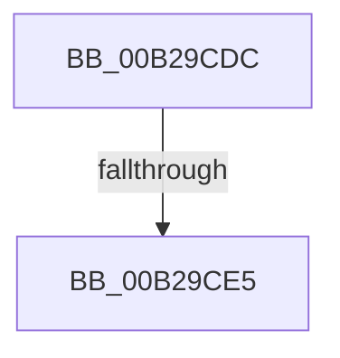

# sub_00B29CDC

- RVA: `0x00B29CDC`–`0x00B29CFA` (길이 `30` bytes)
- VA: `0x0000000140B29CDC`
- 실행 섹션: `PAGE`
- PDB 이름 있음: `아니요`; PDB Function 태그: `아니요`
- unwind 정보 RVA: `0x00096764`
- 디코드: `8`개 명령, `30/30` bytes 표시
- 미해석 바이트: `0` (있으면 어셈블리에 `.byte`로 보존)

> 이 문서는 커널 이미지의 기계어와 PDB 기호를 분석해 생성했습니다. 4번과 5번은 함수 원형과 자료형을 바이너리 사용 방식에서 추정한 C 해석이며 원본 소스 복구 결과는 아닙니다.

## 1. Dependencies

- 직접 호출 지점: **1**; 고유 호출 대상: **1**
- 직접 호출자로 확인된 함수: **0**
- RIP 상대 이미지 참조: **0**

### Outgoing calls
- `0x00B29CED` → [memset](../../text/6C/memset_function_006C6C40.md) (function, `0x006C6C40`)

### Direct callers
- 이 함수 시작 RVA로 연결되는 직접 call은 확인되지 않았습니다. 간접 호출은 완전히 역산할 수 없습니다.

### Static image references
- 디코드된 RIP-relative 메모리 참조가 없습니다.

## 2. Other-region calls and transfers

- 다른 실행 섹션으로 향하는 call: **1**
  - `0x00B29CED` → [memset](../../text/6C/memset_function_006C6C40.md) (`PAGE` → `.text`)
- call이 아닌 외부 분기/꼬리 이동: **2**
  - `0x00B29CDF` → [PiDevCfgQueryObjectProperties + 0x2DD](../97/PiDevCfgQueryObjectProperties_function_0097776C.md) (`tail-transfer`)
  - `0x00B29CF5` → [PiDevCfgQueryObjectProperties + 0x2DD](../97/PiDevCfgQueryObjectProperties_function_0097776C.md) (`tail-transfer`)

## 3. Assembly (complete function range)

```asm
00B29CDC  48 85 F6                        test rsi, rsi
00B29CDF  0F 84 64 DD E4 FF               je 0x140977a49
00B29CE5  44 8B C1                        mov r8d, ecx
00B29CE8  33 D2                           xor edx, edx
00B29CEA  48 8B CE                        mov rcx, rsi
00B29CED  E8 4E CF B9 FF                  call 0x1406c6c40
00B29CF2  45 33 D2                        xor r10d, r10d
00B29CF5  E9 4F DD E4 FF                  jmp 0x140977a49
```

## 4. C-style interpretation (structured pseudocode)

```c
__int64 __fastcall sub_00B29CDC(int a1, int a2)
{
    __int64 result;
    __int64 v_r10;

    a2 = 0;
    result = memset(v_rsi, a2, (unsigned int)(a1), a4);
    v_r10 = 0;
}
```

## 5. (Beta) C Style

```c
int64_t sub_00B29CDC(int32_t Arg1, int32_t Arg2)
{
    int64_t result;
    int64_t local_r10;

    Arg2 = 0;
    result = memset(local_rsi, Arg2, (uint32_t)(Arg1), a4);
    local_r10 = 0;
}
```

## 6. Execution-region graph

[열기: 2D/3D 그래프와 함수 탐색 컨트롤 패널](../../../control-panel.html?section=page&rva=0x00B29CDC&view=graph)

- 2D 그래프는 위에서 아래로 흐르고, 3D 그래프는 빈 공간을 드래그해 회전합니다. Shift+드래그는 이동, 휠은 확대·축소, 함수 노드 선택은 대상 보고서 이동입니다.

### Static fallback


