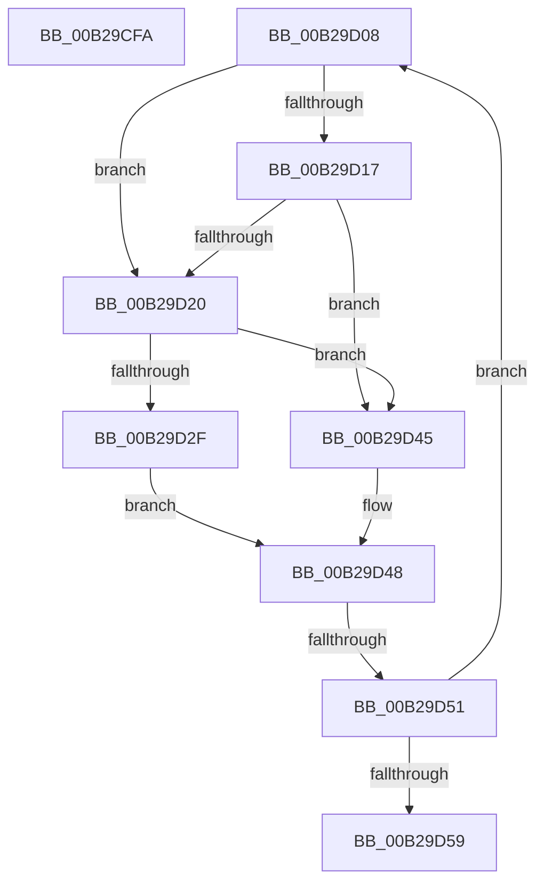

# sub_00B29CFA

- RVA: `0x00B29CFA`–`0x00B29D5E` (길이 `100` bytes)
- VA: `0x0000000140B29CFA`
- 실행 섹션: `PAGE`
- PDB 이름 있음: `아니요`; PDB Function 태그: `아니요`
- unwind 정보 RVA: `0x00096DBC`
- 디코드: `27`개 명령, `100/100` bytes 표시
- 미해석 바이트: `0` (있으면 어셈블리에 `.byte`로 보존)

> 이 문서는 커널 이미지의 기계어와 PDB 기호를 분석해 생성했습니다. 4번과 5번은 함수 원형과 자료형을 바이너리 사용 방식에서 추정한 C 해석이며 원본 소스 복구 결과는 아닙니다.

## 1. Dependencies

- 직접 호출 지점: **4**; 고유 호출 대상: **3**
- 직접 호출자로 확인된 함수: **0**
- RIP 상대 이미지 참조: **0**

### Outgoing calls
- `0x00B29CFD` → [PfpFlushBuffers](../97/PfpFlushBuffers_function_0097C0A0.md) (function, `0x0097C0A0`)
- `0x00B29D0B` → [PfpFlushBuffers](../97/PfpFlushBuffers_function_0097C0A0.md) (function, `0x0097C0A0`)
- `0x00B29D23` → [PfTGenerateTrace](../97/PfTGenerateTrace_function_0097B3CC.md) (function, `0x0097B3CC`)
- `0x00B29D38` → [KeDelayExecutionThread](../../text/20/KeDelayExecutionThread_function_00209550.md) (function, `0x00209550`)

### Direct callers
- 이 함수 시작 RVA로 연결되는 직접 call은 확인되지 않았습니다. 간접 호출은 완전히 역산할 수 없습니다.

### Static image references
- 디코드된 RIP-relative 메모리 참조가 없습니다.

## 2. Other-region calls and transfers

- 다른 실행 섹션으로 향하는 call: **1**
  - `0x00B29D38` → [KeDelayExecutionThread](../../text/20/KeDelayExecutionThread_function_00209550.md) (`PAGE` → `.text`)
- call이 아닌 외부 분기/꼬리 이동: **3**
  - `0x00B29D03` → [PfTLoggingWorker + 0xC7](../97/PfTLoggingWorker_function_0097B140.md) (`tail-transfer`)
  - `0x00B29D4B` → [PfTLoggingWorker + 0x1ED](../97/PfTLoggingWorker_function_0097B140.md) (`tail-transfer`)
  - `0x00B29D59` → [PfTLoggingWorker + 0x1ED](../97/PfTLoggingWorker_function_0097B140.md) (`tail-transfer`)

## 3. Assembly (complete function range)

```asm
00B29CFA  48 8B CF                        mov rcx, rdi
00B29CFD  E8 9E 23 E5 FF                  call 0x14097c0a0
00B29D02  90                              nop
00B29D03  E9 FF 14 E5 FF                  jmp 0x14097b207
00B29D08  48 8B CF                        mov rcx, rdi
00B29D0B  E8 90 23 E5 FF                  call 0x14097c0a0
00B29D10  40 8A F0                        mov sil, al
00B29D13  84 C0                           test al, al
00B29D15  74 09                           je 0x140b29d20
00B29D17  83 BF F8 00 00 00 00            cmp dword ptr [rdi + 0xf8], 0
00B29D1E  74 25                           je 0x140b29d45
00B29D20  48 8B CF                        mov rcx, rdi
00B29D23  E8 A4 16 E5 FF                  call 0x14097b3cc
00B29D28  3D 9A 00 00 C0                  cmp eax, 0xc000009a
00B29D2D  75 16                           jne 0x140b29d45
00B29D2F  4C 8D 44 24 40                  lea r8, [rsp + 0x40]
00B29D34  33 D2                           xor edx, edx
00B29D36  33 C9                           xor ecx, ecx
00B29D38  E8 13 F8 6D FF                  call 0x140209550
00B29D3D  81 C3 E8 03 00 00               add ebx, 0x3e8
00B29D43  EB 03                           jmp 0x140b29d48
00B29D45  41 03 DF                        add ebx, r15d
00B29D48  40 84 F6                        test sil, sil
00B29D4B  0F 85 DC 15 E5 FF               jne 0x14097b32d
00B29D51  81 FB 10 27 00 00               cmp ebx, 0x2710
00B29D57  72 AF                           jb 0x140b29d08
00B29D59  E9 CF 15 E5 FF                  jmp 0x14097b32d
```

## 4. C-style interpretation (structured pseudocode)

```c
__int64 __fastcall sub_00B29CFA(__int64 a1, int a2)
{
    __int64 result;
    unsigned __int64 v_stack_p40;

    result = PfpFlushBuffers(v_rdi, a2, a3, a4);
}
```

## 5. (Beta) C Style

```c
int64_t sub_00B29CFA(int64_t Arg1, int32_t Arg2)
{
    int64_t result;
    uint64_t v_stack_p40;

    result = PfpFlushBuffers(local_rdi, Arg2, a3, a4);
}
```

## 6. Execution-region graph

[열기: 2D/3D 그래프와 함수 탐색 컨트롤 패널](../../../control-panel.html?section=page&rva=0x00B29CFA&view=graph)

- 2D 그래프는 위에서 아래로 흐르고, 3D 그래프는 빈 공간을 드래그해 회전합니다. Shift+드래그는 이동, 휠은 확대·축소, 함수 노드 선택은 대상 보고서 이동입니다.

### Static fallback


