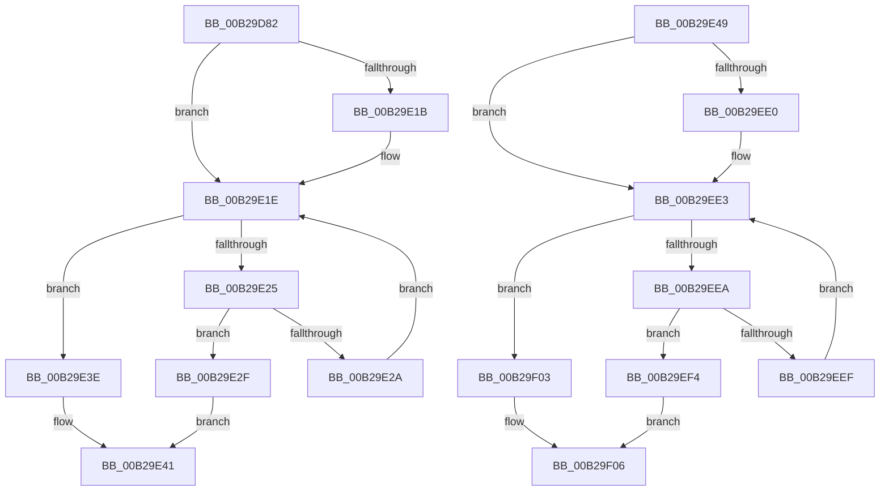

# sub_00B29D82

- RVA: `0x00B29D82`–`0x00B29F0E` (길이 `396` bytes)
- VA: `0x0000000140B29D82`
- 실행 섹션: `PAGE`
- PDB 이름 있음: `아니요`; PDB Function 태그: `아니요`
- unwind 정보 RVA: `0x000974DC`
- 디코드: `107`개 명령, `396/396` bytes 표시
- 미해석 바이트: `0` (있으면 어셈블리에 `.byte`로 보존)

> 이 문서는 커널 이미지의 기계어와 PDB 기호를 분석해 생성했습니다. 4번과 5번은 함수 원형과 자료형을 바이너리 사용 방식에서 추정한 C 해석이며 원본 소스 복구 결과는 아닙니다.

## 1. Dependencies

- 직접 호출 지점: **0**; 고유 호출 대상: **0**
- 직접 호출자로 확인된 함수: **0**
- RIP 상대 이미지 참조: **0**

### Outgoing calls
- 직접 디코드된 call 명령이 없습니다.

### Direct callers
- 이 함수 시작 RVA로 연결되는 직접 call은 확인되지 않았습니다. 간접 호출은 완전히 역산할 수 없습니다.

### Static image references
- 디코드된 RIP-relative 메모리 참조가 없습니다.

## 2. Other-region calls and transfers

- 다른 실행 섹션으로 향하는 call: **0**
- call이 아닌 외부 분기/꼬리 이동: **2**
  - `0x00B29E44` → [EtwpCovSampContextRemoveAndFreeModule + 0x3A](../97/EtwpCovSampContextRemoveAndFreeModule_function_0097D870.md) (`tail-transfer`)
  - `0x00B29F09` → [EtwpCovSampContextRemoveAndFreeModule + 0x4A](../97/EtwpCovSampContextRemoveAndFreeModule_function_0097D870.md) (`tail-transfer`)

## 3. Assembly (complete function range)

```asm
00B29D82  44 8B 89 AC 04 00 00            mov r9d, dword ptr [rcx + 0x4ac]
00B29D89  48 8B C6                        mov rax, rsi
00B29D8C  41 8B C9                        mov ecx, r9d
00B29D8F  4D 23 DF                        and r11, r15
00B29D92  83 E1 1F                        and ecx, 0x1f
00B29D95  41 C1 E9 05                     shr r9d, 5
00B29D99  48 D3 E0                        shl rax, cl
00B29D9C  48 23 42 08                     and rax, qword ptr [rdx + 8]
00B29DA0  48 89 44 24 48                  mov qword ptr [rsp + 0x48], rax
00B29DA5  0F B6 C0                        movzx eax, al
00B29DA8  48 05 CB 5D B1 00               add rax, 0xb15dcb
00B29DAE  48 6B C8 25                     imul rcx, rax, 0x25
00B29DB2  0F B6 44 24 49                  movzx eax, byte ptr [rsp + 0x49]
00B29DB7  48 03 C8                        add rcx, rax
00B29DBA  0F B6 44 24 4A                  movzx eax, byte ptr [rsp + 0x4a]
00B29DBF  48 6B D1 25                     imul rdx, rcx, 0x25
00B29DC3  48 03 D0                        add rdx, rax
00B29DC6  0F B6 44 24 4B                  movzx eax, byte ptr [rsp + 0x4b]
00B29DCB  48 6B CA 25                     imul rcx, rdx, 0x25
00B29DCF  48 03 C8                        add rcx, rax
00B29DD2  0F B6 44 24 4C                  movzx eax, byte ptr [rsp + 0x4c]
00B29DD7  48 6B D1 25                     imul rdx, rcx, 0x25
00B29DDB  48 03 D0                        add rdx, rax
00B29DDE  0F B6 44 24 4D                  movzx eax, byte ptr [rsp + 0x4d]
00B29DE3  48 6B CA 25                     imul rcx, rdx, 0x25
00B29DE7  48 03 C8                        add rcx, rax
00B29DEA  0F B6 44 24 4E                  movzx eax, byte ptr [rsp + 0x4e]
00B29DEF  48 6B D1 25                     imul rdx, rcx, 0x25
00B29DF3  41 8D 49 FF                     lea ecx, [r9 - 1]
00B29DF7  48 03 D0                        add rdx, rax
00B29DFA  0F B6 44 24 4F                  movzx eax, byte ptr [rsp + 0x4f]
00B29DFF  4C 6B C2 25                     imul r8, rdx, 0x25
00B29E03  49 03 C0                        add rax, r8
00B29E06  8B C0                           mov eax, eax
00B29E08  48 23 C8                        and rcx, rax
00B29E0B  49 8B 82 B0 04 00 00            mov rax, qword ptr [r10 + 0x4b0]
00B29E12  48 8D 14 C8                     lea rdx, [rax + rcx*8]
00B29E16  4D 3B DF                        cmp r11, r15
00B29E19  75 03                           jne 0x140b29e1e
00B29E1B  49 8B 06                        mov rax, qword ptr [r14]
00B29E1E  48 8B 02                        mov rax, qword ptr [rdx]
00B29E21  A8 01                           test al, 1
00B29E23  75 19                           jne 0x140b29e3e
00B29E25  48 3B C3                        cmp rax, rbx
00B29E28  74 05                           je 0x140b29e2f
00B29E2A  48 8B D0                        mov rdx, rax
00B29E2D  EB EF                           jmp 0x140b29e1e
00B29E2F  48 8B 03                        mov rax, qword ptr [rbx]
00B29E32  48 89 02                        mov qword ptr [rdx], rax
00B29E35  41 FF 8A A8 04 00 00            dec dword ptr [r10 + 0x4a8]
00B29E3C  EB 03                           jmp 0x140b29e41
00B29E3E  49 8B 06                        mov rax, qword ptr [r14]
00B29E41  4C 89 33                        mov qword ptr [rbx], r14
00B29E44  E9 61 3A E5 FF                  jmp 0x14097d8aa
00B29E49  45 8B 8A BC 04 00 00            mov r9d, dword ptr [r10 + 0x4bc]
00B29E50  49 23 FF                        and rdi, r15
00B29E53  41 8B C9                        mov ecx, r9d
00B29E56  41 C1 E9 05                     shr r9d, 5
00B29E5A  83 E1 1F                        and ecx, 0x1f
00B29E5D  48 D3 E6                        shl rsi, cl
00B29E60  49 23 73 08                     and rsi, qword ptr [r11 + 8]
00B29E64  48 89 74 24 48                  mov qword ptr [rsp + 0x48], rsi
00B29E69  40 0F B6 C6                     movzx eax, sil
00B29E6D  48 05 CB 5D B1 00               add rax, 0xb15dcb
00B29E73  48 6B C8 25                     imul rcx, rax, 0x25
00B29E77  0F B6 44 24 49                  movzx eax, byte ptr [rsp + 0x49]
00B29E7C  48 03 C8                        add rcx, rax
00B29E7F  0F B6 44 24 4A                  movzx eax, byte ptr [rsp + 0x4a]
00B29E84  48 6B D1 25                     imul rdx, rcx, 0x25
00B29E88  48 03 D0                        add rdx, rax
00B29E8B  0F B6 44 24 4B                  movzx eax, byte ptr [rsp + 0x4b]
00B29E90  48 6B CA 25                     imul rcx, rdx, 0x25
00B29E94  48 03 C8                        add rcx, rax
00B29E97  0F B6 44 24 4C                  movzx eax, byte ptr [rsp + 0x4c]
00B29E9C  48 6B D1 25                     imul rdx, rcx, 0x25
00B29EA0  48 03 D0                        add rdx, rax
00B29EA3  0F B6 44 24 4D                  movzx eax, byte ptr [rsp + 0x4d]
00B29EA8  48 6B CA 25                     imul rcx, rdx, 0x25
00B29EAC  48 03 C8                        add rcx, rax
00B29EAF  0F B6 44 24 4E                  movzx eax, byte ptr [rsp + 0x4e]
00B29EB4  48 6B D1 25                     imul rdx, rcx, 0x25
00B29EB8  41 8D 49 FF                     lea ecx, [r9 - 1]
00B29EBC  48 03 D0                        add rdx, rax
00B29EBF  0F B6 44 24 4F                  movzx eax, byte ptr [rsp + 0x4f]
00B29EC4  4C 6B C2 25                     imul r8, rdx, 0x25
00B29EC8  49 03 C0                        add rax, r8
00B29ECB  8B C0                           mov eax, eax
00B29ECD  48 23 C8                        and rcx, rax
00B29ED0  49 8B 82 C0 04 00 00            mov rax, qword ptr [r10 + 0x4c0]
00B29ED7  48 8D 14 C8                     lea rdx, [rax + rcx*8]
00B29EDB  49 3B FF                        cmp rdi, r15
00B29EDE  75 03                           jne 0x140b29ee3
00B29EE0  49 8B 06                        mov rax, qword ptr [r14]
00B29EE3  48 8B 02                        mov rax, qword ptr [rdx]
00B29EE6  A8 01                           test al, 1
00B29EE8  75 19                           jne 0x140b29f03
00B29EEA  49 3B C3                        cmp rax, r11
00B29EED  74 05                           je 0x140b29ef4
00B29EEF  48 8B D0                        mov rdx, rax
00B29EF2  EB EF                           jmp 0x140b29ee3
00B29EF4  49 8B 03                        mov rax, qword ptr [r11]
00B29EF7  48 89 02                        mov qword ptr [rdx], rax
00B29EFA  41 FF 8A B8 04 00 00            dec dword ptr [r10 + 0x4b8]
00B29F01  EB 03                           jmp 0x140b29f06
00B29F03  49 8B 06                        mov rax, qword ptr [r14]
00B29F06  4D 89 33                        mov qword ptr [r11], r14
00B29F09  E9 AC 39 E5 FF                  jmp 0x14097d8ba
```

## 4. C-style interpretation (structured pseudocode)

```c
__int64 __fastcall sub_00B29D82(__int64 a1, __int64 a2)
{
    __int64 result;
    __int64 v_r11;
    unsigned __int64 v_stack_p48;
    unsigned __int8 v_stack_p49;
    unsigned __int8 v_stack_p4A;
    unsigned __int8 v_stack_p4B;
    unsigned __int8 v_stack_p4C;
    unsigned __int8 v_stack_p4D;
    unsigned __int8 v_stack_p4E;
    unsigned __int8 v_stack_p4F;

    v_r11 = (v_r11) & (v_r15);
    a1 = (unsigned int)(((unsigned int)((unsigned int)((unsigned int)(*(unsigned int *)(a1 + 1196))))) & (31));
    a4 = (unsigned int)(((unsigned int)(*(unsigned int *)(a1 + 1196))) >> (5));
    result = (v_rsi) << ((unsigned __int8)(a1));
    result = (result) & (*(unsigned __int64 *)(a2 + 8));
    v_stack_p48 = result;
    result = ((unsigned __int8)(result)) + (0xB15DCBULL);
    a1 = (a1) * (result);
    a1 = (a1) + (v_stack_p49);
    a2 = (a2) * (a1);
    a2 = (a2) + (v_stack_p4A);
    a1 = (a1) * (a2);
    a1 = (a1) + (v_stack_p4B);
    a2 = (a2) * (a1);
    a2 = (a2) + (v_stack_p4C);
    a1 = (a1) * (a2);
    a1 = (a1) + (v_stack_p4D);
    a2 = (a2) * (a1);
    a2 = (a2) + (v_stack_p4E);
    a3 = (a3) * (a2);
    result = (v_stack_p4F) + (a3);
    a1 = (a4 - 1) & ((unsigned int)((unsigned int)(result)));
    result = *(unsigned __int64 *)(v_r10 + 1200);
    if (v_r11 == v_r15) {
        result = *(unsigned __int64 *)(v_r14);
    }
    if ((((unsigned __int8)(*(unsigned __int64 *)(*(unsigned __int64 *)(v_r10 + 1200) + a1 * 8))) & (1)) != 0) goto loc_00B29E3E;
    if ((*(unsigned __int64 *)(*(unsigned __int64 *)(v_r10 + 1200) + a1 * 8)) == v_rbx) goto loc_00B29E2F;
    goto loc_00B29E1E;
loc_00B29E2F:
    *(unsigned __int64 *)(*(unsigned __int64 *)(*(unsigned __int64 *)(v_r10 + 1200) + a1 * 8)) = *(unsigned __int64 *)(v_rbx);
    goto loc_00B29E41;
loc_00B29E3E:
loc_00B29E41:
    *(unsigned __int64 *)(v_rbx) = v_r14;
}
```

## 5. (Beta) C Style

```c
int64_t sub_00B29D82(void *Arg1, void *Arg2)
{
    uint8_t *arg1 = (uint8_t *)Arg1;
    uint8_t *arg2 = (uint8_t *)Arg2;

    int64_t result;
    int64_t local_r11;
    uint64_t v_stack_p48;
    uint8_t v_stack_p49;
    uint8_t v_stack_p4A;
    uint8_t v_stack_p4B;
    uint8_t v_stack_p4C;
    uint8_t v_stack_p4D;
    uint8_t v_stack_p4E;
    uint8_t v_stack_p4F;

    local_r11 = (local_r11) & (local_r15);
    Arg1 = (uint32_t)(((uint32_t)((uint32_t)((uint32_t)(*(uint32_t *)(arg1 + 0x4AC))))) & (31));
    a4 = (uint32_t)(((uint32_t)(*(uint32_t *)(arg1 + 0x4AC))) >> (5));
    result = (local_rsi) << ((uint8_t)(Arg1));
    result = (result) & (*(uint64_t *)(arg2 + 0x8));
    v_stack_p48 = result;
    result = ((uint8_t)(result)) + (0xB15DCBULL);
    Arg1 = (Arg1) * (result);
    Arg1 = (Arg1) + (v_stack_p49);
    Arg2 = (Arg2) * (Arg1);
    Arg2 = (Arg2) + (v_stack_p4A);
    Arg1 = (Arg1) * (Arg2);
    Arg1 = (Arg1) + (v_stack_p4B);
    Arg2 = (Arg2) * (Arg1);
    Arg2 = (Arg2) + (v_stack_p4C);
    Arg1 = (Arg1) * (Arg2);
    Arg1 = (Arg1) + (v_stack_p4D);
    Arg2 = (Arg2) * (Arg1);
    Arg2 = (Arg2) + (v_stack_p4E);
    a3 = (a3) * (Arg2);
    result = (v_stack_p4F) + (a3);
    Arg1 = (a4 - 1) & ((uint32_t)((uint32_t)(result)));
    result = *(uint64_t *)(local_r10 + 0x4B0);
    if (local_r11 == local_r15) {
        result = *(uint64_t *)(local_r14);
    }
    if ((((uint8_t)(*(uint64_t *)(*(uint64_t *)(local_r10 + 0x4B0) + arg1 * 8))) & (1)) != 0) goto loc_00B29E3E;
    if ((*(uint64_t *)(*(uint64_t *)(local_r10 + 0x4B0) + arg1 * 8)) == local_rbx) goto loc_00B29E2F;
    goto loc_00B29E1E;
loc_00B29E2F:
    *(uint64_t *)(*(uint64_t *)(*(uint64_t *)(local_r10 + 0x4B0) + arg1 * 8)) = *(uint64_t *)(local_rbx);
    goto loc_00B29E41;
loc_00B29E3E:
loc_00B29E41:
    *(uint64_t *)(local_rbx) = local_r14;
}
```

### 관측된 메모리 오프셋

구조체 형식이 확인되지 않은 접근은 인자 기준의 오프셋으로만 기록했습니다.

| 기준 인자 | 오프셋 표현 | 폭 (bit) | 접근 |
|---|---:|---:|---|
| `Arg1` | `+ 0x4AC` | `32` | `R` |
| `Arg2` | `+ 0x8` | `64` | `R` |

## 6. Execution-region graph

[열기: 2D/3D 그래프와 함수 탐색 컨트롤 패널](../../../control-panel.html?section=page&rva=0x00B29D82&view=graph)

- 2D 그래프는 위에서 아래로 흐르고, 3D 그래프는 빈 공간을 드래그해 회전합니다. Shift+드래그는 이동, 휠은 확대·축소, 함수 노드 선택은 대상 보고서 이동입니다.

### Static fallback


